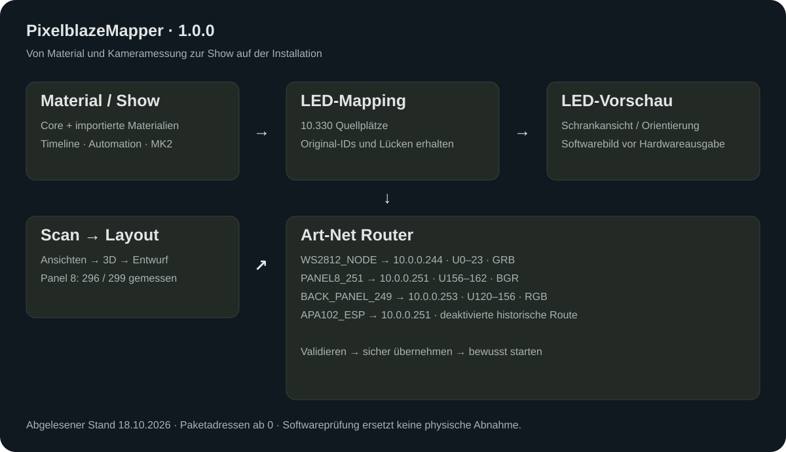
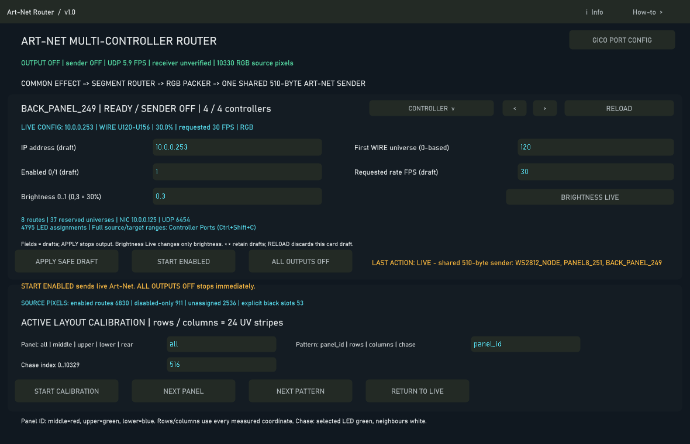
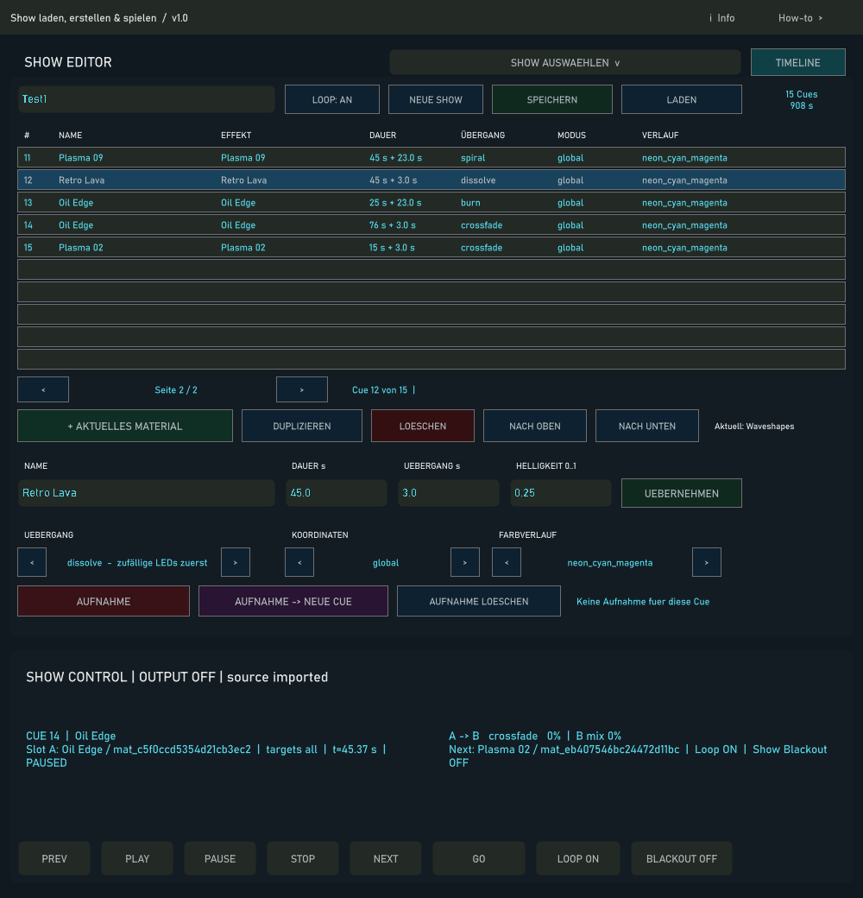
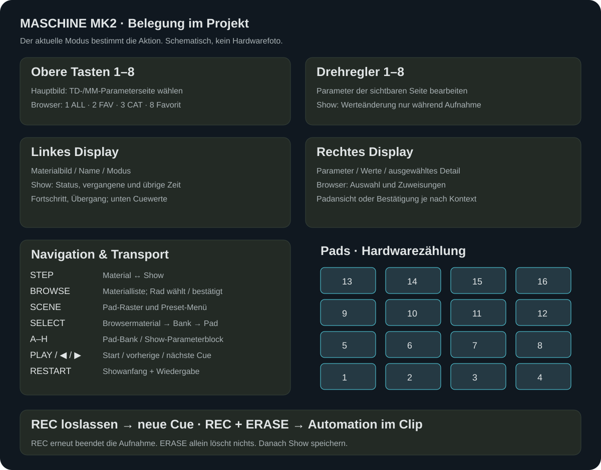

# PixelblazeMapper · TouchDesigner Art-Net Mapper

Scan physical LED panels, align them in a 3D installation, build material-based
shows and route their output to multiple Art-Net controllers. The **v1.0.0**
release brings the workflows together with compact dialogs, contextual help,
examples and a complete German operator guide.



## Open the project

Open **`PixelblazeMapper_v1.0.0.toe`** from the repository folder in TouchDesigner.
Keep `pixelblaze_mapper/`, `config/`, `effects/`, `material_library/`, `mappings/`
and `shows/` beside the project. The release bundles the material catalog, original
source snapshot, textures, shared libraries and all 638 imported packages under
`material_library/`; a separate material download is not required. The catalog
distinguishes 585 adaptable entries from 53 unsupported entries. An imported
package or thumbnail does not mean that every shader is playable on every GPU.
Historical absolute paths are resolved against the local repository at runtime.

Third-party material credits and notices are preserved in the original sources
and package metadata. Individual materials have their own terms; the source
snapshot's Apache 2.0 license is not a blanket license for every material.
See [material dependencies and attribution](docs/release-v1.0.0/MATERIAL_LIBRARY_DE.md).
Personal state, service logs, recordings and recovery backups remain local.

The optional **PXLBLZ / ART-NET** integration additionally needs Node.js, a
separate local PXLBLZ Studio installation and the PXLBLZ router executable.
Configure their paths and local URLs in `tools/pxlblz_manager/settings.json`.
These external applications are not bundled inside the TouchDesigner project;
see the [PXLBLZ Manager guide](docs/release-v1.0.0/pxlblz_manager.html).

Start with **Ctrl+Shift+9** for the shortcut overview. **Ctrl+Shift+6** opens the
Art-Net Router; **Ctrl+Shift+C** opens Controller & Ports. Opening a dialog does
not start output. Check controller identity, address, port layout and brightness
before deliberately starting a sender.

**[Operator guide](docs/release-v1.0.0/index.html)** ·
**[Show workflow](docs/release-v1.0.0/show.html)** ·
**[Timeline](docs/release-v1.0.0/sequencer.html)** ·
**[MK2 controls](docs/release-v1.0.0/mk2.html)** ·
**[Five design directions](docs/release-v1.0.0/design/index.html)**

The HTML guides open locally in a browser. Their workflow illustrations render
on GitHub; raw HTML links on GitHub show source instead of a hosted application.
The chosen theme uses **Bahnschrift** on dark slate (`#101820`): off-white
headings and labels (`#e1e5e6`), cyan values (`#55d6e7`), and readable graphite
button/function text (`#aeb7ba`). Rounded controls group related actions.



## Current installation

The source buffer contains **10,330 addressable slots**, including retained gaps.
This is not a count of newly measured LED positions. Panel 8 has **299 slots and
296 measured positions**. Its original local IDs **1, 61 and 93** remain black.
Its triangle points down; the shorter triangle side faces the installation's
centre.

The release baseline was read from the running project on 18 October 2026:

| Controller identity | Destination | Art-Net reservation, zero-based | Configuration |
|---|---|---|---|
| `WS2812_NODE` | `10.0.0.244` | U0–U23 | GRB, configured enabled |
| `PANEL8_251` | `10.0.0.251` | U156–U162 | BGR, configured enabled |
| `BACK_PANEL_249` | `10.0.0.253` | U120–U156 | RGB, configured enabled |
| `APA102_ESP` | `10.0.0.251` | No reserved block | Disabled historical route retained |

Configured enable flags do not mean a sender is running. The baseline sender
was stopped and the project reported no errors or warnings. Controller names
are stable identities, not guarantees about current IP addresses or physical
panel numbering. See the actual [baseline readback](docs/release-v1.0.0/qa/baseline-live.json)
for segments, source starts, target offsets and brightness.

## Workflows

- **Materials:** search Core and imported materials, preview, activate, and edit
  shared or native parameters.
- **Scan:** review routing, check the camera, capture distinct views, reconstruct
  3D, inspect coverage and add a layout draft. Original IDs stay intact.
- **Layout:** import, move, rotate and scale panels; validate before applying to
  the active mapping. Export the workspace for recovery.
- **Routing:** select a configured controller, inspect its ports, validate a
  draft, and apply with output off. Starting output is a separate action.
- **Show:** choose a saved show, add and edit cues, record automation, edit the
  timeline and transitions, then save and reload the show.
- **MK2:** eight material banks, direct HID displays and controls, context-aware
  parameter pages and separate new-cue/automation recording gestures.





## Show files and recovery

A show is a bundle: `shows/<name>.json`, `<name>.automation.json` and
`<name>.materials.json`. Keep these files together. Saving a show and saving the
whole TouchDesigner `.toe` project are separate operations.

The local pre-release recovery point is
`PixelblazeMapper_BEFORE_RELEASE_1_0_0.toe`. The matching source/configuration
snapshot and working-tree patch live under `Backup/release-v1.0.0-before/`.
Backups are local recovery assets and may be excluded from Git.

Six unreferenced historical root DATs were backed up and removed; their contents
and a verified restoration result remain in the release QA records. The disabled
`APA102_ESP` route and older fixture data remain available because their obsolescence
was not established. See [cleanup and recovery](docs/release-v1.0.0/CLEANUP_RECOVERY_DE.md).

## Verification and documentation

Run portable Python checks from the repository root using the project's prepared
Python environment:

```powershell
python -m unittest discover -s tests
```

Some suites need optional imaging, hardware or browser dependencies. A missing
dependency is not a passed test. Software checks, live TouchDesigner UI checks
and physical camera/LED/MK2 acceptance are separate evidence categories; use the
release QA records for the final results rather than older test counts.

- [Documentation inventory and coverage](docs/release-v1.0.0/DOCUMENTATION_INVENTORY.md)
- [Per-screen assessment and test boundaries](docs/release-v1.0.0/SCREEN_ASSESSMENT_DE.md)
- [Shortcut reference](docs/TOUCHDESIGNER_SHORTCUTS_DE.md)
- [Contextual help catalog](docs/release-v1.0.0/help_catalog.json)
- [Release QA records](docs/release-v1.0.0/qa/)
- [Historical documentation index](docs/release-v1.0.0/historical-docs.html)

Older dated guides, audits and `.toe` filenames describe earlier builds. They
remain historical evidence and are not the current operating instructions.

## Repository structure

| Path | Contents |
|---|---|
| `pixelblaze_mapper/` | Mapping, routing, scan, material, Show/Timeline and MK2 modules |
| `effects/` | Core GLSL materials and manifests |
| `material_library/` | Pinned source snapshot, catalog and 638 imported material packages with original notices |
| `shows/` | Show definitions and associated automation/material states |
| `mappings/` | Coordinate mappings and layout assets |
| `config/` | Controller/UI settings; some personal state is local only |
| `tests/` and `tools/` | Regression suites, audits and support tools |
| `docs/release-v1.0.0/` | Current help, designs, diagrams, screenshots and QA |
| `touchdesigner-mcp-td/` | Embedded TouchDesigner integration bridge |
