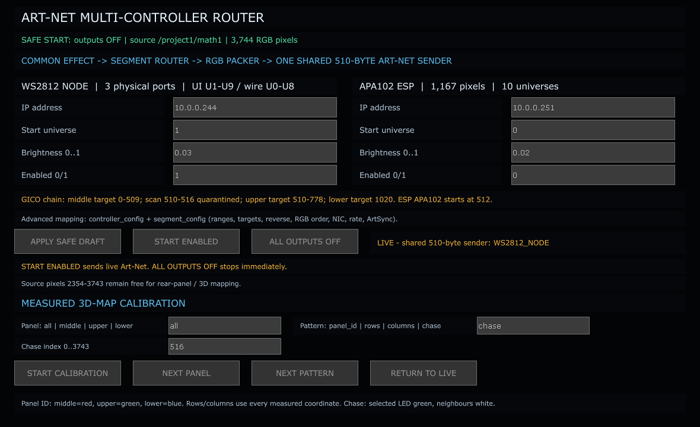
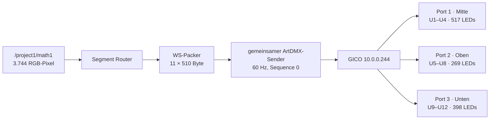

# Regression-Audit: Art-Net Router und physische Panelaufteilung

Stand: 26. August 2026  
Geprüftes Projekt: `PixelblazeMapper_WORKING_PHASE2_EFFECTS_CORE.68.toe`  
Dialog: `Strg+Umschalt+6` — `/project1/multi_controller_output/ui_panel`  
Prüfmodus: Analyse ohne Änderung, ohne `.toe`-Speicherung und ohne Git-Commit

## 1. Ergebnis in Kürze

Der aktive RGB-Packer und der gemeinsame Art-Net-Sender bilden die zuletzt
bestätigte Hardwareaufteilung korrekt in 510-Byte-Frames ab. Alle elf aktiven
WS2812-Frames besitzen einen gültigen ArtDMX-Header, 510 Payload-Bytes und die
erwarteten nullbasierten Wire-Universen 0 bis 10. Die drei Seitenpanels sind im
laufenden Routing so getrennt:

| Panel | Quellpixel | Anzahl | Zielpixel | Controller-Anzeige | Wire-Art-Net | Aktive Pixel je Universe |
|---|---:|---:|---:|---|---|---|
| Mitte | 0–516 | 517 | 0–516 | U1–U4 | U0–U3 | 170, 170, 170, 7 |
| Oben | 517–785 | 269 | 680–948 | U5–U6 | U4–U5 | 170, 99 |
| Reserve Port 2 | — | — | 949–1359 | U6–U8 teilweise | U5 Rest, U6–U7 | schwarz |
| Unten | 786–1183 | 398 | 1360–1757 | U9–U11 | U8–U10 | 170, 170, 58 |

Die Datenübertragung selbst ist formal konsistent. Der Dialog zeigt jedoch
mehrere veraltete oder widersprüchliche Statusangaben. Diese Angaben dürfen vor
einer Korrektur nicht als technische Wahrheit verwendet werden.



## 2. Verbindliche Live-Daten zum Prüfzeitpunkt

### Controller-Tabelle

| Feld | WS2812_NODE | APA102_ESP |
|---|---|---|
| Enabled | 1 | 0 |
| Ziel-IP | 10.0.0.244 | 10.0.0.251 |
| Lokale Schnittstelle | 10.0.0.125 | 10.0.0.125 |
| UDP-Port | 6454 | 6454 |
| Start-Universe | 1 | 0 |
| Farbreihenfolge | GRB | RGB |
| Helligkeit | 0,03 | 0,02 |
| Rate | 60 | 30 |
| ArtSync | 0 | 0 |

Der gemeinsame Sender meldete:

```text
enabled=True
mode=live
controllers=[WS2812_NODE]
error=""
```

Die nativen `dmxout_*`-Operatoren sind nicht der aktive Sender. Der GICO-Pfad
verwendet absichtlich den gemeinsamen Python-Sender, damit exakt 510 statt 512
DMX-Kanäle pro Universe übertragen werden.

### Segment-Tabelle

| Segment | source_start | count | destination_start | reverse | Override |
|---|---:|---:|---:|---:|---|
| WS_SIDE_MIDDLE | 0 | 517 | 0 | 0 | — |
| WS_SIDE_UPPER | 517 | 269 | 680 | 0 | — |
| WS_SIDE_LOWER | 786 | 398 | 1360 | 0 | — |
| APA102 | 1187 | 1167 | 512 | 0 | — |

Nicht zugewiesen sind Quellpixel 1184–1186 und 2354–3743. Die Validator-Tabelle
meldet dazu nur eine Warnung und keinen blockierenden Fehler.

## 3. Signal- und Hardwarefluss



Die Controlleroberfläche zählt Universen ab 1. Das Art-Net-Paket zählt für
diesen GICO-Pfad ab 0. Daher entspricht Controller-U1 dem Wire-Universe 0.

## 4. Inventar aller sichtbaren Bedienelemente

### Eingabefelder

| Feld | Sichtbarer Wert | Datenquelle | Gültigkeitsregel | Status |
|---|---|---|---|---|
| WS IP address | 10.0.0.244 | `controller_config.target_ip` | gültige IPv4-Adresse | korrekt |
| WS Start universe | 1 | `controller_config.start_universe` | 0–32767 | formal korrekt, Zählweise erklärungsbedürftig |
| WS Brightness | 0.03 | `controller_config.brightness` | 0,0–1,0 | korrekt |
| WS Enabled | 1 | `controller_config.enabled` | 0 oder 1 | korrekt |
| APA IP address | 10.0.0.251 | `controller_config.target_ip` | gültige IPv4-Adresse | korrekt |
| APA Start universe | 0 | `controller_config.start_universe` | 0–32767 | korrekt |
| APA Brightness | 0.02 | `controller_config.brightness` | 0,0–1,0 | korrekt |
| APA Enabled | 0 | `controller_config.enabled` | 0 oder 1 | korrekt |
| Panel | all | `calibration_config.panel` | all/middle/upper/lower | korrekt |
| Pattern | chase | `calibration_config.pattern` | panel_id/rows/columns/chase | korrekt |
| Chase index | 516 | `calibration_config.chase_index` | 0–3743 | korrekt, aber nicht panelbegrenzt |

### Buttons

| Button | Handler | Erwartete Wirkung | Verdrahtung | Live-Klick in diesem Audit |
|---|---|---|---|---|
| APPLY SAFE DRAFT | `apply_safe()` | Felder validieren, Builder neu aufbauen, Ausgabe aus | aktiv, `offToOn` | nicht ausgelöst; würde laufende Ausgabe stoppen |
| START ENABLED | `start_enabled()` | validieren und freigegebene Controller starten | aktiv, `offToOn` | nicht ausgelöst; produktive Hardwarewirkung |
| ALL OUTPUTS OFF | `all_off()` | Sender und alle Ausgänge sofort stoppen | aktiv, `offToOn` | nicht ausgelöst; produktive Hardwarewirkung |
| START CALIBRATION | `start_calibration()` | Kalibriermuster bauen und senden | aktiv, `offToOn` | nicht ausgelöst; sichtbare Hardwarewirkung |
| NEXT PANEL | `next_panel()` | Panel wechseln und Kalibrierung neu starten | aktiv, `offToOn` | nicht ausgelöst; sichtbare Hardwarewirkung |
| NEXT PATTERN | `next_pattern()` | Muster wechseln und Kalibrierung neu starten | aktiv, `offToOn` | nicht ausgelöst; sichtbare Hardwarewirkung |
| RETURN TO LIVE | `set_live()` über UI-Callback | auf Live-Bild zurückschalten | aktiv, `offToOn` | bereits Live; nicht erneut ausgelöst |

Alle sieben `Panel Execute DATs` referenzieren den richtigen Button, reagieren
auf `state: offToOn`, sind aktiv und melden keine TouchDesigner-Fehler.

### Sichtbare Anzeigen

| Anzeige | Aktueller Text / Bedeutung | Bewertung |
|---|---|---|
| Titel | ART-NET MULTI-CONTROLLER ROUTER | korrekt |
| Safety | `SAFE START: outputs OFF` | **falsch während Live-Ausgabe** |
| Signalfluss | gemeinsamer 510-Byte-Sender | korrekt |
| WS-Titel | `UI U1-U9 / wire U0-U8` | **falsch: aktiv sind UI U1–U11 / wire U0–U10** |
| APA-Titel | 1.167 Pixel / 10 Universen | korrekt für den geplanten APA-Pfad |
| Firmware-Hinweis | Mitte 0–509; 510–516 quarantined | **widerspricht aktiver Segmenttabelle 0–516** |
| Action Status | `LIVE ... WS2812_NODE` | korrekt |
| Unassigned | 2354–3743 frei | teilweise korrekt; 1184–1186 werden nicht erwähnt |
| Calibration-Hilfe | Farben/Muster/Chase erklärt | korrekt, aber Grenzen je Panel fehlen |

## 5. Gefundene Abweichungen

### AR-01 — Live-Status und Safety-Anzeige widersprechen sich

Schweregrad: hoch für Bedien- und Betriebssicherheit.

Der Sender ist live, das Enabled-Feld steht auf 1 und die Statuszeile meldet
`LIVE`. Direkt darüber behauptet der grüne Safety-Text trotzdem `outputs OFF`.
Der Text ist statisch und nicht an den Senderstatus gebunden.

### AR-02 — Universe-Bereich im WS-Titel ist veraltet

Schweregrad: hoch für Hardwarediagnose.

Der Dialog zeigt U1–U9 beziehungsweise Wire U0–U8. Der Packer enthält elf
Frames und der Sender sendet Wire U0–U10. Das untere Panel nutzt U9–U11; U12
des vier-Universen-Hardwareports bleibt unbenutzt.

### AR-03 — Aussage zur Sieben-LED-Grenze ist veraltet

Schweregrad: hoch für Mappingdiagnose.

Der sichtbare Text bezeichnet Zielpixel 510–516 als „quarantined“. Die aktive
Konfiguration routet aber 517 mittlere Pixel auf Ziel 0–516. Auch die bestehende
Testsuite erwartet sieben aktive Pixel im vierten Universe. Entweder muss der
Text entfernt oder die beabsichtigte Zuordnung erneut mit der Hardware
bestätigt werden. Der gegenwärtige technische Stand behandelt die sieben Pixel
als Teil des mittleren Panels.

### AR-04 — `controller_summary` ist kein Live-Status

Schweregrad: mittel.

Die Tabelle zeigt beide Controller als `enabled=0 / SAFE / DISABLED`, obwohl
`controller_config` für WS Enabled 1 enthält und der Sender live ist. Die
Tabelle beschreibt nur den sicheren Builderzustand, trägt aber keinen Hinweis
darauf. Sie ist deshalb für Laufzeitdiagnose irreführend.

### AR-05 — Universe-Darstellung verwendet drei Zählsysteme

Schweregrad: mittel.

Das Eingabefeld enthält 1, die Routing-Tabelle listet 1–11, der echte Sender
subtrahiert beim GICO eine Eins und sendet 0–10. Funktional ist das im aktuellen
Fall korrekt, aber der Dialog zeigt die Umrechnung nicht pro Route.

### AR-06 — Individuelle Controller-Rate wird latent nicht eingehalten

Schweregrad: mittel, derzeit ohne Auswirkung, da nur WS aktiviert ist.

Der Sender drosselt mit dem Maximum aller aktivierten Controller-Raten und
sendet anschließend jeden aktivierten Controller in diesem gemeinsamen Takt.
Wären WS mit 60 Hz und APA mit 30 Hz gleichzeitig aktiviert, würde auch APA mit
60 Hz gesendet. Das Feld `rate` wirkt damit nicht unabhängig je Controller.

### AR-07 — Keine Laufzeittelemetrie für Gleichlauf und Aussetzer

Schweregrad: mittel für Regressionstests.

Der Dialog zeigt weder tatsächlich gesendete Frames pro Sekunde noch
Paketanzahl, letzten Sendezeitpunkt, Jitter, ausgelassene Frames oder Cook-FPS.
Damit lässt sich das vom Benutzer beobachtete Ruckeln nicht aus diesem Dialog
beweisen oder ausschließen.

### AR-08 — Shortcut-Abgrenzung dieses Audits

Der Art-Net Router gehört zu `Strg+Umschalt+6`. `Strg+Umschalt+7` öffnet dagegen
OUTPUT CONFIG und ist nicht Teil dieses Router-Audits. Die statische
Dateianalyse allein beweist keinen Shortcut-Fehler. Insbesondere ist
`keyEvent(...)` in Core 68 durch reale Tests als funktionsfähig bestätigt und
darf nicht wegen der zusätzlich vorhandenen modernen Callbackvorlage pauschal
als defekt bewertet werden.

Für `Strg+Umschalt+6` sind Konfiguration, Zielpfad und Zieloperator vorhanden.
Ein echter negativer Maus-/Tastaturtest wurde in diesem Durchlauf nicht
beobachtet. Daher lautet der Status für den Router-Shortcut **noch nicht
vollständig abgenommen**, nicht „fehlgeschlagen“.

## 6. Automatische Testevidenz

Ausgeführt wurden folgende bestehende Testsuiten:

```text
tests.test_multi_controller
tests.test_router_calibration
tests.test_artnet_port_length_test
tests.test_artnet_complete_side_test
tests.test_shortcut_hub
tests.test_dialog_contracts

Ran 48 tests in 7.138s
OK
```

Zusätzliche read-only Liveprüfung:

| Prüfung | Ergebnis |
|---|---|
| TouchDesigner-Fehler unter `/project1` | keine |
| WS-Packer | 11 Kanäle × 510 Samples |
| Aktive Wire-Universen | 0–10 lückenlos als Pakete vorhanden |
| Art-Net-Signatur | `Art-Net\0` in allen 11 Frames |
| ArtDMX-Opcode | 0x5000 in allen 11 Frames |
| Protokollversion | 14 in allen 11 Frames |
| Sequence | 0 in allen 11 Frames, GICO-Kompatibilität |
| Payload-Länge im Header | 510 in allen 11 Frames |
| Gesamte Paketlänge | 528 Byte in allen 11 Frames |
| Senderstatus | live, kein Fehler, WS2812_NODE aktiv |

Diese Prüfung beweist Struktur und Routing der erzeugten Pakete. Sie beweist
nicht, dass jedes UDP-Paket den Controller physisch erreicht, und ersetzt keine
beobachtete LED-Abnahme.

## 7. Verbindlicher, beaufsichtigter Hardware-Regressionsablauf

Die folgenden Schritte müssen mit einer Person vor den LEDs durchgeführt und
mit Foto oder Video protokolliert werden. Vorher werden alle Tabellen, der
Senderstatus und das aktive Material exportiert. Nach jedem Test muss exakt auf
diesen Zustand zurückgeschaltet werden.

### HW-01 — Panel-ID

1. Helligkeit auf 0,03 belassen.
2. Panel `all`, Pattern `panel_id` einstellen.
3. `START CALIBRATION` mit echter Maus anklicken.
4. Erwartung: Mitte vollständig rot, oben vollständig grün, unten vollständig
   blau; keine Farbe außerhalb der drei Segmente.
5. Mindestens 20 Sekunden beobachten und als Video aufnehmen.
6. `RETURN TO LIVE` anklicken und Status `LIVE` kontrollieren.

### HW-02 — Einzelne Panels und schwarze Restbereiche

Für `middle`, `upper` und `lower` jeweils `panel_id` starten. Nur das gewählte
Panel darf leuchten. Beim oberen Panel müssen die unbenutzten Portbereiche
einschließlich Wire U6–U7 schwarz bleiben.

### HW-03 — Chase an allen Grenzen

Mit Panel `all` und Pattern `chase` diese Indizes einzeln prüfen:

| Index | Erwartung |
|---:|---|
| 0 | erstes mittleres Pixel grün |
| 516 | letztes mittleres Pixel grün |
| 517 | erstes oberes Pixel grün |
| 785 | letztes oberes Pixel grün |
| 786 | erstes unteres Pixel grün |
| 1183 | letztes unteres Pixel grün |
| 1184 | kein Seitenpanel-Pixel grün |

Nachbarschaftspixel dürfen entsprechend der Chase-Definition weiß sein. Kein
Pixel eines anderen Panels darf den grünen Zielpunkt übernehmen.

### HW-04 — Rows und Columns

Jedes Panel einzeln mit `rows` und `columns` prüfen. Streifen müssen räumlich
zusammenhängend sein und dürfen an Universe-Grenzen 169/170, 339/340, 509/510,
679/680 und 1359/1360 weder springen noch ihre Farbe wechseln.

### HW-05 — 60-Hz-Dauertest

1. Auf Live zurückkehren und eine gleichmäßige, vertikal laufende Animation
   auswählen.
2. Mindestens fünf Minuten filmen.
3. Parallel pro Wire-Universe Paketanzahl, Zeitstempel und Payload-Hash messen.
4. Erwartung: Alle elf Universen erhalten pro Sendezyklus genau ein Paket;
   kein Universe bleibt hinter den anderen zurück.
5. Oberes, mittleres und unteres Panel müssen dieselbe Animationsphase und
   Geschwindigkeit zeigen.

Für diesen Test fehlt aktuell die notwendige Telemetrie im Projekt. Vor einer
automatisierten Hardwarefreigabe sollte der Sender monotone Frame-IDs,
Paketanzähler, Ist-FPS und maximalen Sendeabstand read-only protokollieren.

## 8. Feld-Regression ohne Hardwareverkehr

Jedes Feld benötigt eine automatisierte Tabelle aus gültigem Wert, ungültigem
Wert, erwarteter Validierung und unverändertem Altzustand bei Fehler. Mindestens:

| Feld | gültiger Test | ungültiger Test | Erwartung bei Fehler |
|---|---|---|---|
| IP | 10.0.0.244 | 999.0.0.1 | BLOCKED, keine Aktivierung |
| Universe | 1 | -1 und 32768 | BLOCKED, alter Stand bleibt |
| Brightness | 0.03 | -0.01 und 1.01 | BLOCKED, alter Stand bleibt |
| Enabled | 0/1 | 2 | BLOCKED, alter Stand bleibt |
| Panel | upper | invalid | BLOCKED, keine Kalibrierung |
| Pattern | rows | invalid | BLOCKED, keine Kalibrierung |
| Chase | 516 | -1 und 3744 | BLOCKED, keine Kalibrierung |

Da `APPLY SAFE DRAFT` den Builder neu aufbaut und die Ausgabe absichtlich
stoppt, sind diese Tests in einer Projektkopie oder bei bewusst abgeschalteter
Hardware auszuführen. Ein Live-System lässt sich danach nicht allein durch
Zurückschreiben der Textfelder exakt wiederherstellen.

## 9. Screenshot- und Nachweisplan

| ID | Nachweis | Inhalt |
|---|---|---|
| SS-AR-01 | Baseline-Dialog | alle Felder, Action-Status, Safety-Widerspruch |
| SS-AR-02 | Controller-Utility | 510 Channels/Universe, vier Universen je Port |
| SS-AR-03 | Panel-ID all | Rot/Grün/Blau-Zuordnung aller drei Panels |
| SS-AR-04 | Panel-ID einzeln | je ein Bild Mitte/Oben/Unten |
| SS-AR-05 | Chase-Grenzen | Indizes 516, 517, 785, 786, 1183 |
| SS-AR-06 | Rows/Columns | räumliche Streifen ohne Universe-Sprung |
| SS-AR-07 | Blockierte Eingabe | ungültiger Wert, Fehlermeldung, Ausgabe aus |
| SS-AR-08 | Live-Wiederherstellung | Live-Status und identisches Ausgangsmaterial |
| SS-AR-09 | Paket-Telemetrie | Ist-FPS, Jitter und Paketanzahl U0–U10 |

## 10. Einheitliche Qualitätsbewertung

Bewertungsskala: 0 = nicht vorhanden beziehungsweise unbrauchbar, 10 =
vollständig, nachgewiesen und produktionsreif.

| Kriterium | Wert | Begründung |
|---|---:|---|
| Nutzbarkeit | 5/10 | Die zentralen Felder und sicheren Aktionen sind erreichbar, aber mehrere sichtbare Status- und Universe-Angaben widersprechen dem realen Laufzeitstand. |
| Technische Umsetzung | 8/10 | Validiertes Segmentmodell, getrennte Packer und der gemeinsame exakte 510-Byte-Sender sind technisch sauber; die gemeinsame Ratebehandlung bleibt eine Schwäche. |
| Zuverlässigkeit | 7/10 | Paketform, Grenzen und Fehlersperren sind automatisiert geprüft. Ein beaufsichtigter Langzeit-Hardwaretest sowie Ist-FPS-/Jitter-Nachweise fehlen noch. |
| Wartbarkeit | 6/10 | Tabellen und Pure-Python-Kern sind gut testbar. Statische, doppelte UI-Texte und unterschiedliche Statusquellen führen jedoch bereits zu veralteten Anzeigen. |
| Vollständigkeit | 6/10 | Controller-, Segment- und Kalibrierfunktionen sind vorhanden. Live-Telemetrie, kontextbezogene Hilfe und vollständig automatisierte Hardwareabnahme fehlen. |
| Innovativität | 7/10 | Gemessene 3D-Kalibrierung, räumliche Muster und ein GICO-kompatibler gemeinsamer Sender gehen über eine einfache Universe-Ausgabe hinaus. |
| **Gesamt** | **6,5/10** | Arithmetischer Mittelwert der sechs gleich gewichteten Kriterien. Technischer Kern gut, Bedienwahrheit und Laufzeitnachweise noch nicht freigabereif. |

## 11. Empfohlene spätere Korrekturen — noch nicht umgesetzt

1. Alle Statuszeilen an eine einzige Laufzeit-Statusquelle binden.
2. Universe-Titel aus `segment_config` und dem echten Senderplan generieren.
3. Den veralteten Quarantäne-Hinweis entfernen oder durch einen bestätigten
   Hardwarevertrag ersetzen.
4. `controller_summary` klar in „Builder-Snapshot“ und „Live-Status“ trennen.
5. Controller-Anzeige-Universe und Wire-Universe nebeneinander darstellen.
6. Pro Controller echte Rate-Drosselung oder ausdrücklich eine gemeinsame Rate
   verwenden; das UI muss genau das benennen.
7. Read-only Telemetrie für Frames, Pakete, Ist-FPS, Jitter, Fehler und Alter
   des letzten Pakets hinzufügen.
8. Für jedes Feld und jeden Button eine kontextbezogene Info-Hilfe vorsehen.
9. Alle neun echten Tastenkombinationen automatisiert plus manuell prüfen; eine
   Callback-Umstellung ist nur bei einem reproduzierbaren Fehler vorzunehmen.

## 12. Freigabestatus

| Teilbereich | Status |
|---|---|
| Reines Mapping und Framepacking | bestanden |
| ArtDMX-Paketstruktur | bestanden |
| Aktive Panel-/Universe-Aufteilung | bestanden auf Softwareebene |
| TouchDesigner-Fehlerfreiheit | bestanden |
| Sichtbare Statuswerte | nicht bestanden |
| Echte Mausklicks mit Hardwarebeobachtung | aus Sicherheitsgründen noch offen |
| Langzeit-FPS-/Jitter-Nachweis | offen, Telemetrie fehlt |
| `Strg+Umschalt+6` Art-Net Router | Ziel und Konfiguration vorhanden; echter negativer Test fehlt, daher offen |
| `Strg+Umschalt+7` Output Config | außerhalb dieses Router-Audits; keine Bewertung |

Eine vollständige Dialogfreigabe ist erst möglich, wenn die sichtbaren
Statusabweichungen korrigiert und die Tests HW-01 bis HW-05 beaufsichtigt
abgenommen wurden.
