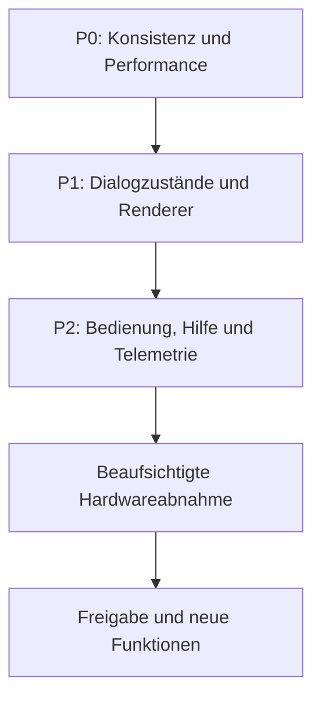

# Abschlussbericht der Dialog-Regression

Status: **Dialoganalyse abgeschlossen**. Die ausdrücklich beaufsichtigten
LED-Hardware-Dauertests sind als eigene Abnahmestufe noch offen. In dieser Phase
wurden keine Produktionslogik und keine `.toe`-Datei verändert oder gespeichert.

## Prüfgegenstand

1. LED Preview
2. Material Browser
3. MadMapper Library
4. Material Player
5. Pixel Mapper
6. Art-Net Router
7. Output Config
8. Show Control
9. Shortcut Help

## Gemeinsame Baseline

Die verbindlichen Messwerte, Testebenen und Abgrenzungen stehen in
`REGRESSION_BASELINE_2026-08-26_DE.md`. Die Bewertungsskala steht in
`DIALOG_AUDIT_SCORECARD_DE.md`. Bestätigte und noch offene Befunde werden im
`REGRESSION_ISSUE_REGISTER_DE.md` geführt.

## Vergleichstabelle

Alle Bewertungen verwenden die gemeinsame Skala 0–10. Ein hoher Gesamtwert
hebt einen separat genannten Blocker nicht auf.

| Nr. | Dialog | Nutzbarkeit | Umsetzung | Zuverlässigkeit | Wartbarkeit | Vollständigkeit | Innovation | Blocker |
|---:|---|---:|---:|---:|---:|---:|---:|---|
| 1 | LED Preview | 5 | 6 | 3 | 4 | 4 | 7 | 3744/3740, Missing-States und widersprüchliche Startindizes |
| 2 | Material Browser | 5 | 5 | 4 | 6 | 5 | 7 | doppelte/unsynchrone Regler, globaler Materialzustand |
| 3 | MadMapper Library | 7 | 7,5 | 6 | 6,5 | 7 | 8 | Live Preview vergisst vorhandenen Import nach Neustart |
| 4 | Material Player | 2 | 6 | 5 | 6 | 3 | 7 | Shortcut zeigt nur Rohbild, keine Player-Bedienoberfläche |
| 5 | Pixel Mapper | 5 | 6 | 4 | 4 | 5 | 7 | Live 3744, Dialog/Preview 3740, alte 3714-Dateiquelle |
| 6 | Art-Net Router | 5 | 8 | 7 | 6 | 6 | 7 | Statusanzeigen teilweise veraltet; beaufsichtigte Hardwareabnahme offen |
| 7 | Output Config | 3 | 3 | 2 | 3 | 2 | 4 | statische Altwerte, entkoppelte Felder, Buttonduplikate |
| 8 | Show Control | 5 | 5,5 | 4 | 6,5 | 4 | 6,5 | A/B-Liveübersetzung und Status ab Cue 2 falsch |
| 9 | Shortcut Help | 7 | 7 | 8 | 8 | 6 | 5 | globaler Hotkey-Scope, Legacy-Callback, missverständliche Dialog-4-Hilfe |

## Dialogübergreifende Fragen

### Zuständigkeiten und Doppelungen

- Soll Output Config ein vollständiger Editor oder eine schreibgeschützte
  Zusammenfassung des Art-Net Routers sein?
- Welche Werte gehören in den Material Browser, welche in den Material Player,
  und welche sollen pro Material gespeichert werden?
- Welche Vorschau ist verbindlich für Hardware, welche nur Rohmaterial- oder
  Diagnoseansicht?
- Welche Parameter sind Benutzeroptionen und welche nur interne/abgeleitete
  Statuswerte?

### Verbindliche Datenquellen

Jeder sichtbare Wert muss im finalen Entwurf genau eine kanonische Quelle
besitzen. UI-Mockups, Drafttabellen, Controllerplan, Senderzustand und
Hilfetexte dürfen den Istwert nicht unabhängig voneinander kopieren.

### Performance und Synchronität

Der Abschlussbericht trennt mindestens:

- TouchDesigner-/Render-FPS;
- neue Materialframes pro Sekunde;
- Packframes pro Sekunde;
- gesendete Art-Net-Frames pro Sekunde;
- wiederholte oder verworfene Frames;
- panelbezogene UV-/Wegsemantik.

## Gesamtergebnis

| Kategorie | Durchschnitt | Einordnung |
|---|---:|---|
| Nutzbarkeit | 4,9/10 | Mehrere Dialoge sind erreichbar, zeigen aber falsche oder unvollständige Bedienoberflächen. |
| Technische Umsetzung | 6,0/10 | Kernmodule, Shader, Parser und Router sind solide; Live-Adapter und Builderzustände sind die Schwachstelle. |
| Zuverlässigkeit | 4,8/10 | Viele Bindungen bestehen, sichtbare Werte und tatsächlicher Zustand widersprechen sich jedoch mehrfach. |
| Wartbarkeit | 5,6/10 | Gute Pure-Python-Tests, aber duplizierte UI-Instanzen und eingebettete Runtime-DATs erschweren Änderungen. |
| Vollständigkeit | 4,7/10 | Grundfunktionen sind vorhanden; Live-Telemetrie, Hilfe, persistente Materialzustände und einige Dialogaktionen fehlen. |
| Innovativität | 6,5/10 | 3D-Mapping, Foto-Preview, kombinierter Materialkatalog und A/B-Showidee sind fachlich stark. |
| **Gesamt** | **5,4/10** | **Innovative Basis, aber vor weiteren Funktionsausbauten zuerst Konsistenz und Performance stabilisieren.** |

## Einzelurteile

### 1. LED Preview – 4,8/10

Die fotoausgerichtete Vorschau und die 80 unabhängigen Rückwand-Ecken sind
fachlich wertvoll. Die Vorschau ist aber kein vollständiger Nachweis der
Hardwareausgabe: RGB-Pfad 3.744, Instanzpfad 3.740, 25 `missing`-Zeilen und drei
konkurrierende Rear-Startwerte 1.154/1.180/1.184. Mehrere sichtbare
Grobkalibrierungs-/Kompatibilitätswerte und `Ledopacity` haben im aktiven Output
keine Wirkung. Gemessen wurden nur etwa 12,5 neue Preview-Cooks/s bei 60-FPS-
Projektzeit. `Strg+Umschalt+1` ist real bestanden.

### 2. Material Browser – 5,3/10

Materialwahl, Suche, Karten, Speed-, Focus- und Gradientbedienung sind eine gute
Basis und wurden real bedient. Der laufende Builderzustand enthält jedoch
überlagerte doppelte Regler. Sichtbarer und wirksamer Speed können abweichen;
Parameter werden nicht pro Material gespeichert. Die globale Zeitformel
`absTime * Speed` erzeugt bei Speedänderung große Phasensprünge.

### 3. MadMapper Library – 7,0/10

Der stärkste Dialog: Suche, Tippfehlertoleranz, Filter, Paging, Kartenwahl,
Preview und sicherer Importablauf sind gut realisiert. Hauptfehler: Nach einem
Neustart erkennt die Karte ein importiertes Material, `OPEN LIVE PREVIEW`
verlangt aber fälschlich erneut den Import, weil der vorbereitete Shader nicht
aus dem persistenten Zustand geladen wird.

### 4. Material Player – 4,8/10

Intern sind 30/30 geprüfte Parameterbindungen korrekt. Der Shortcut öffnet
praktisch aber nur das 512×512-Rohmaterial und keine sichtbaren
Playerparameter. Der Dialog erfüllt damit seinen dokumentierten Bedienzweck
nicht. Speed ist global, Parameterbereiche/Defaults sind teilweise inkonsistent
und direkte Gradient-Menüänderungen wenden den Gradient nicht an.

### 5. Pixel Mapper – 5,2/10

Der aktive 3D-Livepfad ist korrekt und vollständig: 3.744 Punkte, identisch zur
kanonischen `complete_new`-Map. Dialog und Preview arbeiten dagegen mit einem
3.740-Punkt-Entwurf; der angezeigte Quellpfad verweist sogar auf eine alte
3.714-Punkt-Datei. Der Apply-Guard blockiert diesen gefährlichen Unterschied
korrekt. FILL funktionierte real und veränderte die Raw-/Live-Daten nicht;
CONTAIN reagierte im geprüften Viewer nicht zuverlässig.

### 6. Art-Net Router – 6,5/10

Technisch stark: 11 korrekte 510-Byte-ArtDMX-Frames, konsistente Software-
Panelaufteilung und sichere Guards. Schwach sind die sichtbaren Statuswerte:
Universebereich, Safety-Text, Quarantänehinweis und Controller-Summary können
dem aktiven Sender widersprechen. Für mehrere Controller wird außerdem das
globale Ratenmaximum statt einer unabhängigen Rate verwendet. Die physische
Langzeit-/Grenzabnahme bleibt beaufsichtigt offen.

### 7. Output Config – 2,8/10

Kritischster Dialog. Er zeigt ein altes statisches Modell mit 3.714 Pixeln,
30 FPS, falscher lokaler IP und ArtSync ON, während live 3.744 Pixel, 60 FPS,
eine andere Schnittstelle und ArtSync OFF gelten. Felder, Draft und Anzeige sind
entkoppelt; berechnete Werte sind editierbar; Revert/Review wirken nicht; acht
überlagerte Buttoninstanzen zeigen fehlende Builder-Idempotenz. Die Oberfläche
darf in diesem Zustand nicht als verbindliche Konfiguration gelten.

### 8. Show Control – 5,3/10

Transportkern und sichere Trennung sind gut. Alle acht sichtbaren Buttons
wurden real und ohne Hardwarewirkung getestet. Ab Cue 2 ignoriert der Live-
Mixer jedoch die berechnete A/B-Richtung; Renderer und Status können dadurch
den falschen Slot anzeigen. Presets und Zielgruppen erreichen den Renderer
nicht. LOOP und BLACKOUT besitzen keine dauerhafte sichtbare Zustandsanzeige.

### 9. Shortcut Help – 6,8/10

Alle neun Shortcuts bestanden real im Hauptfenster, Material Browser,
LED-Preview-Viewer und bei aktivem Suchfeld. Ziele, Beschriftungen und Tabelle
sind konsistent. Risiken: leerer Panel-Filter macht die Erfassung global, der
Legacy-Callback ist versionsfragil und die Hilfe zu Dialog 4 verspricht eine
Player-Steuerung, obwohl nur das Rohbild erscheint.

## Bestätigte Doppelungen und Zuständigkeitsprobleme

| Bereiche | Doppelung/Problem | Empfehlung für die Produktentscheidung |
|---|---|---|
| Art-Net Router / Output Config | zwei Oberflächen behaupten Ausgabekonfiguration, nur der Router entspricht dem Livepfad | Output Config entweder entfernen/als read-only Summary neu bauen oder vollständig an denselben Zustandsadapter binden |
| Material Browser / Material Player | Parameter liegen intern im Player, sichtbar teilweise im Browser; Shortcut 4 zeigt keine Controls | eine eindeutige Control-Surface festlegen; Browser für Auswahl, Player für vollständige Parameter oder alles bewusst zusammenführen |
| LED Preview / Pixel Mapper | beide zeigen Mapping, aber mit verschiedenen Counts/Splits | genau eine kanonische Map-/Pixel-/Panelgrenzenquelle verwenden |
| Hilfe / Dialogtexte | Hilfe beschreibt Sollfunktionen, nicht immer den realen Istzustand | Hilfetexte aus denselben deklarativen Dialogverträgen erzeugen und per Test gegen Liveziel prüfen |
| Builder / laufende UI | wiederholte Builds erzeugten doppelte Regler und Buttons | alle Builder idempotent machen und Duplikattests verbindlich ausführen |

## Priorisierte nächste Schritte

### P0 – zuerst beheben

1. Eine kanonische Pixelanzahl und Panelaufteilung festlegen: 3.744 Gesamt,
   Seitenwand 1.184 und Rückwand 2.560; alle Dialoge, Previewpfade, Drafts und
   Hilfen daraus speisen.
2. Blockierenden Python-Packer/`onFrameStart`-Pfad profilieren und entkoppeln.
   Erstes Ziel: stabile neue Render-/Packframes statt nur 7,9–13,7 FPS.
3. Output Config als Live-Editor **oder** read-only Router-Zusammenfassung
   entscheiden; bis dahin nicht als verbindliche Oberfläche verwenden.
4. Doppelte Browser-/Output-Controls beseitigen und Builder-Idempotenz testen.

### P1 – fachliche Korrektheit

1. kontinuierliche Materialphase und per-Material-Zustand für Speed, Framing,
   Gradient und weitere Presets einführen;
2. echte lokale UVs/Panel-IDs für Mitte, Oben und Unten definieren;
3. Show-Control-A/B-Richtung, dynamischen Status, Presets und Zielgruppen an den
   Live-Renderer anbinden;
4. persistente MadMapper-Live-Preview bereits importierter Shader reparieren;
5. LED-Preview-Reset und wirkungslose Altparameter bereinigen.

### P2 – Bedienung und Nachweis

1. gemeinsames `i`-Hilfesystem gemäß `INLINE_HELP_SPEC_DE.md` umsetzen;
2. Live-Telemetrie für Render-, Pack- und Sendefrequenz, Jitter, verpasste und
   wiederholte Frames sowie Paketanzahl je Universe hinzufügen;
3. Shortcut-Callback auf den aktuellen Vertrag migrieren und den globalen
   Tastatur-Scope bewusst entscheiden;
4. aktive Zustände für Materialpreset, Gradient, LOOP, BLACKOUT und Controller
   sichtbar markieren;
5. aktuelle Screenshots und getestete Workflows direkt aus den automatisierten
   Abnahmeläufen erzeugen.

## Testabdeckung und offene Abnahmen

- Gesamtsuite: **228 Tests bestanden**.
- Erwartete Fehler: **6**, ausschließlich als explizite Marker für bestätigte
  LED-Preview- und Show-Control-Lücken.
- Reale Shortcuts: **1 bis 9 bestanden** in mehreren Fokuszuständen.
- Reale UI-Tests: Material Browser, MadMapper Library, Pixel Mapper, Show
  Control und Output Config; LED Preview und Hilfe real geöffnet.
- Nicht unbeaufsichtigt ausgeführt: Router-Start/Apply/Kalibrierung mit
  Hardwarewirkung, Mapping-Apply/Export, persistenter Import und produktive
  Show-Ausgabe.

Vor einer Hardwarefreigabe bleiben die im Art-Net-Bericht definierten Tests
HW-01 bis HW-05 offen: Panel-ID, Einzelpanel/Schwarzbereiche, Chase-Grenzen,
Rows/Columns und ein mindestens fünfminütiger 60-Hz-Dauertest mit Paket-
Telemetrie.

## Detailberichte

- `LED_PREVIEW_REGRESSION_AUDIT_DE.md`
- `MATERIAL_BROWSER_PLAYER_REGRESSION_AUDIT_DE.md`
- `MADMAPPER_LIBRARY_REGRESSION_AUDIT_DE.md`
- `PIXEL_MAPPER_REGRESSION_AUDIT_DE.md`
- `ARTNET_ROUTER_REGRESSION_AUDIT_DE.md`
- `OUTPUT_CONFIG_REGRESSION_AUDIT_DE.md`
- `SHOW_CONTROL_REGRESSION_AUDIT_DE.md`
- `SHORTCUT_HELP_REGRESSION_AUDIT_DE.md`

## Freigabepunkt

Die Analyse ist beendet. Vor der Umsetzung ist mit dem Nutzer festzulegen,
welche P0/P1-Punkte gemeinsam in die erste Korrekturrunde kommen. Bis zu dieser
Freigabe bleiben Produktionslogik, Hardwarekonfiguration und `.toe` unverändert.
