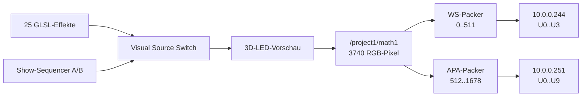
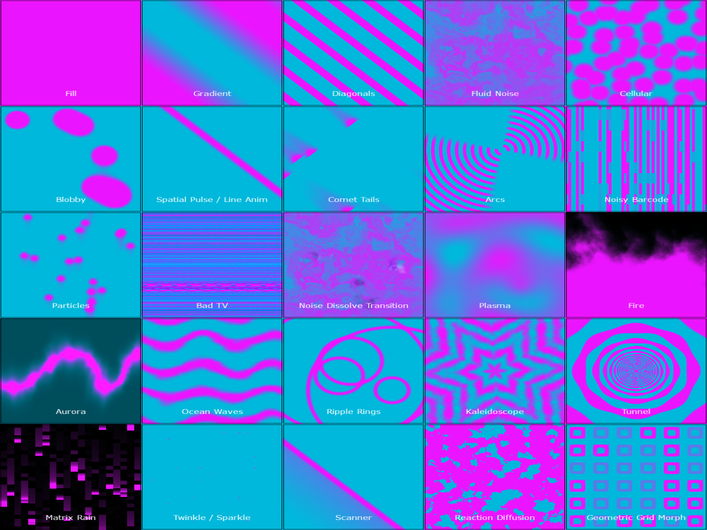
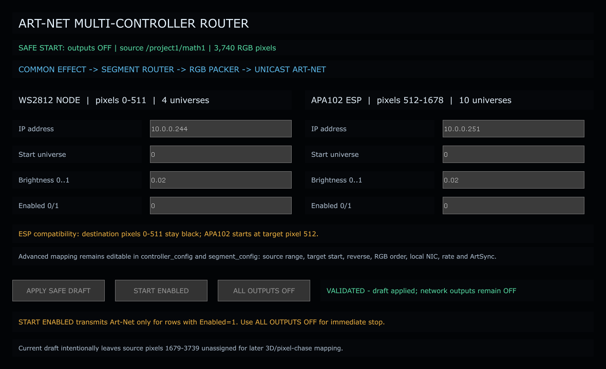
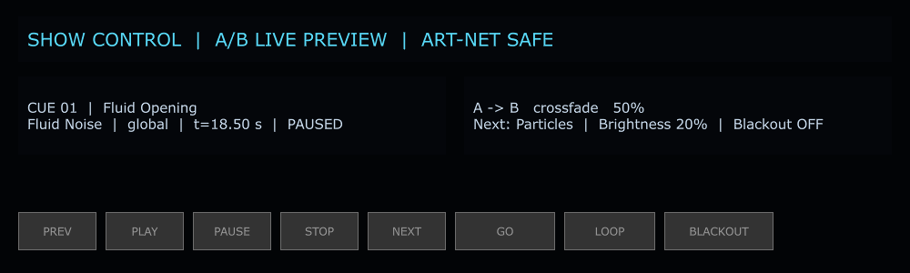
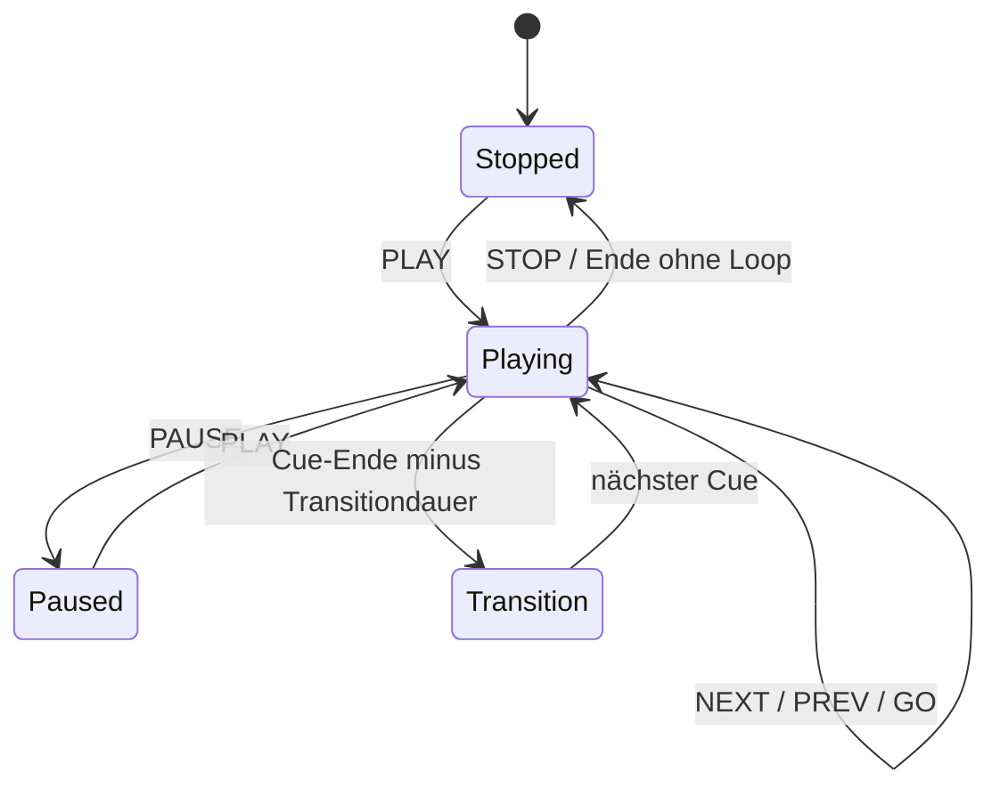

# How-to: TouchDesigner Art-Net Mapper

Stand: 18. August 2026 · Projektdatei: `PixelblazeMapper_WORKING_PHASE2_EFFECTS_CORE.43.toe`

## 1. Sicher starten

1. TouchDesigner öffnen.
2. `PixelblazeMapper_WORKING_PHASE2_EFFECTS_CORE.43.toe` laden.
3. Im Network Editor `/project1` öffnen.
4. Prüfen, dass diese vier Ausgänge `Active = Off` zeigen:
   - `/project1/dmxout1`
   - `/project1/esp_artnet_out`
   - `/project1/multi_controller_output/dmxout_ws2812_node`
   - `/project1/multi_controller_output/dmxout_apa102_esp`
5. Für die neue Bedienung `/project1/multi_controller_output/ui_preview` mit Rechtsklick → **View** öffnen.

Der gespeicherte Stand erfüllt diese Bedingungen bereits. Helligkeit `0.02`
bedeutet 2 %, aber beide neuen Empfänger stehen auf `Enabled=0`.

## 2. Systemfluss



Jedes Universum enthält 510 Werte = 170 RGB-Pixel. Die Universen dürfen bei
verschiedenen IP-Adressen wieder bei 0 beginnen. Innerhalb derselben IP werden
Überlappungen blockiert.

## 3. UC-01 · Effekt mit der Maus wählen

1. `/project1/madmapper_material_browser` öffnen.
2. Den Viewer aktivieren (**Viewer Active**).
3. Eine der 25 Karten direkt anklicken.
4. Kontrollieren, dass die cyanfarbene Auswahlumrandung zur angeklickten Karte
   springt und die 3D-Vorschau denselben Effekt auf Rückwand und Seiten zeigt.



Erwartung: `Source = materials`, der Materialindex entspricht der Kartenposition
von links oben nach rechts unten. Getestet wurden alle Indizes `0..24`.

## 4. UC-02 · Koordinatenmodus wählen

Im Control COMP `/project1/madmapper_player_controls` den Parameter
`Coordinate Mode` setzen:

| Wert | Verhalten |
|---|---|
| `global` | ein zusammenhängendes Bild über die komplette Installation |
| `panel_local` | Muster wird pro Panel lokal wiederholt |
| `hybrid` | globale Bewegung mit lokal lesbaren Paneldetails |

Erwartung: Die drei Modi erzeugen unterschiedliche Renderbilder, verändern aber
weder Pixelanzahl noch Art-Net-Routing.

## 5. UC-03 · Zwei Art-Net-Empfänger konfigurieren

1. `/project1/multi_controller_output/ui_preview` öffnen.
2. Für jeden Empfänger folgende Felder anklicken und bearbeiten:
   - **IP address**
   - **Start universe**
   - **Brightness 0..1**
   - **Enabled 0/1**
3. **APPLY SAFE DRAFT** anklicken.
4. Die grüne Statuszeile abwarten: `VALIDATED - draft applied; network outputs remain OFF`.



Standardwerte:

| Empfänger | IP | Universen | Quellpixel | Zielpixel | Helligkeit | Enabled |
|---|---:|---:|---:|---:|---:|---:|
| WS2812 NODE | 10.0.0.244 | 0–3 | 0–511 | 0–511 | 0.02 | 0 |
| APA102 ESP | 10.0.0.251 | 0–9 | 512–1678 | 512–1678 | 0.02 | 0 |

Ungültige IPs, Helligkeit außerhalb `0..1`, Universe außerhalb `0..32767`,
falsche Farbreihenfolge, unbekannte Controller oder kollidierende Zielbereiche
werden blockiert. Der bisher gültige Tabellenstand bleibt dabei erhalten.

Erweiterte Werte stehen in den DATs `controller_config` und `segment_config`:
lokale Netzwerkkarte, Port, RGB-Reihenfolge, Rate, ArtSync, Quellbereich,
Zielstart, Reverse und Farb-Override. Danach ebenfalls **APPLY SAFE DRAFT**.

## 6. UC-04 · Art-Net kontrolliert starten und stoppen

1. Zunächst **Brightness = 0.02** oder für einen reinen Verbindungstest `0.0` setzen.
2. Nur bei den gewünschten Empfängern **Enabled = 1** setzen.
3. **APPLY SAFE DRAFT** anklicken.
4. Verkabelung und Stromversorgung prüfen.
5. **START ENABLED** anklicken.
6. Status muss `LIVE - ...` anzeigen.
7. Zum sofortigen Stoppen **ALL OUTPUTS OFF** anklicken.

Wichtig: `START ENABLED` validiert erneut und schaltet zuerst alle Ausgänge aus.
Es startet ausschließlich validierte Zeilen mit `Enabled=1`. Der gespeicherte
Projektstand bleibt `Enabled=0` und alle Ausgänge aus.

## 7. UC-05 · Segment-/Pixelrouting ändern

Für neue Stränge oder weitere Empfänger:

1. `controller_config` um eine eindeutige Controllerzeile erweitern.
2. In `segment_config` eine oder mehrere Segmentzeilen anlegen.
3. `source_start` und `count` beziehen sich auf den 3740-Pixel-Quellstrom.
4. `destination_start` ist der logische Pixelindex im Zielgerät.
5. Optional `reverse=1` oder `color_override=GRB` setzen.
6. Builder ausführen:

```python
exec(open(r'C:/Users/jbhtz/TouchDesignerLocal/PixelblazeMapper/pixelblaze_mapper/build_multi_controller_output.py', encoding='utf-8').read())
```

7. `validation` prüfen; bei `error` bleibt alles aus.

Die vorhandene ESP-Regel `destination_start=512` ist absichtlich: der aktuelle
ESP erwartet vor APA102 genau 512 schwarze WS-Pixel.

## 8. UC-06 · Show abspielen

1. `/project1/show_control/control_panel_preview` öffnen.
2. **PLAY** anklicken.
3. Mit **NEXT**, **PREV** oder **GO** die Cuefolge steuern.
4. **PAUSE** friert die exakte Zeitposition ein; **STOP** setzt auf Cue 1 / 0 s.
5. **LOOP** schaltet die Wiederholung um.
6. **BLACKOUT** setzt die Bildhelligkeit auf 0, ohne den Transport zu verlieren.





Der Renderer nutzt zwei Shader-Slots A/B. Unterstützte Übergänge: `cut`,
`crossfade`, `dissolve`, `wipe`, `radial`, `glitch`.


## 9. UC-07 · Eine eigene Show anlegen

`shows/demo_show.json` kopieren und Cues bearbeiten. Pflichtfelder pro Cue:

```json
{
  "id": "particles-room",
  "name": "Particles Across Room",
  "effect": "Particles",
  "preset": "Cyan Magenta",
  "coordinate_mode": "hybrid",
  "duration": 15.0,
  "transition": "dissolve",
  "transition_duration": 2.0,
  "brightness": 0.2,
  "target_groups": ["backwall", "sidewalls"]
}
```

Regeln: IDs eindeutig; `duration > 0`; Helligkeit `0..1`; animierte
Transitiondauer `> 0` und nicht länger als die Cue-Dauer; Cut-Dauer exakt 0.

Builder und Live-Verknüpfung:

```python
exec(open(r'C:/Users/jbhtz/TouchDesignerLocal/PixelblazeMapper/pixelblaze_mapper/build_show_sequencer.py', encoding='utf-8').read())
exec(open(r'C:/Users/jbhtz/TouchDesignerLocal/PixelblazeMapper/pixelblaze_mapper/integrate_live_show.py', encoding='utf-8').read())
```

Beide Skripte sind idempotent. Das erste baut die Show-Steuerung; das zweite
verbindet ausschließlich die visuelle A/B-Kette. Es aktiviert kein Art-Net.

## 10. UC-08 · Tests ausführen

In PowerShell:

```powershell
Set-Location C:\Users\jbhtz\TouchDesignerLocal\PixelblazeMapper
python -m unittest discover -s tests
```

Erwartung:

```text
Ran 92 tests
OK
```

Live-Prüfung im Projekt:

```python
print(op('/project1').errors(recurse=True))
```

Erwartung: leere Ausgabe. Für einen sicheren Abschluss müssen alle vier DMX
Out CHOPs `Active=False` zeigen.

## 11. Fehlerbehebung

| Symptom | Prüfung | Lösung |
|---|---|---|
| Materialkarte reagiert nicht | Viewer Active? | Browser-Viewer aktivieren und Karte direkt anklicken |
| Seiten zeigen neuen Effekt, Rückwand nicht | Source / Show-Verknüpfung | `integrate_live_show.py` erneut ausführen; `visual_source_switch` muss 3 Eingänge haben |
| Apply meldet BLOCKED | rote Statuszeile / `validation` | markiertes Feld korrigieren; alter gültiger Stand bleibt erhalten |
| Kein Licht | Enabled, Active, IP, lokale NIC | zuerst 2 % testen; Empfänger aktivieren; `10.0.0.178` als lokale NIC prüfen |
| ESP APA-Ausgabe verschoben | Zielstart | APA-Segment muss bei Zielpixel 512 beginnen |
| Universen kollidieren | Ziel-IP + Universebereich | gleiche Universen sind nur auf unterschiedlichen IPs erlaubt |
| Sofort alles aus | Controller-UI | **ALL OUTPUTS OFF** anklicken |
