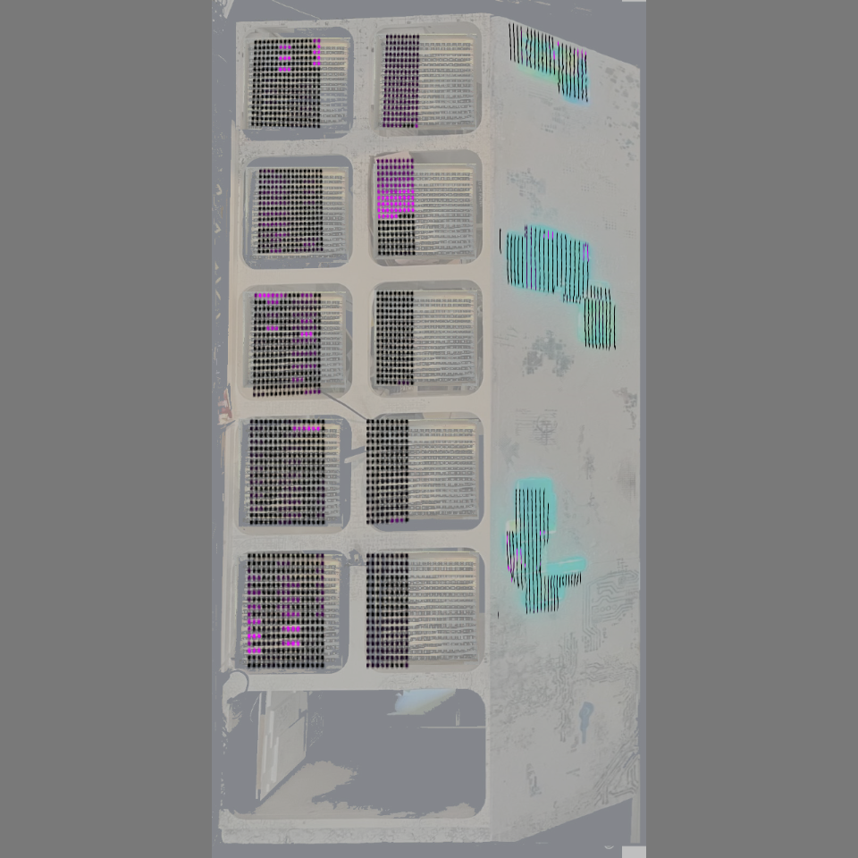
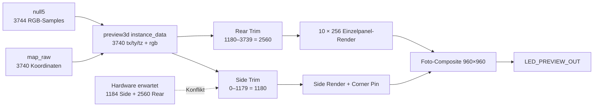

# Regression-Audit: Dialog 1 – LED Preview

Stand: laufendes Core-68-Projekt am 26.08.2026. Dieses Dokument ist eine
Zustandsanalyse. Es wurden keine Funktionen korrigiert, keine `.toe`-Datei
gespeichert, kein Mapping geschrieben und keine Art-Net-Ausgabe verändert.

## 1. Aufgabe und Ergebnis in Kurzform

`Strg+Umschalt+1` soll die verbindliche Fotoansicht der vollständigen
LED-Installation öffnen. Das Ziel ist korrekt als `/project1/LED_PREVIEW_OUT`
konfiguriert. Die Select-TOP-Ausgabe ist pixelgenau identisch mit ihrem
960×960-Quellbild `prototype_out` (maximale und mittlere Abweichung jeweils 0).

Die Vorschau ist trotzdem derzeit **keine vollständige Hardware-Wahrheit**:

- Hardware-/Farbdaten enthalten 3.744 Samples.
- Die Vorschau verarbeitet nur 3.740 Koordinaten und Farben.
- Die vier Indizes 3740–3743 fehlen daher vollständig in der Vorschau.
- 25 weitere Indizes sind in `map_raw` als `state=missing` gekennzeichnet.
- Der sichtbare, schreibgeschützte Wert `Rear panels start index` zeigt 1154.
- Die tatsächlich verwendeten Trim-Nodes trennen bei 1180.
- Aus der aktuellen Hardwareaufteilung 517 + 269 + 398 ergibt sich 1184.

Damit existieren gleichzeitig drei verschiedene Rear-Startwerte: 1154, 1180
und 1184. Vor einer Freigabe muss eine einzige kanonische Aufteilung festgelegt
und aus derselben Quelle in Vorschau, Anzeige, Mapping und Ausgabe verwendet
werden.

## 2. Bedienoberfläche und Mauspfade

Der Shortcut zielt auf einen Select TOP. Das geöffnete Floating-Fenster zeigt
somit ausschließlich das Bild. Es besitzt **keine projektspezifischen Buttons,
Eingabefelder, Statusanzeigen, Legende oder Info-Hilfe**. TouchDesigners übliche
Viewer-Mausaktionen verändern nur die Darstellung des TOP-Viewers.

Die im Parameter `Mouse Controls` angekündigten Aktionen
`LMB orbit | RMB pan | MMB/wheel dolly | F frame | H home` sind an
`interactive_camera/renderView` gebunden. Der per Shortcut geöffnete
`LED_PREVIEW_OUT` leitet Mausereignisse nicht an dieses Panel weiter. Ein
Anwender kann die dokumentierte Kamerasteuerung im Shortcut-Dialog deshalb
nicht erreichen.

Folgerung für echte Klicktests: Es gibt im geöffneten Dialog keinen
anwendungseigenen Button, den ein Test anklicken könnte. Geprüft wurden deshalb
Fensteröffnung, Datenpfad, Parameterbindungen und Bildwirkung. Ein späterer
UI-Umbau sollte ein Container-Panel mit Preview, Legende, Telemetrie und
Info-Icons bereitstellen; erst dann sind echte Button-/Feld-Klicktests für
diesen Dialog sinnvoll.

## 3. Shortcut-Test

Der Keyboard-In-DAT ist aktiv, überwacht `1 2 3 4 5 6 7 8 9` und empfängt den
realen Tastendruck inklusive Ctrl und Shift. Für den isolierten Wiederholungstest
wurde der vorhandene LED-Preview-Viewer zunächst aus der sichtbaren
Top-Level-Fensterliste entfernt und `ui.status` auf einen eindeutigen Prüfmarker
gesetzt. Danach wurde `Strg+Umschalt+1` als reales Windows-Tastaturereignis an
das TouchDesigner-Hauptfenster gesendet.

| Prüfung | Erwartet | Tatsächlich | Ergebnis |
|---|---|---|---|
| Keyboard-FIFO | Key `1`, Ctrl=1, Shift=1, Press/Release | exakt so empfangen | PASS |
| Ziel | `/project1/LED_PREVIEW_OUT` vorhanden | vorhanden | PASS |
| Top-Level-Viewer | LED Preview sichtbar geöffnet/fokussiert | vorhanden und sichtbar | PASS |
| `ui.status` | `LED PREVIEW | /project1/LED_PREVIEW_OUT` | exakt dieser Wert | PASS |

Die vollständige isolierte Shortcut-Serie `Strg+Umschalt+1` bis `9` war im
TouchDesigner-Hauptfenster ebenfalls erfolgreich. `Strg+Umschalt+1`
funktionierte zusätzlich mit Fokus im LED-Preview-Floating-Viewer und aus dem
Material-Browser-Suchfeld heraus. Ergebnis für Dialog 1 im geprüften
Core-68-Stand: **PASS**.

Das installierte Callback-Modul verwendet weiterhin `keyEvent(...)` statt des
neueren Template-Namens `onKey(...)`. TouchDesigner 2025.33070 führt den
Legacy-Vertrag nachweislich korrekt aus. Das ist deshalb **kein aktueller
Funktionsfehler**, sondern nur eine technische Fragilität für eine spätere
TouchDesigner-Migration.

## 4. Signalweg und Hardwareaufteilung

| Ebene | Mitte | Oben | Unten | Side gesamt | Rear | Gesamt |
|---|---:|---:|---:|---:|---:|---:|
| aktuelle Hardware-/Ausgabestruktur | 517 | 269 | 398 | 1184 | 2560 | 3744 |
| Preview-Struktur | nicht getrennt angezeigt | nicht getrennt angezeigt | nicht getrennt angezeigt | 1180 | 2560 | 3740 |
| sichtbarer Parameter | – | – | – | `Panelsstartindex=1154` | – | – |

Die Preview zeigt keine Hardwaregrenzen, Portnummern, Universen oder
Quellindexbereiche. Fehler an einer Panel- oder Universe-Grenze können daher
visuell nicht sicher zugeordnet werden.

## 5. Vollständige Feldinventur hinter der Vorschau

Die zugrunde liegende Preview-COMP enthält 146 benutzerdefinierte Parameter.
Sie sind im Shortcut-Fenster nicht sichtbar.

| Parameterseite | Anzahl | Inhalt |
|---|---:|---|
| Phase 2 Preview | 14 | Hintergrund, Fit, Modus, Opazität, Kamera, Status |
| Background Corner Pin | 8 | vier Hintergrund-Ecken mit X/Y |
| Photo Calibration | 25 | Side/Rear sichtbar, Opazität, Grob-Ecken, Reset, Startindex |
| Einzelfächer | 90 | zehn Überschriften plus 80 X-/Y-Eckwerte |
| Tastatur | 5 | aktives Fach, Ecke/Achse, Schrittweite, Hinweise |
| Rear Split Compatibility | 4 | alte mittlere Trennkante der Rückwand |

### Wirksame Parameter

119 einzelne Bindungsänderungen wurden ausgeführt und vollständig
zurückgesetzt. Nach Berücksichtigung des asynchronen Parameter-Callbacks waren
119 von 119 Zielbindungen korrekt:

- Hintergrund an/aus, Hintergrundopazität und LED-Opazität;
- Kalibrierungsmodus, Side/Rear an/aus und beide Opazitäten;
- alle drei Background-Fit-Optionen;
- beide Alignment-Modi;
- 8 Side-Grobecken und 8 Rear-Grobecken;
- 8 Background-Ecken;
- alle 80 Einzelfach-Ecken;
- `Show axes / pivot` nach einem UI-Frame Callback-Verzögerung.

Eine korrekte Parameterbindung bedeutet jedoch nicht automatisch, dass der
gebundene Node im aktiven Ausgangspfad liegt. Das wurde separat per
Bilddifferenz geprüft.

### Nachgewiesene Bildwirkung

| Teständerung | geänderte Bildpixel | Ergebnis |
|---|---:|---|
| Hintergrundopazität 0,53 → 0,20 | 919.986 | wirksam |
| Hintergrund deaktivieren | 919.986 | wirksam |
| Fit `contain` → `cover` | 918.693 | wirksam |
| Kalibrierung ein → aus | 91.369 | wirksam, wechselt den kompletten Renderpfad |
| Side aus | 9.436 | wirksam |
| Rear aus | 69.017 | wirksam |
| Side-Opazität 1 → 0,25 | 9.436 | wirksam |
| Rear-Opazität 1 → 0,25 | 69.017 | wirksam |
| Side Top-Left X +0,02 | 14.716 | wirksam |
| je ein Top-Left-X-Test an Panel 1–10 | 4.697–11.527 | alle zehn wirksam |
| `Ledopacity` 1 → 0 bei aktiver Kalibrierung | 0 | in diesem Modus wirkungslos |
| Rear-Grobecke Top-Left X +0,02 | 0 | wirkungslos im kanonischen Ausgang |
| Rear-Split-Kompatibilität +0,02 | 0 | wirkungslos im kanonischen Ausgang |

`Alignmentmode=simple` zu `cornerpin` erzeugt mit identischen 0/1-Ecken
erwartungsgemäß keine Bildänderung. Die acht Background-Corner-Felder sollten
im Simple-Modus deaktiviert oder als „nur Perspective Corner Pin“ markiert
werden.

## 6. Buttons und Spezialfunktionen

| Funktion | Callback vorhanden | Wirkung im aktiven Shortcut-Bild | Auditstatus |
|---|---|---|---|
| Open Background | ja, öffnet Dateidialog | potentiell | nicht automatisch ausgelöst; interaktiver OS-Dialog |
| Clear Background | ja | potentiell | nicht ausgelöst; verändert Dateipfad |
| Home / Frame / Reset Camera | ja, `interactive_camera` | keine bei aktiver Photo Calibration | technisch vorhanden, im Shortcut irreführend |
| Reset both planes | ja | Side ja; aktuelle Einzelpanel-Rearwerte nein | Bezeichnung und Wirkung widersprechen sich |
| `+` / `−` Feinkorrektur | Callback vorhanden | jeweilige Einzelfach-Ecke | im Shortcut-Bild nicht sichtbar/erklärbar |

Der Reset-Callback setzt nur 8 Side- und 8 alte Rear-Grobwerte. Die 80 Werte,
die die sichtbaren zehn Rückwandpanels tatsächlich steuern, werden nicht
zurückgesetzt. Damit ist `Reset both planes` für die aktuelle Darstellung
inhaltlich unvollständig.

## 7. Performance- und Ruckelbefund

Über 2.826 Timelineframes bei exakt 60 FPS wurden nur 589 Cooks in der
Preview-/Quellkette beobachtet. Das entspricht rund 12,5 Aktualisierungen pro
Sekunde beziehungsweise einem neuen Preview-Frame nur etwa alle 4,8
Timelineframes.

| Node | beobachtete Updates/s | letzter Cook-Aufwand |
|---|---:|---:|
| visual_source_switch / res1 / math1 | ca. 12,5 | 0,02–0,03 ms |
| preview3d/instance_data | ca. 12,5 | 3,81 ms |
| cal_side_render | ca. 12,5 | 0,29 ms |
| prototype_out / LED_PREVIEW_OUT | ca. 12,5 | 0,01 ms |
| cal_rear_render | statisch in Messfenster | 0,15 ms letzter Cook |

Der Befund passt zum subjektiven Ruckeln. Die einzelnen Cook-Zeiten sind klein;
wahrscheinlicher ist eine Bedarfs-/Taktungsgrenze als reine GPU-Überlastung.
Die Messung beweist noch nicht, dass Art-Net ebenfalls nur mit 12,5 neuen
Frames versorgt wird. Dafür muss die ganzheitliche Ausgabemessung Farbeingang,
Packer und Sender mit gemeinsamen Frame-IDs korrelieren.

## 8. Reproduzierbare Arbeitsabläufe

### A. Sichtkontrolle nach Materialwechsel

1. Material im Material Browser auswählen.
2. `Strg+Umschalt+1` drücken.
3. Erwartet: Floating Viewer `LED_PREVIEW_OUT (960,960)`.
4. Prüfen: zehn Rückwandflächen in zwei Spalten zu je fünf und drei Side-Motive.
5. Derzeit zusätzlich beachten: die Preview deckt nur 0–3739 ab; 3740–3743
   können damit nicht bewertet werden.

### B. Einzelfach-Kalibrierung

1. Parameterseite `Einzelfächer` am Prototype öffnen.
2. Fach auswählen, z. B. Fach 5 = `F04*`.
3. Gewünschte Ecke wählen, z. B. unten links Y = `F04bly`.
4. Mit Schritt 0,002 verändern.
5. Erwartet: ausschließlich dieses Fach verschiebt die betreffende Ecke.
6. Wert sofort zurücksetzen, wenn die Fotoecke nicht genauer getroffen wird.

### C. Side-/Rear-Sichtbarkeit prüfen

1. `Showside=False`: exakt die drei Side-Motive verschwinden.
2. Wert wieder auf `True` setzen.
3. `Showrear=False`: exakt die zehn Rückwandpanels verschwinden.
4. Wert wieder auf `True` setzen.
5. Dieser Test verändert keine Hardwareausgabe.

### D. Datenvollständigkeit prüfen

1. `map_raw` eindeutige Indizes und `state` auswerten.
2. Samplezahl von `null5` und `instance_data` vergleichen.
3. Side- und Rear-Trim zusammenzählen.
4. Sichtbaren `Panelsstartindex` gegen echten Rear-Trim-Start vergleichen.
5. Abnahme nur bei einer identischen Gesamtzahl und identischem Startindex.

## 9. Qualitätsbewertung

Bewertungsskala: 1 = unbrauchbar, 10 = ausgezeichnet.

| Dimension | Score | Begründung |
|---|---:|---|
| Nutzbarkeit | 5/10 | Shortcut funktioniert auch aus zwei zusätzlichen Fokuszuständen zuverlässig; eingebettete Kontrollen, Legende und Hilfe fehlen weiterhin, der Maus-Hinweis passt nicht zum Shortcut-Viewer |
| Technische Umsetzung | 6/10 | sauberer Alias und modularer Composite-Pfad; mehrere parallel erhaltene Altpfade erzeugen Widersprüche |
| Zuverlässigkeit | 3/10 | vier LEDs fehlen, 25 Missing-States, drei konkurrierende Rear-Startwerte, nur ca. 12,5 sichtbare Updates/s |
| Wartbarkeit | 4/10 | 80 präzise Einzelwerte sind strukturiert; zentrale Pixel-/Splitkonstanten fehlen und Altparameter bleiben sichtbar |
| Vollständigkeit | 4/10 | Foto- und Panelansicht vorhanden, aber keine vollständige Hardwareaufteilung, Telemetrie oder sichere Komplett-Resetlogik |
| Innovativität | 7/10 | fotoausgerichtete, individuelle Zehn-Panel-Projektion plus Side-Ebene ist fachlich stark und ungewöhnlich anschaulich |

Gesamturteil: **4,8/10 – wertvolle visuelle Grundlage, aber noch keine
freigabefähige verbindliche Hardwarevorschau.**

## 10. Priorisierte nächste Schritte

### P0 – vor jeder Funktionsfreigabe

1. Eine kanonische Pixelaufteilung definieren und Preview, Map, Anzeige sowie
   Hardwareausgabe daraus erzeugen: aktuell voraussichtlich 1184 + 2560 = 3744.
2. Indizes 3740–3743 in die Preview aufnehmen und die 25 `missing`-Zustände
   fachlich klären.
3. `Panelsstartindex` mit dem tatsächlich verwendeten Trim-Start synchronisieren.
4. Den funktionierenden Legacy-Shortcut-Vertrag dokumentieren und eine spätere
   Migration nur zusammen mit echten Fokusregressionen für alle neun Shortcuts
   durchführen.

### P1 – Zuverlässigkeit und Ruckeln

1. Frame-ID/FPS/Jitter gleichzeitig an Materialquelle, Sampler, Preview,
   Art-Net-Packer und Sender messen.
2. Prüfen, warum der Preview-Pfad trotz 60-FPS-Timeline nur etwa 12,5-mal pro
   Sekunde neu kocht.
3. `Reset both planes` entweder auf alle 80 aktiven Rear-Werte erweitern oder
   eindeutig in `Reset side/coarse legacy planes` umbenennen.
4. Rear-Grob- und Rear-Split-Compatibility-Felder aus der normalen Bedienung
   entfernen oder klar als Legacy/Diagnose markieren.

### P2 – Bedienung und Hilfe

1. Shortcut-Ziel zu einem eigenen Container-Dialog mit Preview umbauen.
2. Panel-/Port-/Universe-Grenzen, Indexbereiche und Missing-LEDs als Overlay
   einblendbar machen.
3. Info-Icons für alle Felder sowie kontextsensitive Kurztexte integrieren.
4. Unwirksame Felder abhängig vom Modus deaktivieren.
5. Aktuelle Auflösung, Pixelzahl, Update-FPS, Material, Quelle und Warnstatus
   direkt im Dialog anzeigen.

## 11. Automatische Tests

- Statischer Vertrag: `tests/test_led_preview_regression.py`
- Rücksetzender TouchDesigner-Livetest: `tools/td_led_preview_regression.py`
- Bestehende Foto-Wiederherstellung: `tests/test_photo_calibration_restore.py`

Die zwei bekannten Datenabweichungen sind im statischen Test als
`expectedFailure` erfasst: 3.744 Pixel und Rear-Start 1184. Der aktuell
funktionierende `keyEvent`-Callback ist ein normaler Pflichtvertragstest; seine
spätere Migration muss zusätzlich mit echten Tastatur- und Fokusfällen
abgesichert werden. Nach einer freigegebenen Datenkorrektur werden die beiden
Marker entfernt und zu festen Pflichtprüfungen gemacht.
