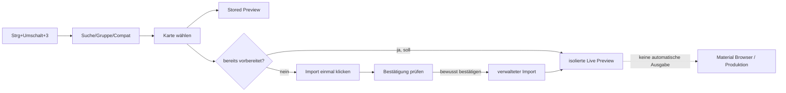
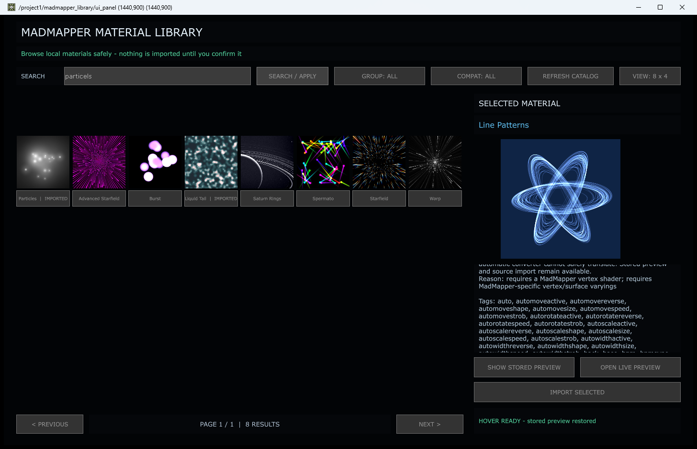
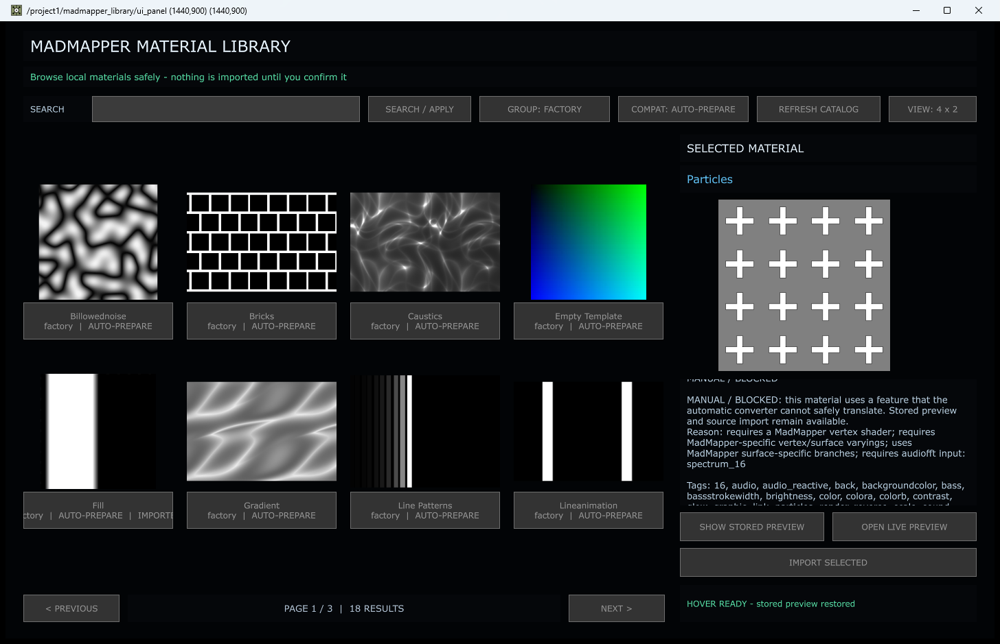
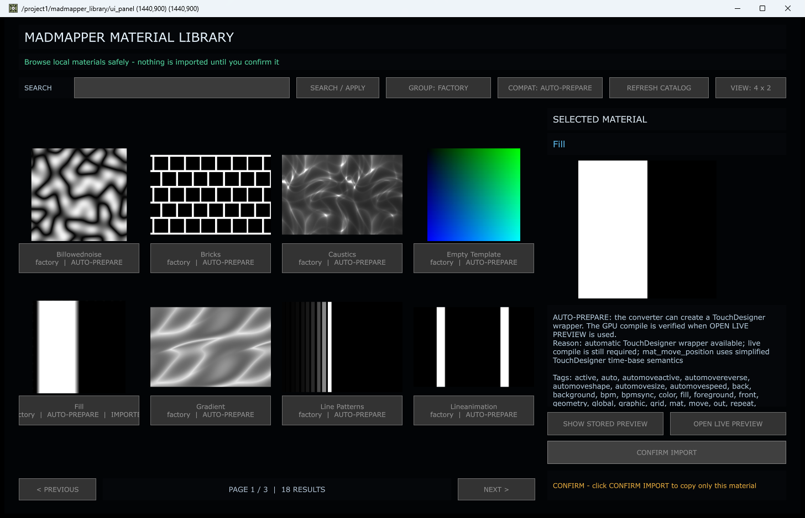
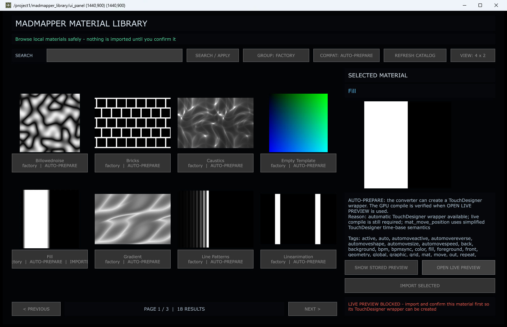

# Regression-Audit Dialog 3 – MadMapper Library

Stand: 26. August 2026  
Projekt: `PixelblazeMapper_WORKING_PHASE2_EFFECTS_CORE.68.toe`  
Dialog: `/project1/madmapper_library/ui_panel`  
Shortcut: `Strg+Umschalt+3`

## Ergebnis in einem Satz

Der Browser ist für Suche, Filterung, Paging, Kartenwahl und lokale
Vorschaubilder gut benutzbar und sicher von der Produktionsausgabe getrennt.
Der wichtigste aktuelle Defekt ist die Live-Vorschau bereits importierter
Materialien: Der Browser erkennt sie sichtbar als `IMPORTED`, findet nach einem
Neustart aber deren vorhandene `prepared.frag` nicht wieder und fordert erneut
einen Import an.

## Prüfgrenzen und Sicherheit

- Der Shortcut und die unten aufgeführten Bedienungen wurden im laufenden
  Core-68-Projekt mit echten Windows-Mausklicks und echter Tastatureingabe
  geprüft.
- Die zweite Stufe von `CONFIRM IMPORT` wurde absichtlich nicht ausgelöst. Sie
  schreibt Dateien und benötigt einen beaufsichtigten Abnahmetest.
- `REFRESH CATALOG` wurde in diesem Durchlauf nicht real angeklickt. Die
  Implementierung liest nur den lokalen Katalog, der Schreib- und
  Fehlerfalltest bleibt trotzdem offen.
- Es wurde weder ein `.toe` gespeichert noch Art-Net, DMX oder die aktive
  Produktionsquelle verändert.
- Nach dem Test wurden Suche, Gruppe und Kompatibilität auf `ALL`, die Ansicht
  auf `8 x 4` und eine offene Importbestätigung zurückgesetzt.

## Tatsächlicher Datenbestand

| Wert | Nachweisbarer Ist-Stand |
|---|---:|
| Katalogeinträge | 638 |
| `adaptable` / `AUTO-PREPARE` | 517 |
| `unsupported` / `MANUAL / BLOCKED` | 121 |
| Factory-Materialien | 42 |
| Factory + Auto-Prepare | 18 |
| lokale Importpakete | 6 |
| davon mit `prepared.frag` | 4 |
| davon ohne vorbereiteten Shader | 2 |

Die sechs erkannten Importe sind `Funkadelic`, `Liquid Tail`, `Fill`,
`Abstract Flows`, `Particles` und `Arcs`. Bei den ersten vier liegt ein
vorbereiteter TouchDesigner-Shader vor.

## Inventar der Oberfläche

### Kopf und Navigation

| Element | Zweck | Ist-Prüfung |
|---|---|---|
| Titel `MADMAPPER MATERIAL LIBRARY` | Dialogidentität | korrekt |
| Sicherheitszeile | bestätigt Zwei-Klick-Import | sichtbar und verständlich |
| `SEARCH` | Texteingabe | echte Eingabe und Löschen funktionieren |
| `SEARCH / APPLY` | Filter anwenden | echter Klick funktioniert |
| `GROUP` | Gruppenmenü | 14 direkte Optionen inklusive `ALL` und `IMPORTED` |
| `COMPAT` | Kompatibilitätsmenü | `ALL`, `AUTO-PREPARE`, `MANUAL / BLOCKED` |
| `REFRESH CATALOG` | lokalen Katalog neu lesen | Implementierung vorhanden; Live-Klick offen |
| `VIEW` | `4 x 2` oder `8 x 4` | echter Klick funktioniert |
| `PREVIOUS` / `NEXT` | Seitennavigation | echter Klick und Seitenbegrenzung funktionieren |
| Seitenstatus | Seite und Trefferzahl | wird bei Filtern, Layout und Paging korrekt aktualisiert |

### Karten- und Detailbereich

| Element | Zweck | Ist-Prüfung |
|---|---|---|
| bis zu 32 Materialkarten | Bild, Name, Importstatus | Auswahl per echtem Klick funktioniert |
| Karten-Hover | lokal adaptierte Animation | Status `HOVER LIVE`/Rückkehr zu Stored Preview beobachtet |
| `SELECTED MATERIAL` | gewähltes Material | Name, Bild, Gruppe, Kompatibilität, Grund und Tags wechseln |
| `SHOW STORED PREVIEW` | lokales Katalogbild | echter Klick funktioniert |
| `OPEN LIVE PREVIEW` | isolierten GLSL-TOP kompilieren | siehe kritischen Defekt unten |
| `IMPORT SELECTED` | Import anfordern | erster echter Klick wird korrekt zu `CONFIRM IMPORT` |
| Aktionsstatus | Ergebnis/Fehler | verständliche farbige Rückmeldung vorhanden |

### Nur im Backend vorhandene Parameter

Diese Werte gehören zum selben COMP, sind im Shortcut-Dialog aber nicht
sichtbar und deshalb dort nicht direkt bedien- oder kontrollierbar:

| Parameter | Builder-Standard | Verwendung |
|---|---:|---|
| `Catalog File` | lokaler offizieller Katalog | Quelle der 638 Einträge |
| `Import Folder` | `material_library/imported` | verwaltete Importpakete |
| `Approved Roots` | Projektwurzel | Dateizugriffsgrenze |
| `Cards Per Page` | 8 | derzeit faktisch vom `VIEW`-Modus 8/32 übersteuert |
| `Coordinate Mode` | `global` | Global/Panel/Hybrid für lokalen GLSL-TOP |
| `Panel Columns` | 2 | Panel-UV-Spalten |
| `Panel Rows` | 5 | Panel-UV-Zeilen |
| `Hybrid Mix` | 0,5 | Mischung Global/Panel |
| `Hover Loop Seconds` | 6,0 s | Schleifenzeit der Vorschau |

`Cards Per Page` suggeriert freie Konfiguration, wird vom aktuellen Runtime-Code
aber nicht ausgewertet. Das ist ein überflüssiger beziehungsweise irreführender
Parameter, solange nur 8 und 32 Karten erlaubt sind.

## Echte Regressionstests

| ID | Aktion | Erwartung | Ergebnis |
|---|---|---|---|
| MM-01 | `Strg+Umschalt+3` | Dialog öffnet | **PASS** |
| MM-02 | Suche `particels` | fehlertolerante Treffer | **PASS**, 8 Treffer |
| MM-03 | Karte `Particles` anklicken | Detaildaten wechseln | **PASS** |
| MM-04 | Gruppe `FACTORY` | ausschließlich Factory | **PASS**, 42 Treffer |
| MM-05 | Kompatibilität `AUTO-PREPARE` | nur vorbereitbare Factory-Einträge | **PASS**, 18 Treffer |
| MM-06 | `8 x 4` → `4 x 2` | 32 → 8 Karten pro Seite | **PASS**, Factory 2 → 6 Seiten |
| MM-07 | `NEXT`/`PREVIOUS` | Seite wechseln, Grenzen einhalten | **PASS** |
| MM-08 | Auto-Prepare-Karte wählen | Bild/Name/Metadaten wechseln | **PASS** |
| MM-09 | `SHOW STORED PREVIEW` | lokales Bild und Status | **PASS** |
| MM-10 | nicht importierte Auto-Karte `OPEN LIVE PREVIEW` | dokumentierter Live-Test | **BLOCKED**: verlangt zuerst Import |
| MM-11 | sichtbare `IMPORTED`-Karte `Fill` mit vorhandener `prepared.frag` öffnen | vorhandenen Shader laden | **FAIL**: verlangt erneut Import |
| MM-12 | `IMPORT SELECTED` einmal | nur Bestätigung, keine Datei schreiben | **PASS** |
| MM-13 | zweite Importbestätigung | verwaltetes Paket schreiben | **OFFEN**, absichtlich nicht ausgelöst |
| MM-14 | `REFRESH CATALOG` | lokalen Katalog neu laden | **OFFEN** als echter Klick |
| MM-15 | Auswahl danach wegfiltern | Auswahl konsistent behandeln | **TEILWEISE**: Detail bleibt auf unsichtbarer Karte |

Die vorhandene automatische Testsuite für Bibliothek, Adapter, Synchronisierung
und Dialog-Builder wurde zusätzlich ausgeführt: **37 von 37 Tests bestanden**.
Sie prüft unter anderem Pfadgrenzen, manipulationssichere Importe,
Idempotenz, Suche, Facetten, Adapter, UI-Callbacks und die Trennung von
Produktionsausgabe und lokaler Vorschau. Die Live-Persistenzlücke MM-11 wird von
dieser Suite bislang nicht erkannt.

## Nachgewiesene Abweichungen

### P1 – Bereits importierte Live-Vorschau ist nach Neustart blockiert

`_normalize()` erkennt ein Material über
`<Import Folder>/<ID>/material-import.json` als importiert. Der Pfad der dort
vorhandenen `prepared.frag` wird jedoch nicht in `prepared_shader_path`
übernommen. `open_live_preview()` akzeptiert alternativ nur
`last_import_id/last_import_path` aus der aktuellen Browser-Sitzung. Damit ist
zum Beispiel `Fill` sichtbar `IMPORTED`, obwohl `OPEN LIVE PREVIEW` die Meldung
„import and confirm this material first“ ausgibt.

Risiko: erneute, unnötige Importversuche und ein Workflow, der nach einem
Projektneustart scheinbar kaputt ist.

### P1 – Beschreibung und tatsächlicher Preview-Workflow widersprechen sich

Die Auswahlbeschreibung behauptet, der GPU-Test werde mit
`OPEN LIVE PREVIEW` geprüft. Bei `adaptable` wird dieser Button ohne
session-aktuellen Import jedoch vorher blockiert. Gleichzeitig kann der
Hover-Pfad denselben Quellshader bereits lokal und ohne Import adaptieren und
kompilieren. Es existieren damit zwei unterschiedliche Freigaberegeln für
denselben isolierten Preview-TOP.

### P2 – Ausgefilterte Auswahl bleibt im Detailbereich aktiv

Nach Wechsel von `ALL` auf `FACTORY + AUTO-PREPARE` blieb die zuvor gewählte,
nicht mehr sichtbare `Particles`-Karte im Detailbereich ausgewählt. Das ist
technisch ungefährlich, aber verwirrend und kann eine Aktion auf ein Material
auslösen, das nicht mehr in der Ergebnisliste sichtbar ist.

### P2 – Dokumentation ist teilweise veraltet

- `particels` ergibt im aktuellen Katalog 8 statt der dokumentierten 4 Treffer:
  Advanced Starfield, Burst, Liquid Tail, Particles, Saturn Rings, Spermato,
  Starfield und Warp.
- Lokal existieren 6 statt der dokumentierten 5 Importpakete.
- Die Formulierung zur sofortigen Live-Vorschau bildet die oben beschriebene
  Importsperre nicht ab.

### P3 – Dialogparameter und Schnellhilfe fehlen in der Oberfläche

Koordinatenmodus, Panel-Raster, Hybrid-Mix und Hover-Schleifenzeit sind nur im
COMP-Parameterfenster erreichbar. Der Dialog enthält keine Info-Icons oder
kontextbezogene Schnellhilfe. Für einen nicht-technischen Bediener ist dadurch
nicht nachvollziehbar, warum zwei Previews anders aussehen können.

### P3 – Wartbarkeit und Performance-Risiko

Der Dialog ist als großer Builder mit eingebettetem Runtime-Quelltext
realisiert. Das hält die Installation in TouchDesigner reproduzierbar, erschwert
aber isolierte Verhaltenstests. In `8 x 4` existieren 32 Bild-TOPs und
Hover-Sensoren. Ein eigener isolierter FPS-Vergleich dieses Dialogs wurde nicht
durchgeführt; wegen der bereits beobachteten allgemeinen FPS-Einbrüche bei
mehreren offenen Floating Dialogs sollte er im Performance-Profil enthalten
sein.

## Dokumentierter Workflow: Material sicher prüfen

1. Dialog mit `Strg+Umschalt+3` öffnen.
2. Suchbegriff eingeben und `SEARCH / APPLY` klicken.
3. Optional `GROUP` und `COMPAT` direkt wählen.
4. Karte anklicken und Name, Gruppe, Kompatibilitätsgrund und Tags lesen.
5. Mit `SHOW STORED PREVIEW` zuerst die sichere lokale Abbildung prüfen.
6. Nur bei gewünschtem Material `IMPORT SELECTED` anklicken, den nun sichtbaren
   Namen erneut kontrollieren und erst dann `CONFIRM IMPORT` verwenden.
7. Nach erfolgreichem Import `OPEN LIVE PREVIEW` verwenden. Bis MM-11 behoben
   ist, kann ein schon früher importiertes Material fälschlich erneut zum
   Import auffordern; dann **nicht erneut bestätigen**.

## Bewertung

| Dimension | 0–10 | Begründung |
|---|---:|---|
| Nutzbarkeit | 7,0 | klare visuelle Suche und Karten; Preview-/Importlogik und versteckte Parameter verwirren |
| Technische Umsetzung | 7,5 | sichere Isolation, Pfadprüfung, kontrollierter Import und Adapter; Persistenzlücke im Live-Pfad |
| Zuverlässigkeit | 6,0 | Kernnavigation stabil, zentraler Wiederöffnungs-Workflow für importierte Shader fehlerhaft |
| Wartbarkeit | 6,5 | gute statische Tests, aber sehr großer eingebetteter Runtime-Block und doppelte Preview-Wege |
| Vollständigkeit | 7,0 | Suche, Filter, Paging, Preview und Import vorhanden; Hilfe, sichtbare UV-Parameter und Persistenztest fehlen |
| Innovativität | 8,0 | fehlertolerante Suche, Hover-Adaption und sicherer Zwei-Klick-Import sind überdurchschnittlich |

Gesamtbewertung: **7,0/10**, derzeit gut als lokaler Katalog-Browser, aber noch
nicht zuverlässig genug als wiederholbarer Import-/Live-Preview-Workflow.

## Priorisierte nächste Schritte – erst nach Freigabe

1. **P1:** Beim Katalog-Refresh für vorhandene, verwaltete Importe
   `prepared.frag` sicher auflösen und validieren; Live Preview unabhängig vom
   flüchtigen `last_import_*` ermöglichen.
2. **P1:** Hover- und Open-Live-Pfad auf eine gemeinsame, eindeutige
   Preview-Freigabe reduzieren und Text/Buttons daran angleichen.
3. **P1:** Automatischen Neustart-/Persistenztest ergänzen: importiertes Paket
   vorhanden → Browser neu laden → Live Preview muss ohne Reimport öffnen.
4. **P2:** Auswahl löschen oder deutlich als „außerhalb des aktuellen Filters“
   markieren, wenn sie weggefiltert wird.
5. **P2:** Dokumentation mit 8 Tippfehlertreffern und 6 Importen aktualisieren.
6. **P2:** `REFRESH CATALOG` und die zweite Importstufe beaufsichtigt mit
   Dateisystem-Vorher/Nachher-Vergleich abnehmen.
7. **P3:** UV-/Loop-Parameter in einen sichtbaren Inspector übernehmen und für
   jedes Feld ein Info-Icon mit Kurzbeschreibung, Wertebereich und Wirkung
   ergänzen.
8. **P3:** `Cards Per Page` entfernen oder wirklich verdrahten und den Dialog
   einzeln gegen Cook-FPS/Jitter profilieren.

