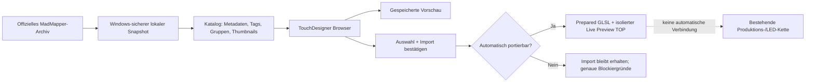

# MadMapper Material Library für TouchDesigner

Dieses Werkzeug ergänzt das bestehende PixelblazeMapper-Projekt. Es ersetzt weder den Core-Effect-Browser noch das LED-Mapping, die Show-Steuerung oder die Art-Net-Ausgabe. Der neue Bereich liegt vollständig isoliert unter `/project1/madmapper_library`.


## Was enthalten ist

- 638 reguläre Video-Materialien aus dem offiziellen `madmappersoftware/MadMapper-Materials`-Repository
- 638 gespeicherte Original-Vorschaubilder
- Gruppen für `factory` (42), `demos` (14) und `online_library` (582)
- abgeleitete Themen wie Noise, Fluid, Particles, Lines/Geometry, Audio, Glitch und Transitions
- Volltext- und fehlertolerante Suche, beispielsweise findet `particels` trotzdem Partikelmaterialien
- Kompatibilitätsanzeige: 517 Materialien sind automatisch vorbereitbar, 121 benötigen Audio, Texturen, Vertexdaten, Feedback oder eine manuelle Portierung
- bewusster Zwei-Klick-Import pro Material
- isolierte GLSL-Live-Vorschau mit Global-, Panel- und Hybrid-Koordinatenmodus
- animierte Karten-Vorschau beim Überfahren mit der Maus; einstellbare Loop-Länge von 1 bis 15 Sekunden

Laser-Materialien werden nicht in den Video-/LED-GLSL-TOP importiert. Sie besitzen einen anderen Rendervertrag. Außerdem enthält der aktuelle Upstream-Laserbaum einen unter Windows ungültigen Verzeichnisnamen. Der Synchronisierer extrahiert deshalb gezielt nur `Materials`, `Libraries` und die zugehörige Dokumentation.

## Ablauf



## Einmalige Quellen- und Katalogerzeugung

In PowerShell im Projektordner ausführen:

```powershell
cd C:\Users\jbhtz\TouchDesignerLocal\PixelblazeMapper
python -m pixelblaze_mapper.sync_madmapper_library --source-parent material_library\sources --catalog material_library\catalogs\madmapper-official-d7ff211.json
```

Erwartetes Ergebnis:

- Quelle: `material_library/sources/madmapper-materials-d7ff211281f1`
- Katalog: `material_library/catalogs/madmapper-official-d7ff211.json`
- 638 Materialien, 517 `adaptable`, 121 `unsupported`

Der Snapshot ist commitgebunden und unveränderlich. Ein vorhandener fremder Zielordner wird nicht überschrieben.

## Browser in TouchDesigner aufbauen

Im Textport oder in einem temporären Text DAT ausführen:

```python
exec(open(r'C:/Users/jbhtz/TouchDesignerLocal/PixelblazeMapper/pixelblaze_mapper/build_material_library_browser.py', encoding='utf-8').read())
exec(open(r'C:/Users/jbhtz/TouchDesignerLocal/PixelblazeMapper/pixelblaze_mapper/build_unified_material_browser.py', encoding='utf-8').read())
```

Danach den Viewer des OP Viewer Components `/project1/madmapper_library/browser_ui` öffnen. Dort funktionieren die Mausklicks direkt. `/project1/madmapper_library/ui_preview` ist die nicht-interaktive 1280×800-Screenshot-/Monitoring-Ausgabe. Der gemeinsame Browser unter `/project1/material_browser` zeigt Core-Effekte und bestätigte Importe; seine Monitoring-Ausgabe liegt unter `/project1/material_browser/ui_preview`. Ein erneuter Builder-Aufruf ist sicher und idempotent; Katalogpfad, Importpfad und Importhistorie bleiben erhalten.

## Wichtigste Bedienfälle

### UC-01 · Suchen

1. In `SEARCH` einen Namen oder mehrere Begriffe eingeben.
2. `SEARCH / APPLY` anklicken.
3. Mehrere Wörter werden als UND-Suche behandelt.
4. Kleine Tippfehler werden toleriert: `particels` liefert `Particles`, `Liquid Tail`, `Spermato` und `Starfield`.

### UC-02 · Nach Gruppe oder Kompatibilität browsen

1. `GROUP` anklicken und die gewünschte Quell- oder Themengruppe direkt aus der Auswahlliste wählen. `ALL` setzt den Filter sofort zurück.
2. `COMPAT` anklicken und `AUTO-PREPARE`, `MANUAL / BLOCKED` oder `ALL` direkt auswählen.
3. `VIEW: 4 x 2` zeigt acht große Karten. `VIEW: 8 x 4` zeigt 32 kleinere Karten pro Seite. Beide Einstellungen werden auch in `ui_preview` dargestellt.
4. Mit `PREVIOUS` und `NEXT` seitenweise wechseln.
5. `REFRESH CATALOG` liest ausschließlich die lokale Katalogdatei neu ein.

### UC-03 · Material ansehen

1. Maus über eine beliebige Stelle der Karte bewegen (Bild oder Titel). Eine transparente Kartenfläche erfasst den Mauszeiger zuverlässig; automatisch vorbereitbare Materialien zeigen dort und rechts sofort eine animierte Live-Vorschau.
2. Maus von der Karte wegbewegen. Die Karte wechselt zurück zum gespeicherten Vorschaubild.
3. Eine Bildkarte anklicken. Rechts erscheinen Name, Tags, Gruppe und Kompatibilitätsgrund.
4. `SHOW STORED PREVIEW` zeigt das offizielle lokale Thumbnail. `OPEN LIVE PREVIEW` hält die Live-Vorschau rechts geöffnet.

Die Hover-Vorschau importiert nichts und verändert keine Produktionsquelle. Materialien mit Audio-, Textur-, Feedback- oder Vertex-Anforderungen bleiben statisch; unten wird der konkrete Blockiergrund angezeigt. Es wird immer nur ein gemeinsamer Live-TOP kompiliert, damit nicht 8 oder 32 Shader gleichzeitig GPU-Zeit verbrauchen.

Wenn eine Karte statisch bleibt, zuerst die Statuszeile unten rechts lesen: `HOVER LIVE` bedeutet eine laufende Animation; `HOVER STATIC` bedeutet, dass dieses Material zusätzliche Eingänge oder eine nicht automatisch übersetzbare Shader-Struktur benötigt. Ändert sich der Materialname in der Statuszeile beim Überfahren, arbeitet der Maus-Sensor korrekt.


`AUTO-PREPARE` bedeutet: Der automatische Konverter kann einen TouchDesigner-Wrapper erzeugen. Erst `OPEN LIVE PREVIEW` führt den echten GPU-Kompiliertest aus. `MANUAL / BLOCKED` bedeutet: Das Material benötigt mindestens eine noch nicht automatisch verdrahtete Funktion, beispielsweise Audio/FFT, Bild- oder Cube-Texturen, Feedback, einen Vertex-Shader oder einen besonderen Generator. Der genaue Grund steht rechts. Thumbnail und Quellpaket bleiben trotzdem verfügbar.

### UC-04 · Material wirklich importieren

1. Materialkarte auswählen.
2. `IMPORT SELECTED` anklicken.
3. Der Button wechselt zu `CONFIRM IMPORT`.
4. Noch einmal anklicken. Erst jetzt wird das komplette Materialpaket in `material_library/imported/<material-id>/` kopiert.
5. Bei erfolgreicher automatischer Portierung entsteht zusätzlich `prepared.frag`.
6. `OPEN LIVE PREVIEW` lädt ausschließlich diesen vorbereiteten Shader in `/project1/madmapper_library/live_preview`.
7. Der Import erhält sofort die Gruppe und den Suchtag `IMPORTED` und erscheint automatisch unter `/project1/material_browser`.
8. Eine dort angeklickte vorbereitete Importkarte wird über den neuen visuellen Eingang `Imported MadMapper Material` aktiviert. Nicht automatisch portierbare Importe bleiben sichtbar, werden aber nicht als Produktionsquelle eingeschaltet.

Schlägt der GPU-Kompiliertest fehl, wird kein rot-blaues TouchDesigner-Fehlerschachbrett mehr angezeigt. Stattdessen erscheint eine lesbare Fehlerkarte; das Material wird für die aktuelle Browser-Sitzung als `MANUAL / BLOCKED` markiert und die konkrete Compilerursache wird eingeblendet.

Ein Import überschreibt keine fremden oder nachträglich veränderten Dateien. Das Manifest `material-import.json` hält Quelle, Material-ID und Datei-Hashes fest.

### UC-05 · Koordinatenmodus einstellen

Am COMP `/project1/madmapper_library` stehen diese Parameter bereit:

| Parameter | Wert | Verhalten |
|---|---|---|
| `Coordinate Mode` | `global` | ein Bild über die gesamte Textur |
| `Coordinate Mode` | `panel` | Effekt wird pro Panel wiederholt |
| `Coordinate Mode` | `hybrid` | Mischung aus globaler und lokaler UV |
| `Panel Columns` | z. B. `2` | Spaltenzahl für Panel Local |
| `Panel Rows` | z. B. `5` | Zeilenzahl für Panel Local |
| `Hybrid Mix` | `0.0–1.0` | Stärke des lokalen Anteils |
| `Hover Loop Seconds` | `1.0–15.0` | Länge der animierten Karten-Vorschau; Standard `6.0` Sekunden |

Im Bibliotheks-Browser betrifft diese Einstellung zunächst die isolierte Vorschau. Erst ein erfolgreicher Klick auf eine Importkarte im gemeinsamen `/project1/material_browser` schaltet diese Vorschau als visuellen Eingang 3. Art-Net/DMX wird dadurch nicht automatisch aktiviert.

## Getestete Sollwerte

| Testfall | Eingabe/Aktion | Erwartung | Echtes Ergebnis |
|---|---|---|---|
| Katalog | `REFRESH CATALOG` | alle regulären Materialien | 638 geladen; 80 Seiten bei 4×2 oder 20 Seiten bei 8×4 |
| Tippfehlersuche | `particels` | sinnvolle Partikeltreffer | 4 Treffer: Particles, Liquid Tail, Spermato, Starfield |
| Quellenfilter | Gruppe `factory` | nur Factory-Bestand | exakt 42 Treffer |
| Erfolgsimport | Factory `Fill`, zweimal Import | kopieren + vorbereiten | `prepared.frag`, 70.063 Shaderzeichen, 0 GLSL-Fehler |
| Relaxed-Metadaten | Online `Liquid Tail`, Import + Live Preview | Header mit `360.` und trailing commas bleibt vollständig | Zeitgenerator vorhanden, 0 GLSL-Fehler, Fluid-Bild statt Fehlerschachbrett |
| Import-Synchronisation | bestätigte Importpakete | automatisch im gemeinsamen Browser sichtbar | 25 Core + 5 vorhandene Importe; `fluid imported` findet nur `Liquid Tail` |
| Kartenansicht | `VIEW` per Mausklick | direkt zwischen 4×2 und 8×4 wechseln | 8 beziehungsweise 32 sichtbare Karten; beide `ui_preview`-TOPs korrekt |
| Hover-Vorschau | Maus über `Sdffuglycompositionexample` | Live-Shader nur lokal anzeigen und beim Verlassen Thumbnail wiederherstellen | 6,0-s-Loop kompiliert ohne Node-Fehler; inkompatible Karten fallen kontrolliert auf ihr Bild zurück |
| Import-Aktivierung | `Liquid Tail` im gemeinsamen Browser anklicken | vorbereiteten Shader als Quelle verwenden | Source/Visual-Switch Index 3, 0 GLSL-Fehler |
| Koordinaten | Global/Panel/Hybrid | unterschiedliche Frames | mittlere Deltas 0,375 / 0,249 / 0,126 |
| Sperrfall | Factory `Arcs` | keine unsichere Live-Kompilierung | blockiert wegen `.vs`, Surface-Varyings und `audioFFT` |
| Idempotenz | beide Builder zweimal | keine Nodes oder Quellverbindungen duplizieren | stabil; genau vier visuelle Eingänge |
| Gesamtsicherheit | kompletter `/project1`-Baum | keine Node-Fehler | 0 Fehler |
| Netzwerk | alle DMX Out CHOPs | deaktiviert | 4 von 4 `Active = False` |

## Lizenz und Herkunft

Das offizielle Repository steht im Root unter Apache-2.0. Einzelne Community-Materialien können zusätzliche Shadertoy-, Creative-Commons-, MIT- oder andere Hinweise enthalten. Credit- und Lizenzangaben im Materialpaket müssen deshalb beim Weitergeben erhalten bleiben. Quellen: [MadMapper-Materials](https://github.com/madmappersoftware/MadMapper-Materials), [MadMapper GLSL Materials](https://docs.madmapper.com/madmapper/6/3.-media/writing-custom-glsl-materials).
