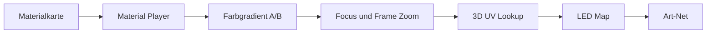

# Material Browser: Tempo, Farbe und Ausschnitt

## Bedienung

Der Material Browser besitzt unterhalb der Materialkarten eine zusätzliche
Live-Steuerleiste. Sie verändert ausschließlich die zentrale Material-Engine;
3D-LED-Map, Pixelzuordnung und Art-Net-Routing bleiben unverändert.

| Steuerelement | Bereich | Wirkung |
|---|---:|---|
| `SPEED` | 0–2 | 0 stoppt die Bewegung, 1 ist Normaltempo, 2 ist doppeltes Tempo. |
| `FOCUS X` | 0–1 | Horizontaler Fokuspunkt des Materialausschnitts. |
| `FOCUS Y` | 0–1 | Vertikaler Fokuspunkt des Materialausschnitts. |
| `FRAME ZOOM` | 0,25–4 | Größe des sichtbaren Materialausschnitts; 1 ist unverändert. |
| `STOP`, `0.5x`, `1x`, `2x` | feste Werte | Reproduzierbare Geschwindigkeitswerte. |
| `RESET VIEW` | — | Setzt Fokus auf Mitte und Zoom auf 1 zurück. |
| `NEON`, `AMBER`, `ACID`, `FIRE/ICE`, `MONO` | Gradienten | Schreibt die zwei vorhandenen zentralen Materialfarben. |

## Signalweg

Der Ausschnitt wird vor der 3D-UV-Umrechnung berechnet. Deshalb ändern Fokus
und Zoom niemals die räumliche Anordnung oder die Universe-Zuordnung der LEDs.

## Tests

- Jeder Slider-Callback wurde mit repräsentativen Werten aufgerufen.
- Alle fünf Gradient-Buttons wurden getestet.
- `RESET VIEW` wurde getestet und stellt 0,5 / 0,5 / 1,0 wieder her.
- Der volle lokale Testlauf umfasst 194 Tests und war erfolgreich.

## Rücksetzen

Falls ein Material den Gradient nicht sichtbar verwendet, bleibt die Auswahl
gespeichert, verändert aber keine LED-Zuordnung. Mit `RESET VIEW` wird nur der
Ausschnitt zurückgesetzt; Material und Farbwahl bleiben erhalten.
