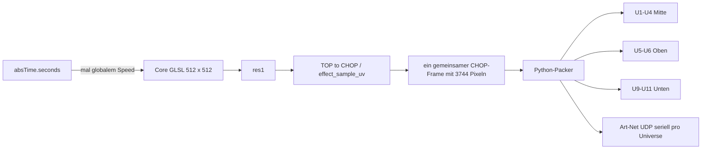
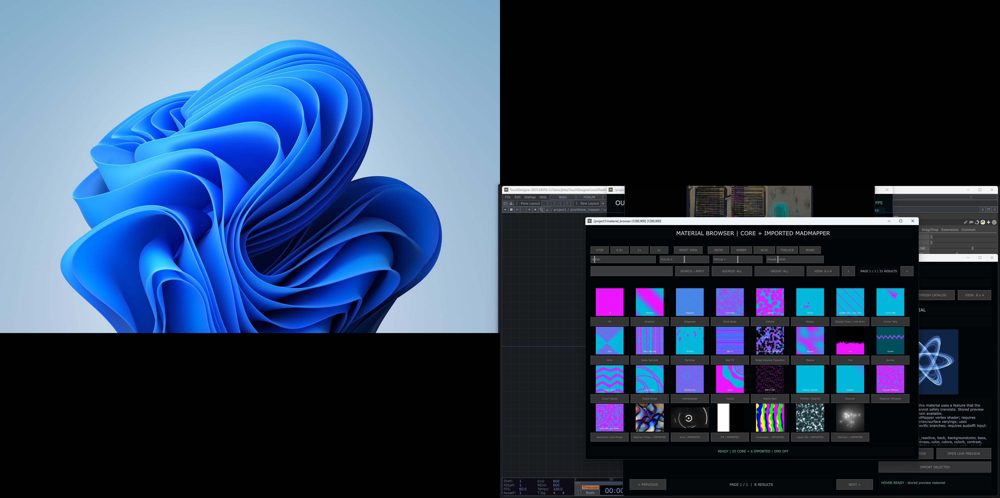
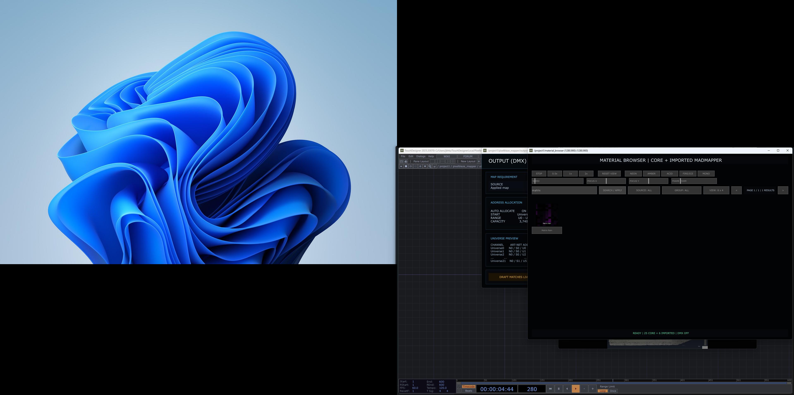
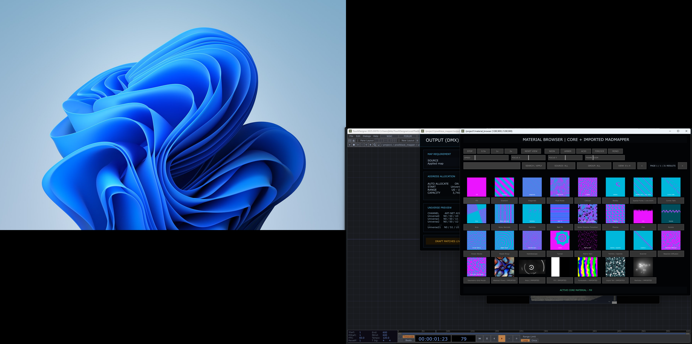
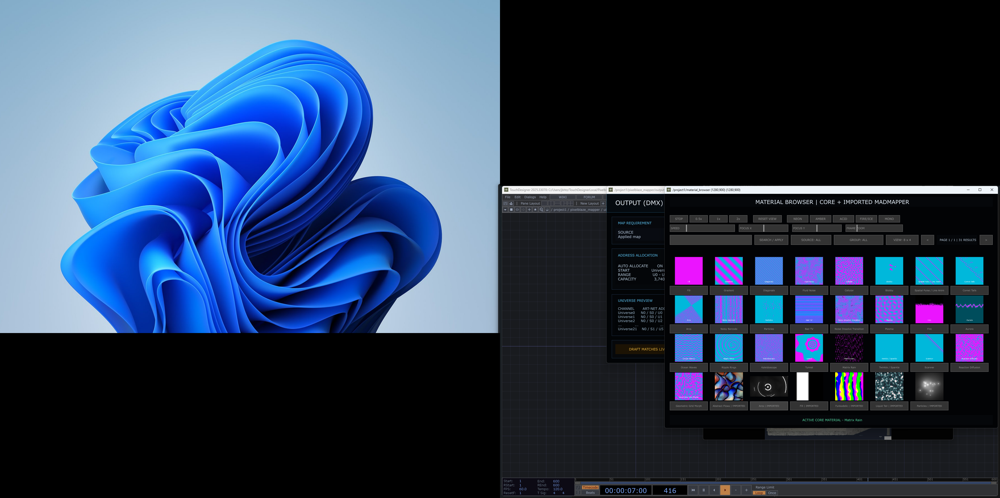
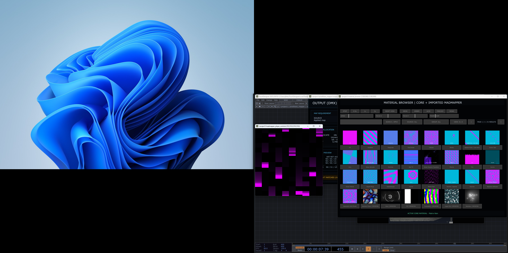

# Regression-Audit: Material Browser und Material Player

Stand der Live-Messung: 26. August 2026, aktive Datei
`PixelblazeMapper_WORKING_PHASE2_EFFECTS_CORE.68.toe`.

Dieses Dokument ist eine Zustandsanalyse der Shortcut-Dialoge **2 Material
Browser** und **4 Material Player**. Während des Audits wurden keine
TouchDesigner-Netzwerke, Hardwarezuordnungen oder `.toe`-Dateien geändert oder
gespeichert. Repräsentative Parameterwerte wurden innerhalb desselben
TouchDesigner-Python-Aufrufs gesetzt, am gebundenen Shaderparameter geprüft und
vor dem nächsten Frame wiederhergestellt.

## Kurzfazit

Die 30 geprüften Parameter- und Callback-Bindungen funktionieren technisch.
Der sichtbare Zustand ist trotzdem nicht freigabefähig:

1. Der aktive LED-Datenpfad lieferte im reproduzierbaren 120-Frame-Messfenster
   nur **24 neue Material-/Pack-Frames in 2,031 Sekunden**, also rund
   **11,8 effektive Aktualisierungen pro Sekunde**. Das erklärt das Ruckeln.
2. `Speed` ist ein einziger globaler Wert für alle Core-Materialien. Beim
   Materialwechsel wird kein materialbezogener Geschwindigkeitswert geladen.
3. Die Shaderzeit ist `absTime.seconds * Speed`. Jede Änderung von `Speed`
   erzeugt deshalb nach langer Laufzeit einen großen Phasensprung. Bei der
   Messung bedeutete bereits eine Änderung von 0,511 auf 0,500 einen Sprung von
   ungefähr 774 Shadersekunden.
4. Im Material Browser liegen doppelte Slider exakt übereinander. Der sichtbare
   `SPEED`-Slider zeigte 0,12048, während der wirksame zentrale Wert 0,511 war.
   Damit widerspricht die Anzeige dem Systemzustand.
5. Oberes, mittleres und unteres Seitenpanel erhalten denselben Quellframe.
   Die unterschiedliche *optische* Geschwindigkeit kommt nicht von drei
   Zeitquellen, sondern von stark unterschiedlichen UV-Ausdehnungen im aktuellen
   globalen Koordinatenmodus.

## Aktiver Signal- und Zeitweg



Der Packer liest einmal 3 x 3744 Werte, erstellt daraus eine gemeinsame
Pixel-Tupelkopie und packt anschließend alle Universen. Es existiert daher im
aktuellen Pfad kein eigener Timer pro Panel. Der Packer wird jedoch synchron im
`onFrameStart`-Callback erzwungen und benötigte zuletzt ungefähr 30 bis 38 ms;
zusätzlich werden Konfiguration, 3744 Tupel und alle 510-Byte-Universen in
Python neu aufgebaut. Dadurch verpasst TouchDesigner Frames, während die
absolute Projektzeit weiterläuft.

## Hardware-Unterteilung und räumliche Wirkung

| Bereich | Quellpixel | Zielstart | Controller-Universen | UV-Spanne X | UV-Spanne Y |
|---|---:|---:|---|---:|---:|
| Mitte | 0–516 | 0 | U1–U4 | 1,0000 | 0,1852 |
| Oben | 517–785 | 680 | U5–U6 | 0,6265 | 0,2099 |
| Unten | 786–1183 | 1360 | U9–U11 | 0,6583 | 0,9995 |

Im Modus `global` bewegt sich ein Effekt mit derselben Geschwindigkeit durch
den normierten Gesamtraum. Für eine vertikale Bewegung deckt das untere Panel
nahezu die fünffache Y-Strecke von Mitte/Oben ab. Eine Linie durchquert das
obere oder mittlere Panel deshalb optisch deutlich schneller, obwohl alle
Pixel denselben `uParams0.y`-Zeitwert erhalten.

Der derzeitige Modus `panel` ist außerdem kein echtes lokales Mapping der drei
unregelmäßigen Seitenflächen. Der Shader berechnet lediglich
`fract(uv * vec2(Panelcolumns, Panelrows))`, aktuell 2 x 5. Das entspricht dem
Rückwandraster, nicht den drei Seitenpanel-IDs. Für gleichmäßige lokale
Geschwindigkeit ist später eine echte lokale UV-Koordinate je Panel nötig.

## Dialog 2: Material Browser

### Sichtbare Elemente und verifizierte Wirkung

| Element | Erwartung | Ist-Prüfung |
|---|---|---|
| Suche / Apply | Filter neu anwenden | Callback vorhanden; Runtime-Katalog wird beim Laden gefüllt |
| Source / Group | Quelle bzw. Gruppe wechseln | Callback und Statuspfad vorhanden |
| View 4x2 / 8x4 | Kartenlayout wechseln | Runtime-Logik vorhanden |
| Vor / Zurück | Seite wechseln | Runtime-Logik vorhanden |
| Materialkarten und Vorschaubilder | Core-/Importmaterial aktivieren | Karten- und Viewer-Callbacks vorhanden |
| Speed Slider | zentralen Speed setzen | Callback bestanden; Anzeige aktuell nicht synchron |
| Stop / 0.5x / 1x / 2x | feste Speed-Werte | 1x-Callback live im selben Frame bestanden |
| Focus X/Y | Fokus im Shader setzen | beide Bindungen bestanden |
| Frame Zoom | Ausschnitt 0,25–4 setzen | Bindung bestanden; Playerparameter erlaubt intern bis 8 |
| Reset View | 0,5 / 0,5 / 1 wiederherstellen | Callback vorhanden |
| 5 Gradientbuttons | Color A/B gemeinsam setzen | AMBER-Callback und RGB-Werte bestanden |

### Gefundene Abweichungen

- Je zwei Instanzen von `SPEED`, `FOCUS X`, `FOCUS Y` und `FRAME ZOOM` liegen
  an denselben Koordinaten. Auch `RESET VIEW` existiert doppelt. Nur eine
  Instanz jeder Gruppe besitzt einen Callback.
- Aktueller Speed-Zustand:
  - wirksamer Playerwert: 0,511;
  - Slider `mb_control_speed`: 0,1204819;
  - überlagerter Slider `mb_control_speed1`: 0,511.
- Der Browser schreibt nur `Source` und `Material`. Er lädt weder Speed noch
  Scale, Width, Farben oder andere Presetparameter pro Material.
- Die Bedienelemente zeigen keine aktive Auswahlmarkierung für Speedpreset oder
  Gradientpreset und besitzen noch keine Inline-Hilfe.
- Die vorhandene Browsergrafik
  [unified_material_browser_8x4.png](images/unified_material_browser_8x4.png)
  dokumentiert das Kartenlayout, aber noch nicht den finalen neuen
  Steuerstreifen.

### Aktuelle Sichtprüfung

`Ctrl+Shift+2` wurde als echte Tastatureingabe an TouchDesigner gesendet und
öffnete den Viewer `/project1/material_browser`. Weil seine gespeicherte
Fensterposition teilweise oberhalb des Desktops lag, wurde ausschließlich das
Floating-Fenster für die Sichtprüfung auf den Bildschirm verschoben; der
Projektinhalt blieb unverändert.



Der Screenshot bestätigt den Steuerstreifen und zugleich die widersprüchliche
Speed-Anzeige. Die Karten, Suche und Materialsteuerung sind sichtbar; die
übereinanderliegenden COMP-Instanzen lassen sich optisch nicht voneinander
unterscheiden.

### Echte Maus-, Feld- und Restore-Prüfung

Die folgenden Aktionen wurden mit realen Windows-Mausereignissen und echten
Tastatureingaben am laufenden TouchDesigner durchgeführt. Es wurde kein
TouchDesigner-Python-Callback direkt ausgelöst.

| Aktion | Sichtbare Erwartung | Ergebnis | Restore |
|---|---|---|---|
| `Ctrl+Shift+2` | Material Browser öffnet | **PASS** – Floating Viewer `/project1/material_browser` geöffnet | Viewer am Ende per sichtbarem X geschlossen |
| `1x` anklicken | Speed auf 1 setzen | **PASS mit Einschränkung** – Button reagiert; der überlagerte Speed-Slider synchronisiert seine Anzeige nicht zuverlässig | Speed anschließend per realem Sliderklick auf ca. 0,511 zurückgesetzt |
| Suchfeld anklicken, `matrix` eingeben, `SEARCH / APPLY` anklicken | nur Matrix-Ergebnisse | **PASS** – Anzeige `PAGE 1 / 1 | 1 RESULTS`, Karte `Matrix Rain` | Suchfeld per `Ctrl+A`, Backspace und realem Apply-Klick geleert |
| `FOCUS X` von Mitte nach links ziehen | Fokuswert und Ausschnitt bewegen | **PASS mit Einschränkung** – reale Sliderbewegung akzeptiert; wegen der exakt überlagerten Slider bleibt die visuelle Instanzzuordnung uneindeutig | mit realem Drag in die Mittelposition zurückgesetzt |
| Karte `Fill` anklicken | Core-Material Fill aktiv | **PASS** – Status `ACTIVE CORE MATERIAL - Fill` sichtbar | Karte `Matrix Rain` real angeklickt; Status `ACTIVE CORE MATERIAL - Matrix Rain` sichtbar |

Belege:

- 
- 
- 

Die Mausprüfung bestätigt damit den zentralen Materialwechsel, die Suche und
das Framing. Sie bestätigt zugleich, dass die Browseranzeige wegen der
doppelten Regler keine verlässliche alleinige Quelle für den tatsächlichen
zentralen Speed-/Focuszustand ist.

### Bewertung

| Kriterium | Score | Begründung |
|---|---:|---|
| Nutzbarkeit | 5/10 | Materialwahl ist kompakt, aber doppelte Regler, unsynchroner Speed und fehlende Auswahlmarkierung verwirren. |
| Technische Umsetzung | 5/10 | Zentrale Callbacks sind klar, die Builder-Idempotenz ist im laufenden Projekt jedoch verletzt. |
| Zuverlässigkeit | 4/10 | Callbacktests bestehen, sichtbare Werte und wirksame Werte können trotzdem auseinanderlaufen. |
| Wartbarkeit | 6/10 | Python-Builder und Pure-Python-Tests sind vorhanden; Laufzeit-DATs und Builderzustand können divergieren. |
| Vollständigkeit | 5/10 | Grundbedienung vorhanden; per-Material-State, Hilfe, Status-Sync und belastbare UI-Regression fehlen. |
| Innovativität | 7/10 | Gemeinsamer Browser für Core und importierte Materialien plus Framing/Gradient ist konzeptionell stark. |

## Dialog 4: Material Player

### Echter Shortcut- und Sichttest

`Ctrl+Shift+4` funktionierte erst, nachdem real in eine freie Netzwerkfläche
geklickt worden war. Mit Fokus in einem Feld beziehungsweise einem Floating
Viewer wurde der Shortcut konsumiert oder nicht sichtbar ausgeführt. Nach dem
Fokuswechsel öffnete er korrekt `/project1/madmapper_player_controls`.



Der Shortcut öffnet jedoch nur einen 512 x 512 großen **animierten
Rohmaterial-Viewer**. In diesem Fenster sind keine der unten inventarisierten
Playerparameter, Buttons, Slider, Werte oder Hilfetexte sichtbar. Deshalb war
in Dialog 4 keine echte Parameter-Mausabnahme möglich. Das ist keine Lücke der
Mausautomation, sondern eine funktionale Abweichung des Dialogziels: Der
Shortcut heißt `MATERIAL PLAYER`, führt aber nur zur Vorschau des Base-COMP.
Die 30 Parameter-/Callback-Bindungen wurden daher ergänzend technisch und
zustandserhaltend geprüft; eine visuelle Bedienabnahme kann erst nach einem
echten Control-Panel für Dialog 4 erfolgen.

### Alle sichtbaren Parameter

| Seite | Parameter | Aktuell | Verifizierte Wirkung / Auffälligkeit |
|---|---|---:|---|
| Player | Source | materials | schaltet `visual_source_switch`; bestanden |
| Player | Material | matrix_rain | schreibt Effektindex; bestanden |
| Player | Speed | 0,511 | bindet globale Shaderzeit; Bereich im Dialog 0–1, Browser bietet 0–2 |
| Player | Scale | 4,0 | bindet Scale; Metadatenbereich nur 0–1, obwohl Presets 1–9 nutzen |
| Player | Width | 0,5 | bindet Width; bestanden |
| Player | Color A RGB | 0,91 / 0 / 1 | alle drei Shaderbindungen bestanden |
| Core Effects | Coordinate Mode | global | Shaderindex bestanden; `panel` ist nur 2x5-Fract, keine echte Seitenpanel-Lokalität |
| Core Effects | Intensity | 1,0 | bestanden |
| Core Effects | Contrast | 1,25 | bestanden |
| Core Effects | Trail | 0,55 | bestanden |
| Core Effects | Direction | 0,125 | bestanden |
| Core Effects | Rotation | 0° | bestanden |
| Core Effects | Seed | 0 | bestanden |
| Core Effects | Transition | 0,5 | bestanden |
| Core Effects | Hybrid Mix | 0,5 | bestanden |
| Core Effects | Particle Density | 1,0 | bestanden |
| Core Effects | Panel Columns / Rows | 2 / 5 | Bindung bestanden; fachlich Rückwandraster statt Seitenpanel-IDs |
| Core Effects | Color B RGBA | 0 / 0,72 / 0,86 / 1 | alle vier Bindungen bestanden |
| Material Framing | Focus X / Y | 0,5 / 0,5 | bestanden; Focus X besitzt irrtümlich Default 0,0 |
| Material Framing | Frame Zoom | 1,0 | bestanden; unclamped im Dialog, Shader clamp 0,25–8 |
| Material Framing | Gradient Preset | Neon | direkte Menüänderung ruft `apply_gradient()` nicht auf |

Der Einzeltest setzte 27 Playerparameter und drei konkrete UI-Callbacks auf
repräsentative Werte, las die jeweiligen Shader-/Switchparameter und stellte
den Ausgangswert im selben Script wieder her. Ergebnis: **30/30 Bindungen
bestanden**. Das beweist die Verdrahtung, nicht die fachliche Semantik der
Bereiche und Defaults.

### Bewertung

| Kriterium | Score | Begründung |
|---|---:|---|
| Nutzbarkeit | 2/10 | `Ctrl+Shift+4` zeigt nur das Rohmaterial; sämtliche Playerparameter bleiben im Shortcut-Dialog unsichtbar. |
| Technische Umsetzung | 6/10 | Alle geprüften Uniformbindungen funktionieren; Zeit- und Panelmodell sind fachlich zu global. |
| Zuverlässigkeit | 5/10 | 30/30 Bindungen bestehen, trotzdem verursachen Phase und Packpfad sichtbare Ruckler. |
| Wartbarkeit | 6/10 | Zentraler Shaderparameterblock ist übersichtlich; Preset-/State-Lebenszyklus fehlt. |
| Vollständigkeit | 3/10 | Parameter existieren intern, aber der als Dialog bezeichnete Shortcut bietet keine Bedienoberfläche; Presets, Hilfe und Reset fehlen zusätzlich. |
| Innovativität | 7/10 | Ein GPU-Effektplayer mit Global/Hybrid/Framing ist flexibel, die räumliche Abstraktion ist noch nicht fertig. |

## Priorisierte nächste Schritte – erst nach Freigabe

### P0: vor weiterer Live-Nutzung

1. Sender und Python-Packer aus dem blockierenden `onFrameStart`-Pfad lösen
   oder den Packer vorab/vorrangig vektorisieren. Routerplan und Zielindizes nur
   bei Konfigurationsänderung neu berechnen. Danach reale 60-Hz-Messung über
   mindestens 60 Sekunden.
2. Kontinuierliche Materialzeit verwenden: Phase akkumulieren und bei
   Speedänderung fortsetzen, statt `absTime * Speed` neu zu berechnen.
3. Speed und weitere Materialparameter pro Material speichern/laden; explizit
   zwischen `Material Default`, `Material Override` und optionalem `Global
   Master` unterscheiden.
4. Doppelte Browser-Controls entfernen, Builder gegen parallele/doppelte
   Installation absichern und die sichtbaren Werte bidirektional mit dem
   zentralen Control-Component synchronisieren.

### P1: fachliche Korrektheit

1. Parameterbereiche korrigieren: Speed 0–2, Scale mindestens 1–9,
   Focus-X-Default 0,5 und Clamping passend zum Shader.
2. `Gradient Preset` im Material Player mit einem Parameter-Callback verbinden,
   damit direkte Menüänderungen auch Color A/B setzen.
3. Echte lokale UVs und eine Panel-ID für Mitte/Oben/Unten bereitstellen. Erst
   dann kann `Panel Local` auf allen physischen Flächen gleich schnell wirken.
4. Performanceanzeige ergänzen: Render-FPS, gesendete Art-Net-Frames/s,
   verpasste Frames und letzter gemeinsamer Source-Frame.

### P2: Bedienung und Dokumentation

1. Für jeden Parameter ein Info-Icon mit Kurzbeschreibung, Wertebereich,
   Einheit, Default, aktuellem Wert und betroffenen Materialien.
2. Aktive Speed-/Gradient-/Coordinate-Auswahl sichtbar markieren.
3. Reproduzierbare Workflows mit aktuellen Screenshots ergänzen: Material mit
   eigenem Speed speichern, globalen Canvasfluss prüfen, echte Panel-Lokalität
   prüfen und Framing zurücksetzen.

## Automatisierte Tests

Offline und ohne Art-Net:

```text
python -m unittest tests.test_material_browser_player_regression -v
```

Ergebnis dieser Revision: **8/8 Tests bestanden**. Die Suite prüft vorhandene
Controls, zentrale Callbackziele, Shaderbindungen, Gradientwerte,
Netzwerkisolation und den gemeinsamen Packer-Snapshot.

## Beaufsichtigte 60-Sekunden-Hardwareabnahme

Dieser Test ist absichtlich noch nicht ausgeführt, aber so spezifiziert, dass
er ohne Interpretationsspielraum mit angeschlossener Hardware wiederholt
werden kann:

1. TouchDesigner und den Controller neu starten, 60 FPS einstellen und alle
   drei Seitenpanel sichtbar filmen. Andere Art-Net-Sender müssen beendet sein.
2. Einen Diagnoseeffekt verwenden, der in jedem gesendeten Frame dieselbe
   fortlaufende Frame-ID farblich codiert und zugleich eine senkrechte
   Markierung über Mitte, Oben und Unten bewegt. Die Frame-ID muss vor dem
   Aufteilen auf U1–U12 entstehen, nicht je Panel separat.
3. Gleichzeitig für 60 Sekunden protokollieren: `absFrame`, Cook-Frame des
   gemeinsamen Material-TOP, Pack-Frame, Art-Net-Sequenznummer und Sendezeit
   jedes Universums. Pro Ausgabeframe müssen U1–U12 dieselbe Frame-ID tragen.
4. Das Video frameweise prüfen: dieselbe Markierungsphase muss auf allen drei
   Panels erscheinen; kein Panel darf einem anderen um mehr als einen
   Ausgabeframe vor- oder nachlaufen.

Abnahmekriterien:

- 60 Sekunden ohne sichtbares Flackern, Aufblitzen oder Rücksprung;
- keine gemischten Frame-IDs innerhalb eines U1–U12-Paketsatzes;
- kein fehlendes oder rückwärts laufendes Art-Net-Sequenzpaket;
- mindestens 59 vollständige Paketsätze pro Sekunde im Mittel bei 60-FPS-Ziel;
- keine Sendepause über 50 ms und keine Panelabweichung über einen Frame.

Der bereits gemessene Zustand mit rund 11,8 neuen Packframes/s würde diese
Abnahme eindeutig nicht bestehen. Der Test darf erst nach einer freigegebenen
Performancekorrektur als Pass/Fail-Hardwaretest ausgeführt werden.

## Noch nicht durchgeführt

- 60-Sekunden-Hardwaremessung mit Framezähler je physischem Panel;
- echte Parameter-Mausabnahme in Dialog 4, weil der Shortcut aktuell keine
  sichtbaren Bedienelemente öffnet;
- Änderungen/Fixes an den oben genannten Befunden.

Bewusst nicht angeklickt wurden alle Aktionen, die externe oder schwer
rückgängig zu machende Zustände betreffen: Import eines MadMapper-Materials,
`OPEN LIVE PREVIEW`, Datei-/Projekt-Speichern, Netzwerk-/DMX-Ausgabe sowie
Controller- und Universe-Konfiguration. Diese gehören nicht zum sicheren
Analyseumfang der Dialoge 2 und 4.

Diese Punkte bleiben bewusst offen, weil der Auftrag für diese Phase Analyse
und Dokumentation vorsieht. Sie bilden die Abnahmeliste für den nächsten, mit
dem Nutzer abgestimmten Umsetzungsschritt.
