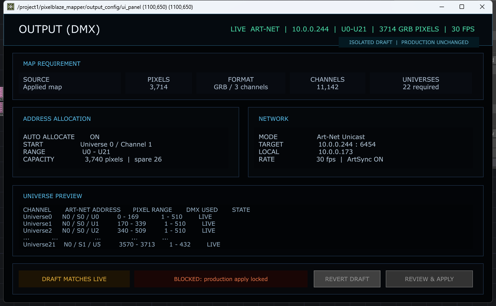

# Dialog 7 – OUTPUT CONFIG: Regressionstest und Zustandsaudit

Stand: 26. August 2026  
Geprüftes Projekt: `PixelblazeMapper_WORKING_PHASE2_EFFECTS_CORE.68.toe`  
Scope: Analyse, Dokumentation und nicht destruktive Tests. Keine `.toe`-Speicherung,
keine Routingänderung, kein Git-Commit.

## Kurzurteil

Dialog 7 ist derzeit **kein Abbild der aktiven Ausgabe**. Er ist eine ältere,
isolierte Phase-2-Mockup-Oberfläche. Fast alle sichtbaren Werte sind fest in
Textfeldern eingetragen. Die öffentlichen Parameter lassen sich zwar ändern,
aktualisieren aber weder die sichtbare Oberfläche noch `config_draft`, die
Universenvorschau oder den aktiven Router.

`Strg+Umschalt+7` wurde mit echten Windows-Tastaturereignissen aus zwei
Fokuszuständen geprüft. Der Tastendruck erreicht den Keyboard In DAT korrekt,
das Ziel existiert, das Viewer-Fenster wird erzeugt und `ui.status` wechselt
auf `OUTPUT CONFIG | /project1/pixelblaze_mapper/output_config/ui_panel`.
Ergebnis im geprüften Core-68-Stand: **PASS**.

Der Callback verwendet weiterhin die älteren Funktionsnamen `keyEvent` und
`shortcutEvent`, während das mit TouchDesigner 2025.33070 installierte aktuelle
Callback-Template `onKey(dat, keyInfo)` und `onShortcut(...)` vorgibt. Die
Laufzeit akzeptiert den älteren Vertrag nachweislich weiterhin. Das ist daher
kein aktueller Funktionsfehler, aber eine technische Fragilität für spätere
TouchDesigner-Versionen.



## 1. Testumgebung und Sicherheitsgrenze

| Punkt | Wert |
|---|---|
| TouchDesigner | 2025.33070 |
| Projekt | Core 68 |
| Timeline | 60 FPS |
| Aktiver RGB-Quellstrom | `/project1/math1`, 3 × 3.744 Samples |
| Aktiver Sender | `artnet_510_sender_callbacks`, Modus `live` |
| Aktiver Controller | `WS2812_NODE`, `10.0.0.244` |
| Lokale Schnittstelle | `10.0.0.125` |
| Sender-Rate | 60 FPS |

Vor und nach jedem Parameterfall wurden `controller_config`, `segment_config`,
Senderstatus und die vier bekannten DMX-Out-`Active`-Werte verglichen. Sie
blieben unverändert. Das Testskript ruft weder Sender noch Apply/Start/Stop auf.

## 2. Shortcut-Test mit echter Tastatur

### UC-07-01 – OUTPUT CONFIG über Shortcut öffnen

1. Ein bereits geöffnetes Output-Config-Fenster schließen.
2. TouchDesigner-Hauptfenster in den Vordergrund bringen.
3. `Strg+Umschalt+7` als echten Tastendruck senden.
4. FIFO, neu erzeugtes Viewer-Fenster und `ui.status` prüfen.
5. denselben Test mit dem Material-Browser-Fenster im Vordergrund wiederholen.

| Prüfung | Erwartet | Tatsächlich | Ergebnis |
|---|---|---|---|
| Keyboard-FIFO | `7`, Ctrl=1, Shift=1, State=1/0 | exakt so empfangen | PASS |
| Ziel | `/project1/pixelblaze_mapper/output_config/ui_panel` vorhanden | vorhanden, keine Node-Fehler | PASS |
| Callback | Ereignis wird verarbeitet | älteres `keyEvent` wird von TD 2025 ausgeführt | PASS, Legacy |
| Hauptfenster-Fokus | Dialog wird geöffnet/fokussiert | neues Output-Config-Fenster + korrekter Status | PASS |
| Material-Browser-Fokus | Dialog wird geöffnet/fokussiert | neues Output-Config-Fenster + korrekter Status | PASS |

Ein negativer Fokusfall wurde in diesen beiden Zuständen nicht reproduziert.
Nicht geprüft ist ein aktiv editierter Texteingabecursor; ein Textfeld darf den
Shortcut laut bestehender Hilfe bewusst abfangen. Der Legacy-Callback sollte
später kontrolliert migriert werden, darf aber nicht als Ursache eines aktuell
nicht funktionierenden `Strg+Umschalt+7` bezeichnet werden.

## 3. Sichtbare Werte gegen den aktiven Systemstand

| Sichtbarer Wert in OUTPUT CONFIG | Anzeige | Aktiver Systemwert | Bewertung |
|---|---:|---:|---|
| Pixel | 3.714 | 3.744 Samples in `/project1/math1` | FAIL, veraltet |
| Kanäle | 11.142 | 11.232 RGB-Samples | FAIL, veraltet |
| globale Farbreihenfolge | GRB | WS2812=GRB, APA102=RGB | FAIL, zu stark vereinfacht |
| Universe-Bereich | U0–U21 / 22 | aktueller Router: WS 11 Routen, APA 10 Routen; unterschiedliche Zielgeräte | FAIL, falsches Modell |
| lokales Interface | 10.0.0.173 | 10.0.0.125 | FAIL |
| Rate | 30 FPS | 60 FPS | FAIL |
| ArtSync | ON | beide Controllerzeilen `0` | FAIL |
| Target | 10.0.0.244 | aktiver WS-Controller 10.0.0.244 | PASS, aber nur ein Ziel dargestellt |
| UDP-Port | 6454 | 6454 | PASS |
| `DRAFT MATCHES LIVE` | behauptet Übereinstimmung | Live-/Draft-Tabelle ist historische Baseline | FAIL |
| Produktion unverändert | isolierter Dialog schreibt nicht in Router | bestätigt | PASS |

Zusätzlicher Systembefund: `controller_config` meldet den WS-Controller mit
`enabled=1`, und der Senderstatus ist live. `controller_summary` zeigt dagegen
noch `enabled=0 / SAFE DISABLED`. Auch diese Statusanzeige ist nicht live
gebunden und darf nicht als Betriebsbeleg verwendet werden.

## 4. Prüfung aller öffentlichen Parameter

Das automatische Live-Audit ändert jeden Wert einzeln, liest Parameter,
sichtbaren Text, Draft-Tabelle und Routerzustand und stellt den Ausgangswert im
`finally`-Block wieder her.

### Eingabeparameter

| Parameter | Testwert | Parameter übernimmt Wert | sichtbare Änderung | Draft-/Allokationsänderung | Ergebnis |
|---|---:|---:|---:|---:|---|
| Enabled | Off | ja | nein | nein | FAIL |
| Pixelcount | 3715 | ja | nein | nein | FAIL |
| Channelorder | RGB | ja | nein | nein | FAIL |
| Autoallocate | Off | ja | nein | nein | FAIL |
| Startuniverse | 1 | ja | nein | nein | FAIL |
| Startchannel | 2 | ja | nein | nein | FAIL |
| Protocol | Broadcast | ja | nein | nein | FAIL |
| Targetaddress | 10.0.0.245 | ja | nein | nein | FAIL |
| Localaddress | 10.0.0.125 | ja | nein | nein | FAIL |
| Port | 6455 | ja | nein | nein | FAIL |
| Rate | 60 | ja | nein | nein | FAIL |
| Priority | 101 | ja | nicht sichtbar | nein | FAIL |
| Artsync | Off | ja | nein | nein | FAIL |

`Pixelformat` besitzt nur den Menüwert `rgb`; ein sinnvoller Alternativwert ist
nicht vorhanden. Auch dieser Parameter ist auf der sichtbaren Oberfläche kein
Eingabefeld.

### Abgeleitete Werte und Statuswerte

`Universesrequired`, `Lastuniversepixels`, `Draftstate`, `Validationstate` und
`Allocatorstatus` sind uneingeschränkt editierbar (`readOnly=False`). Das ist
für berechnete beziehungsweise systemeigene Werte falsch: Ein Benutzer oder
Script kann dadurch einen Zustand anzeigen, der nicht berechnet wurde.

### Pulse und Buttons

| Bedienweg | Erwartet | Tatsächlich | Ergebnis |
|---|---|---|---|
| öffentlicher Pulse `Revertdraft` | Draft auf Live zurücksetzen | keine Wirkung | FAIL |
| lokaler Callback `callbacks.revert_draft()` | Status zurücksetzen | funktioniert | PASS |
| echter Mausklick auf sichtbaren `REVERT DRAFT` | Callback auslösen | keine Wirkung | FAIL |
| `REVIEW & APPLY` | deaktiviert | deaktiviert | PASS |

Im Panel liegen acht sichtbare Button-COMPs auf denselben Koordinaten:

- viermal `REVERT DRAFT`;
- viermal `REVIEW & APPLY`.

Der einzige Panel-Execute-DAT überwacht nur
`ui_panel/btn_revert_draft3`. Die überlappenden Altinstanzen können den echten
Mausklick abfangen. Der Builder ist damit in der laufenden Datei nicht
idempotent.

## 5. Dokumentierte Anwendungsfälle

### UC-07-02 – Live-Ausgabe nur lesen

1. Dialog mit `Strg+Umschalt+7` öffnen.
2. Pixelzahl, lokale Schnittstelle, Rate und Senderzustand mit dem Router
   vergleichen.
3. Bei Abweichung darf **nicht** `DRAFT MATCHES LIVE` angezeigt werden.

Erwartung: alle sichtbaren Werte stammen aus demselben atomaren Live-Snapshot.
Aktuell: FAIL, da die Anzeige statisch ist.

### UC-07-03 – Einen Draftwert ändern

1. Ausgangswert und Routerzustand erfassen.
2. genau ein Feld, beispielsweise `Rate`, von 60 auf 40 ändern;
3. Draftstatus muss `MODIFIED` werden;
4. abgeleitete Werte neu berechnen;
5. Router und Hardware dürfen bis Apply unverändert bleiben;
6. Revert stellt den Livewert wieder her.

Aktuell: Das sichtbare Panel bietet kein Eingabefeld. Eine Änderung am Custom
Parameter bleibt ohne UI-/Draftwirkung. FAIL.

### UC-07-04 – Ungültigen Wert blockieren

1. ungültige IP, Port 0, Rate 0 oder ungültigen Startkanal setzen;
2. Feldbezogene Fehlermeldung anzeigen;
3. Apply deaktivieren;
4. Live-Router unverändert lassen.

Aktuell: Die Owner-Parameter haben keine Dialogvalidierung und die sichtbaren
Werte ändern sich nicht. FAIL.

### UC-07-05 – Revert per echter Maus

1. gültigen Draftwert ändern;
2. `REVERT DRAFT` mit der Maus anklicken;
3. Parameter, Draft-Tabelle und sichtbare Werte müssen wieder Live entsprechen.

Aktuell: echter Klick löst wegen der überlappenden Button-/Handlerstruktur keine
Aktion aus. FAIL.

## 6. Automatischer Test

Datei: `tools/td_audit_output_config_dialog.py`

Ausführung in einem TouchDesigner Textport:

```python
exec(open(
    r'C:/Users/jbhtz/TouchDesignerLocal/PixelblazeMapper/'
    r'tools/td_audit_output_config_dialog.py',
    encoding='utf-8',
).read())
print(result)
```

Der Report enthält für jedes Feld `before`, `requested`, `after`,
`visible_ui_changed`, `draft_table_changed` und `router_unchanged`. Eine
abschließende Safety-Assertion bricht ab, falls Controller-, Segment-, Sender-
oder DMX-Aktivzustand verändert wurde.

## 7. Screenshot-Ziele für die spätere Abnahme

Nach Freigabe der Reparatur sind mindestens diese Bilder neu zu erstellen:

1. `07-01-output-config-live.png`: Dialog direkt nach Shortcut, alle Livewerte;
2. `07-02-output-config-draft-modified.png`: genau ein Feld geändert,
   `MODIFIED` sichtbar;
3. `07-03-output-config-invalid-rate.png`: Rate 0 mit feldbezogener Sperre;
4. `07-04-output-config-reverted.png`: nach echtem Revert-Mausklick;
5. `07-05-output-config-router-unchanged.png`: paralleler Routerstatus vor/nach
   Draftänderung;
6. `07-06-output-config-help.png`: Schnellhilfe für ein Eingabefeld und einen
   Statuswert.

## 8. Bewusst nicht ausgeführte Tests

| Test | Grund | Voraussetzung für spätere Ausführung |
|---|---|---|
| `REVIEW & APPLY` bis zur Hardware | Schaltfläche deaktiviert; Dialog besitzt keinen freigegebenen Transaktionsweg | Produktentscheidung und Rollback-Vertrag |
| Universe-/Port-Umschaltung am realen Controller | Dialog schreibt absichtlich nicht in den Router | beaufsichtigter Hardware-Testplan nach Reparatur |
| ungültiger Wert über sichtbares Eingabefeld | sichtbare Eingabefelder existieren nicht | funktionale Widgets und Validierung |
| Shortcut bei aktivem Textcursor | im Output-Dialog kein Textfeld; fremdes Suchfeld wurde nicht editiert | eigener Fokus-/Eingabematrix-Test |
| Speichern und Projekt-Neustart | Analyseauftrag verbietet `.toe`-Speicherung | freigegebener Snapshot nach Implementierung |

Damit sind Hardwarewirkung und Persistenz **nicht** als bestanden markiert.
Geprüft und bestanden ist nur die Sicherheitsinvariante: Der Analyse- und
Parameter-Audit veränderte Router, Sender und DMX-Active-Werte nicht.

## 9. Offene Punkte vor Implementierung

1. Festlegen, ob Dialog 7 den Mehrcontroller-Router vollständig ersetzt oder
   nur als read-only Zusammenfassung von Dialog 6 dient.
2. Eine eindeutige Quelle für Pixelzahl festlegen: momentan existieren 3.714,
   3.740 und 3.744 in Code beziehungsweise Dokumentation.
3. Universe-Darstellung für mehrere Zielgeräte definieren; eine globale
   U0–U21-Liste ist für die aktuelle Topologie unzureichend.
4. Abgeleitete Werte read-only machen und alle sichtbaren Texte an echte
   Parameter/DATs binden.
5. Shortcut-Callback auf den TouchDesigner-2025-Vertrag umstellen.
6. Altbuttons bereinigen und Builder-Idempotenz mit Wiederholungstest absichern.
7. Erst danach echte Apply-/Hardwaretests mit beaufsichtigter Ausgabe planen.

## 10. Einheitliche Dialogbewertung

Skala: 0 = nicht vorhanden/unbrauchbar, 10 = vollständig und belastbar.

| Kriterium | Score | Begründung |
|---|---:|---|
| Nutzbarkeit | 3/10 | Shortcut funktioniert in zwei Fokuszuständen, aber sichtbare Eingabefelder fehlen und Revert reagiert im geprüften Viewerzustand nicht auf echten Mausklick. |
| Technische Umsetzung | 3/10 | Die Isolation schützt die Produktion, aber Anzeige, Parameter und Draft sind nicht verbunden; veralteter Callback-Vertrag. |
| Zuverlässigkeit | 2/10 | Der Dialog behauptet `MATCHES LIVE`, obwohl mehrere Kernwerte vom aktiven System abweichen. |
| Wartbarkeit | 3/10 | Builder ist nicht idempotent, Werte sind mehrfach hart codiert und sieben überlappende Altbuttons bleiben bestehen. |
| Vollständigkeit | 2/10 | Mehrcontroller-Topologie, echte Validierung, Statusbindung, Eingabewidgets, Apply-Transaktion und Schnellhilfe fehlen. |
| Innovativität | 4/10 | Live/Draft-Trennung und Universenvorschau sind als Konzept sinnvoll, derzeit jedoch nur als statisches Mockup umgesetzt. |
| **Gesamt** | **17/60** | Dialog 7 ist eine sicher erreichbare Designstudie, aber noch kein produktionsfähiger Konfigurationsdialog. |

## 11. Konkrete Verbesserungen und Priorität

### P0 – vor jedem weiteren Bedien-/Hardwaretest

1. Produktentscheidung treffen: Dialog 7 als vollständiger Output-Editor oder als
   read-only Zusammenfassung des Art-Net-Routers. Zwei parallele Editoren für
   dieselben Werte würden neue Inkonsistenzen erzeugen.
2. eine kanonische Livequelle definieren und 3.714/3.740/3.744 bereinigen;
3. überlappende Altbuttons entfernen und einen Wiederholungs-Build-Test ergänzen;
4. den funktionierenden Legacy-Shortcut-Vertrag dokumentieren und eine spätere
   Migration auf `onKey`/`onShortcut` nur zusammen mit echten Fokusregressionen
   durchführen.

### P1 – funktionaler Dialogvertrag

1. echte Widgets für alle freigegebenen Eingaben erstellen;
2. sichtbare Texte und Tabellen ausschließlich aus einem atomaren Live-/Draft-
   Zustandsmodell rendern;
3. abgeleitete Parameter read-only setzen;
4. jede Eingabe einzeln validieren und `MATCHES LIVE`, `MODIFIED` oder `BLOCKED`
   ausschließlich berechnen;
5. Revert-Pulse, echter Button und öffentlicher API-Weg an dieselbe Funktion
   binden.

### P2 – Mehrcontroller- und Hilfeebene

1. Zielgerät, Port/Strang, Hardware-Universe und Art-Net-Wire-Adresse getrennt
   anzeigen;
2. WS2812 und APA102 nicht zu einer globalen Farbreihenfolge zusammenfassen;
3. neben jedem Feld und Status ein `i`-Icon mit Kurzbeschreibung, Wertebereich,
   Herkunft und Auswirkung ergänzen;
4. konfliktfreie Übergabe zwischen Dialog 6 und Dialog 7 dokumentieren.

### P3 – Abnahme und dauerhafte Regression

1. jeden Eingabefall mit echtem Fokus, Mausklick beziehungsweise Tastaturevent
   und anschließendem Systemvergleich testen;
2. die sechs definierten Screenshots automatisch erfassen;
3. ungültige Werte, Revert, Build-Wiederholung und Projekt-Neustart in die Suite
   aufnehmen;
4. beaufsichtigte Hardwaretests erst nach Freigabe von P0–P2 ausführen.
