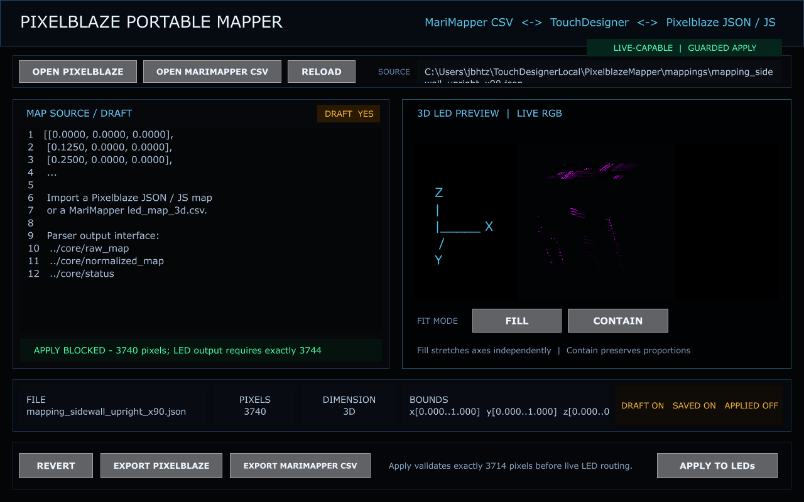
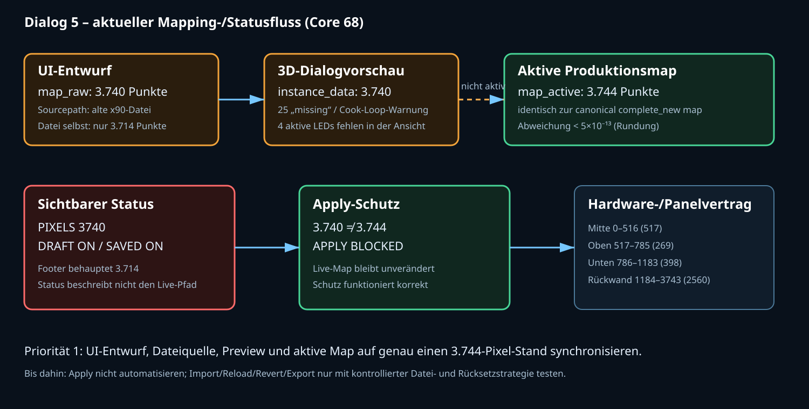
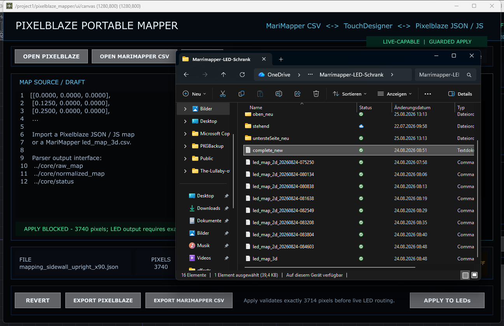
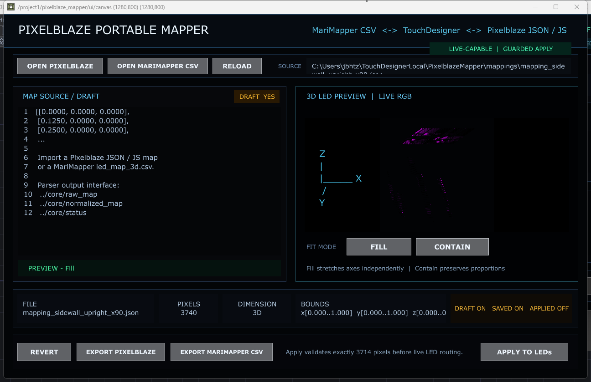
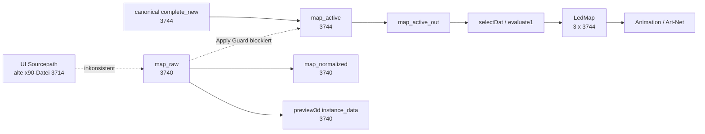

# Dialog 5 – Pixel Mapper: Regression, Datenabgleich und Bewertung

Stand: 2026-08-26  
Projekt: `PixelblazeMapper_WORKING_PHASE2_EFFECTS_CORE.68.toe`  
Dialogziel: `/project1/pixelblaze_mapper/ui/canvas`  
Shortcut: `Ctrl+Shift+5`

## Ergebnis in einem Satz

Der aktive Produktionspfad arbeitet korrekt mit **3.744 LEDs**, der Pixel-Mapper
zeigt und rendert jedoch einen **separaten, veralteten 3.740-Pixel-Entwurf** mit
einer nicht dazu passenden 3.714-Pixel-Quelldatei. Der Apply-Guard verhindert
dadurch zuverlässig eine versehentliche Übernahme, der sichtbare Dialog ist aber
aktuell **keine verlässliche Zustandsanzeige der laufenden Anlage**.

## 1. Prüfbereich und Sicherheitsgrenze

Geprüft wurden:

- alle neun sichtbaren Schaltflächen und ihre TouchDesigner-Callback-Kette;
- alle sichtbaren Status- und Wertefelder;
- `map_raw`, `map_normalized`, `map_active`, `map_active_out` und der aktive
  Signalweg bis `LedMap`, `null4` und `null5`;
- die kanonische 3D-Datei, die räumliche Side-Panel-Lookup-Datei und die
  Panelgrenzen;
- Import, Parser, Fill/Contain, Pixelblaze- und MariMapper-Roundtrip in der
  dateibasierten Testsuite;
- Fehler, Warnungen und die Sicherheit des Apply-Guards.

Nicht unbeaufsichtigt ausgelöst wurden Aktionen, die eine Datei öffnen,
überschreiben, den Entwurf verwerfen oder eine 3.744-Pixel-Map live schalten
könnten. Dafür enthält Abschnitt 8 einen kontrollierten Hardware-/UI-Testplan.
Es wurde keine `.toe`-Datei gespeichert und keine aktive Map verändert.

### Tatsächlicher Tastatur-/Maustest

- `Ctrl+Shift+5`: **bestanden**; öffnete den Viewer
  `/project1/pixelblaze_mapper/ui/canvas`.
- `FILL` mit echter Maus: **bestanden**; `Fitmode` und Preview wechselten von
  `contain` auf `fill`, der Hash von `map_normalized` änderte sich, während der
  Raw-Hash `6511aa…578` und die aktive 3.744-Pixel-Map unverändert blieben.
- `CONTAIN` mit echter Maus: der Rückklick löste trotz korrekter Fenster- und
  Buttonkoordinate keinen Callback aus; **offener reproduzierbarer UI-Befund**.
  Der Zustand wurde danach über denselben Controllerpfad kontrolliert auf
  `contain` zurückgesetzt. Raw- und Normalized-Hash, Status sowie aktive
  Pixelzahl entsprechen wieder exakt der Ausgangsbasis.
- Die vorhandene Explorer-Ansicht wurde für den Test nur temporär minimiert und
  danach wiederhergestellt.

## 2. Sichtbare Bedienelemente

| Element | Sichtbarer Text/Wert | Technische Wirkung | Risiko | Befund |
|---|---|---|---|---|
| `OPEN PIXELBLAZE` | Datei öffnen | JSON/MAP/TXT/JS importieren; Generator optional mit 3.744 materialisieren | Entwurf wird ersetzt | Callback vorhanden und aktiv; Dateidialog nur kontrolliert testen |
| `OPEN MARIMAPPER CSV` | Datei öffnen | CSV importieren; Lücken werden indextreu als Nullkoordinate erhalten | Entwurf wird ersetzt | Callback vorhanden und aktiv |
| `RELOAD` | Quelle neu laden | `Sourcepath` erneut einlesen | aktueller Entwurf wird ersetzt | Besonders kritisch, weil `Sourcepath` nicht zum aktuellen Entwurf passt |
| `FILL` | Achsen einzeln 0…1 | schreibt nur `map_normalized` und Preview-Fitmode | reversibel | Callback vorhanden; Rohkoordinaten bleiben laut Unit-Test unverändert |
| `CONTAIN` | Proportionen erhalten | gemeinsamer Maßstab, Zentrierung; Preview-Fitmode | reversibel | Callback vorhanden; aktuell ausgewählter Modus `contain` |
| `REVERT` | aktive Map wiederherstellen | kopiert `map_active` nach Entwurf/Preview | Entwurf geht verloren | Nicht unbeaufsichtigt klicken |
| `EXPORT PIXELBLAZE` | JSON exportieren | schreibt reines Koordinatenarray des Entwurfs | Dateischreibzugriff | Roundtrip mit 3.744 Testpunkten bestanden |
| `EXPORT MARIMAPPER CSV` | CSV exportieren | schreibt `index,x,y,z` und Metadaten | Dateischreibzugriff | Roundtrip mit 3.744 Testpunkten bestanden |
| `APPLY TO LEDs` | Entwurf live schalten | strikter Count-Guard, danach `map_active` und `selectDat` | Live-Ausgabe | Aktuell korrekt blockiert: 3.740 ≠ 3.744 |

Alle neun `Panel Execute DAT`-Handler sind vorhanden, aktiv und auf das jeweils
sichtbare Button-Panel gebunden. Die Buttons sind jedoch ausnahmslos sichtbar
und enabled; selbst `APPLY TO LEDs` wird nur nach dem Klick im Controller
blockiert. Für eine sichere Bedienung sollte der Button bereits optisch und
interaktiv deaktiviert sein, solange die Vorbedingungen nicht erfüllt sind.

## 3. Sichtbare Werte gegen den realen Stand

| Anzeige im Dialog | Angezeigt | Tatsächlicher Stand | Bewertung |
|---|---:|---:|---|
| Pixel | 3.740 | aktive Map/LED-Kette: 3.744 | beschreibt den Entwurf, nicht Live; missverständlich |
| Dimension | 3D | aktive und Entwurfsmap: 3D | korrekt |
| Bounds | `x/y 0…1`, `z 0…0.684` | nur Entwurfsmap | technisch plausibel, aber nicht als „Draft“ gekennzeichnet |
| Datei | `mapping_sidewall_upright_x90.json` | aktive Map entspricht `mapping_complete_new_0_1183_full_2026-08-24.json` | falsch für Live |
| Quelldatei-Länge | nicht sichtbar | `mapping_sidewall_upright_x90.json`: 3.714 | Quelle passt nicht einmal zum 3.740-Pixel-Entwurf |
| Draft | ON | 3.740-Pixel-Entwurf vorhanden | korrekt |
| Saved | ON | keine nachweisbare Übereinstimmung Entwurf ↔ Sourcepath | nicht belastbar |
| Applied | OFF | Entwurf nicht aktiv | korrekt |
| Apply-Status | blockiert 3.740 ≠ 3.744 | Guard blockiert | korrekt und sicher |
| Footer | „validates exactly 3714“ | Controller erwartet 3.744 | veraltet/falsch |
| Preview-Ziel | `../preview3d/out1` | sichtbarer gerenderter Ausgang ist `preview_out`; `out1` ist der COMP-Ausgang | technisch indirekt, für Nutzer unklar |

### Entscheidender Abgleich

- `map_active`: 3.744 Datenzeilen, Indizes 0–3743.
- `map_active_out`, `selectDat`, `evaluate1`: ebenfalls 3.744 Datenzeilen.
- `LedMap`, `null4`, `null5`: je drei Kanäle und 3.744 Samples.
- Live-`map_active` stimmt mit der kanonischen Datei bis auf reine
  Dezimalrundung überein: 0 Abweichungen über `1e-10`, Maximalfehler
  `< 5e-13`.
- `map_raw` und `map_normalized`: nur 3.740 Datenzeilen.
- `preview3d/instance_data`: nur 3.740 Instanzen.
- `preview3d` meldet `25 missing`; zusätzlich besteht eine
  **Cook-dependency-loop-Warnung** auf `instance_data`.
- Die letzten aktiven Indizes 3740–3743 fehlen vollständig im Dialog-Preview.
- Die 25 alten Draft-`missing`-Indizes stimmen nicht mit der kanonischen
  Qualitätsinformation überein: die aktuelle Spatial-Map enthält 1.160
  gemessene und 24 geschätzte Side-Positionen. Auch die Qualitätsanzeige ist
  damit nicht auf dem aktiven Datenstand.

## 4. Panel- und 3D-Vertrag

Die aktuelle kanonische Map bildet alle 3.744 Indizes lückenlos ab:

| Bereich | globale Indizes | Anzahl | räumliche Daten |
|---|---:|---:|---|
| Seitenpanel Mitte | 0–516 | 517 | 3D + physisches Lattice |
| Seitenpanel Oben | 517–785 | 269 | 3D + physisches Lattice |
| Seitenpanel Unten | 786–1183 | 398 | 3D + physisches Lattice |
| Rückwand, 10 × 16×16 | 1184–3743 | 2.560 | 3D-Raumkoordinaten |
| Gesamt | 0–3743 | 3.744 | vollständig |

`side_spatial_lookup_complete_new_2026-08-24.json` enthält jeden Side-Index
0–1183 genau einmal und bestätigt `wire_order_changed: false`. Damit sind
physische Reihenfolge, räumliche Position und logisches Lattice getrennt
modelliert – eine starke und richtige Grundlage. Der Dialog zeigt diese
Panelgrenzen, Datenqualität (`measured`/`estimated`) und Wire-Reihenfolge jedoch
nicht an.

## 5. Signalweg

## 6. Automatisierte, nicht destruktive Tests

Neue dialogspezifische Suite:

`tests/test_pixel_mapper_dialog_regression.py`

Sie prüft:

1. gemeinsamen 3.744-Pixel-Vertrag von Controller, kanonischer Map und Report;
2. lückenlose Panelgrenzen 517/269/398/2.560;
3. alle Side-Indizes 0–1183 und unveränderte Wire-Reihenfolge;
4. endliche, durchgehend dreidimensionale Koordinaten;
5. verlustfreien Pixelblaze-JSON-Roundtrip;
6. verlustfreien MariMapper-CSV-Roundtrip.

Ergebnis: **6/6 bestanden**. Zusammen mit den bereits relevanten Parser-,
Spatial-, Rescan- und Dialog-Contract-Tests: **35/35 bestanden**.

Wichtig: Diese Tests beweisen Parser, Artefakte und Guard-Vertrag. Sie ersetzen
nicht den Live-UI- und Hardwaretest, weil die 1.280×800-Oberfläche eingebettet in
der `.toe` liegt und derzeit kein reproduzierbarer UI-Builder im Repository
gefunden wurde.

## 7. Konkrete Fehler und Lücken

### Blocker

1. **Zwei Wahrheiten:** Entwurf/Preview 3.740, Live 3.744.
2. **Sourcepath ohne Datenidentität:** angezeigte Datei hat 3.714 Punkte und ist
   weder Entwurf noch aktive Map.
3. **Preview unvollständig:** Indizes 3740–3743 fehlen.
4. **Cook dependency loop** in `preview3d/instance_data`.
5. **Veralteter Footer** nennt 3.714 statt 3.744.
6. **Keine reproduzierbare Dialog-Builderdatei** für die sichtbare Oberfläche;
   die Implementierungszuordnung in `dialog_contracts.py` zeigt auf
   `build_spatial_lookup_td.py`, das nicht diesen Dialog baut.

### Hohe Priorität

- Draft/Live/Datei jeweils getrennt mit Pixelzahl, Hash und Zeitstempel zeigen.
- „SAVED“ nur anzeigen, wenn der Entwurf nachweislich mit einem Artefakt
  übereinstimmt.
- `APPLY TO LEDs` deaktivieren, solange Parser, Count, Dimension, Hash/Dirty und
  aktiver Ausgang nicht vollständig validiert sind.
- `Preservecoordinates` ist ein hochwirksamer Apply-Parameter, aber im Dialog
  unsichtbar. Er muss sichtbar, erklärt und vor Apply bestätigt werden.
- Panelgrenzen und Datenqualität fehlen vollständig.
- Die „Map Source / Draft“-Fläche ist nur ein statischer Mockup-Text, kein
  editierbares Feld. Die Überschrift erweckt einen stärkeren Editor-Anspruch als
  realisiert.

### Mittlere Priorität

- Quelle ist in der 1.280-Pixel-Ansicht abgeschnitten; Tooltip/Kopierfunktion
  fehlt.
- Keine Indizsuche oder LED-Hervorhebung trotz Hinweis „Index Highlight“.
- Keine Vorher-/Nachher-Diffansicht vor Apply.
- Keine Warnung, dass Reload/Revert den Entwurf ersetzt.
- Keine Exportvorschau mit Zielpfad, Count, Hash und Überschreibschutz.
- Keine Info-Icons oder kontextsensitive Schnellhilfe.

## 8. Kontrollierter echter UI-/Hardwaretest

Die folgende Reihenfolge ist rücksetzbar und verhindert unbeabsichtigte
Live-Änderungen:

| ID | Aktion mit echter Maus/Tastatur | Erwartung | Rücksetzung/Guard |
|---|---|---|---|
| PM-UI-01 | `Ctrl+Shift+5` | Pixel-Mapper öffnet/fokussiert | **bestanden** |
| PM-UI-02 | `FILL` klicken | Fitmode `fill`; Raw-Hash unverändert; Preview ändert Projektion | **bestanden** |
| PM-UI-03 | `CONTAIN` klicken | Fitmode `contain`; Proportionen erhalten | **Maus-Callback offen**; Baseline gezielt wiederhergestellt |
| PM-UI-04 | `OPEN PIXELBLAZE`, dann Abbrechen | Dialog erscheint; Zustand unverändert | `Esc` im Dateidialog |
| PM-UI-05 | `OPEN MARIMAPPER CSV`, dann Abbrechen | Dialog erscheint; Zustand unverändert | `Esc` im Dateidialog |
| PM-UI-06 | temporäre 3.744-Fixture importieren | Draft/Pixel/Bounds/Preview aktualisieren, Live unverändert | `REVERT`, nur nach Hash-Sicherung |
| PM-UI-07 | Export in neuem Temp-Verzeichnis | Datei, Count und Roundtrip stimmen | Temp-Datei anschließend archivieren/löschen |
| PM-UI-08 | absichtlich falsche Count-Fixture + Apply | Guard blockiert, aktiver Hash bleibt identisch | kein Hardwareeffekt |
| PM-HW-01 | gültige 3.744-Fixture + Apply | **nur beaufsichtigt**: Live-Hash wechselt atomar, alle Panels bleiben lückenlos | vorher Projektkopie und aktive Map sichern |

`RELOAD`, `REVERT` und ein gültiges `APPLY` dürfen nicht als allgemeine
CI-Mausklicks laufen. Sie brauchen eine vorbereitete Kopie, Hashvergleich und
bei Apply eine beaufsichtigte Hardware-Sitzung.

## 9. Empfohlener Bedienworkflow

1. Aktive Map als „LIVE 3744“, Dateiname und Hash sichtbar bestätigen.
2. Neue Datei importieren; sie erscheint ausschließlich als „DRAFT“.
3. Count, Dimension, Bounds, Missing/Estimated, Panelgrenzen und Diff prüfen.
4. Fill/Contain nur als Preview-Transformation verwenden.
5. Pixelindex-Suche stichprobenartig an Panelanfang/-ende durchführen.
6. Export optional erzeugen und per Roundtrip validieren.
7. Vor Apply eine Zusammenfassung mit aktivem und neuem Hash anzeigen.
8. Apply nur bei 3.744, vollständig gültiger Topologie und expliziter
   Bestätigung freigeben.
9. Nach Apply alle vier Panelbereiche per Chase/Indexmarkierung validieren.

## 10. Schnellhilfe-/Info-Konzept

Für jedes Bedienelement sollte ein kleines `i` verfügbar sein. Minimalinhalt:

- **Open:** erlaubte Formate, ob Raw-Koordinaten erhalten bleiben;
- **Fill/Contain:** visuelles Beispiel und Hinweis „ändert keine Wire-Reihenfolge“;
- **Reload/Revert:** welche Daten überschrieben werden;
- **Export:** genaues Format, Quelle (Raw/Draft) und Ziel;
- **Apply:** Prüfliste, aktive Pixelzahl, Preserve-/Normalize-Modus, Hardwarewirkung;
- **Pixel/Dimension/Bounds:** klarer Scope-Chip `DRAFT` oder `LIVE`;
- **Panelbereiche:** globale Start-/Endindizes und Count;
- **Missing/Estimated:** Bedeutung und Auswirkung auf Preview/Hardware.

## 11. Bewertung

| Kriterium | Punkte / 10 | Begründung |
|---|---:|---|
| Nutzbarkeit | 5,0 | klare Grundstruktur und verständliche Hauptaktionen; Zustands-Scope und wichtige Apply-Optionen fehlen |
| Technische Umsetzung | 6,0 | robuster Parser, Roundtrip und atomarer Guard; UI-/Preview-State ist vom Live-State entkoppelt |
| Zuverlässigkeit | 4,0 | Live-Pfad korrekt, Dialogwerte teilweise falsch; Preview unvollständig und mit Cook-Loop |
| Wartbarkeit | 4,0 | gute Python-Kernmodule/Tests, aber sichtbarer UI-Builder fehlt und Altwerte 3.714/3.740/3.744 koexistieren |
| Vollständigkeit | 5,0 | Kernimport/-export/-apply vorhanden; Diff, Hash, Panelstatus, Indexsuche und Datenqualität fehlen |
| Innovativität | 7,0 | Portable Pixelblaze/MariMapper-Brücke, 3D-Preview und getrenntes physisches Lattice sind konzeptionell stark |
| **Gesamt** | **5,2** | gute technische Basis, derzeit aber keine verlässliche operative Bedienoberfläche |

## 12. Priorisierte nächste Schritte

1. **P0:** Eine kanonische `3744`-Konstante/Manifestquelle für Mapper, Preview,
   Output, Dokumentation und Tests einführen.
2. **P0:** Dialog beim Öffnen aus `map_active` plus echtem Draft-Artefakt
   synchronisieren; Sourcepath nur bei Hashübereinstimmung anzeigen.
3. **P0:** Preview auf 3.744 erweitern und Dependency Loop beseitigen.
4. **P0:** sichtbaren Footer und alle 3.714/3.740-Altwerte korrigieren.
5. **P1:** Draft/Live-Dualanzeige mit Count, Hash, Dirty/Saved und Diff.
6. **P1:** Panelgrenzen, Datenqualität und Index-Highlight realisieren.
7. **P1:** vollständigen reproduzierbaren UI-Builder plus Headless-Contracttest
   unter Versionskontrolle stellen.
8. **P2:** kontextsensitive Info-Icons, Bestätigungsdialoge und dokumentierte
   Import-/Export-/Apply-Workflows integrieren.

Vor Umsetzung dieser Punkte ist eine Rücksprache erforderlich; diese Prüfung hat
bewusst keine funktionalen Änderungen an Core 68 oder der `.toe` vorgenommen.
