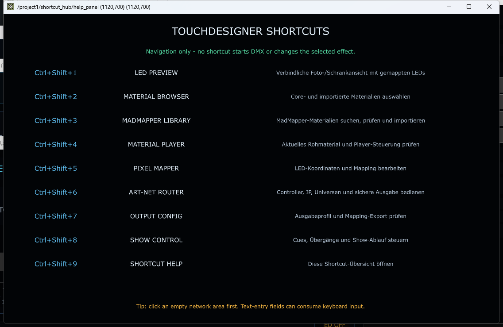

# Regression-Audit Dialog 9: Shortcut Help

Stand: 26.08.2026  
Live-Projekt: `PixelblazeMapper_WORKING_PHASE2_EFFECTS_CORE.68.toe`  
Ziel: `/project1/shortcut_hub/help_panel`  
Phase: ausschließlich Analyse und Dokumentation; kein `.toe`-Save, keine
Ausgabe-, Mapping- oder Materialänderung

## Ergebnis in einem Satz

Alle neun Shortcuts funktionieren im aktuell laufenden Core-68-Projekt real:
Jeder Tastendruck wurde vom Keyboard In DAT empfangen und jeder der neun
Zielviewer geöffnet. Dialog 9 ist damit praktisch nutzbar. Die verbleibenden
Probleme sind vor allem globale Tastenerfassung, eine versionsfragile
Callback-Schnittstelle, fehlende kontextsensitive Hilfe und eine teilweise
missverständliche Beschreibung von Dialog 4.

## Tatsächlicher Aufbau

Die Zuordnung besitzt mit `pixelblaze_mapper/shortcut_hub.py` eine zentrale
Quelldefinition. Der Builder schreibt dieselben Daten in
`/project1/shortcut_hub/shortcut_config` und erzeugt daraus die sichtbaren
Zeilen. Der Live-Abgleich ergab:

- Keyboard In DAT: `active = On`
- Perform Window Only: `Off`
- Filter: Tasten `1 2 3 4 5 6 7 8 9`
- Panels/Fokusfilter: leer, also keine Beschränkung auf bestimmte Panels
- Callback DAT: `/project1/shortcut_hub/shortcut_callbacks`
- Projektfehler unter `/project1/shortcut_hub`: keine
- alle neun Zieloperatoren vorhanden und ohne TouchDesigner-Fehler

Ein Shortcut führt ausschließlich `target.openViewer()` aus und schreibt
`<LABEL> | <PFAD>` in `ui.status`. Ein fehlendes Ziel würde als
`Shortcut target missing: <PFAD>` gemeldet. Es gibt im Shortcut-Callback keine
DMX-, Save-, Import-, Mapping- oder Materialwechselaktion.

## Vollständiges sichtbares Inventar

| Shortcut | Sichtbarer Name | Tatsächliches Ziel | Live-Fenster | Beschreibung im Dialog | Audit |
|---|---|---|---:|---|---|
| `Ctrl+Shift+1` | LED PREVIEW | `/project1/LED_PREVIEW_OUT` | 960 × 960 | Verbindliche Foto-/Schrankansicht mit gemappten LEDs | korrekt |
| `Ctrl+Shift+2` | MATERIAL BROWSER | `/project1/material_browser` | 1280 × 900 | Core- und importierte Materialien auswählen | korrekt |
| `Ctrl+Shift+3` | MADMAPPER LIBRARY | `/project1/madmapper_library/ui_panel` | 1440 × 900 | MadMapper-Materialien suchen, prüfen und importieren | korrekt; Import selbst separat beaufsichtigen |
| `Ctrl+Shift+4` | MATERIAL PLAYER | `/project1/madmapper_player_controls` | 512 × 512 | Aktuelles Rohmaterial und Player-Steuerung prüfen | nur teilweise: real erscheint primär die Rohvorschau; sichtbare Player-Steuerung ist nicht nachgewiesen |
| `Ctrl+Shift+5` | PIXEL MAPPER | `/project1/pixelblaze_mapper/ui/canvas` | 1280 × 800 | LED-Koordinaten und Mapping bearbeiten | korrekt |
| `Ctrl+Shift+6` | ART-NET ROUTER | `/project1/multi_controller_output/ui_panel` | 1180 × 720 | Controller, IP, Universen und sichere Ausgabe bedienen | korrekt; Hardwareaktionen separat beaufsichtigen |
| `Ctrl+Shift+7` | OUTPUT CONFIG | `/project1/pixelblaze_mapper/output_config/ui_panel` | 1100 × 650 | Ausgabeprofil und Mapping-Export prüfen | Shortcut korrekt; sichtbare Werte werden im Dialog-7-Audit bewertet |
| `Ctrl+Shift+8` | SHOW CONTROL | `/project1/show_control/control_panel` | 1000 × 300 | Cues, Übergänge und Show-Ablauf steuern | korrekt; Transportaktionen separat beaufsichtigen |
| `Ctrl+Shift+9` | SHORTCUT HELP | `/project1/shortcut_hub/help_panel` | 1120 × 700 | Diese Shortcut-Übersicht öffnen | korrekt |

Weitere sichtbare Texte:

- Titel: `TOUCHDESIGNER SHORTCUTS`
- Sicherheit: `Navigation only - no shortcut starts DMX or changes the selected effect.`
- Fußzeile: `Tip: click an empty network area first. Text-entry fields can consume keyboard input.`

Die Sicherheits- und Fußzeile sind Englisch, während die Beschreibungen
Deutsch sind. Das ist verständlich, aber sprachlich inkonsistent.

## Reale Tastatur- und Fokustests

Die Tasten wurden als echte Windows-Key-Events eingespeist, nicht durch einen
direkten Python-Aufruf des Callbacks. Während der Hauptserie wurde das
Keyboard-Log vorübergehend nur auf 100 Zeilen erweitert und danach auf den
Ausgangswert 10 zurückgestellt.

| Fokuszustand | Reale Eingabe | Nachweis | Ergebnis |
|---|---|---|---|
| TouchDesigner-Hauptfenster | `Ctrl+Shift+1` bis `Ctrl+Shift+9` | 18 Press-/Release-Zeilen mit `ctrl=1`, `shift=1`; alle neun Zielviewer vorhanden; Status endete auf Shortcut 9 | **PASS 9/9** |
| Material-Browser-Floating-Viewer | `Ctrl+Shift+9` | neue Press-/Release-Zeilen und korrekter `ui.status` | **PASS** |
| LED-Preview-Floating-Viewer | `Ctrl+Shift+9` | neue Press-/Release-Zeilen und korrekter `ui.status` | **PASS** |
| aktives Suchfeld im Material Browser | `Ctrl+Shift+9` | vor Eingabe `panel.focus=1`; Shortcut wurde empfangen; Suchinhalt blieb unverändert; Hilfe öffnete sich | **PASS** |
| echter Text-DAT-/Textport-Editor | nicht verändert | Der offizielle Keyboard-In-Hinweis nennt Texteingabe im Editor als Ausnahme | **offen, erwartete Ausnahme** |

Ein separater Mausklicktest ist in Dialog 9 selbst nicht anwendbar: Das Panel
enthält nur Textzeilen, keine Buttons, Links oder editierbaren Felder. Der
Container zeigt trotzdem einen Pointer-Cursor. Das kann den falschen Eindruck
erwecken, die Zeilen seien anklickbar.

Die offizielle Dokumentation beschreibt den Keyboard In DAT als global
empfangend, auch außerhalb der TouchDesigner-Fenster, mit einer Ausnahme bei
Texteingabe im Editor. Da der aktuelle `Panels`-Filter leer ist, können die
Shortcuts deshalb auch während der Arbeit in anderen Anwendungen reagieren.
Quelle: [Derivative – Keyboard In DAT](https://docs.derivative.ca/Keyboard_In_DAT).

## `keyEvent` gegenüber `onKey`

Der Live-Callback definiert `keyEvent(...)`; `onKey(dat, keyInfo)` ist nicht
vorhanden. Ein statischer Regressionstest markiert die Migration auf den
neueren Vertrag bereits als erwartete zukünftige Korrektur.

Für die Bewertung gilt aber das reale Ergebnis: `keyEvent(...)` wurde in
TouchDesigner 2025.33070 bei allen neun Tasten tatsächlich ausgeführt. Der
aktuelle Stand ist daher **funktionierend, aber versionsfragil**, nicht
„defekt“. Eine Migration darf erst nach einem A/B-Test erfolgen, der dieselbe
Fokusmatrix mit der neuen Signatur wiederholt.

## Automatische Testsuite

Neu ergänzt wurde:

`tests/test_shortcut_help_dialog_regression.py`

Sie prüft nicht-destruktiv:

- exakt neun geordnete, eindeutige Tasten und Ziele;
- Übereinstimmung von Shortcut-Hilfe und Dialogverträgen;
- vollständige sichtbare Zeilenerzeugung;
- Fehler- und Erfolgsmeldung des Callbacks;
- Abwesenheit von Ausgabe-, Save-, Import- und Mappingaktionen;
- vollständige deutsche Benutzerdokumentation.

Gemeinsam ausgeführt mit `test_shortcut_hub.py` und
`test_dialog_contracts.py`: **17 Tests bestanden, 0 Fehler**.

Die reale Fokusmatrix ist noch kein vollautomatischer Test, weil sie echte
Fenster öffnet und den Benutzerfokus übernimmt. Sie sollte zukünftig als
expliziter Desktop-Abnahmetest mit Fensterinventar und garantiertem Restore
bereitgestellt werden.

## Wiederherstellung nach dem Live-Test

- Nur die durch diesen Audit neu geöffneten Viewer 2, 3, 4, 6 und 9 wurden
  geschlossen.
- Die zuvor geöffneten Viewer 1, 5, 7 und 8 blieben erhalten.
- `maxlines` des Keyboard In DAT wurde von 100 auf 10 zurückgestellt.
- Das Material-Browser-Suchfeld blieb inhaltlich unverändert.
- Der Fokus wurde wieder auf das TouchDesigner-Hauptfenster gesetzt.
- Das Projekt wurde nicht gespeichert.

## Befunde und Prioritäten

### Hoch

1. **Globalen Gültigkeitsbereich entscheiden:** Ein leerer Panel-Filter lässt
   die Kürzel auch außerhalb TouchDesigner reagieren. Gewünscht ist entweder
   bewusst „global“ mit deutlichem Hinweis oder „nur in TouchDesigner“ mit
   passendem Fokusfilter.
2. **Dialog 4 klarstellen:** Das reale 512×512-Fenster zeigt die
   Materialvorschau; die Formulierung „Player-Steuerung prüfen“ verspricht mehr,
   als im Viewer direkt sichtbar ist. Ziel oder Beschriftung mit Dialog 4
   abstimmen.
3. **Live-Regression absichern:** Alle neun Fenster, `ui.status`, Fokusfälle und
   Restore in eine wiederholbare Desktop-Abnahmetestsuite aufnehmen.

### Mittel

1. `keyEvent` nach einem nachweislich gleichwertigen A/B-Test auf den aktuellen
   Callbackvertrag migrieren.
2. Sicherheits- und Fußzeile vollständig deutsch oder vollständig zweisprachig
   ausführen.
3. Fußzeile präzisieren: Das leere Netzwerk ist nicht grundsätzlich nötig;
   entscheidend ist, ob eine echte Editor-Texteingabe den Tastendruck bindet.
4. Pointer-Cursor entfernen oder die neun Zeilen tatsächlich anklickbar machen.
5. Sichtbar anzeigen, ob jedes Ziel aktuell vorhanden ist, statt dies erst nach
   einem fehlgeschlagenen Shortcut in `ui.status` zu melden.

### Optional / innovativ

- Jede Zeile erhält ein `i`-Symbol mit Zweck, sicheren/überwachten Aktionen,
  Signalweg und Link zur ausführlichen Dialogdokumentation.
- Eine „zuletzt geöffnet“-Markierung und ein kleiner Fokus-/Shortcut-Diagnose-
  Status helfen bei Supportfällen.
- Ein direkt anklickbarer „Öffnen“-Bereich pro Zeile bietet eine Alternative,
  wenn ein Betriebssystem oder aktives Textfeld den Shortcut abfängt.

## Bewertung

| Kategorie | Punkte | Begründung |
|---|---:|---|
| Nutzbarkeit | **7/10** | Sehr gut lesbare Ein-Seiten-Übersicht und logisch nummerierte Ziele; Abzug für Sprachmix, nicht klickbare Pointer-Fläche und unklare globale Gültigkeit. |
| Technische Umsetzung | **7/10** | Zentrale Spezifikation, sichere Navigation, klare Statusmeldung und Fehlerpfad; Abzug für globalen Fokusbereich und versionsfragile Callbackform. |
| Zuverlässigkeit | **8/10** | Alle neun realen Shortcuts sowie zwei Floating-Fokusfälle und das echte Suchfeld bestanden; echter Texteditor und zukünftige TD-Versionen bleiben offen. |
| Wartbarkeit | **8/10** | Builder und Datenmodell sind übersichtlich und die statischen Verträge gut testbar; Live-Fokusautomation und Callbackmigration fehlen. |
| Vollständigkeit | **6/10** | Alle neun Ziele sind vollständig enthalten; es fehlen kontextsensitive Hilfe, Zielstatus, klickbare Alternative und detaillierte Fehlerhilfe. |
| Innovativität | **5/10** | Solider Shortcut-Hub, aber noch eine konventionelle statische Liste ohne Kontext, Diagnose oder direkten Workflowbezug. |

Orientierender Mittelwert: **6,8/10**. Es gibt keinen aktuellen
Funktionsblocker für Dialog 9. Die Punkte „globaler Gültigkeitsbereich“ und
„Dialog-4-Versprechen“ sollten jedoch vor einer finalen UX-Freigabe entschieden
werden.

