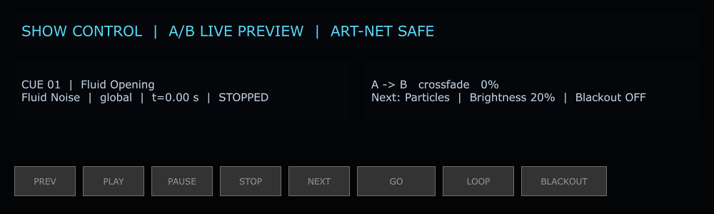
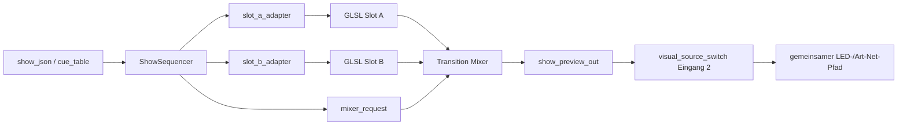
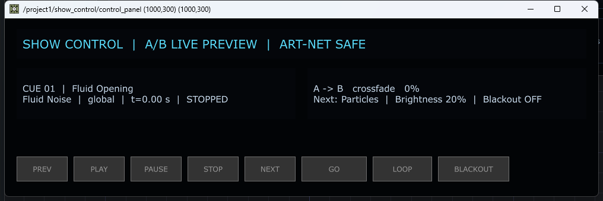
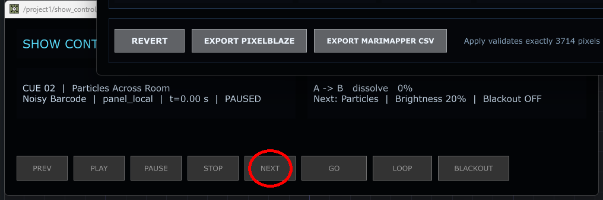
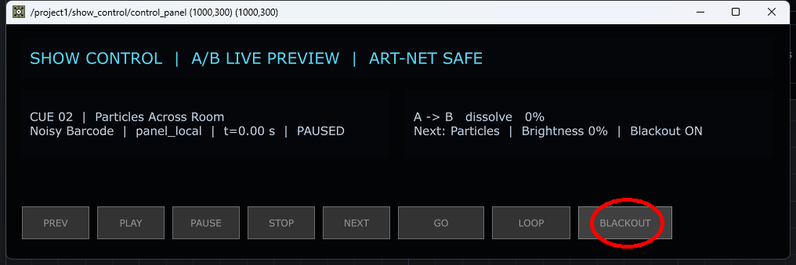

# Regression-Audit Dialog 8: SHOW CONTROL

Stand: 26.08.2026  
Projekt: `PixelblazeMapper_WORKING_PHASE2_EFFECTS_CORE.68.toe`  
Scope: Analyse und Dokumentation; keine funktionale Änderung, kein `.toe`-Save,
kein Commit, kein unbeaufsichtigter Blackout oder Hardware-Eingriff.

## Kurzurteil

Der TouchDesigner-unabhängige Sequencer ist klar aufgebaut, streng validiert
und durch gute Grenzwerttests abgesichert. Der Dialog selbst ist übersichtlich.
Die aktuelle Live-Integration ist für eine verlässliche Show jedoch noch nicht
freigabefähig: Ab Cue 2 wird die A/B-Richtung im Renderer falsch interpretiert,
die Statusanzeige beschreibt dann den falschen Slot, Preset und Zielgruppen
werden zwar gespeichert, aber nicht gerendert. LOOP und BLACKOUT haben keinen
sichtbaren dauerhaften Schaltzustand.



## 1. Geprüfter Zustand

| Bereich | Live-Wert | Bewertung |
|---|---:|---|
| Aktive Bildquelle | `materials`, Switch-Eingang 1 | Show Control ist aktuell **nicht** auf den LEDs aktiv |
| Show-Eingang | Switch-Eingang 2 | korrekt verkabelt, aber nicht ausgewählt |
| Transport | `stopped` | Anzeige stimmt |
| Cue | 1 / `Fluid Opening` | Anzeige stimmt für Cue 1 |
| Zeit | `0.00 s` | Anzeige stimmt |
| Loop | `0` | intern aus; im Dialog nicht sichtbar |
| Blackout | `0` | intern aus; Text zeigt OFF |
| Übergang | `crossfade`, 0 % | Anzeige stimmt für Cue 1 |
| Helligkeit | 20 % | Anzeige stimmt für Cue 1 |
| Production connected | `1` | visueller Show-Eingang vorhanden |
| Network output enabled | `0` | nur lokale Show-Control-Flag; **kein belastbarer globaler Art-Net-Status** |
| Fehler unter `/project1/show_control` | keine | technische Operator-Fehlerfreiheit bestätigt |

Die Tabelle `adapter_contract` ist dagegen veraltet: Sie meldet die Material-
und Mixer-Adapter weiterhin als `UNCONNECTED` und Production als `DISABLED`,
obwohl der Live-Pfad vorhanden ist. Diese Anzeige darf nicht als Ist-Zustand
verwendet werden.

## 2. Sichtbare Bedienelemente

Alle acht Buttons sind sichtbar, aktiv und über je einen `Panel Execute DAT`
mit `callbacks.command(...)` verbunden.

| Button | Sollwirkung | Beobachtete Implementierung | Risiko / Lücke |
|---|---|---|---|
| PREV | vorheriger Cue, Zeit 0 | `sequence.previous()` | bei Cue 1 ohne Loop keine Wirkung und kein Hinweis |
| PLAY | starten / aus Pause fortsetzen | `sequence.play()` | Materialanimation hängt weiter an `absTime`, nicht an Transportzeit |
| PAUSE | Cuezeit anhalten | `sequence.pause()` | Transition stoppt; Materialbild selbst läuft weiter |
| STOP | stoppen und Cue 1 / 0 s | `sequence.stop()` | korrekt im Kern; kein Bestätigungsfeedback |
| NEXT | nächster Cue | `sequence.next()` | Kern korrekt; Live-A/B-Ausgabe ab Cue 2 falsch |
| GO | wie NEXT | `sequence.go()` | funktional doppelt zu NEXT, Bedeutung nicht erklärt |
| LOOP | Wiederholung umschalten | interner Toggle | Live-Button ist `momentary`; Zustand nicht sichtbar |
| BLACKOUT | Showbild auf 0, Transport weiter | interner Toggle und Shader-Flag | Live-Button ist `momentary`; Hardwaretest nur beaufsichtigt |

Die Laufzeit meldet für **alle acht** Buttons den Typ `momentary`. Der Builder
beabsichtigt für LOOP und BLACKOUT zwar Toggle-Buttons, dieses Ziel kommt im
gespeicherten Core 68 nicht an.

### Sichtbare Statusfelder

1. Titel: `SHOW CONTROL | A/B LIVE PREVIEW | ART-NET SAFE`
2. Cue: Nummer, Name, Material, Koordinatenmodus, Zeit und Transportzustand
3. Transition: fest `A -> B`, Übergangsart, Fortschritt, nächstes Material,
   Helligkeit und Blackout

Es fehlen: aktiver Visual-Source-Modus, Cue-Dauer/Restzeit, Loop-Zustand,
aktiver/outgoing Slot, Zielgruppen, tatsächlicher Netzwerk-/Senderstatus,
Fehler-/No-op-Feedback und ein direkter Hilfetext.

## 3. Cue-Inventar

| # | Cue | Material / Preset | Modus | Dauer | Übergang | Helligkeit | Ziele |
|---:|---|---|---|---:|---|---:|---|
| 1 | Fluid Opening | Fluid Noise / Ocean Blue | global | 20,0 s | crossfade 3,0 s | 20 % | all |
| 2 | Particles Across Room | Particles / Cyan Magenta | hybrid | 15,0 s | dissolve 2,0 s | 20 % | backwall, sidewalls |
| 3 | Barcode Finale | Noisy Barcode / Neon | panel_local | 12,0 s | radial 2,5 s | 15 % | all |

Die JSON- und Kernvalidierung prüft Pflichtfelder, eindeutige IDs,
Koordinatenmodi, Dauer, Übergangsdauer, Helligkeit und doppelte Zielgruppen.
Unbekannte Material-/Preset-Namen werden beim Laden der Show nicht gegen den
tatsächlichen Materialkatalog geprüft.

## 4. Datenfluss



Wichtig: Der Dialog schaltet die Quelle nicht selbst live. Im geprüften Zustand
ist am Switch weiterhin `materials` aktiv. Ein Klick im Show-Control-Dialog kann
daher intern korrekt reagieren, ohne die aktuelle LED-Animation zu verändern.

## 5. Kritische Befunde

### SC-01 · A/B-Richtung ab Cue 2 falsch — Priorität P0

Der Kern berechnet bewusst zwei Werte:

- `progress`: Fortschritt der aktuellen Transition, immer 0 bis 1.
- `output_b_mix`: tatsächlicher Anteil von Slot B; berücksichtigt, ob aktuell A
  oder B der ausgehende Slot ist.

Nach `NEXT` auf Cue 2 ist der ausgehende Slot B. Dann gilt korrekt:
`progress = 0`, aber `output_b_mix = 1`. Der Live-Renderer liest ausschließlich
`progress` und rendert bei 0 Slot A. Damit erscheint vor der Cue-2-Transition
bereits der falsche, nächste Cue. `output_b_mix` wird zwar in Tabellen geschrieben,
aber im Mixer nicht verwendet.

### SC-02 · Statusanzeige beschreibt ab Cue 2 den falschen Inhalt — P1

`cue_status` verwendet immer `label_a`; die Übergangszeile ist fest
`A -> B`. Wenn Cue 2 in Slot B liegt, zeigt die UI deshalb Cue-2-Name zusammen
mit dem Material aus Slot A (Cue 3). Das kann bei einer Show zu falschen
Operatorentscheidungen führen.

### SC-03 · Cue-Preset wird nicht angewendet — P1

Der Adapter überträgt `preset`, der Renderer liest diesen Wert aber nicht. Er
verwendet ausschließlich das Standard-Preset der Effect-Definition. Die sichtbaren
Namen `Ocean Blue`, `Cyan Magenta` und `Neon` sind daher derzeit Metadaten, keine
nachgewiesene Bildsteuerung.

### SC-04 · Zielgruppen werden nicht angewendet — P1

`target_groups` wird validiert und im Plan geführt, erreicht den Renderpfad aber
nicht. Ein Cue mit `backwall,sidewalls` wirkt deshalb nicht nachweisbar anders als
`all`.

### SC-05 · PAUSE stoppt nicht die Materialanimation — P1

Die A/B-Shader-Zeit ist an `absTime.seconds * 0.45` gebunden. PAUSE hält Cuezeit
und Übergangsfortschritt an, das Material selbst animiert weiter. Die Dokumentation
„friert die exakte Zeitposition ein“ ist damit nur für den Sequencer, nicht für
das sichtbare Bild wahr.

### SC-06 · Kein sichtbarer Zustand für LOOP/BLACKOUT — P2

Beide Laufzeitbuttons sind momentary. Der interne Toggle funktioniert, aber der
Button bleibt optisch nicht eingerastet. Blackout steht nur in der Textzeile;
Loop wird überhaupt nicht angezeigt.

### SC-07 · Veraltete und mehrdeutige Sicherheitsanzeigen — P2

`adapter_contract` meldet trotz Live-Verkabelung `UNCONNECTED/DISABLED`.
`network_output_enabled=0` ist nur eine lokale Show-Control-Flag und kann nicht
beweisen, dass der gemeinsame Art-Net-Ausgang aus ist. Der Titel `ART-NET SAFE`
ist ohne tatsächlichen globalen Senderstatus zu stark formuliert.

### SC-08 · Stottern bei niedriger TouchDesigner-Cookrate — P1, systemweit

Der Transport aktualisiert sich nur an `onFrameEnd`. Bei der gemessenen niedrigen
Cookrate werden Übergang und Materialbild in sichtbaren Sprüngen berechnet, auch
wenn Art-Net denselben letzten Frame häufiger sendet. Zusätzlich begrenzt der
Transport ein einzelnes Delta auf maximal 1 s; längere Hänger verschieben dadurch
die Showzeit. Die Ursachenbewertung gehört zum gemeinsamen Timing-Audit.

## 6. Automatische Tests

Ausgeführt:

```text
python -m unittest tests.test_show_sequencer \
  tests.test_live_show_integration tests.test_shortcut_hub -v
```

Ergebnis: **23/23 bestanden**. Sie decken JSON-Validierung, Zustandsmaschine,
Grenzen, Loop, Blackout-Logik, sechs Transition-Namen, visuelle Verkabelung und
Shortcutvertrag ab. Sie prüfen bislang nicht die korrekte Richtung des echten
GLSL-A/B-Mixers.

Neue nicht-destruktive Audit-Suite:

```text
python -m unittest tests.test_show_control_dialog_regression -v
```

Ergebnis: **3 bestanden, 4 erwartete Fehler**. Die erwarteten Fehler bilden
SC-01 bis SC-04 ab und werden nach einer Reparatur in normale Muss-Tests
umgewandelt.

Vorbereitet ist außerdem `tools/td_show_control_regression.py`. Das Live-Audit:

- inventarisiert Buttons, Tabellen und Statusfelder,
- führt STOP, PLAY, PAUSE, NEXT, PREV, GO, LOOP und BLACKOUT nur aus, wenn
  Show **nicht** als Bildquelle aktiv ist,
- deaktiviert währenddessen den Zeit-Execute,
- stellt Runtime, Tabellen, Texte, Shaderuniforms und Execute-Zustand wieder her,
- verändert weder Visual Source noch Art-Net und speichert das Projekt nicht.

Das Live-Audit wurde anschließend ausgeführt: **COMPLETED_AND_RESTORED**.
STOP, PLAY, PAUSE, NEXT, PREV, GO, LOOP und BLACKOUT durchliefen den echten
Callbackpfad. Quelle, Switch, alle vier Zustandstabellen, Texte, Mixeruniforms
und Execute-Aktivierung wurden vollständig auf den Eintrittszustand
zurückgestellt.

## 7. Maus- und Hardware-Abnahmetests

Diese Fälle werden erst in einem exklusiven UI-Slot beziehungsweise mit
Bestätigung am LED-Aufbau durchgeführt:

| ID | Test | Erwartung | Sicherheitsbedingung |
|---|---|---|---|
| M-01 | Strg+Umschalt+8 | **PASS:** genau ein Show-Control-Fenster öffnet bei echtem TouchDesigner-Fokus | keine |
| M-02 | jeden Transportbutton einmal klicken | **TEIL-PASS:** Callback und Tabelle korrekt; Cue-2-Text nach NEXT/GO falsch | Show-Quelle war nicht live |
| M-03 | LOOP zweimal klicken | **TEIL-PASS:** 0 → 1 → 0; keine sichtbare Rückmeldung | Show-Quelle war nicht live |
| M-04 | BLACKOUT zweimal klicken | **PASS mit UX-Lücke:** 0 → 1 → 0, Text OFF/ON/OFF; Button rastet nicht ein | Show-Quelle war nicht live |
| H-01 | Show live wählen, PLAY | korrekter Cue 1 auf allen Panels | Nutzer beobachtet Hardware |
| H-02 | NEXT auf Cue 2 | kein Cue-3-Vorgriff, korrekte A/B-Richtung | erst nach SC-01-Fix |
| H-03 | BLACKOUT live | alle Ziel-LEDs schwarz, Transport läuft weiter | ausdrücklich angekündigt |
| H-04 | Rückkehr zu Materials | vorherige Materialquelle wieder aktiv | Wiederherstellungscheck |

Echte Klickbelege:







Nach dem Test wurde verifiziert: Source `materials`, Switch 1, Transport
`stopped`, Cue 1 / 0,00 s, Loop 0, Blackout 0, letzte Anforderung `stop`, keine
Fehler unter `/project1/show_control`.

## 8. Dokumentierte Arbeitsabläufe

### Workflow A: Show sicher vorhören

1. Bildquelle auf `Show Sequencer` stellen, während Hardwareausgabe beaufsichtigt ist.
2. Show Control mit `Strg+Umschalt+8` öffnen.
3. STOP drücken: Cue 1 und 0,00 s prüfen.
4. PLAY drücken und Cue-/Transitionsanzeige beobachten.
5. PAUSE/PLAY auf identischer Cuezeit prüfen.
6. Am Ende wieder zur Materialquelle wechseln.

### Workflow B: Cue manuell wechseln

1. Aktuelle Cue-Nummer, ausgehenden Slot und Zielgruppen prüfen.
2. GO oder NEXT **einmal** drücken.
3. Cue-Nummer, Material, Preset, Koordinatenmodus und Helligkeit gegen JSON prüfen.
4. Bei falschem Inhalt STOP und zur sicheren Materialquelle zurückkehren.

### Workflow C: Blackout

1. Laufenden Cue und Zeit notieren.
2. BLACKOUT drücken; Status muss klar ON zeigen.
3. Prüfen, dass das Bild schwarz ist, der Cue-Timer aber weiterläuft.
4. BLACKOUT erneut drücken; Bild kehrt ohne Cue-Reset zurück.

Der Live-Blackout ist erst nach Nutzerfreigabe durchzuführen.

## 9. Direkt-Hilfe-Konzept für diesen Dialog

Für jeden Button wird ein kleines `i` mit Kurztext empfohlen:

| Element | Schnellhilfe |
|---|---|
| PREV | Springt zum vorigen Cue und setzt dessen Zeit auf 0. Ohne Loop bei Cue 1 keine Wirkung. |
| PLAY | Startet oder setzt die Cue-Zeit fort. |
| PAUSE | Hält Cue und Transition an; gewünschte Material-Freeze-Semantik noch festlegen. |
| STOP | Stoppt und setzt auf Cue 1 / 0 s zurück. |
| NEXT | Springt sofort zum nächsten Cue. |
| GO | Operator-Trigger für den nächsten Cue; aktuell funktional wie NEXT. |
| LOOP | Wiederholt nach dem letzten Cue; aktiven Zustand sichtbar markieren. |
| BLACKOUT | Setzt nur die Show-Helligkeit auf 0; Transport läuft weiter. |
| Cue-Status | Aktueller Cue, Material, Modus, Zeit und Transport. |
| Transition | Richtung, Typ, Fortschritt, Helligkeit und nächster Cue. |

## 10. Bewertung (0–10)

| Dimension | Score | Begründung |
|---|---:|---|
| Nutzbarkeit | 5,0 | aufgeräumt und schnell erfassbar, aber wichtige Zustände/Quelle fehlen |
| Technische Umsetzung | 5,5 | starker deterministischer Kern, fehlerhafte Live-A/B-Übersetzung |
| Zuverlässigkeit | 4,0 | Cue 1 plausibel, ab Cue 2 falscher Render- und UI-Zustand möglich |
| Wartbarkeit | 6,5 | saubere Kernmodelle und Tests; generierte DAT-Strings erschweren Integrationstests |
| Vollständigkeit | 4,0 | Presets, Zielgruppen, Source-/Loop-Anzeige und echte Live-Abnahme fehlen |
| Innovativität | 6,5 | gute A/B-/Koordinatenidee und sichere Trennung, aber noch nicht konsequent realisiert |

Gesamteinschätzung: **5,3/10 – gutes Fundament, noch nicht showtauglich.**

## 11. Priorisierte nächste Schritte

1. **P0:** Mixer auf `output_b_mix` beziehungsweise explizite Outgoing-/Incoming-
   Richtung umstellen; Cue-2/3-Regression als harter Test.
2. **P1:** UI-Texte aus dem tatsächlichen outgoing/incoming Slot erzeugen.
3. **P1:** Preset und `target_groups` im Renderer wirklich anwenden und testen.
4. **P1:** gemeinsame Cookrate-/Stotterursache beheben und reale Framezeiten anzeigen.
5. **P1:** Semantik von PAUSE festlegen: nur Cuezeit oder vollständiges Bild einfrieren.
6. **P2:** LOOP/BLACKOUT als sichtbare Zustände, plus Source-, Dauer-, Restzeit- und
   Zielgruppenanzeige.
7. **P2:** `adapter_contract` und Sicherheitsstatus live statt statisch ableiten.
8. **P2:** Hilfe-Icons und oben beschriebene Kurztexte ergänzen.
9. Erst danach M- und H-Abnahmetests durchführen und den Dialog freigeben.

## 12. Offene Blocker

- Live-/Hardwaretest wartet auf Nutzeraufsicht und SC-01-Fix.
- SC-01 bis SC-04 sind bewusst noch nicht repariert, weil diese Phase nur den
  Ist-Zustand analysiert.
