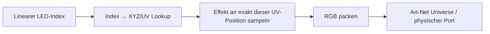

# Räumliche LED-Lookup-Map

Die drei Seitenpanels werden nicht mehr über angenommene Zeilenlängen oder
gleich große Farbbänder adressiert. Der lineare Art-Net-/Kabelindex bleibt
unverändert und wird für jede einzelne LED auf ihre gespeicherte räumliche
Position abgebildet.

Das entspricht dem Prinzip einer FastLED-XY-Map, nur in der für
TouchDesigner benötigten Gegenrichtung:

- FastLED: logische Rasterzelle `(x,y)` → physischer LED-Index.
- TouchDesigner: physischer LED-Index → gemessene Position `(x,y,z)` und
  globale Effektposition `(u,v)`.

Pixelblaze arbeitet ebenso indexbasiert: Jeder Eintrag der Mapping-Liste ist
die räumliche Position genau dieses Pixelindex. Pixelblaze skaliert die
Koordinaten anschließend auf Weltkoordinaten von 0 bis 1 und übergibt sie an
`render2D(index,x,y)` beziehungsweise `render3D(index,x,y,z)`. Unsere Tabelle
behält deshalb sowohl das unveränderte XYZ als auch die daraus erzeugte
globale UV-Projektion.

Referenzen:

- https://electromage.com/docs/intro-to-mapping/
- https://electromage.com/docs/language-reference/
- https://github.com/macetech/FastLED-XY-Map-Generator
- https://jasoncoon.github.io/led-mapper/

## Dateien und TouchDesigner-Operatoren

- Export: `mappings/side_spatial_lookup_complete_new_2026-08-24.json`
- Generator: `pixelblaze_mapper/spatial_map.py`
- Exportkommando: `python tools/export_side_spatial_map.py`
- TD-Import: `pixelblaze_mapper/build_spatial_lookup_td.py`
- Live-Tabelle: `/project1/pixelblaze_mapper/side_spatial_lookup`
- Qualitätsstatus: `/project1/pixelblaze_mapper/side_spatial_status`
- Live-Sampler: `/project1/effect_sample_uv`

Die Lookup-Tabelle enthält pro Index:

`index, panel, x, y, z, u, v, column, row, coordinate_quality`

`x/y/z` und `u/v` sind die maßgeblichen Werte für Effekte. `column/row` ist
nur eine aus dem gemessenen Punktabstand abgeleitete Diagnoseansicht.

## Messqualität

Der aktuelle Scan besitzt 1.160 direkt gemessene und 24 rekonstruierte
Koordinaten. Die rekonstruierten Indizes werden nicht verschwiegen, sondern
als `coordinate_quality=estimated` markiert:

`423, 424, 634, 710, 714, 913, 914, 929, 930, 986, 1000, 1001, 1002, 1003, 1016, 1017, 1018, 1019, 1032, 1033, 1034, 1035, 1167, 1183`

Für eine vollständig messwertbasierte Map müssen nur diese 24 Indizes neu
gescannt werden. Alle anderen Koordinaten stammen direkt aus dem Export.

## Sicherheitsregel

Das Erzeugen und Importieren der Lookup-Tabelle verändert weder Universes
noch Controller-IP, RGB-Reihenfolge oder Output-Enable. Eine `.toe`-Datei wird
erst nach einem bestätigten Hardwaretest gespeichert.
