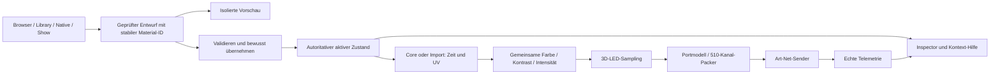

# PixelblazeMapper – neue Gesamtbewertung und Optimierungsplan

**07.09.2026 · Analyse, keine funktionale Umsetzung freigegeben oder durchgeführt**

## 1. Mein Gesamturteil

Das Projekt hat eine gute technische Basis und einen ungewöhnlich nützlichen Funktionsumfang: gemeinsame Core-/Importmaterialien, dynamische native Parameter, räumliches LED-Mapping, Fotoabgleich, Showsteuerung und portbezogene Ausgabe. **Die wichtigste nächste Verbesserung ist nicht ein weiteres Feature, sondern ein verlässlicher Zusammenhang zwischen Anzeige, Einstellung und tatsächlicher Wirkung.**

Meine Gesamteinordnung ist **etwa 6/10 für die derzeit nachgewiesene Produktreife**, bei deutlich höherem konzeptionellem Potenzial. Das ist eine begründete Bewertung, keine objektive Messgröße und keine Hardwarefreigabe. Insbesondere dürfen starke Ideen oder viele grüne Tests keine unsichere Apply-Funktion überdecken.

Ich empfehle **keinen Komplettneubau**. Parser, Materialschemas, Teile der Zustandsmodelle und der gemeinsame Ausgabepfad sind erhaltenswert. Die Übergänge dazwischen, die Erzeugung der Dialoge und die Zustandsanzeigen brauchen gezielte Konsolidierung.

### Wichtigste neuen Ergebnisse

1. **Echte Reglerprüfung:** Alle acht sichtbaren Player-Regler ändern den zugehörigen zentralen Wert. Scale, Width, Focus und Zoom erreichen auch den Importshader. **Intensity und Contrast erreichen beim Import dagegen nur den Corepfad** – die Bedienelemente versprechen hier mehr als sie bewirken.
2. **Sichere Übernahme ist noch nicht wirklich atomar:** Router-Apply kann bereits eine Live-Tabelle verändern, bevor ein späterer Fehler die gesamte Eingabe blockiert. GICO hat eine ähnliche Validierungs-/Übernahmelücke. Das ist ein P0-Risiko für spätere Konfigurationsänderungen.
3. **Universe-Zählweise ist an einer Grenze doppelt umgerechnet:** Der aktuell eingestellte UI-Start1 funktioniert in diesem Pfad; UI-Start2/7 würden falsch im ArtDMX-Header landen. Nicht pauschal die heute funktionierenden Ports umstellen.
4. **Zustandsanzeigen widersprechen einander:** Routertext sagt LIVE, Sender ist OFF. Player nennt `arcs`, tatsächlich aktiv ist Bubble Rings. Mapper zeigt 3714 und Beispieldaten, während die Livequelle 3744 Pixel hat.
5. **Browser und Library müssen getrennt betrachtet werden:** Material-Browser-NEXT funktioniert; dessen Anfangszahl war aber veraltet. Library-NEXT bleibt im heutigen Maustest auf Seite5 stehen. Die genaue Ursache des Library-Klickfehlers bleibt offen.
6. **Einige alte Fehler sind wirklich verbessert:** Native Params ist kompakt und hat einen funktionierenden Rückweg. Shortcut7 funktioniert aus Routerfokus. Show-Loop lässt sich mit zwei Klicks korrekt ein-/ausschalten. Output Config ist tatsächlich eine read-only Übersicht.
7. **Weitere Integrationsrisiken:** Library-Livepreview teilt den Produktionsrenderer; Native-Rollback hat einen reproduzierbaren Referenzkopiefehler; Showübergänge haben Phasen-/UV-Probleme; die Gradientformel färbt auch Schwarz ein.

## 2. Grundlage und Beweiskraft

Geprüfter Quellstand: Git `725d6b0`, Branch `codex/multi-controller-show-system`. Laufende Datei: `Backup/Projektdatei/PixelblazeMapper_WORKING_PHASE2_EFFECTS_CORE.88.toe`, TouchDesigner2025.33070. Im Repository liegen bereits fremde/unfertige Änderungen; sie wurden nicht verworfen oder in diesen Audit integriert.

Drei spezialisierte Agents haben parallel Materials/Imports, Routing/Output sowie Mapping/Show/Hilfe untersucht. Ich habe ihre Befunde gegengeprüft, die Livezustände erfasst, die echten Bedienprüfungen ausgeführt und diese Gesamtbewertung erstellt. Die zehn Dialoge wurden vollständig auf diese Arbeitsbereiche verteilt; es liefen nicht zehn konkurrierende Maussteuerungen auf demselben Desktop.

| Ebene | Heute tatsächlich erledigt | Aussagegrenze |
|---|---|---|
| Gesamte vorhandene Offline-Suite | **315 Tests bestanden** | Keine automatische End-to-End-Freigabe |
| Agent-Teiltests | 93 Material-,56 Output-,75 Mapping/Show-Tests bestanden | Teilmengen/Überschneidungen, nicht zu315 addieren |
| Quellcode und isolierte Verhaltensbeispiele | Alle zehn Dialogbereiche; neue Fehlerfälle analysiert/reproduziert | Einzelne Befunde sind Builder-/Rebuild-Risiken, nicht aktuelle UIfehler |
| Live-Leseprüfung | Zehn Dialogziele,986 UI-Unterknoten, Parameter/Tabellen/Bindings, keine abschließenden Operatorfehler | Inventur ist nicht986 erfolgreich betätigte Controls |
| Echte Maus/Tastatur | Acht Player-Regler, Native hin/zurück, Browser-NEXT, Library-NEXT, Loop, Router-Navigation, Shortcut7 | Vollständige Einzelabnahme aller Felder/Workflows noch offen |
| Bilddokumentation |14 Screenshots aus allen zehn Dialogen plus Zusatzfällen | Statische Bilder sind keine Performance-/Hardwaremessung |
| Laufzeit-Stichprobe | Ca.31 Sekunden; betroffene Materialknoten ca.39,6 Cooks/s bei Zeitbasis60 | Nicht gleich Netzwerksendefrequenz; Instrumentierung kann Einfluss haben |
| Physische LEDs/Art-Net | Sender blieb OFF,0 gesendete Pakete im erfassten Sender | **Keine neue Hardwareabnahme** |

Details: [echte UItests und offene Prüfungen](UI_TESTS_DE.md), [Controlinventar](CONTROL_INVENTORY.csv), [Livezustand vorher](live-baseline.json), [nachher](live-final.json), [Wiederherstellungsnachweis](ui-verification.json).

## 3. Meine Bewertung jedes Dialogs

Skala0–10: Nutzbarkeit, technische Umsetzung, Zuverlässigkeit, Wartbarkeit, Vollständigkeit, Innovativität. Der Reifewert ist der gerundete gleichgewichtete Mittelwert; kritische Sicherheitsdefekte bleiben unabhängig davon blockierend. Bewertungen gelten für die belegte Implementierung, nicht als Prozentzahl erledigter Arbeit.

| Shortcut/Dialog | Nutzung | Umsetzung | Zuverl. | Wartung | Vollst. | Innovation | Reife | Meine wichtigste Empfehlung |
|---|---:|---:|---:|---:|---:|---:|---:|---|
|1 LED Preview|5|7|5|6|5|8|6,0|Aktive/Entwurfsansicht klar trennen; Pixelqualität und Herkunft sichtbar machen|
|2 Material Browser|6|6|4|5|6|8|5,8|Aktives Material eindeutig markieren, Zähler sofort aktualisieren, Reglerwirkung vereinheitlichen|
|3 MadMapper Library|7|6|4|5|7|8|6,2|NEXT zuverlässig abnehmen; Vorschau vollständig von Liveausgabe isolieren|
|4 Material Player + Native|6|6|4|5|6|8|5,8|Wahrheitsgetreuer Materialname; Intensity/Contrast für Import; gemeinsame Werte-/Hilfedokumentation|
|5 Pixel Mapper|4|6|5|5|5|6|5,2|Beispieleditor und falsche3714-Anzeige ersetzen; Draft/Active/Saved eindeutig|
|6 Art-Net Router|5|6|4|5|6|7|5,5|Erst Gesamtvalidierung, dann eine atomare Übernahme; Livebadge aus echtem Senderzustand|
|7 Output Config|7|8|6|8|6|5|6,7|Als kompakte Statusübersicht behalten; Warnungsdetails und Zählweise verständlich erklären|
|8 Show Control|5|6|4|6|5|7|5,5|Eigene UV-/Zeitquelle pro Cue; nahtlose Phasenübergabe; reproduzierbarer Builder|
|9 Shortcut Help|7|7|6|8|5|5|6,3|Klickbare Navigation plus Fokus-/Tastaturlayouttests; zentrale kontextsensitive Hilfe|
|0 GICO Port Config|5|6|4|5|6|7|5,5|Typed Portmodell, genau eine Universekonversion, Applytransaktion, keine duplizierten Buttons|

Die verschachtelte Photo Calibration bewerte ich ergänzend mit Nutzung5/Umsetzung7/Zuverlässigkeit6/Wartung6/Vollständigkeit6/Innovation8. Der vollständige88-Werte-Reset ist im aktuellen Code verbessert; eine neue physische/fotografische Kalibrierungsabnahme wurde nicht durchgeführt.

### Was diese Bewertung bewusst nicht behauptet

- Die frühere Seitenwand-/LED-Geometrie wurde hier nicht neu bestätigt oder korrigiert. Die aktuelle Fotovorschau zeigt weiterhin schmale Seitenkonturen; ob ihre Eckkalibrierung physisch stimmt, ist offen.
- Der Source-/Builderfehler bei Show-Togglebuttons ist nicht identisch mit dem laufenden Projekt: Live sind sie momentary und der Looptest bestand.
- Ein nicht abgefangener7-Tastendruck im Netzwerk ist kein Beweis, dass der Shortcut generell defekt ist. Aus dem Router funktionierte er.
- Kein Nachweis, dass Hardwareflackern heute erneut vorliegt. Die Historie mit ausgetauschtem LED-Segment ist keine aktuelle Ursache für die hier gefundenen Softwareprobleme.

## 4. Priorisierte Verbesserungspakete

| Priorität / Paket | Konkrete Änderung nach Freigabe | Messbare Abnahme | Risiko/Abhängigkeit |
|---|---|---|---|
|**P0-A Konfigurationstransaktion**|Alle Router-/GICO-Felder in einem unveränderlichen Entwurf prüfen. Bei Fehler null Liveänderungen; bei Erfolg gemeinsam übernehmen, Fehlerrollback vollständig.|Ungültiges letztes Feld lässt Controller-/Segmenttabellen, Senderzustand und aktive Konfiguration unverändert.|Vor jeder weiteren Ausgabe-Konfigurationsfunktion erledigen|
|**P0-B Universevertrag**|Intern ausschließlich wire-zero-based; UI1-based nur am Ein-/Ausgang konvertieren.|UI1,2,7 und Grenzwerte durch UIparser→Modell→ArtDMXheader testen; keine doppelte Subtraktion.|Aktuelle UI1-Konfiguration erhalten; Hardwaretest separat|
|**P1-A Materialidentität und Isolation**|`selected`, `previewed`, `active` getrennt halten. Ein ausdrücklicher Applywechsel. Eigenständiger Previewrenderer auch für OPEN LIVE PREVIEW.|Katalogwahl/Hover/Preview verändert keine aktive ID, Liveuniforms oder Senddaten. Fehlkompilierung erhält altes Material.|Grundlage aller Material-/Native-Regler|
|**P1-B Einheitliche Parameterwirkung**|Intensity/Contrast gemeinsame Ausgabestufe oder expliziter Importadapter. Unsupported Controls deaktivieren und erklären. Material-Speed, Native-Speed und globalen Transport trennen.|Echte Eingabe→Systemwert→Uniform→definierter Frame. Intensity0 dunkel für Core/Import; kein unbeabsichtigter globaler Presetwechsel.|Gradient-/Originalmodus muss vorher entschieden werden|
|**P1-C Bedienereignisse und Katalog**|Library-NEXT-Ursache isolieren, dann deterministische Ereignisse. Daten beim Öffnen aktualisieren; IDbasierte Auswahl; Nativeöffnung ohne Setter/Persistieren.|Mindestens30 NEXT/PREV-Wechsel bei verschiedenen Bildraten; Auswahl auf Seite2/letzter Seite korrekt; Öffnen ohne Wertänderung.|Keine reine Callback-Direktprüfung als Ersatz für Klicktest|
|**P1-D Native-Transaktion und Performance**|Rollback mit unabhängiger Tiefenkopie; no-op-/Befüllungsschutz; Uniformwerte ohne mehrfache komplette Shaderadaption ändern.|Fehlerprobe stellt1 statt3 wieder her; identischer Wert verursacht keine Arbeit; keine Kompilierung beim gewöhnlichen Uniformdrag.|Nicht jedes Nativefeld ist laufzeitänderbar; Schema muss das kennzeichnen|
|**P1-E Mapping/Show-Vertrag**|Draft/Active/Saved trennen; UV pro Show-Slot; incoming Phase übernehmen; dokumentierte Achsen-/Einheitenkonvention.|3744/1184 aus einer Vertragsquelle; keine aktive Previewänderung beim Draftedit; Phasenkontinuität an jeder Cuegrenze.|Große Bilder/Geometrie nicht nach Gefühl drehen|
|**P1-F Reproduzierbarkeit**|Livepatches in reproduzierbare Builder überführen; stabile Knotennamen; veraltete Duplikate kontrolliert bereinigen.|Dreifacher Build erzeugt gleiche Knotenanzahl/Bindings;17 Apply-/Validate-Kopien entstehen nicht erneut; Restore/Relaunch gleich.|Keine pauschale Bereinigung unbekannter Benutzerknoten|
|**P2-A Diagnose und Hilfe**|Numerische Sliderwerte/Einheiten, Kontextinfo, Warnungsdetails, echte FPS/Stalls/Quelle, Prüfzeitpunkt.|Jedes freigegebene Control hat Hilfe+Test-ID+Zustandsquelle; keine unbewiesenen SAFE/LIVE-Meldungen.|Auf gemeinsamen Parametervertrag aufbauen|
|**P2-B Oberfläche**|Materialwahl/Library in einem Arbeitsbereich, Player als Inspector; Router/Portconfig als klare Unteransicht; Output Config bleibt Dashboard.|Weniger Fensterwechsel, keine doppelt editierbaren Autoritäten; gleiche Bezeichnung/Bereiche überall.|Nicht vor Behebung der Zustandsfehler nur optisch zusammenlegen|

## 5. Empfohlene Zielstruktur: ein Zustand, mehrere Ansichten

Dies ist ein **Vorschlag**, keine Beschreibung einer bereits eingebauten neuen Architektur. Entscheidender Unterschied: Eine Libraryvorschau hat keine heimliche Verbindung zur aktiven Ausgabe. Alle Anzeigen lesen denselben Zustand, statt Statusmeldungen aus der letzten Buttonaktion zu behalten.

### Dialoge zusammenlegen oder behalten?

- **Behalten:** Output Config als übersichtliches read-only Dashboard. Das ist eine sinnvolle zweite Sicht, keine schlechte Duplizierung.
- **Zusammenführen auf Ebene des Zustands:** GICO-Porteditor und Router; GICO ist ein Hardwareprofil unter derselben Konfiguration, kein unabhängiger zweiter Writer.
- **Ein gemeinsamer Materialarbeitsbereich:** links Bibliothek, mittig isolierte Vorschau, rechts Inspector/Nativeparameter. Core, importiert, kompatibel und aktiv werden als Filter/Status dargestellt. Bestehende Shortcuts können direkt den passenden Bereich fokussieren.
- **Nicht überladen:** Show Control bleibt eine Transport-/Cueansicht. Materialdetailbearbeitung im Inspector; keine zweite unbemerkte Kopie sämtlicher Materialsettings.
- **Mapper:** echter Tabellen-/Punktinspector statt Mocktext, mit Draft/Active-Vergleich und klarer Applyvorschau. Fotoecken und reale3D-Geometrie nicht als dieselbe Art von Transformation präsentieren.

## 6. Ruckeln und unterschiedliche Panelgeschwindigkeit

Heute wurde die Hardware nicht angesteuert. Die gemessenen ca.39,6 Cooks/s bei einer60er-Zeitbasis sind ein Diagnosehinweis, aber kein Beweis einer konkreten Ruckelursache und keine Art-Net-Framerate. Die Playerzeile zeigt immerhin TARGET60 und ACTUAL Art-Net0 bei OFF korrekt; die tatsächliche Renderfrequenz fehlt dort.

Drei getrennte Fragestellungen:

1. **Zeit:** Verwenden alle Renderer dieselbe monotone Phase und denselben Transport? Bei Showübergängen ist ein Phasensprung nachgewiesen. Nativekomponenten können bewusst unterschiedliche Speedparameter haben.
2. **Raum:** Gleiche Phase bedeutet nicht gleiche physische Bewegung. Bei separat auf0–1 normalisierten unterschiedlich großen Panels kann ein Muster in gleicher Zeit unterschiedliche reale Strecken zurücklegen. Beispielhaft bei `f(k*y/H - omega*t)` ist die physische Geschwindigkeit proportional zu `H`. Dafür braucht es eine Entscheidung zwischen globaler Raumgeschwindigkeit und panelweise gleicher Musterperiode.
3. **Ausgabe:** Kommen vollständige Frames gleichmäßig an, oder werden Pakete/Universen versetzt aktualisiert? Das braucht Paket-/Hardwaremessung; eine feste Anzeige60 beweist es nicht.

### Mein Optimierungsvorschlag

Zuerst eine30–60s-Vergleichsmatrix mit gleicher Szene: Browser geschlossen,4×2,8×4, Hover an/aus, Player offen, Native-Drag; jeweils Core/Import. Erfassen: tatsächliche Renderframes, p95/p99-Framedauer, Shaderkompilierungen, Dateizugriffe, Packer-/Sendezeit, vollständige Sendframes und verworfene Frames. Danach gezielt optimieren:

- Nativewerte als Uniformupdate; Schema/Adapter cachen statt wiederholt aufbauen.
- Nur sichtbare Thumbnails aktiv rechnen; gespeicherte Bilder und einen begrenzten Hoverrenderer nutzen.
- Teure Arbeit bei Drag bündeln, Abschlusswert zuverlässig übernehmen.
- Eine globale Transportphase; material-/komponentenspezifische Faktoren ausdrücklich benennen.
- Keine vorschnelle allgemeine FPSsenkung als Lösung eines Bindungs- oder Zuordnungsfehlers.

## 7. Dokumentation und direkte Schnellhilfe

Die neuen Teilberichte enthalten pro Dialog Funktionsinventare, Bindungen, Fehler, Verbesserungen und Abnahmekriterien. Eine vollständige, mit echten Werten durchgespielte Bedienungsanleitung für jede Feldkombination ist noch nicht belegt. Alte Anleitungen mit3714/3740, falschen Rearstarts oder vier Universen pro Port müssen als **historisch** markiert oder aktualisiert werden, nicht kommentarlos gelöscht.

Empfohlenes gemeinsames Controlschema:

| Feld | Zweck |
|---|---|
|Stabile ID / Komponente / nativer Parametername|Gleichnamige Speedparameter zweier Materialkomponenten sicher unterscheiden|
|Anzeigename / Gruppe / Datentyp|Passendes kompaktes Eingabefeld, keine universelle Riesen-Sliderliste|
|Einheit / Bereich / Default / Schrittweite|Werte sind verständlich und direkt reproduzierbar|
|Wirkungsbereich|Dieses Material, diese Komponente, alle Materialien oder Hardwareausgabe|
|Unterstützte Quellen / Bedingungen|Nicht wirksame Controls ausgegraut mit Begründung|
|Entwurf / aktiver Wert / gespeichert|Nutzer sieht, was bereits wirkt und was noch nicht|
|Hilfetext / Warnung / Workflowlink|Hover/Infoicon erklärt Wirkung, Beispiel und Rückweg|
|Test-ID / erwarteter Effekt|Dokumentation und Tests beziehen sich auf dieselbe Definition|

**Infoicon-Vorschlag:** Kurzer Hovertext plus anklickbare, tastaturerreichbare Hilfe im Inspector. Beispiel „Frame Zoom:1=unverändert,2=halber sichtbarer Ausschnitt um Focus X/Y; verändert keine LED-Koordinaten“. Bei Native-Speed den Komponentenpfad und BPM-/Reverse-Abhängigkeiten zeigen. Die Hilfe darf nicht nur den Feldnamen wiederholen.

Vor Umsetzung dieses Hilfesystems sollte das Schema beschlossen werden. Andernfalls entstehen wieder separate Hilfetexte, die von tatsächlichen Parametergrenzen und Wirkungen abweichen.

## 8. Nächste Schritte und nötige Entscheidungen

### Vor Änderungen kurz festlegen

1. **Farben:** Empfehlung „Original“ als unveränderter Modus; Gradient als bewusster Effekt mit Stärke und schwarztreuer Helligkeit. Bestehende Shows beim Wechsel nicht stillschweigend umfärben.
2. **Geschwindigkeit:** Empfehlung Material-Speed plus getrennt benannter globaler Transportfaktor; Native-Komponentenspeed zusätzlich erhalten. Standard für räumlichen Fluss: globaler Raum, optional panelweise normalisiert.
3. **Materialübernahme:** Empfehlung Auswahl und Hover niemals live; bewusster Applywechsel. Sofortübernahme optional deutlich gekennzeichnet, nicht versteckt.
4. **Hardwarevertrag:** Aktuell gelesen: sechs Universen pro Port; vier WS-Portblöcke, Port4 source1284/count896. Historische517/524-Grenzdebatte nicht aufgrund alter Nachrichten erneut ändern. Für eine neue Hardwareabnahme diesen Iststand explizit als Ausgangspunkt bestätigen.
5. **Bedienstruktur:** Empfehlung bestehende zehn Shortcuts erhalten; zuerst Zustandsmodell reparieren, anschließend Ansichten integrieren.

### Vorgeschlagene Reihenfolge nach Freigabe

**Block A:** P0-Konfigurationstransaktion und Universegrenze, nur mit isolierten Tests beginnen.  
**Block B:** Materialidentität/Previewisolation, Importparameterwirkung, Native-Rollback, Libraryklicks.  
**Block C:** Mapping-/Show-UV/Phase, reproduzierbarer Builder und Statusbereinigung.  
**Block D:** Einheitlicher Inspector, Schnellhilfe, numerische Controls und vollständige Dialogworkflows.  
**Block E:** Saubere Rebuild-/Relaunch-Regression, Performanceprofil und beaufsichtigte Hardwareabnahme.

Jeder Block endet mit: reproduzierbarer Fehlertest → begrenzter Fix → Offlineprüfung → echter UItest → Zustand/Restore prüfen → dokumentieren → getrennt committen. Die Hardware wird erst im ausdrücklich vereinbarten Testblock eingeschaltet. Grüne Tests werden nicht als100-%-Sicherheitsgarantie bezeichnet.

## 9. Dokumentpaket

- [Material Browser, Library, Player und Native – Detailanalyse](MATERIALS_DE.md)
- [Router, Output Config und GICO – Detailanalyse](OUTPUT_DE.md)
- [LED Preview, Mapper, Show und Hilfe – Detailanalyse](MAPPING_SHOW_DE.md)
- [Echte UItests, Eingabewerte und klare Grenzen](UI_TESTS_DE.md)
- [Alle inventarisierten UI-Unterknoten als CSV](CONTROL_INVENTORY.csv)
- [Maschinell geprüfte Restore-/Reglerergebnisse](ui-verification.json)

### Aktuelle Dialogansichten

|Dialog|Screenshot|
|---|---|
|1 Preview|[Fotovorschau](screenshots/01-led-preview.png)|
|2 Browser|[Startzustand](screenshots/02-material-browser.png),[Seite2](screenshots/02-material-browser-page2.png),[Native](screenshots/02-native-parameters.png)|
|3 Library|[Katalog und Materialdetails](screenshots/03-madmapper-library.png)|
|4 Player|[Player](screenshots/04-material-player.png),[Intensity0](screenshots/04-intensity-zero-not-black.png)|
|5 Mapper|[Draft-/Mockanzeige](screenshots/05-pixel-mapper.png)|
|6 Router|[Statuswiderspruch](screenshots/06-router.png)|
|7 Output|[Live Summary](screenshots/07-output-summary.png)|
|8 Show|[Ausgangszustand](screenshots/08-show-control.png),[Loop ON](screenshots/08-show-loop-on.png)|
|9 Hilfe|[Zehn Shortcuts](screenshots/09-shortcut-help.png)|
|0 GICO|[Sechs Universen pro Port](screenshots/00-gico-port-config.png)|

**Abschlussstatus:** Analyse und Optimierungsvorschlag liegen vor. Vollständige End-to-End-Regression, physische Abnahme und funktionale Umsetzung sind ausdrücklich nicht als erledigt markiert. Testwerte wiederhergestellt; keine Ausgabe gestartet; keine funktionalen Projektdateien bearbeitet oder TOE gespeichert.
