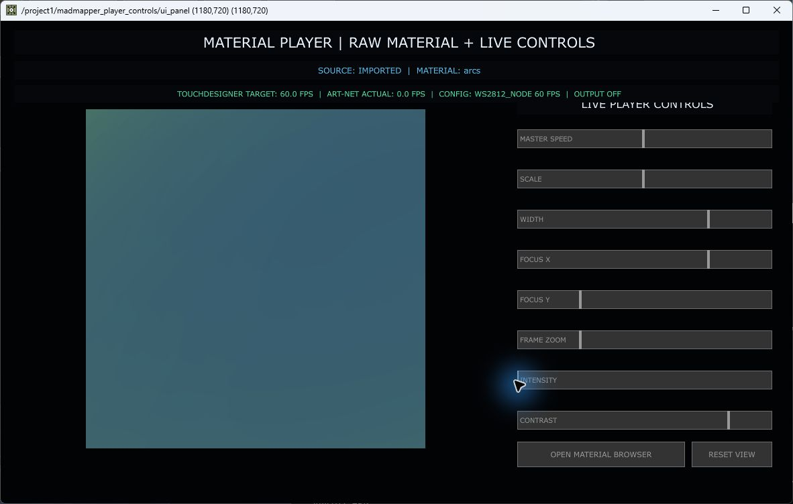

# Echte Bedienprüfungen und Abdeckungsgrenzen

Datum: 07.09.2026. Laufende CORE.88, TouchDesigner 2025.33070. Ergänzt die drei unabhängigen Quellcodeanalysen; ersetzt keine vollständige Hardwareabnahme.

## Schutz und Methode

- Sender war bei Beginn ausgeschaltet. Weder START ENABLED noch START CALIBRATION, APPLY oder ein Dateiimport wurden ausgelöst.
- Dialoge wurden zunächst über ihre vorhandene `openViewer`-Schnittstelle geöffnet. Das ist **kein** bestandener Shortcuttest. Danach wurden die unten genannten Aktionen mit echter Windows-Maus beziehungsweise Tastatur ausgeführt.
- Screenshots wurden mit dem Windows-Computer-Use-Werkzeug aufgenommen. Es gab anfangs Fokuswechsel/überdeckte Fenster; diese Versuche gelten nicht als zuverlässige Funktionsnachweise. Nach Rückfrage gab der Nutzer das Fenster für weitere Maustests frei.
- Ein Aktionsergebnis wurde zusätzlich gegen vorhandene Tabellen, Parameter oder Shaderbindungen geprüft. Ein bewegter Slider allein gilt nicht als bestätigte Bildwirkung.
- Acht temporär veränderte Playerparameter wurden zurückgesetzt. Vorher-/Nachherwerte, alle Materialeinstellungen und die native Zustandstabelle sind wieder identisch. Nur die laufende Animationsphase wurde nicht zurückgespult.
- Controller- und Segmenttabellen sind vor/nach bytegleich; alle zentralen Controls identisch; Sender endet OFF, Send-/Packet-/Pack-Zähler jeweils 0. Kein TOE-Speichern, kein funktionaler Fix.

## Tatsächlich ausgeführte Abläufe

| Test | Aktion | Beobachtung | Urteil |
|---|---|---|---|
| UI-01 | Ctrl+Shift+7 im Netzwerk; anschließend expliziter Netzwerkfokus und Wiederholung | Kein neues sichtbares Fenster; 7 erreichte den ausgelesenen Keyboard-FIFO nicht | Eingabe-/Fokuspfad offen, kein Beweis fehlenden Handlers |
| UI-02 | Ctrl+Shift+7 aus fokussiertem Router | Output Config wird sichtbar geöffnet | PASS für diesen Fokus |
| UI-03 | Output Config → OPEN ART-NET ROUTER mit Maus | Routerfenster sichtbar | PASS nach gesichertem Vordergrundfokus |
| UI-04 | Material Browser NEXT | Seite 1 → 2; gleichzeitig 36 → 53 Treffer und 11 → 28 Imports | Navigation PASS; veralteter Anfangsstand bestätigt |
| UI-05 | Native Params öffnen | Bubble Rings, 15 Parameter in kompaktem Zweispaltenlayout | PASS für Öffnen; ungewollte UPDATED-Meldung separat |
| UI-06 | Native Params → ZURÜCK ZU MATERIALIEN | Materialkatalog wieder sichtbar | PASS; frühere Sackgasse nicht reproduziert |
| UI-07 | Browser PREVIOUS nach Native-Rückkehr | Bei einem Versuch weiter Seite 2 | Einzelbeobachtung, noch kein abschließend isolierter Defekt |
| UI-08 | GICO VALIDATE DRAFT ohne veränderte Felder | Weiter VALID DRAFT; keine Ausgabe gestartet | Status konsistent; ohne unterscheidbare Statusänderung keine sichere Callback-Abnahme |
| UI-09 | Show LOOP zweimal klicken, Wiedergabe STOPPED | OFF → ON → OFF; wieder CUE03, t=12, Blackout ON | PASS, Ausgangszustand wiederhergestellt |
| UI-10 | Library NEXT auf Seite 5; Wiederholung; Mausdrag innerhalb desselben Buttons | Weiter PAGE5/20 und 638 Treffer | FAIL beobachtet; Handlerpfad aktiv, Ursache offen |
| UI-11 | Alle zehn Dialogziele öffnen und visuell erfassen | Alle vorhanden, Screenshots abgelegt, keine rekursiven Operatorfehler im abschließenden Dump | Öffnungs-/Sichtprüfung PASS, nicht jede Funktion getestet |

Der Library-NEXT-Test ist ausdrücklich nicht der erfolgreiche NEXT-Test des separaten Material Browsers. Kurze Klickflanken über einen CHOP sind nur eine Hypothese; der zusätzliche Drag beweist diese Ursache nicht.

## Acht einzelne Player-Regler

Ausgangsmaterial: importiertes Bubble Rings, zentrale Source=imported, Globalmasterspeed=1. Die Playerüberschrift meldet fälschlich `arcs`. Jeder folgende Schritt änderte genau einen der acht erfassten zentralen Parameter. Vorangegangene Testwerte blieben bis zur abschließenden Wiederherstellung bestehen; deshalb ist dies eine Parameterbindungsprüfung, kein zeitlich eingefrorener A/B-Bildvergleich.

| Control | Vorher → per Maus gesetzt | System-/Shaderwirkung | Bewertung |
|---|---|---|---|
| MASTER SPEED | 0,253298 → 0,992084 | Speed geändert; gemeinsame laufende Phasenbindungen vorhanden | Parameter PASS; gemessene Geschwindigkeit pro Panel offen |
| SCALE | 3,91768 → 2,034565 | Core und Import-Uniforms geändert | Bindung PASS |
| WIDTH | 0,42 → 0,749340 | Core und Import-Uniforms geändert | Bindung PASS; Wirkung als horizontale UV-Skalierung erklären |
| FOCUS X | 0,5 → 0,749340 | Beide Renderer erreichen Fokus X | Bindung PASS |
| FOCUS Y | 0,5 → 0,248021 | Beide Renderer erreichen Fokus Y, X bleibt unverändert | Bindung PASS |
| FRAME ZOOM | 0,658971 → 2,172164 | Beide Renderer erreichen Zoom; Ausschnitt sichtbar größer | Bindung PASS; noch kein exakter GPU-A/B-Vergleich |
| INTENSITY | 0,532982 → 0 | Nur Core-Uniform geändert, Importbindung fehlt; Bild bleibt farbig | Wirkung für Import FAIL |
| CONTRAST | 3,33113 → 2,055145 | Nur Core-Uniform geändert, Importbindung fehlt | Wirkung für Import FAIL; bei bereits Intensity0 kein isolierter visueller Kontrastvergleich |

Die nichtschwarze Ausgabe bei Import-Intensity0 darf nicht alleine als Beweis der Gradientformel-Ursache bezeichnet werden: Es fehlt schon die Importbindung. Zusätzlich und unabhängig hebt die geprüfte Gradientformel schwarze Eingangspixel an. Beides ist im Materialbericht getrennt erklärt.

Evidenz: `ui-before.json`, `ui-speed.json` bis `ui-contrast.json`, `ui-restored.json` und die maschinell abgeleitete `ui-verification.json`. Die Wiederherstellung korrigiert auch die genaueren gespeicherten Speed-/Scale-Werte, nicht nur ihre gerundete Anzeige.

## Noch nicht ausgeführte vollständige Abnahme

- Nicht alle 986 inventarisierten UI-Unterknoten sind eigene Bedienelemente. Darunter sind Beschriftungen, innere Sliderteile, versteckte Karten und Duplikate. Die Zahl ist **keine** getestete Buttonzahl.
- Die Inventur reicht drei Unterebenen unter dem jeweiligen Dialogziel. Photo Calibration hat zusätzlich verschachtelte Parameter; deren Quellinventar steht im Mappingbericht.
- Keine vollständige Typ-/Grenzwertmatrix jedes Eingabefelds, kein vollständiger 10-Shortcut×Fokus×Tastaturlayout-Test.
- Keine vollständige Materialauswahl-/Hover-/GPU-Abnahme aller 638 Katalogeinträge oder 28 Imports. Keine Library-Import-/Compile-Fehlertransaktion live ausgelöst.
- Keine Neukalibrierung, keine 88 Corner-Werte verändert, kein Mapping APPLY/REVERT/EXPORT. Diese Aktionen können echte Daten ersetzen.
- Keine ungültigen Router-/GICO-Apply-Eingaben live ausgelöst, weil die Analyse genau dort Teilmutationen nachweist. Diese Fehler wurden isoliert im Softwaremodell geprüft.
- Kein Start der LEDs, keine Paketmitschnitte, kein physischer Panelgrenzentest, keine neue 40-/60-FPS-Hardwarefreigabe.
- Keine gemessenen p95/p99-Framezeiten, keine thermische/Langzeitabnahme, keine saubere Neuinstallation/Rebuild/Relaunch-Abnahme.

Diese offenen Prüfungen sind Teil des folgenden Abnahmeplans, nicht versteckte PASS-Ergebnisse. Eine 100-%-Funktionsgarantie lässt sich aus den bisherigen Tests nicht ableiten.
