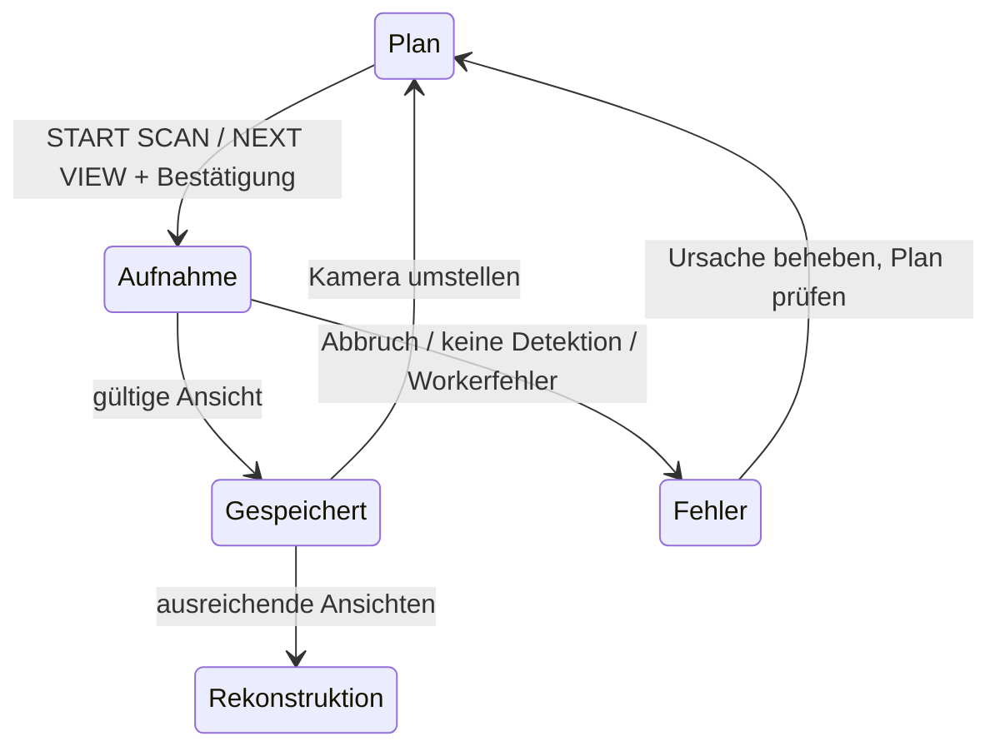

# 1 · Ein weiteres Rückwandpanel scannen

[Übersicht](README_DE.md) · [Weiter: 3D-Ergebnis](02_3D_MAPPING_DE.md)

Ziel: neue Messdaten aufnehmen, **ohne** zuerst ein Dummy-Panel im Layout zu erfinden oder die laufenden Routen umzubauen. Einstieg: **GUIDED SCAN** im Layout, Dialog `/project1/guided_scan/ui_panel`.

## A. Ausgang und Aufnahmebereich vorbereiten

1. Normale Animation im Multi-Controller-Router mit **ALL OUTPUTS OFF** stoppen.
2. Controller-Weboberfläche prüfen: angeschlossener GPIO/Port, echte LED-Anzahl, Startuniversum, Farbreihenfolge. Die zunächst verwendeten 256 waren eine Testannahme; das erste Panel hat **203**, nicht 256 und nicht 156 LEDs.
3. Nicht benötigte Testausgänge dort deaktivieren. Nur empfangene Pakete sind kein Beleg für tatsächlich ausgegebene Frames. Ein Controller kann bei unvollständiger konfigurierter Ausgabe trotz Netzwerkverkehr 0 FPS anzeigen.
4. In Guided Scan **NEW CAPTURE (NO LAYOUT)** öffnen. Für ein neues Panel einen eindeutigen Namen wählen, etwa `Rueckwand_Feld_02`.
5. Felder eintragen, dann **CREATE ACQUISITION (OUTPUT OFF)**. Das erzeugt nur lokale Aufnahmeidentitäten und einen getrennten Scanplan; weder Kamera noch LEDs starten. Alte Dateien bleiben auf der Platte.

| Feld | Eingabe / Wirkung | Referenz des ersten Panels |
|---|---|---|
| CAPTURE NAME | Eindeutiger Name der Aufnahme | `Rueckwand_Feld_01` |
| CONTROLLER IPv4 | Zielgerät, nicht Rechner-IP | `10.0.0.249` |
| LOCAL IPv4 INTERFACE | Eigene Netzwerkkarte im Controller-Netz; aktuell verfügbare Adresse prüfen | zuletzt `10.0.0.125` |
| START UNIVERSE (WIRE, ZERO-BASED) | Tatsächliche Art-Net-Adresse ohne +1 | `120` |
| LED COUNT (LOCAL 0..COUNT-1) | Anzahl, **nicht** letzte LED-ID | `203` → 0–202 |
| FPS LIMIT | Obergrenze, keine garantierte gemessene Rate | `30` |
| NETWORK COLOR ORDER (not LED wiring) | Reihenfolge der übertragenen Kanäle; Hardware-Farbordnung separat prüfen | `RGB` |

**Für das nächste Panel nicht blind diese Werte kopieren.** Bei anderer Verkabelung ist insbesondere Startuniversum/Anzahl neu zu prüfen. Ein inaktiver normaler Controller-/Port-Eintrag verhindert nicht grundsätzlich die getrennte Aufnahme: diese besitzt ihr eigenes geprüftes Scanrouting. `Enabled` im normalen Router ist keine Aufforderung, parallel Live einzuschalten.

## B. Kamera, Helligkeit und Dateiziel

| Guided-Scan-Feld | Bedeutung / Beispiel |
|---|---|
| CAMERA DEVICE | OpenCV-Geräte-ID, zuletzt T1A über `0`. IDs können sich nach USB-Wechsel ändern. `0` garantiert nicht intern/extern. |
| EXPOSURE | Kameraspezifische Belichtung; bisher `-10`. Nur mit Bildkontrolle ändern. |
| DETECTION THRESHOLD | Helligkeitsschwelle 0–254, bisher `160`. Nicht mit LED-Helligkeit verwechseln. |
| SCAN BRIGHTNESS % | Feld und Schieber 1–10 %, Ausgangswert 5 %. Marker/Füllung zeigen die Position. Ändert nur den Scan, nicht Live-Helligkeit. |
| ZERO-BASED SOURCE INDICES | Für neue Aufnahme lokale IDs, z. B. `0-202`. Bei bestehendem Layout dessen vorbereitete Quell-IDs. Kommas erlauben Teilbereiche. |
| VERIFICATION ANCHOR SOURCE INDICES | Stabile Vergleichspunkte für einen geplanten Ersatzscan; sie sollen nicht ersetzt werden. Kein Automatismus für gute Registrierung. Bei eigenständiger Vollaufnahme normalerweise leer. |
| EXISTING 2D VIEW CSV PATHS | Aufgenommene Ansichten, mit `|` getrennt; erfolgreiche neue Ansicht wird angehängt. Nur passende Ansichten derselben Aufnahme verwenden. |
| EXISTING WORKSPACE FOLDER | Existierender, eigener Ordner für diese Aufnahme. Neues Feld = neuer Ordner; nicht die Ansichten verschiedener Panels mischen. |
| OFFLINE WORKER PYTHON | Geprüfter installierter MariMapper-Interpreter für Rekonstruktion, gewöhnlich `C:\Users\jbhtz\AppData\Roaming\uv\tools\marimapper\Scripts\python.exe`. Kein Kamera-Auswahlfeld. |

1. **CHECK CAMERA** drücken. Kameravorschau prüfen: richtiges Gerät, Bild, Schärfe, Belichtung, alle gewünschten LEDs im Bild. Das sendet keine LEDs und speichert keine Ansicht.
2. **CLOSE CAMERA** und bestätigte Freigabe abwarten. Eine noch laufende Kamera-Vorschau blockiert den Scanstart; nicht gleichzeitig ein zweites Kameraprogramm öffnen.
3. Helligkeit vor dem Scan wählen, bei Bedarf mit niedriger Einstellung beginnen. Überstrahlte LED-Flecken erschweren die Zuordnung.
4. **CHECK SCAN PLAN** drücken. Die Zusammenfassung muss Ziel-IP, Universen, Anzahl und Scan-Prozent korrekt zeigen. Dieser Schritt startet nichts und ersetzt das alte missverständliche „Prepare Dry Run“.
5. Nach Änderung von Kamera, Ordner, Umfang, Routing oder Helligkeit den Plan erneut prüfen. Alte Vorbereitung wird zu Recht ungültig.

## C. Eine Ansicht aufnehmen und wiederholen

1. Kamera und Panel unbewegt halten, Fremdlicht stabil halten.
2. **START SCAN / NEXT VIEW**, Bestätigungsdialog lesen und **Start Scan** bestätigen. Eine Betätigung nimmt **eine** Ansicht auf.
3. Währenddessen weder USB, Verkabelung noch Kameraposition ändern. **STOP SCAN** bricht ab; Live startet anschließend nicht automatisch.
4. Auf **VIEW SAVED** und eine zusätzliche akzeptierte Ansicht/CSV warten. Nicht nur auf das Kamerafenster verlassen. Die Abdeckungsanzeige hält Anzahl, fehlende/schwach erfasste LEDs und letzten Zustand fest.
5. Kamera deutlich seitlich oder in der Höhe versetzen; mehrere Blickrichtungen mit gemeinsam sichtbaren LEDs wählen. Nicht nur zehn fast gleiche Bilder aufnehmen.
6. Wieder **START SCAN / NEXT VIEW**. Die Panel-/Quellzuordnung während derselben Aufnahmesitzung nicht ändern.

Mindestens zwei unterschiedliche Ansichten sind für den Offline-Auftrag nötig. Das ist keine Qualitätsgarantie. Beim ersten Panel wurden zehn akzeptierte Ansichten verwendet; alle 203 LEDs waren mindestens zweimal erfasst, 198 mindestens dreimal. Das ist ein Vergleichswert, kein zwingender Sollwert für jedes weitere Panel.

## D. Rekonstruktion ohne Kamera

1. Ansichtenliste kontrollieren: mindestens zwei unterschiedliche passende CSVs; keine Fremdaufnahme.
2. **PREPARE 3D OFFLINE JOB** erstellt Manifest und Befehlsplan. Noch keine Rekonstruktion und keine LEDs.
3. **START 3D** und **Start 3D** im Bestätigungsdialog. Separater MariMapper-Prozess, Zeitlimit fünf Minuten; keine Kamera und keine Ausgabe.
4. Bei Bedarf **STOP 3D**. Bei Fehler Status/Logpfad lesen; vorhandene gute Ansichten bleiben erhalten.
5. Bei fertigem Ergebnis **3D RESULT / PATH** öffnet die Ergebnisprüfung. Es wird **nicht** automatisch ins aktive Layout geschrieben.

## Störungen gezielt unterscheiden

| Symptom | Vorgehen |
|---|---|
| Kein Kamerabild | CHECK CAMERA/Status prüfen, andere Kamera-App schließen, Gerät-ID kontrollieren. Nicht während Capture USB abziehen. |
| Kein LED-Blinken | STOP SCAN; gemeinsame Masse, Versorgung, Controller-Port/Anzahl/Universe prüfen. Hier war bereits eine abgegangene Masse die Ursache. Erst dann neuen Scan. |
| Fremdlicht verwirrt Detektion | Ansicht abbrechen, Licht stabilisieren, erneut aufnehmen. Eine fehlerhafte Ansicht nicht einfach als gut akzeptieren. |
| 0 erkannte LEDs | Aufnahme gilt nicht als erfolgreiche Messung; keine Abdeckung daraus ableiten. Erst Hardware-/Lichttest, nicht nur Threshold beliebig senken. |
| VIEW SAVED nur kurz | Akzeptierte Ansichten, CSV-Liste und Coverage prüfen. Ein kurzfristiger Text allein beweist weder Verlust noch erfolgreiche Vollerfassung. |
| Plan verweigert Start | Angezeigte geänderte Einstellung korrigieren und CHECK SCAN PLAN neu ausführen. |
| Windows-/USB-Problem | Scan nicht weiter stressen; Kamera sauber schließen, Daten sichern, Treiber/USB getrennt diagnostizieren. |
| CANCEL SESSION | Beendet den Arbeitsablauf der Sitzung; nicht als Ersatz für die Kontrolle verwenden, ob Kamera/Ausgabe tatsächlich gestoppt sind. Dateien nicht vorsorglich löschen. |

**Abnahme vor 3D:** richtige IDs/Anzahl, mindestens zwei Ansichten, keine fehlenden oder bewusst dokumentierte fehlende IDs, keine gemischten Panels, Kamerafreigabe bestätigt, Rohdateien vorhanden.
