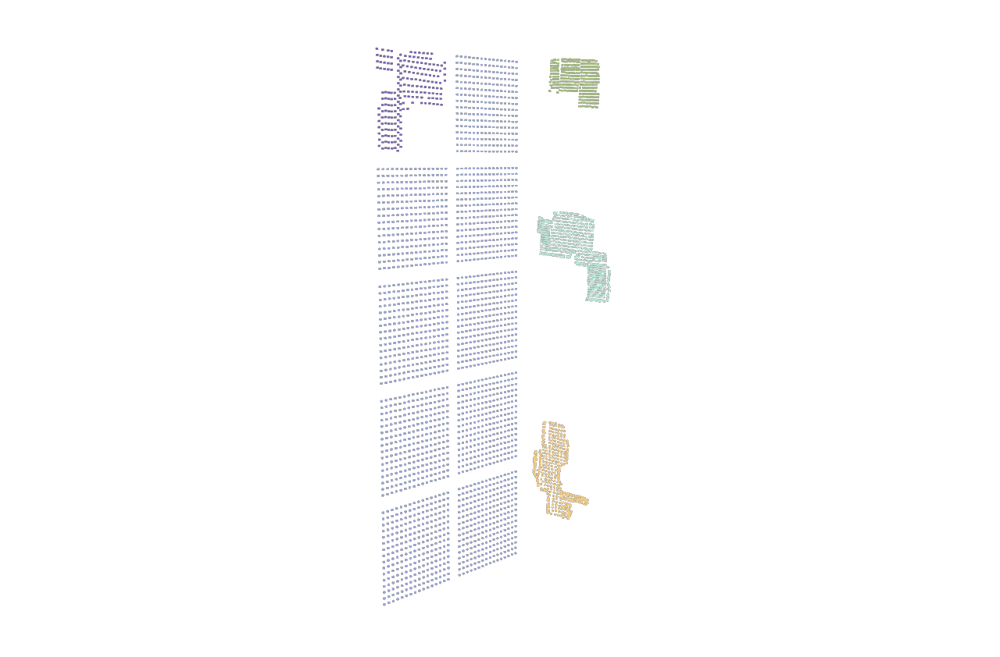

# 2 · Vom Rohscan zum montierten 3D-Panel

[Übersicht](README_DE.md) · [Aufnahme](01_GUIDED_SCAN_DE.md) · [2D und Abnahme](03_2D_FIXTURES_UND_ABNAHME_DE.md)

## A. Ergebnisprüfung verstehen

**3D RESULT / PATH** führt zu **3D RESULT REVIEW | RAW SCAN TO DRAFT**. Prüfen: LED-Anzahl, `missing observed IDs`, Grenzen und Pfad von `candidate_3d.csv`. „Raw SfM units; NOT registered“ heißt: rekonstruierte Koordinaten, aber noch keine bestätigte Montageposition oder Zentimeterskala.

| Feld / Aktion | Wirkung |
|---|---|
| NEW OBJECT NAME | Eindeutiger Name, z. B. `Rueckwand oben rechts – Scan 02` |
| GLOBAL SOURCE OFFSET | Wird zur **ursprünglichen Scan-ID** addiert. Offset 4000 und Scan-ID 202 ergibt Quelle 4202. Keine automatische Verdichtung fehlender IDs. |
| TRANSLATION X/Y/Z | Verschiebung im Layout-Koordinatensystem; keine Zentimeterwerte |
| ROTATION DEGREES X/Y/Z | Drehung in Grad |
| SCALE X/Y/Z | Faktoren, Standard 1; nicht Breite/Höhe in cm |
| ADD AS NEW DRAFT OBJECT | Fügt nach Bestätigung nur ein neues Entwurfsobjekt hinzu; ersetzt keine vorhandene Fläche und startet keine Ausgabe |
| BACK TO GUIDED SCAN | Zurück, ohne hierdurch aktiv zu übernehmen |

### Hinzufügen ist nicht Ersetzen

Beim nächsten Rückwandfeld besteht vermutlich bereits ein angenommener Platzhalter. Rohscan zunächst archivieren und ausrichten; nicht einfach denselben globalen Bereich ein zweites Mal vergeben. Überlappende Quell-IDs werden blockiert.

- **APPEND SCAN / ADD AS NEW DRAFT OBJECT:** neuer Gegenstand oder vorläufiges, nicht überlappendes Importobjekt.
- **REPLACE REGION:** ausgewählte lokale LEDs eines vorhandenen Objekts durch bereits passend registrierte Messdaten ersetzen. Unbeteiligte LEDs unverändert lassen.
- **Andere LED-Anzahl als Platzhalter:** erfordert einen ausdrücklichen Ersatz-/Slotplan. Das erste Feld ersetzte 256 angenommene durch 203 echte LEDs und ließ 53 schwarze Slots zurück. Das ist **kein** Beweis, dass jeder künftige Ersatz automatisch im allgemeinen Dialog funktioniert.

Für das nächste Feld vor Übernahme festhalten: Name/Blickrichtung, lokaler Bereich, tatsächliche Anzahl, bisheriger globaler Platzhalterbereich, künftige Quellen, Zielcontroller/Port/Universe. Nicht die vorhandene 53er-Lücke willkürlich mit einem anderen Panel auffüllen.

## B. Layout-Datei importieren und Entwurf erhalten

Einstieg `/project1/layout_scene_editor/ui_panel`, **3D LAYOUT + 2D FIXTURES**.

| Feld / Schaltfläche | Bedeutung |
|---|---|
| LOAD ACTIVE SNAPSHOT | Neuer Entwurf aus der aktiven Map; kann den sorgfältig gruppierten bisherigen Entwurf ersetzen. Vorher exportieren. |
| LOAD CURRENT FILE | Angezeigte Ausgangsdatei neu laden |
| OPEN SCENE | Gespeicherten Workspace/Scene laden; nicht dasselbe wie einen Rohscan anhängen |
| Import format | `marimapper-csv`, `marimapper-json`, `pixelblaze` |
| New object / scan name | Name des angehängten Scans |
| Explicit global source start | Expliziter globaler Quellbeginn, nicht Art-Net-Universe |
| Original scan indices | Originale Scan-IDs auswählen, leer = alle |
| APPEND SCAN | Dateiauswahl für zusätzliches Objekt; bestehende Quell-IDs dürfen nicht kollidieren |
| Selected object LOCAL range to replace | Lokaler Bereich des **ausgewählten Objekts**, nicht automatisch globaler Index |
| REPLACE REGION | Nach Bestätigung registrierte Teilmessung einsetzen; die Zusicherung ist keine automatische Genauigkeitsprüfung |
| Expected final count / SET COUNT | Erwartete Anzahl validieren; nicht als Reparatur zum Abschneiden oder Erfinden von LEDs verwenden |

MariMapper-JSON wird als unterstütztes Koordinatenarray gelesen; CSV für 3D enthält `index,x,y,z`. Die Aufnahmeansichten `index,u,v` sind **2D-Messungen**, kein fertiges 3D-Layout. Pixelblaze-2D-Punkte erhalten eine Null-Tiefe. Beliebiger Generatorcode wird im UI nicht ausgeführt.

## C. Ansicht und Objekt getrennt bewegen

| Bedienung | Wirkung |
|---|---|
| Object number + SELECT | Wählt ein Objekt; Namen, Quellen und LED-Anzahl unten prüfen |
| Rechte Maustaste ziehen | Nur Kamera/Ansicht drehen |
| Mausrad, ZOOM + / ZOOM - | Nur Ansicht zoomen |
| VIEW LEFT / VIEW RIGHT | Nur Kamera schrittweise drehen |
| FRAME / RESET VIEW | Kamera auf Inhalt einstellen; keine LED-Ausrichtung reparieren |
| Linke Maustaste ziehen | **Ausgewähltes Objekt ändern**, je nach `move`, `rotate`, `scale` |
| Pfeiltasten | Objekt in X/Y ändern, wenn die Editorfläche den Fokus hat |
| Page Up / Page Down | Z ändern |
| Rotate/scale axis | x/y/z für Dreh-/Skalieroperation |
| Key step | Schrittweite in Welteinheiten bzw. Grad |
| Translate/Rotate/Scale + SET TRANSFORM | Numerische Transformation ausdrücklich übernehmen |
| Escape während Ziehen | Vorschau abbrechen |
| UNDO / REDO, Ctrl+Z / Ctrl+Y | Entwurfsänderung zurück/vor; nicht automatisch aktive Ausgabe zurücknehmen |

Benutzerachsen: **X = Höhe, Y = rechts, Z = hinten**. Die Darstellung wandelt intern `(X,Y,Z)` in `(Y,X,-Z)` um; das ist kein Grund, Exportachsen eigenmächtig zu vertauschen. In der bisherigen Rückwandgeometrie liegt die Ebene bei Y=1. Aussagen wie „links“ immer mit Blickrichtung dokumentieren.

### Konkreter Größen-/Ausrichtungsworkflow

1. Objekt auswählen, LED 0 und letzten Punkt mit realem Panel vergleichen. Blick direkt auf die LED-Seite festhalten.
2. Bestätigte Montageform herstellen. „Oben/unten tauschen“ und „links/rechts tauschen“ ausdrücklich unterscheiden; Kameradrehung ist keine geometrische Spiegelung.
3. Erst Breite/Höhe messen, dann skalieren. Der aktuell verwendete relative Maßstab lautet **30 cm = 0,16875 Welteinheiten**, also 0,005625 Einheiten/cm. Das ist aus der bisherigen Referenz abgeleitet, keine neue Gesamtvermessung.
4. Zur Kontrolle: 20 × 16 cm entsprechen 0,1125 × 0,09; 29,5 × 29 cm entsprechen 0,1659375 × 0,163125; 23 × 33 cm entsprechen 0,129375 × 0,185625. Das sind gewünschte **Ausdehnungen**, nicht direkt die Scale-Feldwerte. Faktor = gewünschte Ausdehnung / gemessene aktuelle Ausdehnung entlang derselben Achse.
5. Wenn Breite/Höhe unterschiedliche Faktoren verlangen, Scanverzerrung/Messbezug prüfen. Eine freie Achsenskalierung kann das Panel verformen; Rohdaten deshalb behalten.
6. Position nach Nachbarfeldern einstellen, Tiefe/Abstand prüfen. Die bisherigen Seitenpositionen sind vom Foto geschätzt und bleiben vorläufig.
7. Entwurf exportieren; Form/LED-0-Lage/Abstände visuell bestätigen, danach aktive Daten separat behandeln.

[Details und bestätigte Seitenformen](../implementation-2026-09-07/side-alignment/HOWTO_SEITENPANELS_DE.md). Dort sind auch frühere Diagnosezustände enthalten; für „aktiv oder Entwurf?“ den Nachtrag zur Live-Übernahme beachten.

## D. Routing und aktive Übernahme

**BIND ROUTE DRAFT** speichert Controller identity und Physical port als Absicht. Es ist keine sofortige Netzwerkkonfiguration. Auch ein gut aussehendes Modell beweist noch nicht, dass das richtige physische Panel angesteuert wird.

Der allgemeine geprüfte Ablauf für einen **vollständigen, gültigen** Workspace:

1. Ausgabe ausschalten. Vorher Workspace und TOE-Sicherung erstellen.
2. `Keep live routes` ausdrücklich `YES`: vorhandene Routen bleiben erhalten; Entwurfsrouten werden nicht angewendet.
3. Gewünschten 3D-/2D-Tab und Projektionsachsen wählen.
4. **VALIDATE / PREPARE**, Zusammenfassung bestätigen. Noch keine aktive Änderung.
5. **APPLY (OUTPUT OFF)** erneut bestätigen. Änderungen seit Prepare, falsche Counts/Abdeckung, laufende Sender oder Konflikte blockieren zu Recht.
6. Aktive XYZ/UV, unveränderte andere Panels und Quellen kontrollieren. Live erst anschließend bewusst starten.
7. **REVERT LAST** gilt nur für die passende letzte allgemeine Übernahme; externe Änderungen können Rücknahme blockieren.

**Für den jetzigen lückenhaften Entwurf nicht blind APPLY drücken.** Rückwandfeld 1 und Seitenpanels wurden über separate geprüfte Teilübernahmen aktiviert. Die Rücknahme-Daten liegen im Router als `back_panel_partial_activation_backup` und `side_panel_partial_activation_backup`; der generische REVERT-Knopf gehört nicht zu diesen Sondertransaktionen. Für den nächsten Ersatzscan ist dieser Integrationsschritt weiterhin separat zu prüfen, nicht durch `SET COUNT` oder Umnummerierung zu umgehen.

## E. Speichern und Exportieren

| Export | Enthält | Nicht enthalten / Grenze |
|---|---|---|
| EXPORT WORKSPACE | Rohscanherkunft, IDs, 3D-Transformationen, Routingabsicht, 2D-Domänen | Kein automatischer Start/Hardware-Setup; Laden setzt die exportbezogene Undo-Historie neu auf |
| EXPORT PIXELBLAZE 3D | Dichtes XYZ-Array | Kein vollständiger Identitäts-/Routing-/Undo-Ersatz; Lücken blockieren statt still neu zu nummerieren |
| EXPORT UV | Geprüfte Material-UV-Zuordnung | Kein physischer 3D-Export; veraltete oder unvollständige Fixtures blockieren |
| TOE speichern | TouchDesigner-Projektstand einschließlich vorbereiteter primitiver Sitzungssnapshots | Externe Scanarchive separat sichern; Speicherwarnungen ernst nehmen |

Ein sinnvolles Archiv pro Feld enthält: Rohansichten, Ergebnis-CSV, Workspace vor/nach Einfügen, Maße/Blickrichtung/LED-0-Foto, Route/Universe, Übernahmeprotokoll und benannte TOE-Sicherung. Nicht nur den zuletzt verwendeten Pfad notieren.
