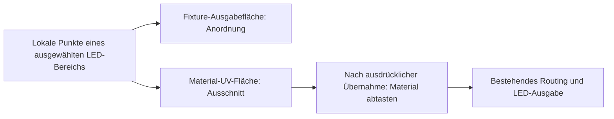
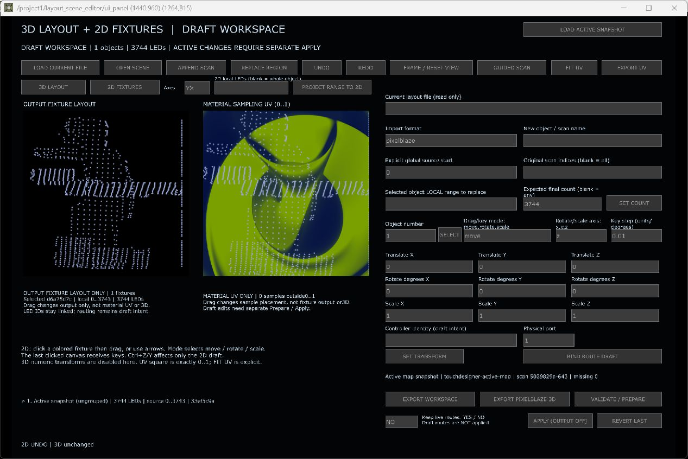

# 3 · 2D-Fixtures, Materialausschnitt und Abnahme

[Übersicht](README_DE.md) · [3D-Workflow](02_3D_MAPPING_DE.md)

## Zwei Flächen, zwei verschiedene Aufgaben

Links wird die **Fixture-Anordnung** bearbeitet. Rechts wird festgelegt, **welcher Teil des Materials** für die LEDs abgetastet wird. Eine Änderung rechts verschiebt nicht die physische 3D-Montageposition. Eine Änderung links verschiebt nicht automatisch den Materialausschnitt.

## Einen Bereich auf ein Material legen

1. Workspace exportieren. Aktuell sind die vor der Seitenkorrektur erzeugten 2D-Fixtures veraltet; nicht ihre scheinbar passende Grafik als aktuellen Datenstand verwenden.
2. In **3D LAYOUT** das gewünschte Objekt über **Object number / SELECT** auswählen.
3. **Axes** einstellen: `YX` bedeutet lokale Y horizontal, lokale X vertikal. Andere erlaubte Projektionen: XY, XZ, ZX, YZ, ZY. Bei einem schrägen Rohscan zuerst dessen Koordinatenrahmen verstehen; eine unpassende Projektion kann das Panel als Linie zeigen.
4. **2D local LEDs** leer für das gesamte Objekt oder explizit `0-19,40-59`. Das sind lokale Objekt-IDs, keine Universen und nicht zwangsläufig globale Quellen.
5. **PROJECT RANGE TO 2D**. Disjunkte Bereiche können eigene Fixtures werden. Teilweise überlappende Bereiche werden nicht heimlich zerlegt. Ein exakt vorhandener Bereich kann nach Bestätigung neu projiziert werden.
6. **2D FIXTURES** öffnen. Klick nahe einem farbigen Punkt wählt das Fixture, nicht nur eine LED. Objekt-/Bereichsidentität prüfen.
7. Linke Fläche anklicken und mit `move` anordnen; rechte Fläche anklicken und Materialausschnitt verschieben. Ziehen und Pfeile wirken nur auf die zuletzt angeklickte Fläche. `rotate` dreht in der Ebene, `scale` ändert die Größe.
8. **FIT UV** passt das ausgewählte Fixture ausdrücklich in 0–1 ein. Nur Material-UV wird verändert. Falls nur ein kleiner Materialausschnitt gewünscht ist, anschließend gezielt positionieren/skalieren.
9. **UNDO/REDO** prüfen, dann Workspace exportieren. **EXPORT UV** erst bei vollständiger gültiger Abdeckung und unveralteter Quelle.

## Felder und Grenzen

| Bedienung | Erwartete Wirkung / Grenze |
|---|---|
| Axes | Lokale Projektion, nicht automatisch Weltposition und kein Kameraorbit |
| 2D local LEDs | Explizite Fixture-Mitgliedschaft; Reihenfolge nummeriert keine LEDs neu |
| Mode move/rotate/scale | Bearbeitet die gewählte 2D-Domäne |
| 3D Translate/Rotate/Scale | Im 2D-Tab deaktiviert; keine versteckte Bearbeitung räumlicher Koordinaten |
| FRAME / RESET VIEW | Linke Ansicht passend rahmen; UV bleibt im festen 0–1-Raum |
| FIT UV | Bewusste UV-Normalisierung des ausgewählten Fixtures |
| Materialhintergrund | Vorschau aus `/project1/res1`, sofern vorhanden; **allein dadurch noch keine Live-Sampling-Verbindung** |
| EXPORT UV | Prüft aktuelle 3D-Revision, vollständige LED-Abdeckung, fehlende Punkte und 0–1-Grenzen. Keine stille Klemmung. |

Nach Änderungen der 3D-Quelle bleiben Fixture-Daten zur Sicherheit erhalten, gelten aber als veraltet. Erneute Projektion kann das Zurücksetzen des **gesamten 2D-Workspaces** verlangen. Vor Bestätigung exportieren. Ein differenzielles automatisches Nachführen alter Fixtures ist derzeit keine zugesicherte Funktion. Wiederprojektion desselben Fixtures kann dessen beide Transformationen und 2D-Historie zurücksetzen.

Für aktive 2D-Übernahme gilt derselbe separate Prepare-/Apply-Sicherheitsablauf wie im [3D-How-to](02_3D_MAPPING_DE.md). Er übernimmt UV und Fixture-Anordnung, **nicht physische XYZ**. Controller-/Port-Entwurfsbindungen werden nicht automatisch aktiv. Im gegenwärtig lückenhaften Projekt ist die vollständige Übernahme zunächst zu klären.

## Foto-Vorschau ist eine weitere Darstellungsebene

Die LED-Fotoansicht verwendet jetzt einen gemeinsamen orthografischen Renderpfad aus den aktiven XYZ-Punkten und einer expliziten Foto-Projektion pro Fläche. Der vorherige Weg mit zusätzlichen Rendertransformationen, festen Zuschnitten und Corner Pins bleibt für Rücknahme erhalten, ist aber nicht mehr die aktive LED-Überlagerung. Deshalb drei getrennte Prüfungen:

1. Stimmt die unverzerrte Punktwolke mit der gemessenen Panelkontur überein?
2. Liegt dieselbe Form im 3D-Layout am richtigen Ort, in richtiger Größe und Blickrichtung?
3. Liegt die Fotoüberlagerung auf der fotografierten Fläche?

Wenn nur Punkt 3 scheitert, nicht den Rohscan verzerren, um die Foto-Projektion zu kompensieren. Materialbewegung, Fotoansicht und echte LED-Ausgabe jeweils separat beurteilen. Die neue Preview ist eingespielt; besonders die geschätzten Seiten-Eckpunkte brauchen noch den Nutzerabgleich. [Bedienung und tatsächlicher neuer Render](04_PHOTO_PREVIEW_DE.md).

## Abnahmeblatt für jedes weitere Rückwandfeld

Die Liste ist eine wiederholbare Prüfanweisung, keine Behauptung, dass die folgenden Prüfungen bereits für Feld 2 bestanden sind. Pro Test Datum, Werte, Screenshot/Dateipfad und Ergebnis festhalten.

| Nr. | Handlung mit festen Werten | Erwartetes Ergebnis | Nachweisart |
|---|---|---|---|
| S1 | Tatsächliche Anzahl N notieren; IDs 0 und N−1 prüfen | Erste/letzte physische LED stimmen; N ist nicht N−1 | Hardware/Sicht |
| S2 | Ziel-IP und Start-Wire-U im Plan mit Gerät vergleichen | Exakte Übereinstimmung, kein +1-Versatz | UI + Gerätekonfig |
| S3 | Helligkeit z. B. 5 %, Plan prüfen, Ansicht starten | Scanhelligkeit passend; Live-Helligkeit unverändert | UI + Hardware |
| S4 | Eine Ansicht speichern, danach weitere Blickrichtung | Akzeptierte CSV-Liste wächst; richtige Aufnahme-IDs | Datei + UI |
| S5 | Coverage vor Rekonstruktion lesen | Fehlende/schwach erfasste LEDs bekannt; keine Nullansicht als Erfolg | Datei + UI |
| M1 | Ergebnis laden und Anzahl/fehlende IDs prüfen | Keine unerklärte Verdichtung oder fremde LEDs | Daten |
| M2 | Nur ausgewähltes Objekt verschieben; UNDO | Andere Objekte identisch, Undo stellt Position wieder her | Daten + UI |
| M3 | Rechts ziehen / Mausrad | Ansicht ändert sich, Objektkoordinaten nicht | Daten + UI |
| M4 | Maße und LED 0 abgleichen | Korrekte Breite/Höhe und Blickrichtung | Messung + Sicht |
| M5 | Export Workspace, getrennte Kopie laden | IDs, Punkte, Maße und Zuordnung erhalten | Datei-Roundtrip |
| U1 | Rechts UV verschieben, links kontrollieren | Nur Ausschnitt ändert sich, Fixture-Anordnung bleibt | Daten + UI |
| U2 | Links Fixture verschieben, rechts kontrollieren | Nur Anordnung ändert sich, UV bleibt | Daten + UI |
| A1 | Vor aktiver Übernahme Ausgaben ausschalten | Keine parallele Animation/Scan-Ausgabe | Senderstatus |
| A2 | Geprüfte Übernahme; unbeteiligte XYZ/UV/Routen vergleichen | Nur vereinbarter Bereich verändert | Datenvergleich |
| A3 | Einzelne kontrollierte Farbe/Chase, anschließend Animation | Richtiger Anschluss, keine Nachbarpaneländerung | Hardware |
| A4 | Gleiche Laufrichtung und Helligkeit vergleichen | Gewollte Bewegung; kein unerklärter Tempo-/Helligkeitsunterschied | Sicht + Senderwerte |
| A5 | Gemessene FPS am Sender und Controller lesen | Sollrate von tatsächlicher Rate unterschieden; Aussetzer dokumentiert | Telemetrie |
| A6 | Ausschalten, geprüft speichern, später wieder öffnen | Keine Speicherwarnung; Daten erhalten; kein unbeabsichtigter Ausgabestart | TOE-Wiederöffnung |

## Verbleibende Grenzen transparent halten

- Ruckeln kann trotz korrekter Geometrie aus Sender-/Render-Framezeiten kommen. Fehlerfreie Paketaufrufe beweisen weder stabile FPS noch die physische Bildausgabe.
- Helligkeiten sind pro Controller unterschiedlich einstellbar; Scanhelligkeit ist separat. Einen Controller nicht allein wegen einer dunkleren Vorschau pauschal auf 100 % setzen.
- Allgemeine Vollübernahme/UV-Export und aktuelle Quell-ID-Lücken sind noch getrennt zu behandeln; kein automatisches Renumbering.
- Scanqualität und metrische Registrierung werden nicht allein durch „203 Punkte“ bewiesen. Fehlende Perspektiven, Reflexionen und LED-Verwechslungen bleiben mögliche Fehler.
- Mouse-/Hardwaretests benötigen die tatsächliche Oberfläche und den Nutzerblick auf die Installation. Ein bestandener Modelltest ist kein Ersatz.
