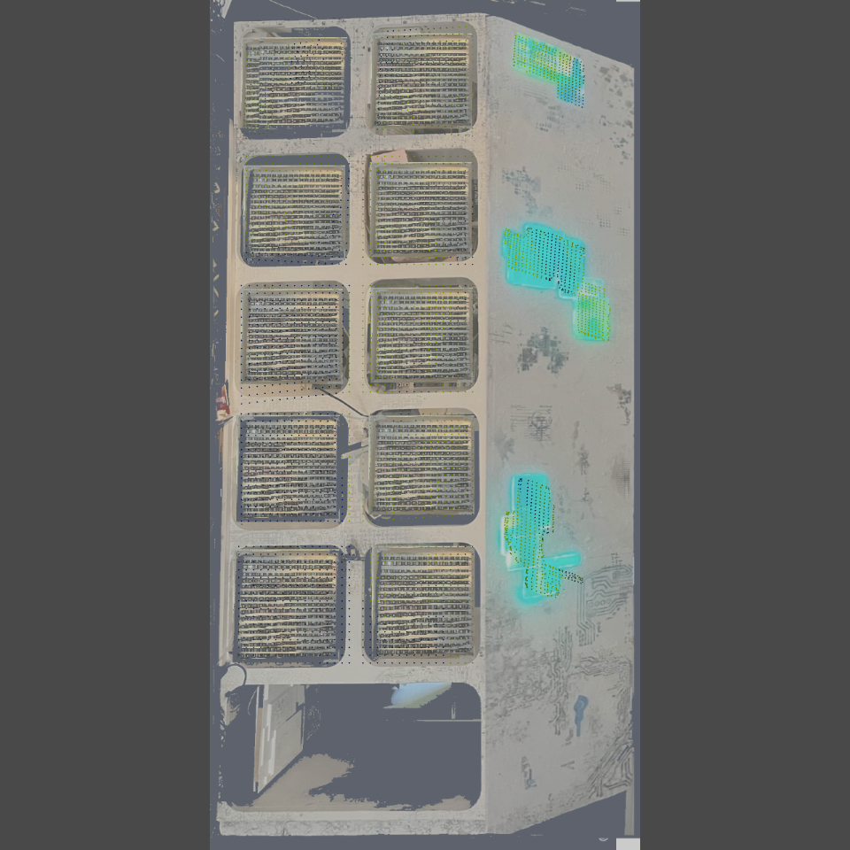
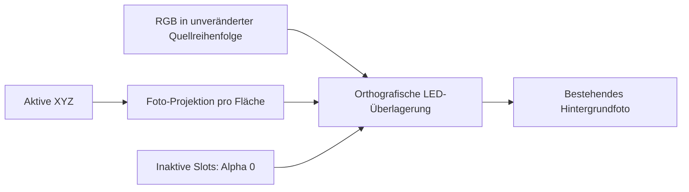

# 4 · LED-Fotovorschau und dynamischer Router

[Übersicht](README_DE.md) · [3D-Geometrie](02_3D_MAPPING_DE.md) · [Prüfliste](03_2D_FIXTURES_UND_ABNAHME_DE.md)

Stand: 9. September 2026 nach Live-Installation. **Die Fotoanpassung verändert weder die aktive 3D-Map noch LED-IDs, Farbreihenfolge, Universen oder Hardwareausgabe.**

## Was an der Vorschau geändert wurde

Die bisherige Fotoansicht besaß einen zusätzlichen Darstellungsweg mit festen Geometrie-Transformationen und Zuschnitten. Diese Einstellungen passten nicht mehr zuverlässig zu den nun ausgerichteten aktiven Punkten. Der Fehler war daher nicht allein durch „203 statt 256 LEDs“ erklärt.

Der neue Weg in `pixelblaze_mapper/photo_map_preview.py`:

1. Liest tatsächliche XYZ aus `/project1/pixelblaze_mapper/map_active`.
2. Projiziert jede aktive Seitenform auf ihre eigene Fotofläche, ohne die Reihenfolge der Quellpunkte/Farben zu ändern.
3. Ordnet Rückwandpunkte anhand ihrer Weltposition dem fotografierten Feld F00–F09 zu, **nicht** durch einen angenommenen 256er-Quellblock.
4. Das gemessene 203er-Panel liegt dadurch im Foto-Feld **F00, oben links beim Blick von vorne**.
5. Die technischen Schwarz-Slots 1643–1695 erhalten Alpha 0. Es bleiben 3744 Datenplätze, davon **3691 sichtbar**; unsichtbare Slots werden nicht gelöscht oder neu nummeriert.
6. Rendert die LED-Punkte über eine gemeinsame orthografische Kamera auf das Foto.

Die übrigen Rückwandfelder sind weiterhin angenommene/alte Flächen, **keine neu vermessenen Panels**. Ein sauber aussehendes Rechteck ist kein Scan-Nachweis.

## Seitliche Fotoflächen fein ausrichten

Die Eckeinstellungen gehören zum COMP:

`/project1/pixelblaze_mapper/preview3d/phase2_interaction_background_prototype`

Dort die benutzerdefinierte Parameterseite **Photo panels** öffnen. Je Panel gibt es vier Ecken mit je X/Y. Das ist derzeit die native TouchDesigner-Parameterseite, kein zugesicherter neuer Maus-Griffeditor auf dem Foto.

| Beschriftung | Fläche / Bedeutung |
|---|---|
| Upper TL/TR/BL/BR X/Y | Oberes Seitenpanel |
| Middle TL/TR/BL/BR X/Y | Mittleres Seitenpanel |
| Lower TL/TR/BL/BR X/Y | Unteres Seitenpanel |
| TL / TR | oben links / oben rechts |
| BL / BR | unten links / unten rechts |
| X | Normierte Fotoposition horizontal; 0 links, 1 rechts |
| Y | Normierte Fotoposition vertikal; 0 unten, 1 oben |

1. Vorher Werte notieren oder Projekt unter neuem Namen sichern.
2. Nur ein Panel bearbeiten; **Upper** entspricht oben, nicht dem ersten elektrischen Port.
3. Eckpunkte in kleinen Schritten verschieben, bis die projizierte Kontur auf der fotografierten LED-Fläche liegt.
4. Nicht die Eckreihenfolge kreuzen oder eine Fläche auf eine Linie zusammenziehen. Degenerierte Projektionen können einen Fehler erzeugen; dann die letzten gültigen Werte zurücksetzen.
5. Mit einer ruhigen/kontrastreichen Materialansicht prüfen. Die gemessenen 20×16, 29,5×29 und 23×33 cm bleiben Eigenschaften der 3D-Geometrie; Fotoeckwerte sind **keine Zentimetermaße**.

Die ersten Seiten-Eckwerte stammen aus dem Foto und bleiben geschätzt. Sie bestimmen die Fotoplatzierung und Perspektive unabhängig von den bestätigten Montageformen. Die bestehenden Rückwand-Ecken F00–F09 wurden beibehalten. Beim nächsten gescannten Rückwandfeld erst dessen Weltposition korrekt setzen; danach Fotoüberlagerung prüfen.

Sichtbarkeit und Darstellung verwenden weiterhin **Showside**, **Showrear**, **Sideopacity**, **Rearopacity** und **Ledopacity**. Diese Opazitäten sind Vorschauwerte, **nicht Controller-Helligkeit**. Falls alle Punkte unsichtbar erscheinen, zunächst diese Werte und den ausgewählten Vorschauweg prüfen.

## Technische Rücknahme der Vorschau

Der alte `cal_leds`-Verbund bleibt angeschlossen und gültig erhalten. Die neue Überlagerung speist Eingang 0 von `cal_over_background`. Für eine gezielte technische Rücknahme kann dieser Eingang wieder mit `cal_leds` verbunden werden. Das ist eine Network-Editor-/Integrationshandlung, kein neuer „Undo Preview“-Button. Nicht die aktive Map zurücksetzen, um nur die alte Fotoansicht wiederherzustellen.

## Router: neue Controller automatisch erreichbar

Im **ART-NET MULTI-CONTROLLER ROUTER** werden Karten nun aus der aktuellen Konfiguration erzeugt. Mit **<** und **>** wechseln; Titel und „n / Anzahl controllers“ zeigen den ausgewählten Controller. `BACK_PANEL_249` ist damit regulär erreichbar und nicht mehr von einer fest eingebauten Zweieransicht ausgeschlossen.

| Feld / Button | Wirkung |
|---|---|
| IP address (draft) | Entwurf der Ziel-IP |
| First WIRE universe (0-based) | Startuniversum auf der Leitung, ohne +1 |
| Enabled 0/1 (draft) | Controllerfreigabe im Entwurf; allein kein Startbefehl |
| Requested rate FPS (draft) | Sollrate, nicht tatsächliche Bildrate |
| Brightness 0..1 | 0,3 bzw. 0.3 = 30 % |
| BRIGHTNESS LIVE | Nur Helligkeit des ausgewählten Controllers ändern; Senderzustand bleibt gleich |
| < / > | Controller wechseln, offene Kartenentwürfe bleiben erhalten |
| RELOAD | Entwurf der aktuellen Karte verwerfen und Konfiguration neu lesen |
| APPLY SAFE DRAFT | Konfiguration geprüft übernehmen; stoppt Ausgabe, nicht mit Helligkeits-Schnelländerung verwechseln |
| START ENABLED / ALL OUTPUTS OFF | Bewusst starten / stoppen |

Die Route/Statusanzeige hilft, tatsächliche Konfiguration und offene Feldentwürfe zu unterscheiden. Fehlende Animation auf der Rückwand kann weiterhin ein Geräteproblem sein: GPIO 27 muss für das erste Panel **203 LEDs ab U120** erwarten. Weitere nur zum Test aktivierte Geräteausgänge können die Framevollständigkeit beeinflussen; TD-Karten ersetzen nicht die Controller-Webkonfiguration.

### Tatsächlich durchgeführte Router-Prüfung dieses Arbeitslaufs

- Mit echten Mausklicks durch alle drei Karten navigiert.
- Nur BACK_PANEL_249-Helligkeit 0,9 → 0,85 → 0,9 geändert.
- Seitenhelligkeit blieb 0,7; Sender blieb ausgeschaltet.
- APPLY SAFE DRAFT real angeklickt und unveränderte Konfigurationstabellen bei unverändertem Entwurf kontrolliert.

Dies beweist die UI-/Konfigurationswirkung, **nicht** die physische Helligkeit oder eine neue stabile Hardware-FPS-Messung. Live erst zum nächsten bewussten Test starten. Die Scanstart-Bestätigung ist ebenfalls auf den tatsächlichen 1–10-%-Bereich korrigiert.

## Vor dem nächsten Panel

- Foto-Seitenkonturen visuell abgleichen; ungemessene Rückwandfelder nicht als fertige Messung behandeln.
- Scan wie in [How-to 1](01_GUIDED_SCAN_DE.md) aufnehmen, danach Weltposition und Identitäten prüfen.
- Die lückenhafte vollständige Layout-Übernahme bleibt eine separate Einschränkung. Der neue Foto-Renderer behebt weder die 53er-Quelllücke noch die allgemeinen APPLY-/UV-Exportbedingungen.
