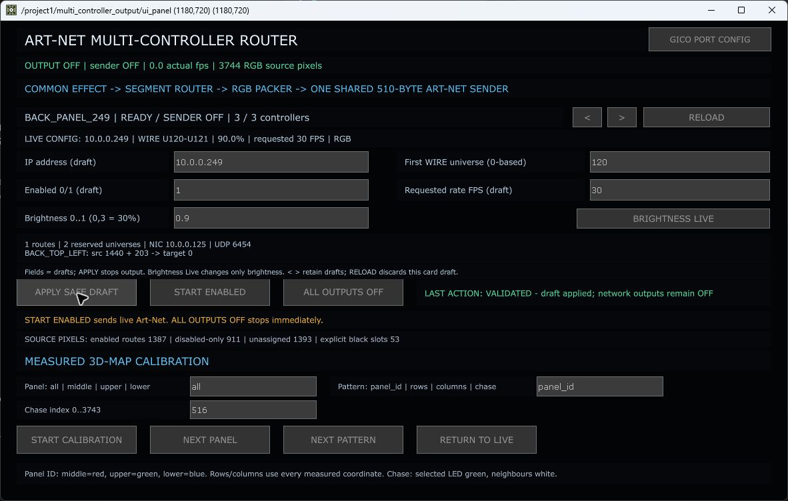

# Abschluss dieser Fixrunde – 9. September 2026

## Eingespielt

- Dynamische Router-Karten für alle konfigurierten Controller; getrennte Entwurfswerte und wirksame Konfiguration. BACK_PANEL_249 erscheint einschließlich Helligkeit und WIRE U120–121.
- Helligkeitsübernahme ändert nur den ausgewählten Controller. Safe Apply wurde auch im echten Dialog geprüft; der während der Integration gefundene `panelexecuteDAT`-Namespacefehler ist behoben.
- Individuelle Sender-Deadlines statt eines gemeinsamen, driftenden Zeitabstands. Konfigurierte 60/30 FPS werden getrennt behandelt, ohne verspätete Pakete als Burst nachzuholen.
- Fotovorschau: echte aktive XYZ-Punkte, orthografischer Einzelrender, räumliche Zuordnung der Rückwandfelder, separate Foto-Eckkalibrierung der drei Seiten. Kein erneutes Verschieben von LED-IDs oder Hardware-Routen.
- 53 unbesetzte Rückwand-Slots sind transparent; 3691 sichtbare Punkte bei weiterhin 3744 adressierbaren Quellslots. Das gescannte Feld mit 203 Punkten liegt im Foto oben links.
- Scanstart-Hinweis korrigiert: ausgewählte Scanhelligkeit 1–10 %, nicht pauschal „max 5 %“.
- Fünf deutschsprachige Einstiegs-/How-to-Dokumente mit Parametertabellen, Abläufen, Diagramm und realen Projektbildern.

## Tatsächlich geprüft

| Prüfung | Ergebnis |
|---|---|
| 62 Router-/Pacing-/Preview-Tests | erfolgreich |
| 337 Scan-/3D-/Fixture-/Speicher-/Maskentests | erfolgreich |
| Voller generierter Sender mit echten Packern, simuliertem Socket und Uhr | 600 Seiten- und 300 Rückwandframes im 10-s-Test; korrekte Adressen, Nutzdaten, Farbe, Schwarzmaske, Stopp und Zähler |
| Echte Maus: Controller weiter | alle drei Karten erreicht |
| Echte Maus: BACK-Helligkeit 0,90 → 0,85 → 0,90 | Datenzelle und Live-Anzeige ändern sich; Seitenwert bleibt 0,70, Sender bleibt OFF |
| Echte Maus: APPLY SAFE DRAFT | VALIDATED; Controller- und Segmenttabellen gegenüber vorher unverändert; Ausgabe OFF |
| TouchDesigner Fehlerprüfung nach Integration | keine Operatorfehler unter /project1 |
| Foto-Render | visuell geprüft; keine schmalen Seitenstreifen mehr; aktive Punktgeometrie statt alter Transformationskette |
| Controller .249 per lesender API | GPIO 27: 203 LEDs, U120–121; GPIO 14/25 deaktiviert |
| TOE-Speicherung mit Storage-/Pickle-Vorprüfung | erfolgreich, siehe save-evidence.json |

Die Mausprüfung benötigte eine erneute Öffnung des Routerfensters, nachdem die erste Fensterinstanz keine Button-Ereignisse mehr lieferte. Die anschließende Übernahme und Rücknahme wurden an den tatsächlichen Konfigurationsdaten verifiziert. Die 399 automatischen Tests sind keine Garantie für jede denkbare Hardware-/UI-Situation.

## Bewusst noch nicht als erledigt erklärt

- **Hardware-Dauerlauf/gefühltes Ruckeln:** Der Sender wurde nicht eigenmächtig wieder eingeschaltet. Der getestete Taktungsfehler ist korrigiert, ein konstanter physischer 60-FPS-Betrieb aber nicht nachgewiesen. Weitere Render-/GPU-Engpässe sind möglich.
- **Fotogenauigkeit:** Seiten-Eckpunkte und Montagezentren beruhen teilweise auf dem Foto. Noch nicht gescannte Rückwandfelder bleiben Platzhalter. Foto-Kalibrierung ist keine metrische Nachvermessung.
- **Allgemeines Sparse-APPLY:** Der gesamte Entwurf hat 3691 Punkte bei 3744 Slots. Die vorhandene allgemeine Übernahme/der dichte Pixelblaze-Export bleiben deshalb geschützt. Bisherige Teilübernahmen sind kein universeller Ersatz dafür. Den nächsten Ersatzscan gezielt integrieren; nicht per SET COUNT oder Umnummerierung umgehen.
- **Nächste Aufnahme:** In dieser Runde wurde keine neue Kameraaufnahme und kein neues physisches Panel gescannt. Vorher dessen Anschluss, tatsächliche LED-Anzahl und Universen festhalten.

Aktuelle sichere Datei: `Backup/Implementation/PixelblazeMapper_20260909_ROUTER_PREVIEW_HOWTOS.2.toe`. Der Sender ist beim Speichern OFF. Externe Rohscans bleiben unverändert.
