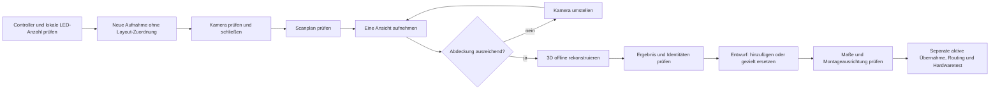

# Scan und Mapping: Bedienungsweg für die Rückwand

Stand: 9. September 2026, nach Einspielen der dynamischen Router-Karten und des neuen Foto-Renderpfads. Diese Anleitung beschreibt die aktuelle Implementierung, nicht den alten August-Router. Sie ersetzt für diese Arbeitsabläufe die alten Beispieladressen und LED-Zahlen in `docs/HOWTO_CURRENT_SYSTEM_DE.md`. Echte Router-Klicktests wurden durchgeführt; die neue Fotokalibrierung bleibt visuell am realen Schrank abzugleichen. Keine neue Scan-Hardwareprüfung wird dadurch behauptet.

## Direkt zum nächsten Schritt

1. [Nächstes Panel aufnehmen: Kamera, Art-Net, mehrere Ansichten, Fehlerbehebung](01_GUIDED_SCAN_DE.md)
2. [3D-Ergebnis prüfen, hinzufügen oder ersetzen, ausrichten und übernehmen](02_3D_MAPPING_DE.md)
3. [2D-Fixtures, Materialausschnitt, Exporte und Abnahme](03_2D_FIXTURES_UND_ABNAHME_DE.md)
4. [LED-Fotovorschau und dynamischer Router: neue Bedienung und Grenzen](04_PHOTO_PREVIEW_DE.md)

## Vier Dinge nicht verwechseln

| Begriff | Bedeutung | Beispiel des ersten gescannten Rückwandpanels |
|---|---|---|
| Lokale LED-ID | Position in der elektrischen Kette; nullbasiert | 0–202 = **203 LEDs** |
| Globaler Quellindex | Platz im gemeinsamen Animationsdatenstrom | 1440–1642 nach der gezielten Ersetzung |
| Art-Net-Universum | Adresse eines Datenpakets auf der Leitung | **120 und 121**, ohne +1 |
| Weltposition / Material-UV | Montageposition / Stelle im Material | Unabhängig von IP, Port und LED-ID |

203 LEDs ergeben 170 RGB-Pixel in U120 und 33 in U121. Die restlichen 137 Pixelplätze in U121 sind Reserve, keine weiteren gescannten LEDs. 510 Kanäle entsprechen 170 RGB-Pixeln. Ein physischer Port, GPIO und UDP-Port 6454 sind drei verschiedene Dinge.

## Verbindliche Referenz, keine Vorgabe für das nächste Panel

| Bereich | Bestätigter Stand |
|---|---|
| Erstes Rückwandpanel | 30 × 30 cm, oben links **beim Blick von vorne in den Schrank**; LED 0 oben links |
| Sein Controller | `10.0.0.249`, GPIO 27, 203 LEDs, Wire U120–121; weitere Ausgänge waren Tests |
| Seiten oben | 20 cm breit × 16 cm hoch; globale Quellen 517–785 |
| Seiten Mitte | 29,5 × 29 cm; Quellen 0–516 |
| Seiten unten | 23 × 33 cm; Quellen 786–1183 |
| Seitencontroller | `10.0.0.244`, drei physische Anschlüsse; Port 4 leer |

Das nächste Panel bekommt seine **tatsächliche** LED-Anzahl und den am Controller eingerichteten Anschluss/Start. Nicht automatisch wieder U120 verwenden, wenn das erste Panel dort angeschlossen bleibt. Bei Geräten mit globalen Universen pro Port müssen die reservierten Abstände zur Hardware passen; eine individuelle Software-Portkonfiguration ändert keine Firmware-Einschränkung.

## Sicher arbeiten und speichern

- Vor Aufnahme oder Layoutübernahme **ALL OUTPUTS OFF** im Router. Scan und normale Animation dürfen nicht gleichzeitig denselben Ausgang beschreiben.
- Beim Scan werden die im Plan genannten reservierten Universen schwarz gesetzt. Die Kamera bleibt während einer Ansicht fest; nur zwischen Ansichten umstellen.
- USB-Kamera nicht unter laufender Aufnahme abziehen. Hier gab es bereits einen Windows-Neustart nach USB-Unterbrechung. Ein separater Python-Prozess schützt nicht sicher vor Treiber-/Kernelproblemen.
- Vor destruktivem Entwurfswechsel **EXPORT WORKSPACE**. Rohansichten, Rekonstruktion und Workspace behalten; die TOE ersetzt kein Scanarchiv.
- Bei TOE-Speicherwarnungen (z. B. PicklingError) nicht von einer vollständigen Sicherung ausgehen. Fehler beheben und den geprüften Speicherweg mit neuer Datei benutzen. Nicht über die einzige funktionierende Sicherung speichern.
- Aktuell existieren **3744 Ausgabeslots**, aber **3691 belegte Punkte** im bearbeiteten Entwurf und 53 explizite Schwarz-Slots 1643–1695. Das ist ein wichtiger Unterschied für APPLY, Export und künftige Ersatzscans.

## Was diese Dokumentation belegt

Beschriftungen und Verhalten wurden aus `build_scan_session_ui.py`, `guided_scan_live.py`, `scan_result_review.py`, `standalone_scan.py`, `build_layout_scene_ui.py` und den Layout-/Fixture-Verträgen geprüft. Vorhandene Bilder sind echte frühere Projektaufnahmen, ausdrücklich keine Behauptung, dass jedes Bild den inzwischen neuesten Dialog zeigt. Die abschließende Prüfliste unterscheidet Softwarekontrolle, Sichtprüfung und Hardwarewirkung.
