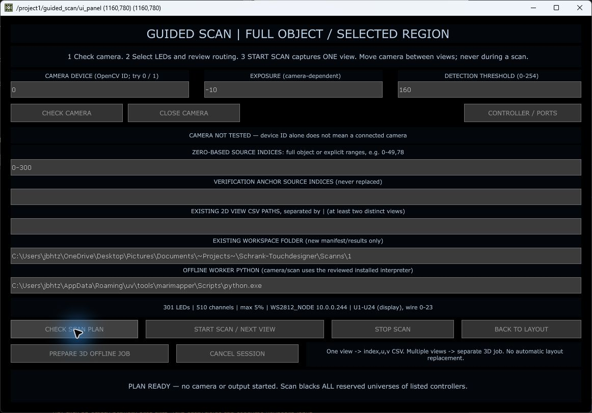

# Guided Scan mit MariMapper und Art-Net

Stand: 7. September 2026. Softwareintegration und Kamera-Vorschau geprüft; ein echter LED-Scan mit anschließender 3D-Rekonstruktion ist **noch nicht abgenommen**.

## Was übernommen wurde

MariMapper hat bereits ein Art-Net-Backend. Dessen fortlaufende 512-Kanal-Adressierung passt jedoch nicht unverändert zu diesem Projekt: Hier gelten 510 RGB-Kanäle je Universum und reservierte Universenblöcke je Port. Deshalb verwenden wir MariMappers native Kamera-, Belichtungs- und Einzel-LED-Erkennung mit einem eigenen, streng begrenzten Ausgabeadapter. Keine zweite unabhängige Adresszuordnung und keine Änderungen am installierten MariMapper-Paket.

Geprüft: MariMapper 3.4.2, Commit `7dc5f799a1b7c180573c2632f6d12a3be0cbf4fa`. Versionsabweichungen werden vor Kamera-/Scanbetrieb abgelehnt.

Primärquellen und technischer Vergleich: [Art-Net-Review](MARIMAPPER_ARTNET_REVIEW_DE.md), [offizielles Art-Net-Backend](https://github.com/TheMariday/marimapper/blob/7dc5f799a1b7c180573c2632f6d12a3be0cbf4fa/marimapper/backends/artnet/artnet_backend.py).

## Wo einstellen und starten?

TouchDesigner: **Ctrl+Shift+G**, Ziel `/project1/guided_scan/ui_panel`. Der Shortcut wurde nach dem erneuten Laden mit einem echten Tastendruck geprüft. Den Scan zunächst über das ausgewählte Objekt im Layout vorbereiten, damit die stabilen LED-IDs zur Szene gehören.

| Feld / Schaltfläche | Wirkung und Prüfung |
|---|---|
| Camera Device | OpenCV-Gerätenummer, z. B. 0 oder 1. Keine automatische Geräteinventur; eine eingetragene Nummer beweist keine Verbindung. |
| Exposure | Native Kamera-Belichtung, hier −10. Die Kamera kann Werte ablehnen; die Vorschau meldet angeforderten und zurückgelesenen Wert. |
| Detection Threshold | Erkennungsschwelle 0–254, hier 160. Vor dem Scan darf die Erkennung bei ausgeschalteten LEDs keine Lichtquelle finden. |
| CHECK CAMERA | Öffnet ausschließlich MariMappers Kamera-/Erkennungsvorschau. Keine LED-Pakete und keine gespeicherten Kamerabilder. |
| CLOSE CAMERA | Beendet die Vorschau und gibt die Kamera frei. Vor einem Scan erforderlich. |
| CONTROLLER / PORTS | Öffnet die bestehende GICO-Port-Konfiguration. Hier werden Universenblöcke und Portbelegung vorbereitet; der Scan übernimmt die kanonische Router-Konfiguration. |
| Source Indices | Nullbasierte originale LED-Nummern. `0-300` umfasst 301 LEDs, nicht 300. Auch getrennte Bereiche wie `0-4,20,35-39` sind möglich. |
| Anchor Indices | Zusätzliche bekannte LEDs für die spätere Registrierung/Prüfung; nicht automatisch ersetzen. Gleiche stabile IDs bleiben erhalten. |
| Existing 2D Views | Aufgenommene CSV-Dateien mit `index,u,v`, getrennt durch `|`. Erfolgreiche neue Ansichten werden angehängt. |
| Workspace | Ein existierender Ordner. Jede Aufnahme erzeugt einen neuen Unterordner; vorhandene Maps werden nicht überschrieben. |
| Offline Worker Python | Interpreter für den separaten Rekonstruktionsauftrag. Kamera und Art-Net-Scan benutzen unabhängig davon den fest geprüften isolierten MariMapper-Interpreter. |
| CHECK SCAN PLAN | Validiert Auswahl, Kameraangaben und Routing, ohne Kamera oder LEDs zu starten. Ersetzt das unklare „Prepare Dry Run“. |
| START SCAN / NEXT VIEW | Nach zusätzlicher Bestätigung eine Ansicht aufnehmen: Schwarzprüfung → jeweils eine LED → Erkennung → Bewegungsprüfung → CSV. Kamera und Objekt dabei nicht bewegen. |
| STOP SCAN | Fordert Abbruch und Schwarzsetzung an. Live-Animation startet danach nicht automatisch. |
| PREPARE 3D OFFLINE JOB | Benötigt mindestens zwei unterschiedliche CSV-Ansichten. Speichert Auftrag und explizite Startargumente in `worker_plan`; startet selbst weder Kamera noch Rekonstruktion. |
| BACK TO LAYOUT | Öffnet das Layout. Kein automatisches Übernehmen eines Scan-Ergebnisses. |
| CANCEL SESSION | Bricht die Scan-Sitzung ab; aktive Aufnahme wird gestoppt. Bestehendes Layout bleibt unverändert. |

### Universen und Portreservierungen

Die aktuelle Hardware benötigt **global sechs Universen je Port**. Der Scan ändert diese Hardwareeinstellung nicht und behauptet auch nicht, individuelle Portwerte in diesen Controller schreiben zu können. Bei Basis-Anzeigeuniversum 1 ergeben sich Reservierungen:

| Port | Anzeige in der Oberfläche | Art-Net-Paketadresse, nullbasiert |
|---|---|---|
| 1 | U1–U6 | 0–5 |
| 2 | U7–U12 | 6–11 |
| 3 | U13–U18 | 12–17 |
| 4 | U19–U24 | 18–23 |

517 als Source-ID ist daher nicht selbst eine Universumsadresse. Die tatsächliche Zuordnung kommt aus Controller-/Segmenttabellen. 510 RGB-Kanäle entsprechen 170 LEDs pro Universum; unbenutzte reservierte Bereiche werden nicht zusammengerückt.

**Wichtig:** Während der Aufnahme werden sämtliche reservierten Universen der betroffenen Controller schwarz gehalten, nicht nur die ausgewählte LED-Gruppe. Bei diesem Controller betrifft das U1–U24. Nur die gerade erfasste LED leuchtet mit höchstens 5 %; eine kleinere konfigurierte Controllerhelligkeit bleibt maßgeblich. Andere Programme dürfen parallel keine LED-Daten senden.

## Praktischer Ablauf

1. Im Layout das richtige Objekt auswählen und Guided Scan öffnen. Bestehende Live-/Kalibrierungsausgabe beenden.
2. Kamera auf den Schrank richten, ID wählen und CHECK CAMERA verwenden. Belichtung/Schwelle auf die tatsächliche Szene abstimmen. Danach CLOSE CAMERA.
3. Einen kleinen, bekannten LED-Bereich eintragen; CHECK SCAN PLAN. Zielcontroller, reservierte Universen und Source-IDs kontrollieren.
4. START SCAN bestätigen. Während einer Ansicht nichts bewegen. STOP ist jederzeit der Abbruchweg.
5. Nach erfolgreicher Aufnahme die Kamera versetzen und NEXT VIEW starten. Überlappende Ansichten derselben LEDs sind für 3D nötig; zwei Dateien allein garantieren keine rekonstruierbare Geometrie.
6. PREPARE 3D OFFLINE JOB erstellt den getrennten Rekonstruktionsauftrag mit `camera_model_opencv`. Die expliziten Argumente stehen im DAT `/project1/guided_scan/worker_plan`.
7. Rekonstruktion, Registrierung zur vorhandenen Szene und Qualitätskontrolle separat durchführen. Erst danach einen ausgewählten Bereich bewusst in den Layout-Entwurf übernehmen. Keine automatische Änderung der aktiven Map.

## Kamera-Fehler: Ursache und reale Prüfung

Der frühere Start hing beim Laden der nativen NumPy/OpenCV-Abhängigkeiten, während bereits ein anderer Thread auf Standardeingabe wartete. Reproduziert im TouchDesigner-Kindprozess: ohne diesen Thread laden die Abhängigkeiten sofort; mit vorher gestartetem Reader erst nach Freigabe der Eingabe. Jetzt werden die nativen Bibliotheken vor dem Steuer-Reader geladen. Ein Start-Watchdog begrenzt zusätzlich die Wartezeit.

Realer Kameratest: Gerät 0 lieferte 640 × 480, Belichtung −10 wurde zurückgelesen. Der abschließend gespeicherte Lauf meldet 589 Frames, reguläres Ende, bestätigte Cleanup-Aufrufe und Exitcode 0. Das beweist Kamerazugriff, **nicht** die Eignung des Bildausschnitts für den Schrank. Eine Konturerkennung in der Vorschau beweist ohne gesteuerte LEDs auch keinen gültigen LED-Treffer. Hardware-Einstellungswiederherstellung bleibt kameratreiberabhängig und wird nicht behauptet.

[Messprotokoll](guided-scan-evidence/camera-live-test.json): alle vier nativen DMX-Ausgaben aus, gemeinsamer Sender aus, 0 versandte Pakete, kein Scan gestartet.

## Schutzmechanismen und Grenzen

- Einfrierung und Prüfung der Router-Konfiguration, Source-IDs, Layoutrevision und Auswahl. Änderungen vor/nach der Vorbereitung machen den Plan ungültig; Änderungen während der Aufnahme lösen Abbruch aus.
- Nur ein beaufsichtigter Ausgabeprozess; synchrone Einzel-LED-Aufträge mit bestätigter ID. Timeout/ungültige Antworten sperren weitere Aufträge.
- Verlust des TouchDesigner-Heartbeats, ausbleibender Kamerafortschritt oder STOP führen zu Abbruch und wiederholtem Versand schwarzer Frames. „Versandt“ ist kein Beweis dafür, dass Hardware sie empfangen hat.
- Eigene Live-Einstiegspunkte werden gesperrt; direkte native Ausgänge werden zusätzlich kontrolliert. Fremde Programme, Netzwerkunterbrechung oder Stromausfall können softwareseitig nicht vollständig abgesichert werden.
- ArtSync-aktivierte Routen sind derzeit vor Ausgabe gesperrt; keine stillschweigend unvollständige Synchronisation.
- MariMappers Fast-Modus und zusätzliche bunte Statusmuster sind nicht aktiv. Es wird nur einzeln und begrenzt beleuchtet.
- Die CLI-Optionen `interpolation_max_fill 3` und `interpolation_max_error 0.15` sind **noch nicht** in diesem Rekonstruktionsweg umgesetzt. Fehlende LEDs werden nicht erfunden; vor einer Interpolation müssen native Skalierung und Fehlermaßstab korrekt reproduziert und getestet werden.
- Ein kompletter optischer Scan, reale Art-Net-Einzel-LED-Zuordnung, Bewegungserkennung am Schrank und vollständige 3D-Rekonstruktion bleiben praktische Abnahmepunkte.

## Tests und Sicherung

106 gezielte Tests für Kamera, Routing, IPC, Aufnahme-Supervisor, TouchDesigner-Brücke und Offline-Worker bestanden. Kamera-/Socket-/Prozessfehler werden dabei simuliert; diese Tests ersetzen nicht die physische Abnahme. Hinzu kommen echte Klicks für Kameravorschau, Schließen und Scan-Plan in TouchDesigner.

Die Gesamtsuite des vorhandenen Arbeitsverzeichnisses: **696 Tests, 695 bestanden, 1 übersprungen**. Sie umfasst auch vorbestehende, nicht zu diesem Commit gehörende Tests. Das Ergebnis ist deshalb gesondert vom gezielten Scan-Testumfang zu betrachten. Der Speicher-/Neuladetest hat alle **22** Vergleiche bestanden; aktive Koordinaten, UVs, Controller-/Segmenttabellen, Materialeinstellungen und Undo-Verlauf blieben gleich. Keine Projekt- oder Picklingfehler, kein Senderstart beim Laden.

Separate Projektdatei: `Backup/Implementation/PixelblazeMapper_20260907_GUIDED_SCAN_ARTNET.1.toe`. [Speicherprotokoll](guided-scan-evidence/save.json) und [erneutes Laden / Zustandsvergleich](guided-scan-evidence/roundtrip.json). Quelle und Testskripte gehören zur Projektdatei; die TOE allein ersetzt nicht das Python-Projektverzeichnis.
