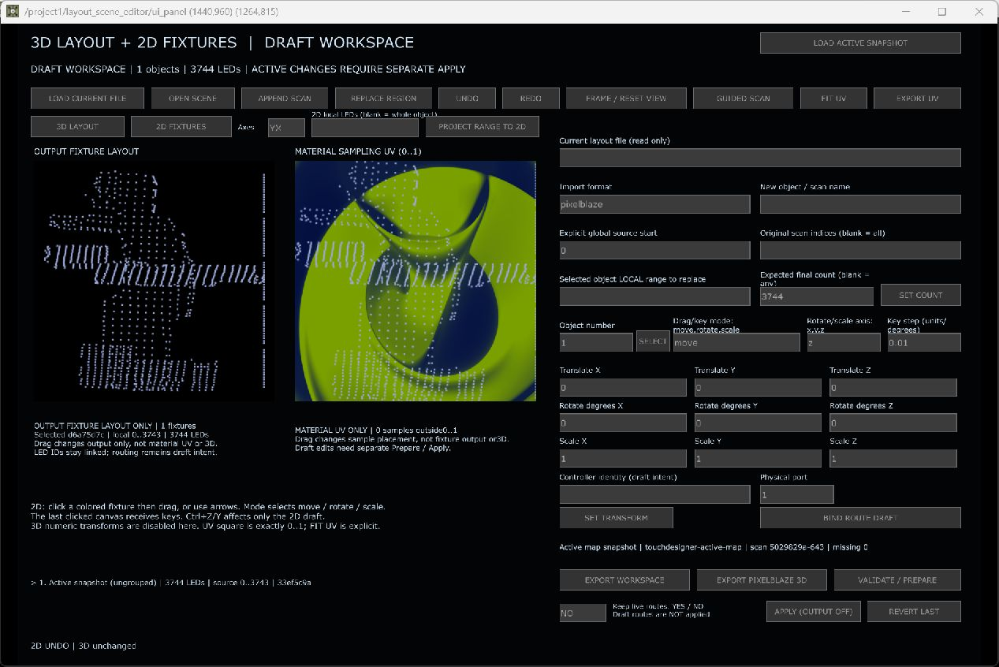

# Zwei unabhängige 2D-Flächen – getesteter Ablauf

Stand 07.09.2026. Diese Oberfläche ergänzt das 3D-Modell; sie ersetzt nicht die physischen Koordinaten. Sender während sämtlicher hier beschriebener Tests OFF.

## Ausgangspunkt und Bedienung

1. In TouchDesigner **Strg + Umschalt + L** drücken.
2. **LOAD ACTIVE SNAPSHOT** liest den aktiven Bestand als Entwurf. Im geprüften Projekt: 3.744 LEDs. Weil bestehende Router-Quellbereiche sich überlappen, wurde absichtlich ein ungruppiertes Objekt erzeugt statt Panelgrenzen zu raten.
3. **PROJECT RANGE TO 2D** erstellt ein Fixture aus der gewählten Projektion. Das Feld **2D local LEDs** begrenzt die Auswahl, beispielsweise `0-9,20-29`; leer bedeutet das ganze Objekt. Im realen Maustest war es leer, Projektion `YX`.
4. Links liegt **OUTPUT FIXTURE LAYOUT**, rechts **MATERIAL SAMPLING UV** über dem laufenden Material. Eine Bewegung links verändert die Fixture-Anordnung, rechts den abgetasteten Materialausschnitt. LED-IDs und die unveränderten Scanpunkte bleiben erhalten.
5. Die zuletzt angeklickte Fläche erhält Pfeiltasten. **Strg+Z** und **UNDO** machen Entwurfsänderungen rückgängig. Außerhalb des UV-Bereichs 0–1 wird gewarnt; eine automatische Anpassung wird nicht still ausgeführt.

## Echte Eingaben und geprüfte Werte

Die Pixelpositionen gelten nur für das dokumentierte Testfenster; für die Bedienung sind die Flächenüberschriften maßgeblich.

| Eingabe | Fixture-Verschiebung X/Y | UV-Verschiebung X/Y | Ergebnis |
|---|---|---|---|
| Ausgangspunkt | 0 / 0 | 0 / 0 | 3D- und aktive Prüfsumme erfasst |
| Linke Fläche: Maus (164,343) → (184,357) | 0,0735376045 / −0,0490250696 | 0 / 0 | Nur Fixture-Anordnung verändert |
| Pfeiltaste rechts | 0,0835376045 / −0,0490250696 | 0 / 0 | Genau +0,01 auf gewählter Fläche |
| Rechte Fläche: Maus (500,350) → (479,361) | unverändert | −0,0696378830 / −0,0362116992 | Nur Materialausschnitt verändert; 180 Punkte außerhalb gemeldet |
| Strg+Z auf rechter Fläche | unverändert | 0 / 0 | Nur letzter UV-Schritt rückgängig |
| Zweimal UNDO | 0 / 0 | 0 / 0 | Ausgangswerte vollständig wiederhergestellt |

Alle Schritte: 3D-Szenenprüfsumme und aktive Map-/UV-/Routerprüfsumme unverändert; keine gemeldeten Operatorfehler. Belege: `ui-layout-before.json`, `ui-layout-output-drag.json`, `ui-layout-output-key.json`, `ui-layout-uv-drag.json`, `ui-layout-uv-undo-key.json`, `ui-layout-restored.json`.

## Aktive Übernahme ist ein eigener Schritt

Der Entwurf verändert zunächst keine LED-Ausgabe. **VALIDATE / PREPARE** prüft den Entwurf; **APPLY (OUTPUT OFF)** verlangt ausdrücklich die bestehende Routenzuordnung. Neue LED-Anzahlen und neue Routen sind noch keine gemeinsame Transaktion. Separater tatsächlicher Backend-Test mit 3.744 LEDs: UV verändert, physische Map und tatsächlich ausgewertete XYZ unverändert; **REVERT** stellt die vollständige Ausgangsprüfsumme wieder her. Dieser Backend-Test wird nicht als Maus- oder Hardwaretest gezählt.

Noch nicht durch diese Klickfolge abgedeckt: alle Rotations-/Skalierungsmodi, Mehrfach-Fixture-Importdialoge, eine echte neue Kameraaufnahme und physische LED-Abnahme. Die sichtbare Oberfläche benötigt weitere Verdichtung und deutsche Beschriftungen; sie ist ein funktionaler Testkandidat, kein abgeschlossener UX-Feinschliff.
