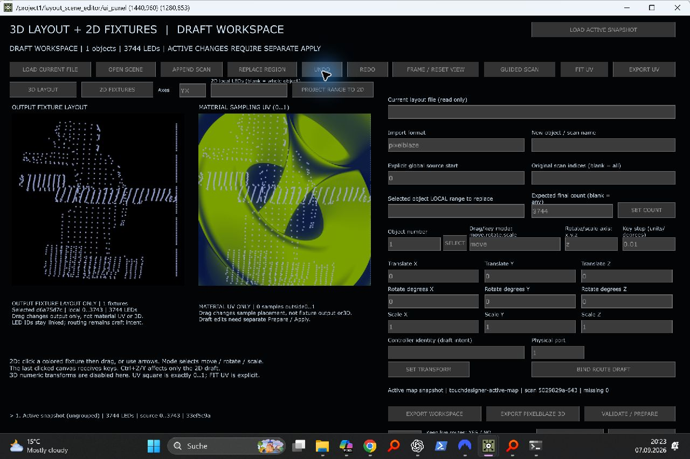

# Performance-Zwischenstand – 07.09.2026

Dieser Schritt ist abgeschlossen und gespeichert; die gesamte P0/P1-/Dialogabnahme ist **noch nicht abgeschlossen**. Sender während aller Tests OFF; kein Paketversand und keine Änderung der Controller-, LED- oder aktiven UV-Zuordnung.

Aktueller geprüfter Projektstand: `Backup/Implementation/PixelblazeMapper_20260907_PERFORMANCE_VERIFIED.1.toe`. Die zuvor geprüfte STORAGE_VERIFIED-Datei bleibt als Rückfallstand erhalten.

## Umgesetzt und geprüft

| Änderung | Nachweis | Grenze |
|---|---|---|
| Materialzeit nur einmal pro Bild; Zeituniform nur für aktive Quelle | Neue ausführbare Callbacktests; live installiert. Imported-Force-Cook erhalten | Kein messbarer Gesamt-FPS-Sprung durch diese kleine Änderung allein |
| Bildpfad einer Materialkarte nur bei geändertem Pfad schreiben | Verhaltenstest mit unverändertem und geändertem Bild | Keine Behauptung, dass importierte Karten zuvor alle live gerendert wurden; diese Karten sind Standbilder |
| Unveränderte Layout-/Fixture-Historie wiederverwenden | 15 Storage-Tests, unabhängiges Agentenreview, echte Maus-/Undo-Tests und Save/Reopen | Neue Drag-Vorschau benötigt weiterhin O(N)-Serialisierung und Render-/Bounds-Arbeit |
| Zahlenkonvertierung im Ausgabepacker beschleunigt | Exakte Byte-Parität, Rundung/Grenzfälle/Fehlerarten; zusätzlich echter Live-Datensatz vor/nach Reload identisch: 24 × 510 und 10 × 510 Bytes | Keine Port-/Universe-/LED-Zählungsänderung; Hardwaretest nicht erfolgt |
| Fünf alte unverbundene Show-Platzhalter gültig initialisiert | Nur leere Null-TOPs erhalten 1×1 transparent-schwarze Quellen; vorhandene Verbindungen bleiben erhalten; live anschließend keine Fehler | Ausdrücklich **keine** echten Show-Vorschauen; reale A/B-Pipeline bleibt unverändert |

Interne Session-Speicherung ist jetzt Version 2: validierte unveränderliche JSON-Texte statt wiederholt dekodierter großer Dictionaries. Version 1 wird weiterhin gelesen; öffentliches Workspace-Import-/Exportformat bleibt unverändert. Cache-Hits prüfen auch nach Modul-Reload die aktuelle Modellgeneration. Vollständige Vorprüfung vor Speichern bleibt erhalten.

## Messungen und Einordnung

- Gesamtsuite: **583 Tests, OK, ein übersprungener NumPy-Test**, 22,940 s. Der NumPy-Fall wurde zusätzlich im vorhandenen nativen Interpreter ausgeführt und bestanden (Agentennachweis).
- Reproduzierbarer Offline-Packerbenchmark: sieben wechselnde Vergleichsläufe à 150 Bilder, 2.351 Pixel-Schreibvorgänge/Bild. Median vorher 1,8607423 s, danach 0,9880528 s: **46,9 % weniger Packzeit**. Reproduktion: `python -B -m tests.test_realtime_packer_fastpath --benchmark`. Keine Umrechnung dieses Teilgewinns in Gesamt-FPS.
- Live: Wiederholtes Persistieren unveränderter Layout- und Fixture-Zustände zusammen 0,108 / 0,033 / 0,027 ms. Das misst nur den Persistierungsschritt, nicht den vollständigen Drag-Handler oder die GPU.
- Synthetischer 3.744-LED-Test, zehn Undo-Schritte: warme Snapshots zusammen etwa 0,009 ms; neue Vorschauen etwa 187 ms. Ausführliche Grenzen in `docs/LAYOUT_SCENE_EDITOR_DE.md`.
- Vergleich der laufenden Material-/Ausgabekette: vorher **11,48** neue Bilder/s; nach kleiner Materialkorrektur **11,20**; nach Packeränderung bei geöffnetem Layout **12,49**. Unterschiedliche Fenster-/Systemlast, kurze Stichproben: kein kontrollierter Gesamtleistungsgewinn und **keine 60-FPS-Abnahme**. Shaderauflösung, Iterationszahl, Materialgeschwindigkeit und Look wurden nicht heruntergesetzt.
- Python-Profil zeigt weitere Arbeit im alten `chopexec1 → script4`-Pfad (478 erzwungene Berechnungen bei 66 Transportframes), im alten ESP-Packer und in der Vorschau. Diese wurden nicht blind deaktiviert: Verbraucher und gewünschtes Verhalten müssen vorher geklärt werden.

Die erste breite Inventur `baseline-storage-verified.json` las auch Width/Height und löste dabei erstmalige Berechnungen aus. Ihre Laufzeiten sind **keine belastbare Leerlauf-Baseline**; außerdem verwendete sie TD-Zeit statt Wanduhrzeit. Nachfolgende gezielte Messungen verwenden eine monotone Wanduhr und verzichten auf solche Größenabfragen. Diese Inventur machte lediglich die latenten Show-Platzhalterfehler sichtbar. Profilierung und Testlast wurden vor der letzten Live-Stichprobe beendet.

## Echte Maus- und Tastaturprüfung

| Eingriff im geöffneten Layoutdialog | Fixture X/Y | Material-UV X/Y |
|---|---|---|
| Ausgangszustand | 0 / 0 | 0 / 0 |
| Maus links: (167,345) → (186,355) | 0,0643454 / −0,0337047 | unverändert |
| Maus rechts: (500,349) → (485,359) | unverändert | −0,0417827 / −0,0306407 |
| Strg+Z rechts | unverändert | wieder 0 / 0 |
| UNDO-Button | wieder 0 / 0 | 0 / 0 |

3D-Szene, aktive Map, aktive UV und beide Routingtabellen blieben bei jedem Schritt identisch. Der Test stellt anschließend auch die ursprüngliche Historie mit einem Undo- und drei Redo-Einträgen wieder her, nicht nur die sichtbaren Nullwerte. Keine geratene Panelgruppierung und kein Apply auf die LED-Ausgabe.

## Speicherung und weitere Arbeit

Native Meldung „saved successfully“, anschließend tatsächliches Neuladen derselben neuen Datei. `performance/roundtrip.json` prüft Materialeinstellungen, Browserzustände, Showzustand, Workspace sowie vollständige Layout-/Fixture-Historien per Hash. Keine Operator-/Picklefehler, Sender OFF und null gesendete Pakete. Zeitphase darf während laufender Animation fortschreiten; die P1-Einstellungen werden unabhängig davon verglichen.

Nächste Prioritäten: Verbraucher des alten Mehrfach-CHOP-Effektpfades und paralleler Packer bestimmen; nur nachgewiesen ungenutzte Arbeit entkoppeln. Danach kontrollierte Langzeitmessung mit identischem Material/Fensterzustand, erneute Dialogtests und zuletzt gesonderte Hardwareabnahme. Geführte Kameraaufnahme, gemeinsame Layout-/Routingtransaktion und der native C-Shortcut-Konflikt bleiben ebenfalls offen.
