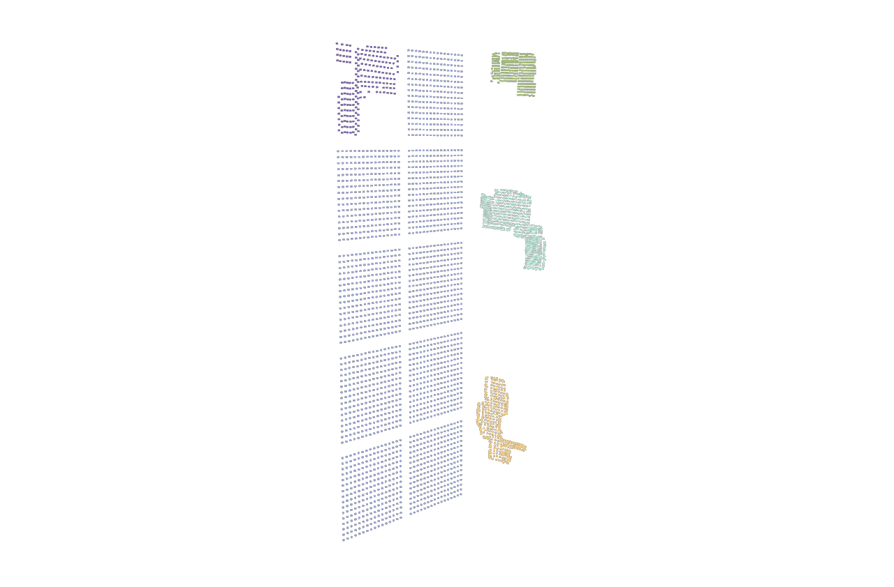
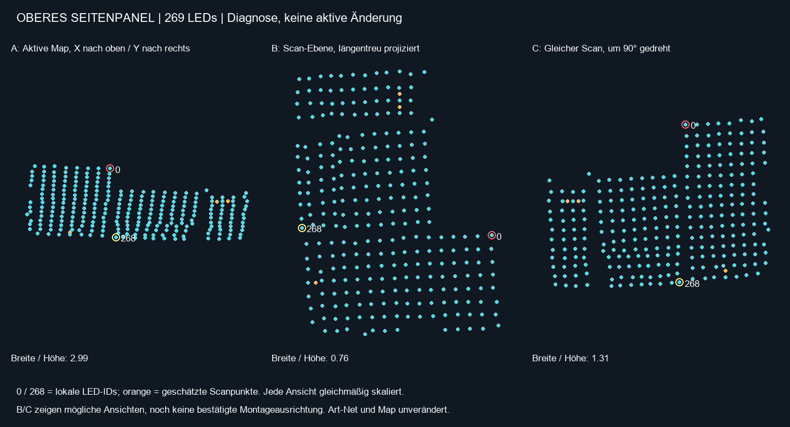
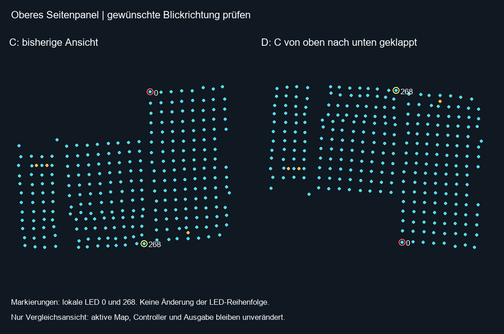
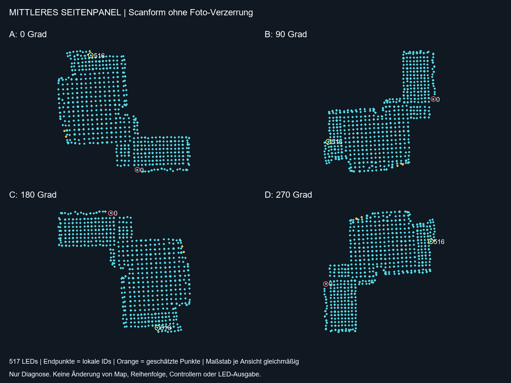
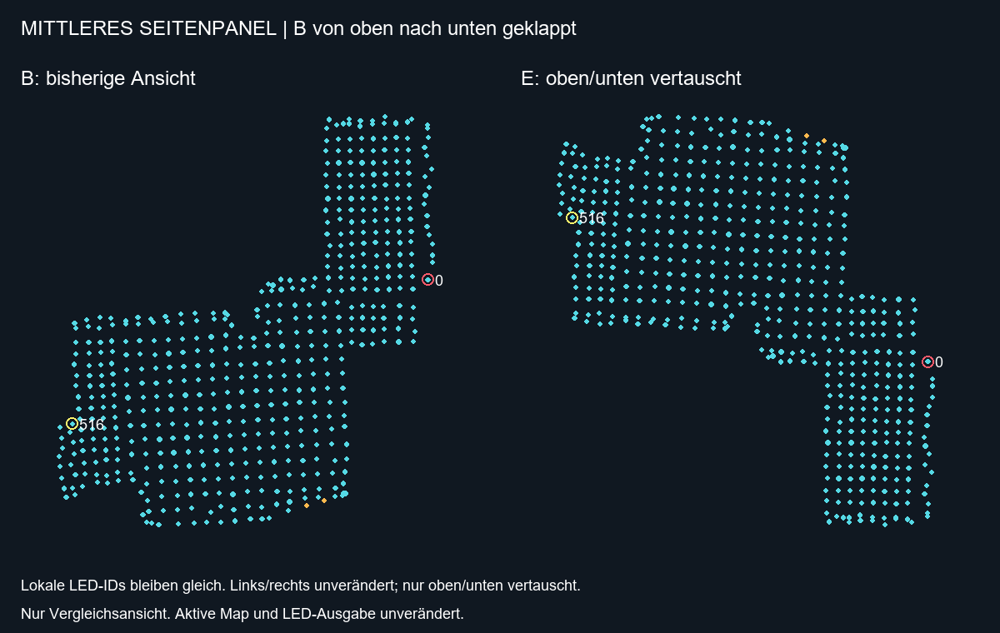
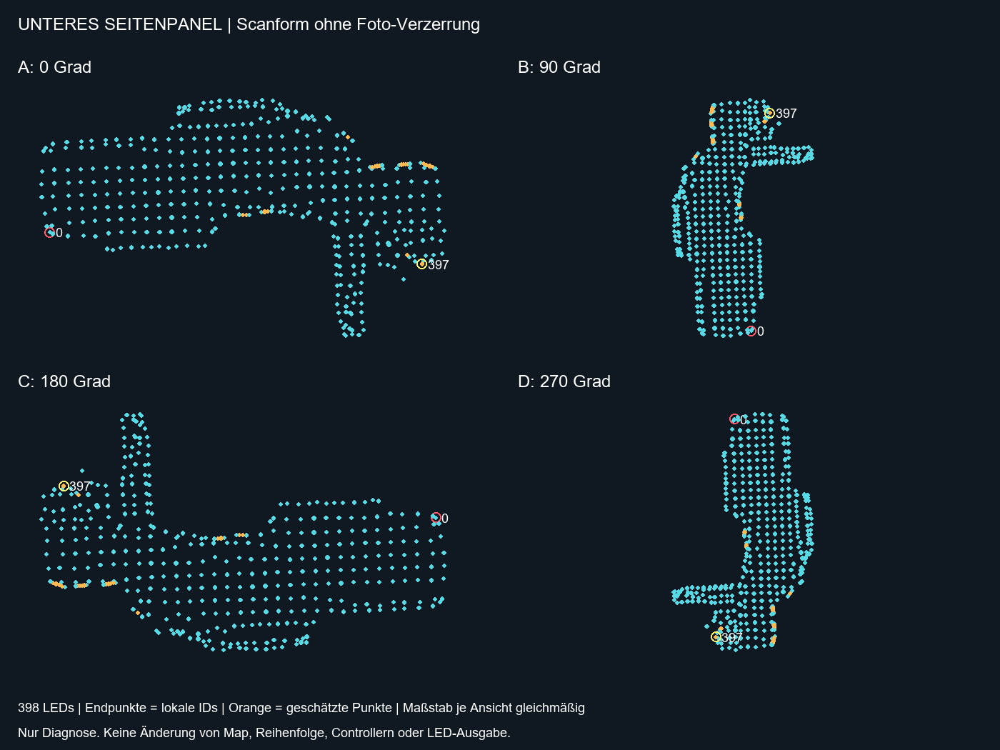
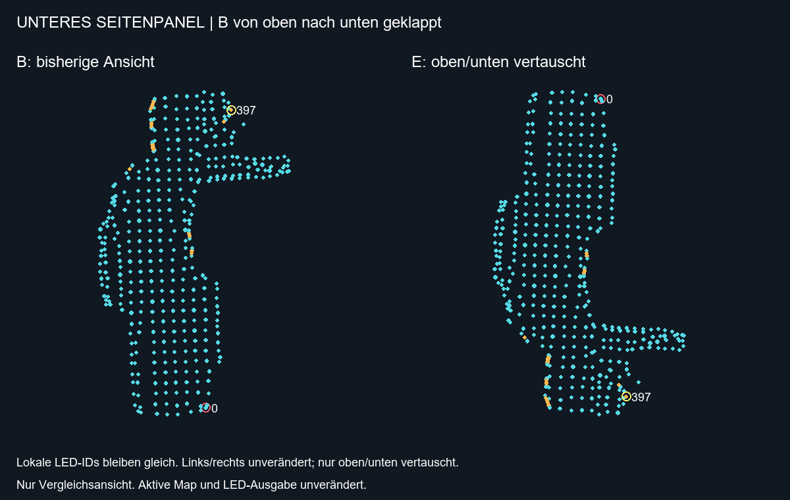

# Seitenpanels einzeln ausrichten – Arbeitsprotokoll

Stand: 2026-09-09. **Alle drei Seitenpanels im Entwurf ausgerichtet und gespeichert.**
Die folgenden Diagnoseabschnitte halten den Weg zur bestätigten Form fest.
Die aktive Map und die Foto-Vorschau der aktiven Map wurden nicht umgestellt.

## Ergebnis und Bedienung

| Objekt im Layout | Breite × Höhe | Globale LED-IDs | Stand |
|---|---|---|---|
| Seite oben | 20 × 16 cm | 517–785 | Ausrichtung und Maße bestätigt |
| Seite Mitte | 29,5 × 29 cm | 0–516 | Ausrichtung und Maße bestätigt |
| Seite unten | 23 × 33 cm | 786–1183 | Ausrichtung und Maße bestätigt |

Die drei Formen sind getrennte Objekte. Die ungescannten Rückwandfelder und
das bereits gescannte Rückwandfeld bleiben unverändert. Es gibt insgesamt
5 Objekte mit 3691 belegten Quell-IDs. Die bereits vorhandene Lücke
1643–1695 bleibt bestehen; sie wird weder aufgefüllt noch neu nummeriert.

### Im Dialog ansehen und nachjustieren

1. Den bestehenden Dialog **3D LAYOUT + 2D FIXTURES** verwenden. Nicht
   **LOAD ACTIVE SNAPSHOT** drücken: das würde den bearbeiteten Entwurf ersetzen.
2. **3D LAYOUT** wählen. Objektnummer **3 = oben, 4 = Mitte, 5 = unten**,
   anschließend **SELECT**. Die Namen und Maße stehen auch in der Objektliste.
3. Rechte Maustaste ziehen dreht nur die Ansicht; Mausrad zoomt. Die Ansichts-
   und Zoom-Buttons sind Alternativen. **FRAME / RESET VIEW** betrifft nur die Kamera.
4. Linkes Ziehen bzw. Pfeiltasten verändern das ausgewählte Objekt. Für genaue
   Werte Translate/Rotate/Scale bearbeiten und **SET TRANSFORM** verwenden.
   Diese Zahlen sind Weltkoordinaten bzw. Skalierungsfaktoren, **keine Zentimeterfelder**.
5. **UNDO** nimmt die letzte Entwurfsänderung zurück. Die gemeinsame Einrichtung
   der drei Panels ist genau ein Undo-Schritt; **REDO** stellt sie wieder her.
6. Änderungen als **EXPORT WORKSPACE** sichern. Vorliegender gesicherter Entwurf:
   `Backup/Implementation/side-alignment-draft.workspace.json`.

### Grenzen der bisherigen Übernahme

- Größen wurden auf die bekannte Rückwandreferenz bezogen: 30 cm entsprechen
  der bisherigen Feld-Ausdehnung 0,16875 Welteinheiten, also 0,005625 Einheiten/cm.
  Das ist ein relativer Maßstab, keine komplette metrische Neukalibrierung des Schranks.
- Die rechte Seitenebene und die Abstände wurden aus dem Foto geschätzt:
  Ebene Z=0,30; Mittelpunkte XYZ oben (0,94; 0,875; 0,30), Mitte
  (0,62; 0,875; 0,30), unten (0,20; 0,90; 0,30). Diese Positionen sind vorläufig.
- Größen beruhen auf den gemessenen maximalen Ausdehnungen. Die Scanachsen
  mussten gegenüber gleichmäßiger Skalierung relativ um ca. +4,7% oben,
  −10,1% Mitte und −16,0% unten korrigiert werden, um diese Maße einzuhalten.
  Die Roharchive bleiben unverändert; vorhandene Tiefenabweichungen bleiben erhalten.
- Die internen LED-Bindungs-IDs wurden beim Aufteilen in eigene Objekte neu
  vergeben, weil das Datenmodell eine Verschiebung stabiler IDs in andere
  Objekte verbietet. Globale Quell-IDs, LED-Reihenfolge und Hardware bleiben gleich.
- Die unabhängigen **2D-Fixtures sind bewusst unverändert und veraltet** gegenüber
  der neuen Geometrie/Objektaufteilung. Vor ihrer weiteren Nutzung müssen sie
  separat abgeglichen werden; sie wurden nicht automatisch neu auf Materialien projiziert.
- **Nicht APPLY drücken**, um diesen Teilentwurf sofort live zu übernehmen:
  Die bestehende Quell-ID-Lücke verlangt weiterhin einen gezielten, geprüften
  Teil-Übernahmepfad. Aktive Foto-Kalibrierung, UV-Abgleich und Hardwareprüfung
  sind nicht Bestandteil dieser Entwurfsübernahme.

### Sicherung und Prüfung

- Vorher: `Backup/Implementation/PixelblazeMapper_20260909_BEFORE_SIDE_ALIGNMENT.1.toe`
- Nachher: `Backup/Implementation/PixelblazeMapper_20260909_SIDE_ALIGNMENT_DRAFT.1.toe`
- Separater Vorher-Entwurf: `Backup/Implementation/side-alignment-before.workspace.json`
- 77 automatisierte Tests bestanden (Migration, Szenenmodell, Editor, Sitzungsspeicherung).
- Live-Datenvergleich: Map, UV, Controller und Segmente haben vorher/nachher denselben Hash.
- Rückwand-Bindungen und -Koordinaten vollständig identisch; alle Quell-IDs erhalten.
- Undo/Redo, Dokument-JSON und komplette Sitzungshistorie erfolgreich roundtrip-geprüft.
- Projekt erfolgreich gespeichert, keine TD-Operatorfehler, Sender weiterhin aus.
- Kein Neustart-/TOE-Wiederöffnungstest und kein Hardware-/Mausklicktest in diesem Schritt;
  geprüft wurden Datenmodelle, TD-Integration und der tatsächlich erzeugte 3D-Render.

Reproduzierbare Migration: `pixelblaze_mapper/side_alignment_draft.py`.
Die Integrationsroutine `tools/align_side_panels_20260909.py` verweigert erneutes
Anwenden auf einen bereits aufgeteilten Entwurf. Sie ist kein allgemeiner Importdialog.

## 1. Daten und Darstellung getrennt prüfen

Die Foto-Vorschau liest live `map_active`, mit Fitmodus `contain`.
Sie rendert die Seitenwand zusätzlich über `cal_side_geo` (aktuell Rz=-90°, Sx=-1),
Crop und Corner Pin. Eine Position im Layout ist deshalb noch kein Nachweis
einer korrekten Ausrichtung auf dem Foto.

Das obere Panel umfasst aktuell globale IDs 517–785 (269 LEDs). Keine
Umnummerierung und keine Änderung von Ports oder Universen ist Teil dieser Prüfung.

## 2. Oberes Panel: Vergleich ohne Foto-Perspektive

Links: aktive Koordinaten, X nach oben / Y nach rechts. Mitte und rechts:
reparierter archivierter Gesamtscan, auf seine per SVD ermittelte Ebene
projiziert; rechts zusätzlich um 90° gedreht. Innerhalb jeder Grafik erfolgt
nur gleichmäßige Skalierung. B/C sind keine bestätigten Montageausrichtungen.

Quelle: `mappings/sources/complete_new_0_1183_raw_2026-08-24.json`, Segment
517–785, Reparatur nach bestehender `complete_side_measurements`-Funktion.
Die drei geschätzten globalen Punkte 634, 710 und 714 sind orange markiert.
Lokale Endpunkte 0 und 268 sind beschriftet.

Aktive Ausdehnung XYZ: 0.2098694 / 0.6265257 / 0.0417593.
Das alte `align_panel_3d` skaliert Scanner-X und Scanner-Y unabhängig in
vorhandene Zielgrenzen. Dies kann das Seitenverhältnis verändern. Die
Gegenüberstellung zeigt deutlich unterschiedliche Proportionen; sie allein
bestimmt noch nicht, welche Montageansicht richtig ist.

Reproduktion (nur lesender TD-Zugriff):
`tools/inspect_upper_panel_20260909.py` mit Python inklusive Pillow ausführen.
Das Skript schreibt nur Diagnose-JSON/PNG in diesen Ordner.

## 3. Vor einer Korrektur noch festlegen

Oberes Panel: Nutzer hat die oben/unten geklappte Variante D ausdrücklich
bestätigt. Danach am Schrank gemessen: **20 cm Breite × 16 cm Höhe**.
Diese Maße ersetzen die vorherige Fotoschätzung von etwa 20 × 15 cm.
Noch keine aktive Skalierung oder Übernahme durch die Diagnosewerkzeuge.

Korrigierter Nutzerabgleich: Gemeint ist die ursprüngliche Ansicht C von
oben nach unten geklappt (Spiegelung an einer horizontalen Bildachse),
nicht links/rechts vertauscht. Vergleich D negiert daher die vertikale
Bildkoordinate von C; horizontale Position und LED-IDs bleiben gleich.
Die vorherige Links/rechts-Variante wurde verworfen. Dies ist nur eine
Diagnoseansicht, noch keine aktive 3D-Transformation.

- Bestätigte Maße oben: 20 × 16 cm; widersprechen unabhängige Achsenskalierungen
  dem Scan-Seitenverhältnis, Abweichung vor einer Verzerrung prüfen.
- Lage der lokalen LED 0, direkt auf die LED-Seite des montierten Panels gesehen.
- Daraus Rotation und gegebenenfalls Blickrichtungswechsel ableiten;
  Größe mit physischer Referenz abgleichen und erst im Entwurf positionieren.
- Nutzer bestätigt Form, Orientierung und Position. Erst danach getrennte
  Übernahme und Prüfung von Foto-Vorschau, Material-Sampling und Ausgabe.

Mitte, unten und Rückwand bleiben bei diesem ersten Schritt unverändert.

## 4. Mittleres und unteres Panel – Ausrichtung abgleichen

`tools/inspect_remaining_panels_20260909.py` erzeugt aus dem archivierten,
nach bestehender Funktion reparierten Gesamtscan vier gedrehte Ansichten
je Panel. Die Ebenenprojektion verwendet dieselbe Methode wie oben.
Die Darstellungen sind noch nicht auf reale Maße skaliert oder registriert.

- Mitte: globale IDs 0–516, lokale IDs 0–516, 517 Punkte.
- Unten: globale IDs 786–1183, lokale IDs 0–397, 398 Punkte.
- Drehungen A/B/C/D: 0/90/180/270 Grad in der dargestellten Scanebene.
- Eine erforderliche Spiegelung wird nach Nutzerabgleich separat festgelegt.

Nutzerwahl Mitte: B von oben nach unten geklappt, ohne Links/rechts-Tausch.
Die zusätzliche Vergleichsansicht E setzt daher B=(-v,u) auf E=(-v,-u).
Die resultierende Form wurde anschließend vom Nutzer ausdrücklich bestätigt.
Noch keine aktive Übernahme oder maßstäbliche Platzierung.

Nutzerwahl unten: ebenfalls B von oben nach unten geklappt, ohne
Links/rechts-Tausch. Vergleich E=(-v,-u) ist erstellt; aktive Daten bleiben
unverändert. Maße und Platzierung des unteren Panels sind noch offen.

Offen: jeweilige Ansicht bestätigen, Maße bestimmen und Position im Entwurf
einzeln prüfen. Aktive Map, Ausgabe und Rückwand bleiben unverändert.
