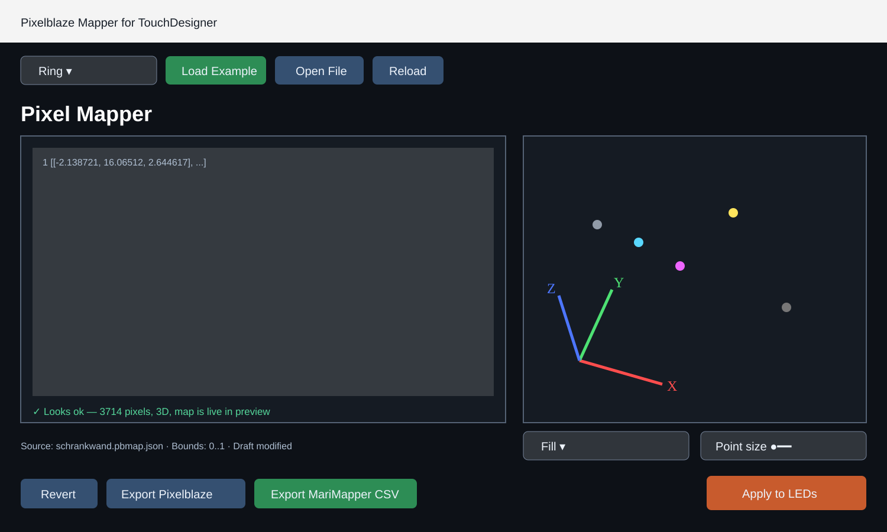
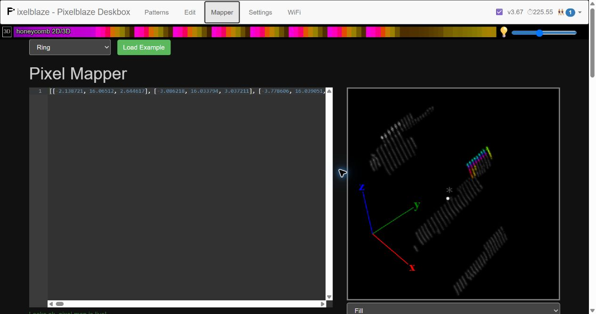
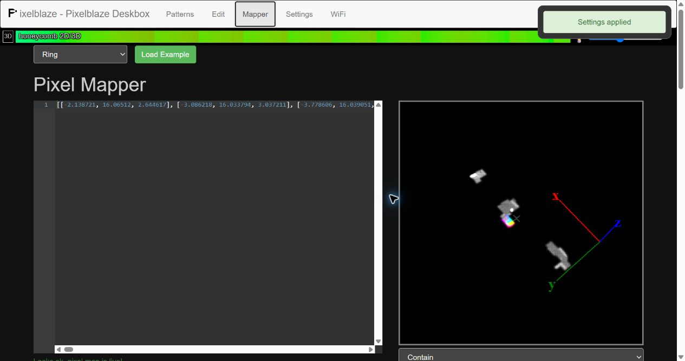
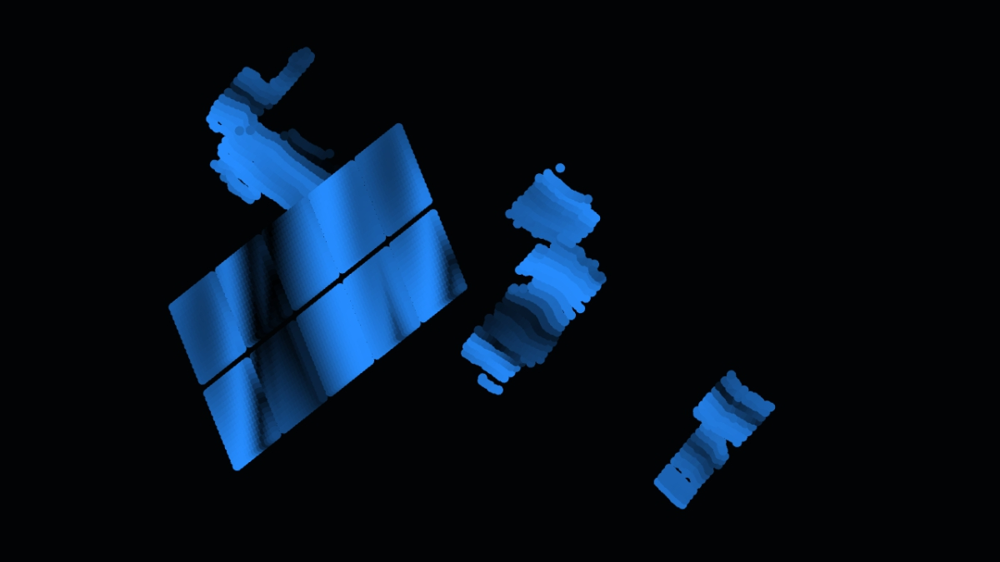
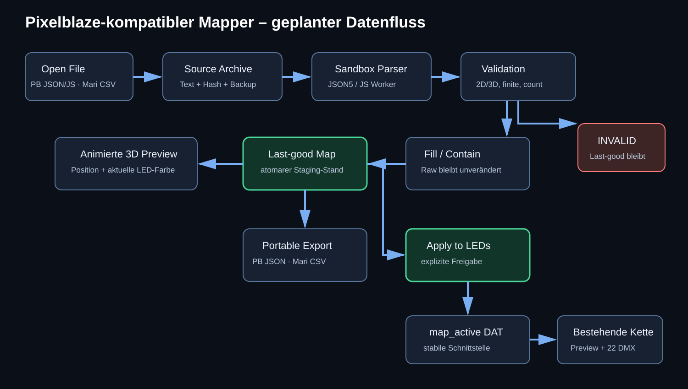

# Pixelblaze-kompatibler 3D LED Mapper in TouchDesigner

Stand: 13. August 2026  
Pixelblaze: `http://10.0.0.87/#mapperPanel`, Version 3.67  
Status dieses Dokuments: Analyse und Umsetzungsplan; noch keine Implementierung

## 1. Zielbild

In `/project1` soll ein eigenständiger Mapper entstehen, der sich visuell und funktional eng am Pixelblaze Pixel Mapper orientiert. Die höchste Priorität ist dabei ein **portables, indextreues Austauschformat** zwischen MariMapper, Pixelblaze und TouchDesigner. TouchDesigner darf kein eigenes Format voraussetzen, um eine Map benutzen oder weitergeben zu können.

```text
MariMapper led_map_3d.csv
          ⇅
TouchDesigner Mapper
          ⇅
Pixelblaze JSON / JavaScript
```

Die gewünschte Bedienung:

1. **Open File** öffnet einen Windows-Dateidialog.
2. Eine Pixelblaze-Map als JSON/JavaScript oder eine MariMapper-`led_map_3d.csv` wird geladen.
3. Der Editor zeigt den Originaltext; gültige Änderungen aktualisieren die Vorschau live.
4. Eine animierte 2D/3D-Vorschau zeigt die reale Punktreihenfolge und die Farben der aktuellen TouchDesigner-Quelle.
5. **Fill** oder **Contain** normalisiert die Koordinaten wie bei Pixelblaze.
6. **Export Pixelblaze** schreibt ein reines Pixelblaze-Koordinatenarray ohne TouchDesigner-Metadaten.
7. **Export MariMapper CSV** schreibt eine indexierte `index,x,y,z`-Datei.
8. **Save Project Copy** ist nur eine optionale Komfortfunktion; **Apply to LEDs** übergibt die geprüfte Map an die bestehende LED-/DMX-Kette.
9. Ein fehlerhafter Entwurf überschreibt niemals die letzte gültige Map.



## 2. Visuell geprüfte Pixelblaze-Referenz

### Aktueller Mapper mit Fill



### Derselbe Datensatz mit Contain



Die Prüfung wurde read-only durchgeführt. Zum Vergleich wurde `Contain` kurz gewählt und anschließend wieder auf `Fill` zurückgestellt. **Save wurde nicht betätigt.**

Visuell und funktional bestätigt:

- Navigation: Patterns, Edit, Mapper, Settings und WiFi.
- Beispielauswahl: Ring, Matrix, Multiple Panel Matrix, Volumetric Cube und Walled Cube.
- Linke Seite: ACE-Codeeditor mit einer Pixelblaze-Map als eine lange Koordinatenzeile.
- Rechte Seite: animierte 3D-Punktwolke mit roten, grünen und blauen Achsen.
- Die aktuelle Animation `honeycomb 2D/3D` färbt die aktiven LEDs; die übrigen Punkte bleiben grau sichtbar.
- Gültiger Editorinhalt meldet `Looks ok, pixel map is live!`.
- Editoränderungen wirken laut Gerätedokumentation live auf Vorschau und gerendertes Pattern.
- `Save` persistiert die Map für den nächsten Pixelblaze-Start.
- `Fill` skaliert jede Achse unabhängig auf den Einheitsraum.
- `Contain` erhält das Seitenverhältnis und skaliert nach der größten Ausdehnung. Beim Test erschien `Settings applied`.
- Pixelblaze akzeptiert 2D-Paare `[x,y]`, 3D-Tripel `[x,y,z]` und eine JavaScript-Funktion `function(pixelCount) { ... }`.
- Rohkoordinaten dürfen reale Einheiten und negative Werte enthalten. Pixelblaze normalisiert sie auf World Units von 0 bis 1.

Die vollständige lange Referenzseite ist zusätzlich in [02-pixelblaze-mapper-fullpage.png](02-pixelblaze-mapper-fullpage.png) erfasst.

## 3. Analyse der aktuellen TouchDesigner-Realisierung



### Aktuelle Datenkette

```text
schrankwand_only_normalized_coordinates (1.154 Pixel)
                         +
backwall_10_panels_coordinates          (2.560 Pixel)
                         |
                         v
schrankwand_plus_backpanels_coordinates (3.714 Pixel, Table DAT)
  -> selectDat
  -> evaluate1
  -> LedMap / read_LED_map
  -> null4
  -> TOP-Sampling der Animation
  -> RGB-Aufbereitung
  -> Preview und 22 DMX/Art-Net-Universen
```

Verifizierter Ist-Zustand:

| Element | Ist-Zustand |
|---|---|
| Kombinierte Map | 3.714 eindeutige 3D-Punkte plus Header |
| Wertebereich | X/Y/Z insgesamt 0 bis 1 |
| Rechtes bestehendes Mapping | 1.154 Pixel |
| Zehn Rückwandpanels | 2.560 Pixel, je 16×16 |
| DMX-Ausgabe | 22 Universen mit je maximal 170 RGB-Pixeln |
| Quelldatei | Keine; `file` der Table DAT ist leer |
| Import | Kein Open-File-Workflow |
| Vorschau | Animation wird über die gemappten Punkte dargestellt |

### Exakte aktuelle Extraktionslogik

`/project1/LedMap` verwendet `/project1/read_LED_map` als Callback:

1. `evaluate1` wird direkt über seinen Namen gesucht.
2. Die Header-Zeile wird übersprungen.
3. Jede Zeile wird mit `float(...['tx'/'ty'/'tz'])` eingelesen.
4. Pro Achse wird nur der Minimalwert berechnet.
5. Wenn ein Minimum negativ ist, wird die ganze Achse ins Positive verschoben.
6. Danach werden die CHOP-Kanäle `tx`, `ty` und `tz` erzeugt.

Wichtige Konsequenz: Das Script führt **keine echte Pixelblaze-Normalisierung** aus. Es skaliert nicht auf 0 bis 1, beherrscht keine 2D-Maps, prüft keine gemischten Dimensionen und fängt ungültige Werte nicht ab. Bei den aktuellen Tabellen fällt das nicht auf, weil diese bereits auf 0 bis 1 vorbereitet sind.

### Historische Quelle `BallsMatrix3___normalized_coordinates`

Die frühere Lösung ist weiterhin im Projekt vorhanden und bestätigt den bisherigen CSV-Workflow:

| Eigenschaft | Wert |
|---|---|
| Node | `/project1/BallsMatrix3___normalized_coordinates` |
| Quelldatei | `BallsMatrix3 - normalized_coordinates.csv` |
| Spalten | `index, tx, ty, tz` |
| Datenzeilen | 935 |
| kleinster/größter Index | 0 / 937 |
| fehlende Indizes | 894, 895, 896 |
| Wertebereich | X/Y/Z jeweils 0 bis 1 |

Das ist für die neue Lösung entscheidend: `read_LED_map` ignoriert momentan die Spalte `index` und übernimmt nur die physische Zeilenreihenfolge. Dadurch werden Indexlücken komprimiert und alle nachfolgenden LED-Zuordnungen können sich verschieben.

Die neue Importlogik muss deshalb die LED-Nummer als primären Schlüssel verwenden. Für `BallsMatrix3` entsteht eine Pixelblaze-Liste mit **938 Positionen** (`0..937`); die drei fehlenden LEDs werden entsprechend dem MariMapper-Verfahren als `[0,0,0]` eingesetzt und im UI deutlich als fehlend markiert.

### Technische Schwachstellen

- Harte Abhängigkeit von den Namen `evaluate1` und den Spalten `tx/ty/tz`.
- Kein Dateidialog, kein Reload, kein Save As, keine Projektkopie.
- Kein JSON-/JavaScript-Parser für das Pixelblaze-Format.
- Kein Fehlerzustand mit Zeile/Spalte und keine letzte gültige Map als Rückfall.
- Keine getrennte Staging-Map: Ein Fehler könnte später direkt die reale Ausgabe beeinflussen.
- Kein Pixelzahl-Schutz gegenüber der 3.714-Pixel-/22-Universen-Konfiguration.
- `read_LED_map` durchläuft Tabellen mehrfach und erzeugt Python-Listen pro Cook; für Live-Editing sollte nur bei Map-Änderungen neu gebaut werden.

## 4. Empfohlene Architektur



Neuer Hauptbaustein:

```text
/project1/pixelblaze_mapper
  /ui
  /parser
  /normalizer
  /map_staging
  /map_active
  /preview3d
  /persistence
  /status
```

Die bestehende LED-/DMX-Kette bleibt hinter einer stabilen Schnittstelle erhalten. Statt die bestehende Map sofort zu ersetzen, erzeugt der Mapper zunächst `map_staging`. Erst **Apply to LEDs** kopiert eine gültige Map atomar nach `map_active`, das anschließend `selectDat` speist.

### Zustandsmodell

```text
EMPTY -> LOADED -> VALID -> PREVIEWING -> SAVED -> APPLIED
                    |
                    +-> INVALID (letzte gültige Vorschau bleibt aktiv)
```

Getrennte Zustände sind wichtig:

- **Draft:** momentaner Editorinhalt.
- **Last good:** zuletzt erfolgreich geparste und validierte Map.
- **Saved:** projektlokal gespeicherte Map.
- **Applied:** aktuell an Preview/DMX übergebene Map.

## 5. Portabler Import und Export

### Eingangsformate

- `.json`, `.map`, `.txt`: reines Pixelblaze-Koordinatenarray `[[x,y,z], ...]`.
- `.js`: Pixelblaze-JavaScript-Generator `function(pixelCount) { ... }`.
- `.csv`: MariMapper-`led_map_3d.csv` mit mindestens `index,x,y,z`.
- MariMapper-Zusatzspalten wie `xn,yn,zn,error` werden beim Import erkannt und archiviert, beeinflussen die LED-Position aber nicht.

Pixelblaze zeigt in seiner Dokumentation Arrays mit optionalem abschließendem Komma. Deshalb reicht striktes `json.loads()` allein nicht. Der Parser benötigt einen JSON5-/JavaScript-kompatiblen Arraymodus.

### Indexerhaltender MariMapper-Import

MariMapper erzeugt `led_map_3d.csv` und sein Pixelblaze-Uploader baut daraus eine Liste in LED-Indexreihenfolge. Nicht rekonstruierte beziehungsweise fehlende Indizes werden als `[0,0,0]` eingesetzt, bevor `setMapCoordinates()` aufgerufen wird.

TouchDesigner übernimmt dasselbe semantische Verhalten, jedoch mit zusätzlicher Prüfung:

1. `index` wird als Integer gelesen und darf nicht doppelt vorkommen.
2. Die Ausgabelänge ist `max(index) + 1`, nicht die Zahl der CSV-Zeilen.
3. Jede vorhandene Zeile wird an genau ihrem Index eingesetzt.
4. Fehlende Indizes erhalten `[0,0,0]` und einen Warnstatus `missing`.
5. Die Reihenfolge der CSV-Zeilen ist unerheblich.
6. Zusatzspalten werden beim Rundlauf erhalten, soweit die Quelldatei sie enthielt.

### Echter Pixelblaze-Export

**Export Pixelblaze JSON** erzeugt ausschließlich:

```json
[
  [0.2818803615, 0.2553087288, 0.8722365639],
  [0.1866835381, 0.07241020109, 0.8879191305]
]
```

Keine Headerzeile, keine `index`-Spalte und keine TouchDesigner-Metadaten werden in diese Datei geschrieben. Die Arrayposition ist der LED-Index. Die Datei kann direkt in den Pixelblaze Mapper eingefügt oder über einen späteren Netzwerkadapter hochgeladen werden.

Exportiert werden standardmäßig die **unveränderten Rohkoordinaten**. Die für Fill/Contain berechneten 0-bis-1-Werte dienen der Vorschau und der aktiven TouchDesigner-Abtastung, ersetzen aber nicht die vermessene Geometrie. Damit übersteht ein MariMapper→TouchDesigner→Pixelblaze-Rundlauf ohne unnötige Neu-Skalierung.

**Export Pixelblaze JavaScript** ist optional. Bei einer ursprünglich importierten `.js`-Map wird der Originalgenerator unverändert exportiert. Eine aus CSV geladene Punktwolke wird standardmäßig als JSON exportiert, da ein künstlich erzeugter JavaScript-Generator keinen Vorteil bietet.

### MariMapper-CSV-Export

Der kompatible Minimalexport lautet:

```csv
index,x,y,z
0,0.2818803615,0.2553087288,0.8722365639
1,0.1866835381,0.07241020109,0.8879191305
```

Bei einem MariMapper-Rundlauf können vorhandene Spalten `xn,yn,zn,error` zusätzlich erhalten werden. Maps aus Pixelblaze erhalten beim CSV-Export nur die vier sicheren Kernspalten.

### Sichere JavaScript-Ausführung

JavaScript darf nicht per Python-`eval` ausgeführt werden. Empfohlen ist ein isolierter Worker mit:

- ausschließlich dem Parameter `pixelCount`, `Math` und lokalen Variablen;
- keinem Datei-, Netzwerk- oder TouchDesigner-Zugriff;
- Zeitlimit von 250 ms;
- begrenzter Ergebnisgröße;
- Abbruch bei Endlosschleifen;
- anschließender identischer numerischer Validierung wie bei JSON.

### Optionale Projektkopie

Vorgeschlagener Speicherort relativ zur `.toe`-Datei:

```text
maps/
  active/
    current.pixelblaze.json
    current.marimapper.csv
  imported/
  exported/
  backups/
  session.json
```

Beispielschema:

```json
{
  "schema": "td.mapping-session/v1",
  "name": "schrankwand_3714",
  "sourceKind": "pixelblaze-json",
  "sourceText": "[[...]]",
  "generatedCoordinates": [[0, 0, 0]],
  "pixelCount": 3714,
  "dimensions": 3,
  "fit": "fill",
  "sourceSha256": "...",
  "savedAt": "2026-08-13T00:00:00Z"
}
```

Diese Sessiondatei ist **nicht** das Austauschformat. Sie speichert nur UI-Zustand, Dateipfade, Prüfsummen, Warnungen und die zuletzt aktive Auswahl. Die portablen Pixelblaze-JSON- und MariMapper-CSV-Dateien bleiben davon getrennt und vollständig ohne TouchDesigner-Abhängigkeit.

Für JavaScript wird sowohl der Generator als auch das konkret erzeugte Array in der Session referenziert. So bleibt das Resultat reproduzierbar, selbst wenn sich `pixelCount` später ändert.

## 6. Normalisierung

Für jede Achse gelten `min`, `max` und `span = max - min`.

### Fill

```text
normalized[i] = (value[i] - min[i]) / span[i]
```

Jede Achse wird unabhängig auf 0 bis 1 skaliert. Das kann die Proportionen strecken oder stauchen.

### Contain

```text
maxSpan = max(spanX, spanY, spanZ)
normalized[i] = (value[i] - min[i]) / maxSpan
                + (1 - span[i] / maxSpan) / 2
```

Alle Achsen verwenden denselben Maßstab; kürzere Achsen werden zentriert. Eine Achse mit `span = 0` wird mittig bei 0,5 platziert.

Die Rohkoordinaten bleiben unverändert erhalten. Nur die abgeleitete normalisierte Map speist die Vorschau und später die LED-Kette.

## 7. Oberflächenkonzept

Die Anordnung folgt der Pixelblaze-Seite:

- obere Leiste mit Beispielen, **Load Example**, **Open Pixelblaze**, **Open MariMapper CSV** und **Reload**;
- links großer Editor mit Syntaxstatus und Zeilen-/Spaltenfehlern;
- rechts animierte 3D-Punktvorschau;
- direkt unter der Vorschau **Fill/Contain**;
- Statuszeile mit Pixelzahl, 2D/3D, Bounds, Dateiname und Änderungsstatus;
- unten **Revert**, **Export Pixelblaze**, **Export MariMapper CSV**, optional **Save Project Copy** und deutlich getrennt **Apply to LEDs**.

Zusätzliche sinnvolle Vorschaufunktionen:

- Orbit, Zoom, Reset View und Front/Side/Top-Presets;
- X/Y/Z-Achsen und optionales Grid;
- Punktgröße und Helligkeit;
- LED-Indexsuche und Hervorhebung;
- Startpixel, Laufrichtung und Gruppen-/Panelgrenzen;
- Umschaltung zwischen neutraler Punktfarbe und aktueller animierter LED-Farbe;
- Anzeige `Draft`, `Saved` und `Applied` mit unterschiedlichen Farben.

## 8. Schutz der realen LED-Ausgabe

Empfehlung: Pixelblaze-Liveverhalten gilt zunächst nur für die Vorschau. Reale LEDs werden erst durch **Apply to LEDs** aktualisiert.

Vor dem Apply werden geprüft:

- gültige und einheitliche 2D- oder 3D-Koordinaten;
- ausschließlich endliche Zahlen;
- Pixelzahl und Indexreihenfolge;
- benötigte Universen `ceil(pixelCount / 170)`;
- Übereinstimmung mit der aktuellen 3.714-Pixel-Konfiguration;
- keine Änderung an DMX-Routing oder Universen ohne explizite Bestätigung.

Doppelte Koordinaten sind nur eine Warnung, kein Fehler: Bei echten Installationen können mehrere LEDs physisch denselben Messpunkt besitzen.

## 9. Parallel ausführbare Arbeitspakete

Nach Freigabe dieses Plans können drei Subagenten parallel arbeiten; der Hauptagent bleibt Integrations- und Freigabeinstanz. Jeder Agent erhält einen getrennten Node-/Dateibereich, damit das laufende `.toe` nicht gleichzeitig widersprüchlich geändert wird.

### P0 – Integrationsvertrag und Backup (Hauptagent, zuerst)

- Projekt speichern und `.toe`/betroffene COMPs sichern.
- Schnittstellen für `raw_map`, `normalized_map`, `status` und Steuerpulse festlegen.
- Testfixtures aus aktueller 3.714-Pixel-Map erzeugen.
- Dev-Bereich `/project1/_dev_pixelblaze_mapper` anlegen.

Abnahme: Backup-Pfad, Vorher-Screenshot, Knotenzahlen und 3.714/22-Baseline dokumentiert.

### P1 – Parser, Validierung und Normalisierung (Agent 1)

- JSON/JSON5 und 2D/3D einlesen.
- sandboxed JavaScript-Generator mit `pixelCount`.
- Fill/Contain mathematisch implementieren.
- Fehlerobjekte mit Position und verständlichem Text.
- Last-good-Map und maschinenlesbare Tests.

Eigentum: `/project1/_dev_pixelblaze_mapper/core` und reine Parsermodule.

### P2 – UI, File-Dialog und Persistenz (Agent 2)

- Pixelblaze-nahe Oberfläche bauen.
- Open File, Reload, Save, Save As und Revert.
- relative Projektpfade, Backups und `index.json`.
- Statusanzeige und Dirty-/Saved-/Applied-Zustände.

Eigentum: `/project1/_dev_pixelblaze_mapper/ui` und `maps/`.

### P3 – Animierte 3D-Vorschau (Agent 3)

- instanzierte Punkte für mindestens 3.714 LEDs.
- Achsen, Kamera, Orbit/Zoom, View-Presets.
- aktuelle TouchDesigner-Farben pro Pixel integrieren.
- Auswahl/Index, Punktgröße, Fill-/Contain-Aktualisierung.

Eigentum: `/project1/_dev_pixelblaze_mapper/preview3d`.

### P4 – Integration und DMX-Schutz (Hauptagent, nach P1–P3)

- Komponenten verbinden und `map_active` als einzige Übergabe definieren.
- bestehendes `selectDat -> LedMap -> Preview/DMX` kontrolliert umstellen.
- Pixelzahländerungen abfangen; DMX-Neukonfiguration nicht automatisch ausführen.
- Rollback testen und Projekt speichern.

### P5 – Systemtest und Dokumentation (gemeinsam, zuletzt)

- alle Testfälle durchführen;
- Node Errors und Cook-Performance prüfen;
- Screenshots nach der unten definierten Matrix sichern;
- erst danach Aufgaben als abgeschlossen markieren.

## 10. Detaillierte Testfälle

| ID | Test | Erwartung |
|---|---|---|
| M01 | gültiges 3D-Pixelblaze-JSON | Pixelzahl, Reihenfolge und XYZ stimmen exakt |
| M02 | gültiges 2D-JSON | Dimension bleibt 2D; Vorschau verwendet definierte Z-Ebene |
| M03 | JS-Zickzackmatrix | Ergebniszahl entspricht `pixelCount` |
| M04 | Syntaxfehler | Fehler mit Position; Last-good bleibt sichtbar und angewendet |
| M05 | gemischte 2D/3D-Punkte | Ablehnung vor Vorschau/Apply |
| M06 | NaN/Infinity/Text | Ablehnung; keine Änderung an LEDs |
| M07 | doppelte Koordinaten | Warnung, aber gültig |
| M08 | Fill | jede nicht-degenerierte Achse erreicht 0 und 1 |
| M09 | Contain | Proportionen bleiben erhalten; Geometrie ist zentriert |
| M10 | Save/Restart | Map und Fit-Modus werden wiederhergestellt |
| M11 | abweichende Pixelzahl | Preview erlaubt; Apply blockiert bis Bestätigung |
| M12 | bestehende Installation | weiterhin 3.714 Pixel und 22 Universen |
| M13 | Animationsvorschau | Farbe/Index stimmen mit der bestehenden LED-Farbkette überein |
| M14 | Performance | 3.714 Punkte ohne sichtbares Stottern; keine unnötige Neuparsing-Schleife |
| M15 | Rollback | vorherige Map und DMX-Ausgabe in einem Schritt wiederherstellbar |
| M16 | `BallsMatrix3`-CSV | Ergebnis hat 938 Slots; 894–896 sind `[0,0,0]` |
| M17 | CSV unsortiert | Ausgabe bleibt streng nach `index` sortiert |
| M18 | CSV→Pixelblaze→CSV | Index und XYZ bleiben innerhalb der gewählten Präzision identisch |
| M19 | Pixelblaze JSON Export | Datei enthält nur ein Array von 2D-/3D-Punkten |

## 11. Screenshot-Abnahmematrix

Eine Aufgabe ist nur dann `complete`, wenn ihre Tests bestanden sind und die folgenden Nachweise existieren:

| Datei | Nachweis |
|---|---|
| `10-baseline-network.png` | bestehende Mapping-/DMX-Kette vor Umbau |
| `11-open-file-dialog.png` | Dateidialog mit Pixelblaze-Dateifiltern |
| `12-valid-3d-import.png` | Editor, Status, Pixelzahl und 3D-Vorschau nach Import |
| `13-invalid-map-last-good.png` | sichtbarer Fehler bei weiterhin intakter Last-good-Preview |
| `14-fill.png` | definierte Referenzmap im Fill-Modus |
| `15-contain.png` | dieselbe Kamera/Map im Contain-Modus |
| `16-save-reload.png` | gespeicherte Map nach Neustart/Reload |
| `17-live-animation.png` | aktuelle Animation auf den importierten Punkten |
| `18-index-highlight.png` | gesuchte LED mit Index und XYZ hervorgehoben |
| `19-dmx-guard.png` | Blockierung bei falscher Pixelzahl |
| `20-final-3714-22.png` | finale 3.714-Pixel-/22-Universen-Verifikation |
| `21-node-errors.png` | keine neuen Fehler im Mapper und seiner Integrationskette |
| `22-performance.png` | Cook-/FPS-Nachweis unter realer Last |

Zu jedem Screenshot gehört ein kurzer Testlog mit Datum, Map-Hash, Pixelzahl, Modus, Ergebnis und verantwortlichem Agenten.

## 12. Entscheidungen vor dem Start

| Entscheidung | Empfehlung |
|---|---|
| D1: Live auf echte LEDs? | **Nein**, live nur in Preview; LEDs über Apply |
| D2: 2D-Z-Ebene | **0,5**, damit die Ebene mittig im 3D-Raum liegt |
| D3: falsche Pixelzahl | Preview erlauben, Apply blockieren |
| D4: DMX automatisch umbauen? | Nein; getrennte explizite Bestätigung |
| D5: Speicherort | relativ zur `.toe` unter `maps/` |
| D6: Direktimport von `10.0.0.87` | nach stabilem Dateiimport als zweite Phase |
| D7: UI-Technik | native TouchDesigner-Container plus Render TOP; JavaScript nur isoliert für Parser |
| D8: primäres Austauschformat | Pixelblaze JSON; MariMapper CSV als gleichwertiger Import/Export |
| D9: Indexlücken | mit `[0,0,0]` auffüllen und sichtbar warnen |
| D10: internes Metadatenformat | nur optionale Sessiondatei, niemals Voraussetzung für Portabilität |
| D11: Exportkoordinaten | Rohkoordinaten exportieren; Normalisierung nur abgeleitet verwenden |

## 13. Empfohlene Reihenfolge

1. D1 bis D11 gemeinsam bestätigen oder ändern.
2. Backup und Schnittstellenvertrag erstellen.
3. P1, P2 und P3 parallel in getrennten Dev-Bereichen umsetzen.
4. Ergebnisse einzeln anhand der Screenshotmatrix abnehmen.
5. Integration in die bestehende 3.714-Pixel-Kette.
6. DMX- und Rollback-Tests.
7. Erst nach vollständiger Abnahme die alte statische Table-DAT-Lösung als Backup stilllegen.

## 14. Verwendete Primärquellen

- [MariMapper PixelBlaze Backend Tutorial](https://github.com/TheMariday/marimapper/blob/main/docs/backends/PixelBlaze.md)
- [MariMapper Pixelblaze CSV-Uploader](https://github.com/TheMariday/marimapper/blob/main/marimapper/backends/pixelblaze/upload_map_to_pixelblaze.py)
- [MariMapper Pixelblaze Backend](https://github.com/TheMariday/marimapper/blob/main/marimapper/backends/pixelblaze/pixelblaze_backend.py)
- [MariMapper Beispiel einer 3D-Rekonstruktion](https://github.com/TheMariday/marimapper/blob/main/docs/highbeam_example/example_3d_reconstruction.csv)
