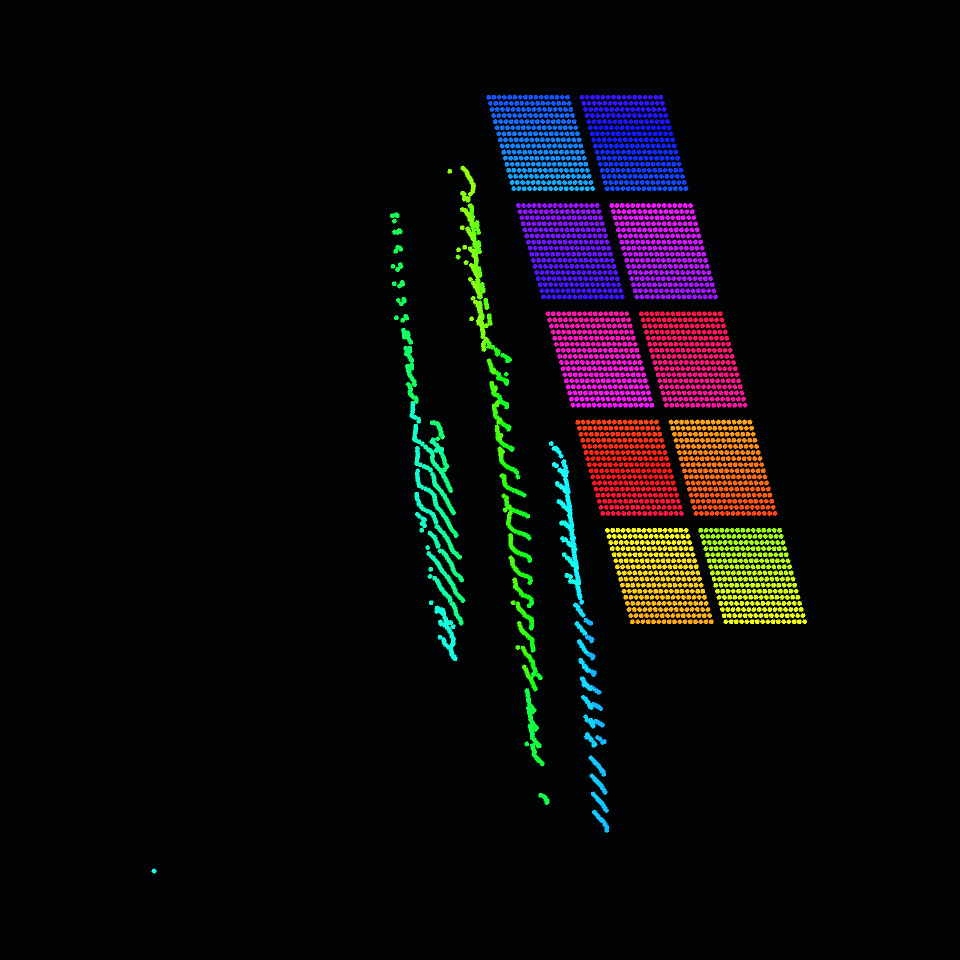

# Agentenbericht: isolierte 3D-Mappingvorschau

Stand: 13.08.2026

## Ergebnis

Die pruefbare 3D-Vorschau wurde isoliert unter folgendem Pfad aufgebaut:

`/project1/_dev_pixelblaze_mapper/preview3d`

Der eindeutig benannte Ausgabe-TOP ist:

`/project1/_dev_pixelblaze_mapper/preview3d/preview_out`

Die bestehende Produktionskette wurde nicht verbunden, umgeschaltet oder veraendert. Als Testquelle dient eine private Momentaufnahme der aktuellen kombinierten Koordinatentabelle. `project.save()` wurde nicht aufgerufen.

## Schnittstellen

Die Custom-Parameterseite `Pixelblaze Preview` des Base COMP stellt diese Schnittstellen bereit:

| Parameter | Funktion |
| --- | --- |
| `Coordinatedat` | OP-Pfad zu einer Table DAT mit Header `index,tx,ty,tz` |
| `Colorchop` | Optionaler OP-Pfad zu einem CHOP mit `r`, `g`, `b` und mindestens einem Sample pro Pixel |
| `Pointsize` | Radius der instanzierten LED-Punkte, Standard `0.0042` |
| `View` | `isometric`, `front`, `side` oder `top` |
| `Fitmode` | `contain`, `fill` oder `raw` |
| `Animationspeed` | Geschwindigkeit der animierten Ersatzfarben |
| `Camerazoom` | Orthografische Kamerabreite, Standard `1.62` |
| `Status` | Direkt lesbarer Validierungsstatus |

`preview_status` stellt den Status zusaetzlich als Table DAT bereit. Ohne gesetzten `Colorchop` wird bewusst eine animierte Regenbogenfolge verwendet. Damit lassen sich Punktreihenfolge und Animation pruefen, bevor eine echte Farbquelle verbunden wird. RGB-Werte der optionalen Quelle koennen entweder im Bereich 0..1 oder 0..255 liegen.

## Nodes im Preview-COMP

| Node | Typ | Aufgabe |
| --- | --- | --- |
| `coordinates_fixture` | Table DAT | Private Kopie der derzeitigen kombinierten Map |
| `color_input` | Constant CHOP | Sichtbare Vorlage fuer die optionale RGB-Schnittstelle |
| `instance_data_callbacks` | Text DAT | Parser, Indexerhalt, Validierung, Fit und Farblogik |
| `instance_data` | Script CHOP | Liefert `tx ty tz r g b` fuer alle Instanzen |
| `animation_driver` | Execute DAT | Aktualisiert die Ersatzanimation gedrosselt mit ca. 15 Hz |
| `led_points_geo/led_point` | Geometry COMP / Sphere SOP | Instanzierte, niedrig aufgeloeste LED-Punkte |
| `led_material` | Constant MAT | Neutrales Material fuer Instance Color |
| `preview_camera` | Camera COMP | Orthografische Kamera |
| `preview_render` | Render TOP | 960 x 960, neutraler fast schwarzer Hintergrund, 2x AA |
| `preview_out` | Null TOP | Stabile oeffentliche Preview-Ausgabe |
| `preview_status` | Table DAT | Maschinenlesbarer Status |
| `README_preview3d` | Text DAT | Kurzanleitung direkt im TouchDesigner-Netzwerk |

## Koordinaten- und Indexverhalten

Die Tabelle wird anhand der Headernamen gelesen und nach dem expliziten LED-Index aufgebaut. Fehlende Indizes werden entsprechend der vereinbarten Portabilitaetsregel bei `[0,0,0]` eingesetzt und als Warnung gemeldet. Doppelte Indizes verwenden den zuletzt gelesenen Wert.

Die private Fixture enthaelt 3.714 Datenzeilen. Ihr hoechster Index ist jedoch 3.738; dadurch entstehen 3.739 Instanzplaetze und 25 eingefuegte Fehlstellen:

`190, 203, 405, 423, 424, 425, 731, 732, 747, 748, 779, 780, 818, 819, 820, 821, 834, 835, 836, 837, 850, 851, 852, 853, 910`

Das ist keine Aenderung der Produktionsmap, sondern eine Diagnose ihrer gegenwaertigen Indexwerte. Die ueberlagerten Platzhalter sind in der Preview als einzelner Punkt an der normalisierten `[0,0,0]`-Position sichtbar.

Fit-Verhalten:

- `Contain`: ein einheitlicher Skalierungsfaktor erhaelt die Proportionen aller drei Achsen.
- `Fill`: jede Achse wird separat auf den Vorschau-Wuerfel skaliert.
- `Raw`: Rohkoordinaten werden nur um die Mitte ihrer Bounding Box zentriert.

Bei der aktuellen Fixture reichen alle Achsen bereits von 0 bis 1. Deshalb ergeben Fill, Contain und Raw in diesem konkreten Test dieselben Grenzwerte von -0.5 bis 0.5. Der Code behandelt abweichende Achsenskalierungen getrennt.

## Visuelle und funktionale Pruefung

- Isometrische Punktwolke sichtbar: bestanden.
- Zehn 16 x 16-Panels als 2 x 5-Anordnung sichtbar: bestanden.
- Bestehende Seitenwand-Geometrie gleichzeitig sichtbar: bestanden.
- Animierte Ersatzfarben aktualisieren sich automatisch: bestanden.
- Optionaler RGB-CHOP mit 3.739 Samples getestet: bestanden; Testwert `255,128,0` wurde korrekt zu `1.0,0.50196,0.0` normalisiert.
- View-Werte: Front `rx=0, ry=0`; Side `rx=0, ry=90`; Top `rx=90, ry=0`; Isometric `rx=-24, ry=38`.
- Output-Aufloesung: 960 x 960 Pixel.
- Fehlerpruefung auf dem kompletten Preview-COMP: 0 Node-Fehler.

## Leistung

Messwerte nach der Optimierung auf eine niedrig aufgeloeste Kugel und 2x Antialiasing:

| Operator | gemessene CPU-Cook-Zeit |
| --- | ---: |
| `instance_data` | ca. 4.9 bis 6.7 ms pro Animationsupdate |
| `preview_render` | ca. 0.47 bis 0.76 ms beim Test-Cook |
| `preview_out` | ca. 0.01 bis 0.03 ms |

Die Python-Farbanimation wird nicht auf jedem Projektframe, sondern etwa 15-mal pro Sekunde aktualisiert. Die Renderausgabe kann weiterhin mit der Projektrate dargestellt werden.

## Integration fuer die anderen Teilaufgaben

Der Import-/Parser-Baustein muss seine validierte Tabelle nur ueber `Coordinatedat` eintragen. Der UI-Baustein kann `preview_out` anzeigen, `preview_status` auslesen und die vorhandenen Parameter direkt binden. Fuer die Integration muss kein Produktions-DMX- oder LED-Node umverdrahtet werden.

Referenz-Screenshot:

`docs/pixelblaze-mapper-plan/agent-preview-preview3d.png`
