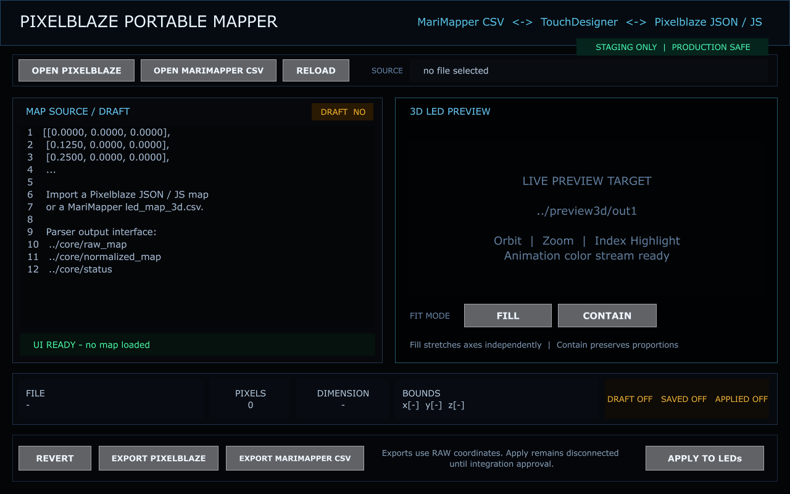

# Agent UI Report – Pixelblaze Portable Mapper

Stand: 13. August 2026  
Arbeitsbereich: `/project1/_dev_pixelblaze_mapper/ui`  
Produktionsintegration: **nicht verbunden**  
Projektdatei gespeichert: **nein**

## Ergebnis

Die Mapper-Oberfläche wurde als isolierter TouchDesigner-Dev-Baustein umgesetzt. Sie bildet den gewünschten portablen Workflow sichtbar ab:

- Pixelblaze JSON/JS öffnen
- MariMapper `led_map_3d.csv` öffnen
- Quelle neu laden und Entwurf zurücksetzen
- Rohkoordinaten als Pixelblaze oder MariMapper exportieren
- Normalisierung zwischen **Fill** und **Contain** umschalten
- Datei, Pixelzahl, Dimension, Bounds sowie Draft/Saved/Applied anzeigen
- **Apply to LEDs** bewusst räumlich und farblich trennen

Der Apply-Button ist absichtlich gesperrt, bis die spätere Integrations- und DMX-Schutzschicht angeschlossen ist. Er verändert keine vorhandene Mapping-, Preview- oder DMX-Kette.

## Zentrale Nodepfade

| Funktion | Nodepfad |
|---|---|
| UI Base COMP | `/project1/_dev_pixelblaze_mapper/ui` |
| Sichtbare 1280×800 Canvas | `/project1/_dev_pixelblaze_mapper/ui/canvas` |
| Screenshot-/QA-TOP | `/project1/_dev_pixelblaze_mapper/ui/ui_preview` |
| Maschinenlesbarer Schnittstellenvertrag | `/project1/_dev_pixelblaze_mapper/ui/interface` |
| Datei-/Export-/Status-Callbacks | `/project1/_dev_pixelblaze_mapper/ui/callbacks` |
| Öffentliche Pulse | `/project1/_dev_pixelblaze_mapper/ui/pulse_callbacks` |
| Pixelblaze öffnen | `/project1/_dev_pixelblaze_mapper/ui/canvas/btn_open_pb1` |
| MariMapper CSV öffnen | `/project1/_dev_pixelblaze_mapper/ui/canvas/btn_open_csv1` |
| Reload | `/project1/_dev_pixelblaze_mapper/ui/canvas/btn_reload1` |
| Fill | `/project1/_dev_pixelblaze_mapper/ui/canvas/btn_fill1` |
| Contain | `/project1/_dev_pixelblaze_mapper/ui/canvas/btn_contain1` |
| Revert | `/project1/_dev_pixelblaze_mapper/ui/canvas/btn_revert1` |
| Pixelblaze exportieren | `/project1/_dev_pixelblaze_mapper/ui/canvas/btn_export_pb1` |
| MariMapper CSV exportieren | `/project1/_dev_pixelblaze_mapper/ui/canvas/btn_export_csv1` |
| Guarded Apply | `/project1/_dev_pixelblaze_mapper/ui/canvas/btn_apply1` |

## Öffentliche Parameter

Alle Integrationsparameter liegen direkt auf `/project1/_dev_pixelblaze_mapper/ui`.

| Parameter | Typ | Richtung | Bedeutung |
|---|---|---|---|
| `Sourcepath` | String | UI → Core | ausgewählte JSON/MAP/TXT/JS- oder CSV-Datei |
| `Fitmode` | Menu | UI → Normalizer | `fill` oder `contain` |
| `Status` | String | Core/Persistenz/Integration → UI | lesbarer Status oder Fehler |
| `Pixelcount` | Integer | Core → UI | validierte Zahl der Pixelslots |
| `Dimensions` | String | Core → UI | `2D`, `3D` oder `-` |
| `Bounds` | String | Core → UI | Rohdaten-Min/Max je Achse |
| `Draft` | Toggle | beide | ungespeicherte Quelle/Editoränderung |
| `Saved` | Toggle | Persistenz → UI | lokal persistierter Stand |
| `Applied` | Toggle | Integration → UI | tatsächlich aktive LED-Map |
| `Lastaction` | String | intern/Diagnose | letzte UI-Aktion |

Öffentliche Pulse:

`Openpixelblaze`, `Openmarimapper`, `Reload`, `Revert`, `Exportpixelblaze`, `Exportmarimapper`, `Applytoleds`.

## Callback-Vertrag

`callbacks` stellt folgende Funktionen bereit:

- `choose_pixelblaze()` öffnet einen Load-Dialog für `json`, `map`, `txt`, `js`.
- `choose_marimapper()` öffnet einen Load-Dialog für `csv`.
- `choose_export(kind)` bereitet einen Save-Dialog für JSON oder CSV vor.
- `handle_pulse(name)` ist der zentrale Dispatch-Punkt für Buttons und öffentliche Pulse.

Nach einer Dateiauswahl werden nur `Sourcepath`, `Status`, `Draft`, `Saved` und `Lastaction` aktualisiert. Das Core-Modul kann `Sourcepath` und `Fitmode` konsumieren und danach die übrigen Statusparameter aktualisieren.

Die visuelle Preview-Fläche benennt die vorgesehene Übergabe explizit als `../preview3d/out1`. Sie enthält derzeit bewusst nur einen Interface-Platzhalter, damit der Preview-Agent seinen eigenen Nodebereich unabhängig entwickeln kann.

## Durchgeführte Tests

| Test | Ergebnis |
|---|---|
| Canvas-Render über `ui_preview` | bestanden, 1280×800 |
| dynamische Statusausdrücke | bestanden; robuste Referenz über `op('../..')` |
| Fill-Button-Callback | `Fitmode=fill`, Status aktualisiert |
| Contain-Button-Callback | `Fitmode=contain`, Status aktualisiert |
| Reload-Dispatch | Status `RELOAD REQUESTED` |
| Revert-Dispatch | Draft wird `False`, Status `REVERT REQUESTED` |
| Apply-Schutz | Status `APPLY BLOCKED - integration/DMX guard not connected`, `Applied=False` |
| UI Node Errors | **0** |
| Produktionskette verändert | **nein** |
| `project.save()` ausgeführt | **nein** |

Die Dateidialoge wurden als ausführbare TouchDesigner-Callbacks vorbereitet, während des automatisierten Tests aber nicht geöffnet, damit keine modale GUI den parallelen Lauf blockiert.

## Screenshot

- Datei: `docs/pixelblaze-mapper-plan/agent-ui-preview.png`
- Live-TOP: `/project1/_dev_pixelblaze_mapper/ui/ui_preview`

