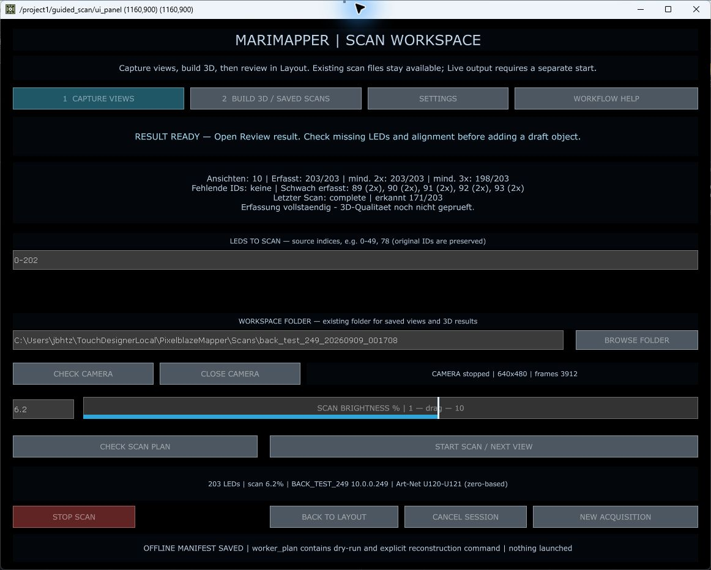
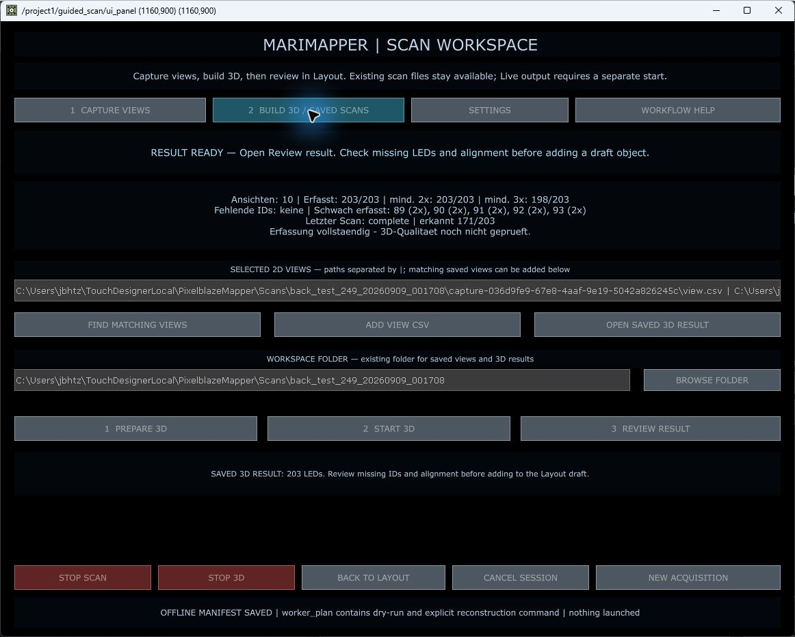
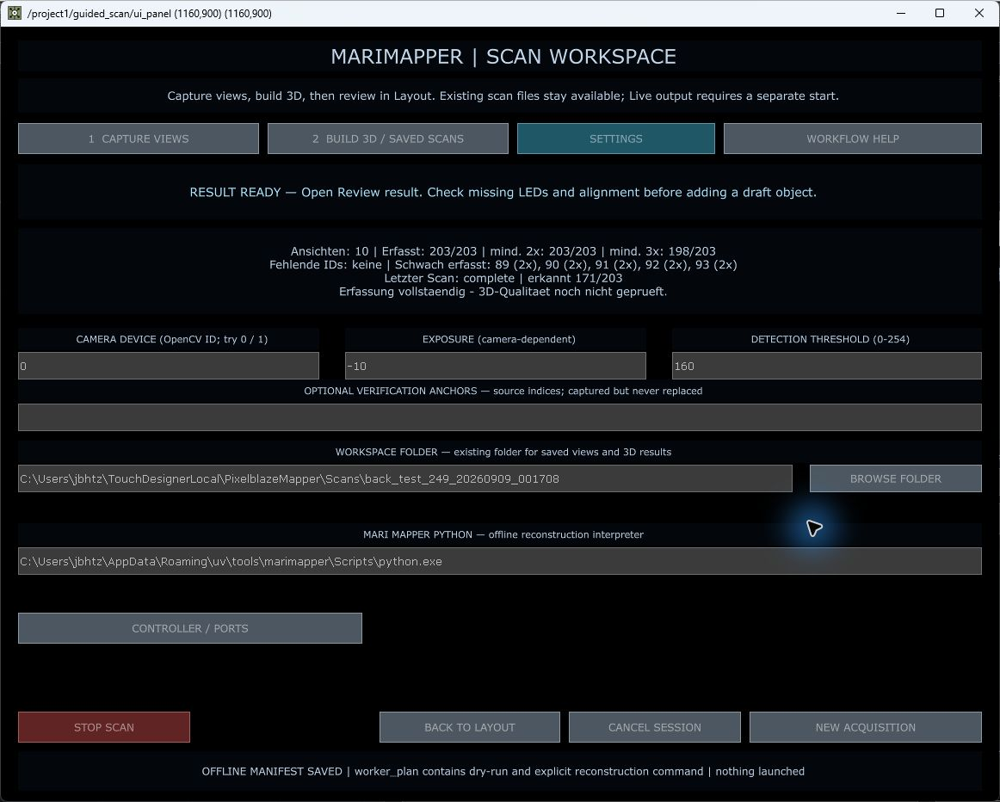

# MariMapper-Workflows: Umsetzung und Bedienung

Stand: 10. September 2026. Neue, gespeicherte und erneut geladene Projektdatei:
[`PixelblazeMapper_SCAN_UX_20260910.1.toe`](../../PixelblazeMapper_SCAN_UX_20260910.1.toe).

Quellcode-Commit: **f63ad54**, Branch **codex/scan-workflow-ux-20260910**.
Ausgangspunkt: **d224049** und die vorhandene Datei
`Backup/Implementation/PixelblazeMapper_20260909_LED_SEARCH.1.toe`.
Die neue TOE wird mit diesem Bericht separat in Git versioniert; Prüfsumme und Größe stehen in `artifact-manifest.json`.

## Was sich geändert hat

| Bereich | Vorher | Jetzt |
|---|---|---|
| Scan-Navigation | Aufnahme, Kamera, Interpreter und 3D-Aktionen gleichzeitig | Direkt anwählbare Bereiche **Capture views**, **Build 3D / Saved scans**, **Settings**; Kontextzeile nennt den nächsten Schritt |
| Vorhandene Ansichten | Lange manuell eingegebene Pfadliste | Ordnerauswahl, einzelne CSV per Dateidialog hinzufügen, passende gespeicherte Ansichten finden; manuelle Liste bleibt für Spezialfälle |
| Vorhandene 3D-Ergebnisse | An den letzten Workerzustand gebunden | **Open saved 3D result** öffnet ein gespeichertes `candidate_3d.csv` samt zugehörigem Bericht direkt |
| Ergebnisprüfung | Lange ID-Listen, volle Pfade und neun Transformationsfelder | Kompakte Anzahl/ID-Bereiche, Adressvorschlag, optional aufklappbare Transformation; aktuelle Werte bleiben als Zusammenfassung sichtbar |
| Teilscan aus Layout | Gesamtes Objekt trotz eingetragenem Teilbereich | Lokaler Bereich wird in stabile LED-IDs übersetzt; Objektwechsel löscht den alten Bereich |
| Neue 3D-Vorbereitung | Geänderte CSV-Liste konnte zum alten Auftrag führen | Geänderte Listen entwerten den Auftrag; explizite Neuvorbereitung erhält eine neue Auftrags-ID und berücksichtigt bearbeitete Bereiche |
| Hilfe und Fehler | Technischer Gesamttext | Workflow-Hilfe, nächste Aktion, konkrete Hinweise bei Adresskonflikten, falscher Identität oder veralteter Auswahl |
| Visuelle Hierarchie | Gleichartige graue Buttons | Aktiver Bereich cyan, Stop rot, seltener verwendete Einstellungen ausgelagert; Stop 3D bleibt während eines laufenden Jobs in jedem Bereich erreichbar |
| Import und Projektpfad | CSV-Format und alter Codeordner mussten stimmen | Importformat `auto`; Scanmodule und eingebettete Python-Codepfade verwenden diesen Arbeitsordner |

Die Änderungen entstanden mit drei parallelen Agenten für Scan-Workflow, Scanverwaltung und Recherche/UX-Prüfung. Ein Agent hat anschließend die Layout-Änderungen unabhängig mit Verhaltenstests geprüft. Die dokumentierten Quellen und die begründete Ausgangsbewertung stehen in [Recherche und UX-Bewertung](RESEARCH_AND_UX_REVIEW_DE.md).

## Neu aufnehmen oder weitere Ansichten ergänzen

1. Im Layout Objekt auswählen und **GUIDED SCAN** öffnen. Für eine getrennte neue Aufnahme **NEW ACQUISITION** verwenden; dort Name, Ziel, Universum und LED-Anzahl eintragen. Die vorhandene LED-Suche bleibt verfügbar.
2. **Browse folder** wählt den Speicherordner. Unter **Settings** bei Bedarf Kamera, Belichtung und Schwelle anpassen. Die Scanhelligkeit bleibt direkt unter Capture erreichbar.
3. Kamera prüfen und schließen, **Check scan plan**, dann **Start scan / next view**. Der bestehende Bestätigungsdialog nennt den betroffenen Ausgabebereich. Ein Start erfasst eine Ansicht.
4. Zwischen Ansichten Kamera bewegen; während der Aufnahme ruhig halten. Die Abdeckung zeigt fehlende und schwach erfasste LEDs. Zusätzliche Ansichten desselben Objekts können im selben Arbeitsordner aufgenommen werden.
5. In **Build 3D / Saved scans** die Ansichtsauswahl prüfen, **Prepare 3D**, **Start 3D**, **Review result**. Nach Änderung von Auswahl oder Bereich erneut vorbereiten.

## Vorhandene Scans wiederverwenden

- **Find matching views** sucht im gewählten Ordner und dessen unmittelbaren `capture-*`-Unterordnern. Automatisch vorgeschlagen werden nur erfolgreich abgeschlossene Aufnahmen mit passenden gespeicherten LED-Identitäten, Szenenrevision und Scanbereich. Dateinamen oder zufällig gleiche numerische IDs reichen nicht aus.
- **Add view CSV** fügt eine bewusst ausgewählte Ansicht hinzu. Bei älteren CSVs Herkunft und Objekt selbst prüfen. Abbrechen im Dateidialog verändert die Auswahl nicht. Dateien werden nicht verschoben oder gelöscht.
- **Open saved 3D result** benötigt `candidate_3d.csv` und `quality_pending.json` nebeneinander. Die Prüfung liest IDs, Schema, endliche Koordinaten und Bericht; vor dem Hinzufügen werden beide Dateiprüfsummen erneut geprüft.
- Bei älteren Berichten ohne ursprüngliche Beobachtungs-IDs steht die Zahl fehlender Beobachtungen ausdrücklich auf **unknown**. Lücken in Quelladressen werden nicht als fehlgeschlagene Erfassung ausgegeben.

## Hinzufügen, Bearbeiten und Teilersatz

**Zusätzliches Objekt:** Ergebnis öffnen, Name und vorgeschlagenen Source-Offset prüfen, **Add as new draft object**. Der Vorschlag vermeidet belegte Quelladressen im aktuellen Entwurf; er konfiguriert keinen Controller. Danach im Layout ausrichten. Undo nimmt die Entwurfsänderung zurück. Bei erneutem Öffnen desselben Ergebnisses bleiben Eingaben erhalten; ein anderes Ergebnis erhält frische Vorschläge und Standardtransformationen.

**Teilerfassung:** Im Layout das gewünschte Objekt wählen und im Feld **LOCAL LEDs: scan / replace** z. B. `0-19, 35` eintragen. **GUIDED SCAN** übernimmt genau diese lokalen LEDs mit ihren bestehenden stabilen und globalen IDs. Ein leeres Feld bedeutet beim Scan das gesamte ausgewählte Objekt. Beim Objektwechsel wird der Teilbereich geleert. Während eines noch laufenden Layout-Drags wird kein Scan vorbereitet.

**Bereits ausgerichteten Teilscan ersetzen:** Im Layout die vorhandene Replace-Funktion nutzen. Lokalen Zielbereich und gegebenenfalls Original-Scanbereich ausdrücklich angeben. Der Ersatz muss denselben ursprünglichen Koordinatenrahmen verwenden. Rohes SfM ist keine verifizierte Registrierung. Die neue Ergebnisprüfung fügt bewusst ein neues Entwurfsobjekt hinzu; sie verspricht keinen automatischen passgenauen Teilersatz.

## Prüfung und Nachweise

| Prüfung | Ergebnis |
|---|---|
| Gezielte Scan-/Layout-/Persistenz-/LED-Suche-/GICO-Suite | **314 Tests bestanden**, Protokoll `targeted-tests.txt` |
| Letzte Prüfung der neuen Workflows/Verwaltung/Teilbereiche/Staging | **44 Tests bestanden**, `final-focus-tests.txt` |
| Vollständige Suite mit installiertem MariMapper-Python | **891 Tests**, davon **884 bestanden**, sieben bereits bekannte Router-Fehler; `full-suite-tests.txt` |
| Ausgangslauf mit System-Python | 845 Tests; dieselben sieben Router-Fehler plus zwei fehlende NumPy-Imports und ein Skip; `baseline-tests.txt` |
| Native Integration, zweimal | Hashes von aktivem Mapping, UV, Controller-/Segmenttabellen, 3D-Entwurf und Fixtures unverändert; `installation*.json` |
| Echte Oberfläche | Tabs und Ergebnis öffnen sowie optionale Ausrichtung mit Maus geprüft; Screenshots visuell kontrolliert |
| Speichern und erneutes Laden | Alle Datenhashes identisch, keine Operatorfehler, Scanmodule aus diesem Arbeitsordner; `save.json`, `roundtrip.json` |
| Ausgabezustand | Sender und alle nativen DMX-Ausgänge aus; Paketanzahl null, keine Kameraaufnahme gestartet |

Die bestehenden Routerfehler liegen in `test_routing_apply_regression`: Die bereits vor dieser Arbeit geänderte Router-Runtime erwartet inzwischen Owner-Storage (`fetch`), das deren Test-Doubles nicht anbieten. Dieser vorbestehende Routercode wurde nicht in den Scan-Commit aufgenommen. Der GICO-Testextraktor erhielt lediglich den inzwischen dynamischen `PROJECT_ROOT`, damit er denselben Kontext wie die echte Factory hat. Der Gesamtstand wird ausdrücklich nicht als vollständig grüne Suite bezeichnet.

Die neue TOE speichert Bedienzustand und bestehende Daten; die darin sichtbaren 10 Ansichten/203 LEDs stammen aus der früheren Aufnahme. In dieser Runde wurden weder Kamera noch neue LED-Scans physisch getestet. Vorhandene Rohscan-Verweise auf `TouchDesignerLocal` bleiben erhalten. Die geprüfte Umstellung betrifft Codepfade; sie ist keine vollständige Migration aller externen Assets und historischen Datenreferenzen.

## Bewertung nach der Überarbeitung

Die Arbeitsphasen sind nun direkt erkennbar, übliche Dateiauswahlen erfordern keine getippten Pfade, und technische Einstellungen überlagern den Hauptablauf weniger. Teilbereiche und wiederverwendete Ansichten werden an ihre Identität gebunden. Das ist der wesentliche funktionale Fortschritt gegenüber einer rein kosmetischen Menüänderung.

Die kontextbezogene Handlungsempfehlung und identitätsgeprüfte Wiederverwendung übernehmen sinnvolle Muster aus MariMapper, MadMapper, Agisoft und Progressive Disclosure. Es wurden keine gemessenen Zeitersparnisse oder erfundenen UX-Scores vergeben. Weitere sinnvolle Ausbaustufen sind eine durchsuchbare Bibliotheksliste mit Vorschaubildern, interaktives Markieren schwach erfasster Punkte und ein eigener geprüfter Registrierungsdialog. Diese Funktionen werden hier nicht als implementiert ausgewiesen. Allgemeines Sparse-Apply und automatische geometrische Registrierung bleiben separate offene Funktionen.

## Git, Wiederherstellung und erneutes Einspielen

Der Quellcode-Commit enthält ausschließlich Änderungen dieser Scan-/UX-Runde. Die vorher bereits veränderten Dateien `.gitignore`, `README.md`, `build_multi_controller_output.py` und die alte Core-TOE sowie fremde unversionierte Dateien bleiben separat im Arbeitsverzeichnis.

Zum Wiederherstellen des alten Laufzeitstands die unveränderte `Backup/Implementation/PixelblazeMapper_20260909_LED_SEARCH.1.toe` öffnen. Für einen Vergleich der Implementierung `git diff d224049..f63ad54` verwenden. Code lässt sich über einen separaten `git revert f63ad54` zurücknehmen; die neue TOE dadurch nicht weiterverwenden.

Erneutes Einspielen in ein laufendes Projekt erfolgt vom Repository aus mit `python -m tools.install_scan_workflow_ux`. Das Werkzeug verlangt gestoppte Kamera-/Scan-/3D-Prozesse und ausgeschaltete Ausgabe, dokumentiert Modulpfade und angepasste DATs, prüft Datenhashes und speichert nicht automatisch. Es migriert das Importformat vom bisherigen Standard `pixelblaze` auf `auto`; explizite Formatauswahl bleibt im Layout möglich.

## Bildschirmbelege

