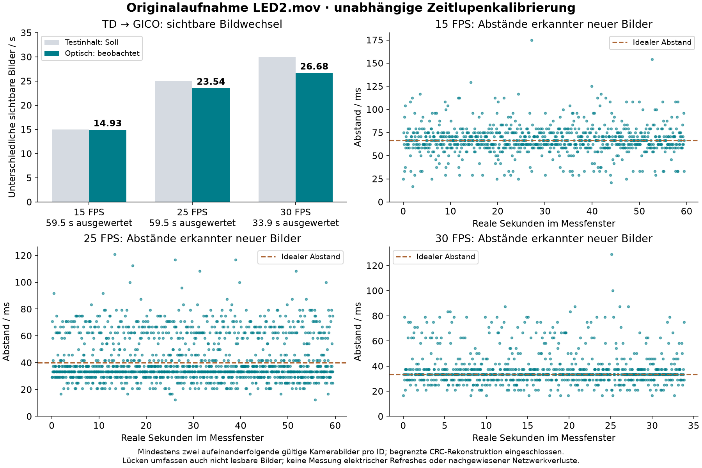

# Optische FPS-Auswertung – TouchDesigner → GICO

Stand: 2026-09-13. Quelle: `E:/LED2.mov`, Lauf `gico-td-camera-001`.

**Im ausgewerteten 30-FPS-Zeitlupenfenster sind etwa 26,68 unterschiedliche sichtbare Bilder/s optisch nachgewiesen. Stabile 30 FPS sind für diesen Lauf nicht nachgewiesen.** Nicht decodierbare Bilder bleiben möglich; 26,68 ist daher keine exakte Obergrenze tatsächlich sichtbarer Inhalte. Der frühere unabhängige Sendertest lieferte am gefilmten Panel starke Evidenz für nominal 30 FPS; aus dem jetzigen Ergebnis folgt keine allgemeine GICO-Leistungsgrenze.

## Messwerte

Die Hauptauswertung verlangt dieselbe gültige Bildnummer in mindestens zwei unmittelbar aufeinanderfolgenden Kamerabildern. Sie enthält direkt gelesene CRC-Codes und eindeutig begrenzte Erasure-Rekonstruktionen. Gezählt werden neue sichtbare Bildnummern, keine wiederholten Netzwerkpakete oder elektrischen LED-Refreshes.

| Sollinhalt | Ausgewertete reale Zeit | Eindeutige sichtbare IDs | Beobachtete neue Bilder/s | IDs mit direktem CRC-Beleg / nur rekonstruiert |
|---|---:|---:|---:|---:|
| 15 FPS | 59,500 s | 890 | **14,933** | 717 / 173 |
| 25 FPS | 59,500 s | 1.402 | **23,544** | 1.135 / 267 |
| 30 FPS | 33,875 s | 905 | **26,680** | 675 / 230 |

Die Rate berechnet sich aus den beobachteten neuen IDs zwischen erster und letzter akzeptierter Beobachtung. Die nominale Fensterdauer ist separat angegeben; Randbilder werden nicht als vollständige Zeitintervalle gerechnet.



Die zeitlichen Abstände erkannter neuer Bilder sind ungleichmäßig: bei 30 FPS Median 33,33 ms, 95. Perzentil 66,67 ms und Maximum 129,17 ms. Diese Abstände enthalten auch optisch nicht nachgewiesene IDs; sie sind keine isolierte Messung der Controller-Latenz.

Das normal schnelle Exportende liefert über weitere 21 s **26,322 beobachtete IDs/s** (553 IDs). Dort enthält die Datei nur 30 Kamerabilder pro realer Sekunde. Dieses ergänzende Ergebnis verwendet deshalb einzelne gültige Kamerabilder und ist kein gleichwertiger Zweibildnachweis. Der Übergang zwischen Zeitlupe und Normalgeschwindigkeit wurde ausgeschlossen. Es gibt ausdrücklich keinen durchgängigen 60-s-Zweibildnachweis für die 30-FPS-Phase.

## Wo fehlen Bilder?

Der Vergleich benutzt die Bildnummern im TD-Einreichungsprotokoll erst nach der optischen Decodierung. Fehlende Bildnummern wurden niemals daraus ergänzt.

| Ausgewerteter ID-Bereich | Optisch nicht nachgewiesen | Bereits nicht als TD-Batch eingereicht | Eingereicht, optisch nicht nachgewiesen |
|---|---:|---:|---:|
| 15 FPS: 3–896 | 4 | 4 | 0 |
| 25 FPS: 5–1.493 | 87 | 23 | 64 |
| 30 FPS, Zeitlupe: 7–1.023 | 112 | 52 | 60 |

Diese Zahlen betreffen die inneren ID-Bereiche der ausgewerteten Fenster. Über die gesamte 60-s-30-FPS-Phase fehlen bereits **88 von 1.800 geplanten Inhalts-IDs** im Einreichungsprotokoll: Der Producer liefert nur 1.712 verschiedene IDs, entsprechend 28,533/s. Eine spätere Stufe kann diese fehlenden Testbilder nicht wiederherstellen.

Die zusätzlich eingereichten, aber optisch nicht bestätigten IDs können zwischen Einreichung, Worker-Auswahl, Ausgabe und optischer Beobachtung fehlen. Ohne protokollierte tatsächlich gesendete Inhalts-IDs und elektrische/empfangsseitige Messung lassen sie sich nicht eindeutig dem GICO oder Netzwerk zuordnen.

Der Worker meldete über den ganzen Lauf durchschnittlich **29,773 gesendete Batches/s**, ohne gemeldete Socketfehler. Ein Batch kann denselben Inhalt wiederholen. Dieser Wert bestätigt daher nicht 29,773 unterschiedliche sichtbare Bilder/s. Auch die 3.139 vom Latest-Frame-Worker ersetzten älteren Einreichungen sind keine nachgewiesenen Netzwerkverluste.

## Wahrscheinlicher Optimierungsansatz und nächste Messung

Der Testinhalt schaltet mit 15/25/30 Hz, TouchDesigner reicht mit unregelmäßig etwa 44 Hz ein, der Senderworker wählt mit einer unabhängigen 30-Hz-Uhr aus. Diese mehrfache zeitliche Abtastung kann Wiederholungen und ausgelassene Inhalts-IDs erzeugen. Das ist eine begründete Erklärungsmöglichkeit, noch kein isolierter Ursachenbeweis. Der Test ersetzt außerdem die normale Effektquelle; das Ergebnis lässt sich nicht pauschal auf beliebige Effekte übertragen.

Zusätzlich zeigt das Producerprotokoll 17 auffällige Schrittpausen von etwa 93–156 ms, deren Beginn sich ungefähr alle **12,8 s** wiederholt. Die Codeprüfung fand keinen expliziten Timer mit diesem Intervall. Speicherbereinigung und wiederholter Aufbau von Test-CHOPs sind Kandidaten, keine bestätigte Ursache.

Nächste Schritte in sinnvoller Reihenfolge:

1. Testbildwechsel und tatsächliche Ausgabe zeitlich koppeln; tatsächlich gesendete Inhalts-ID pro Batch protokollieren. Wiederholungen, Producer-Ausfälle und Worker-Auswahl dadurch getrennt messen.
2. Überflüssiges Neuerzeugen der Testkanäle, Allokationen und erneutes Cooken unveränderter Testbilder reduzieren; die periodischen Producerpausen mit Zeitmarken gezielt erfassen.
3. Den korrigierten TD-Test wiederholen und mit dem unabhängigen Sender vergleichen. Für einen vollständigen Zweibildnachweis die gesamte 30-FPS-Phase als unveränderte Zeitlupe exportieren.

Ein Controllerwechsel ist durch diese Aufnahme allein nicht begründet: Der frühere unabhängige Lauf zeigte **29,991 beobachtete IDs/s** und 1.785 aufeinanderfolgende IDs ohne Lücke im 30-FPS-Fenster. Dieser frühere Nachweis verwendete teilweise nur ein Kamerabild pro ID und ebenfalls begrenzte CRC-Rekonstruktion; er ist starke Evidenz für nominal 30 FPS am gefilmten Panel, keine Abnahme sämtlicher Ports. Siehe [frühere Originalauswertung](../gico-camera-001-original-review/ERGEBNISSE_DE.md).

## Zeitbasis und Qualität

- Original: 1080 × 1920, 44.534 exportierte Bilder bei 30 Wiedergabe-FPS, 1.484,467 s. SHA-256: `8f65f06de4c2fa991e8aed9c2f332006d3e87edaaa1524c7e4aad988cb5d64b3`.
- Die Datei mischt normale Geschwindigkeit, Übergänge und achtfache Zeitlupe. Unabhängig von den decodierten Mess-IDs ergeben die Schwarzpausen eine Steigung von 7,99978468. Arbeitszeitbasis im langsamen Mittelteil: reale Testzeit = `(Videozeit + 93) / 8`. Ein gemeinsamer unbekannter zeitlicher Versatz erlaubt keine absolute Latenzaussage.
- Ausgewertete Videozeiten: 133–609 s, 653–1.129 s und 1.173–1.444 s. Das separate normale Ende verwendet 1.450–1.471 s. Direkt CRC-gelesene Anker dort bestätigen nachträglich ungefähr 30 Inhalts-ID-Schritte pro Videosekunde.
- 21 Marker des gefilmten unteren 398-LED-Panels wurden anhand der einzelnen Kalibrierblitze lokalisiert und visuell geprüft. Die eingefrorene photometrische Ridge-Kalibrierung wurde mit anderen Kalibrierbildern geprüft: kleinster eingeschalteter Markerwert 0,9336, größter ausgeschalteter Wert 0,0436.
- Die bewegungskorrigierte Registrierung hat in sämtlichen Messfenstern mindestens 137 Inlier. Es gibt keine verworfenen Registrierungen. Optisch unlesbare Samples treten höchstens einzeln auf; im langsamen Teil entspricht ein Sample etwa 4,17 ms realer Zeit.
- Die Rekonstruktion akzeptiert höchstens drei unlesbare Bits, davon höchstens zwei Gray-Bits, nur bei einer einzigen passenden der 4.096 möglichen Bildnummern. Bekannte Bits werden nicht umgedreht; Soll-FPS und Sende-IDs gehen nicht in die Decodierung ein. CRC und Kalibrierung schließen einen optischen Fehlentscheid nicht absolut aus.
- Keine decodierte ID liegt außerhalb der tatsächlich eingereichten ID-Menge; keine unerwarteten Rücksprünge. Das ist ein nachträglicher Konsistenzcheck, keine unabhängige Fehlerwahrscheinlichkeitsmessung.
- Rein direkte CRC-Auswertung mit zwei aufeinanderfolgenden Bildern ergibt konservative Teilmengen von 11,906 / 18,247 / 19,157 IDs/s. Diese Werte verlieren optisch schwächere, nur rekonstruierbare Codes und sind keine gemessenen Hardware-FPS-Grenzen.

## Reproduzierbarkeit und Umfang

Rohentscheidungen pro Kamerabild, Markerwerte, Registrierung und SHA-256-Verknüpfung sind unter `optical/extraction*` und `optical/comparison.json` archiviert. Die gespeicherten ganzzahligen Entscheidungen stammen aus Float64-Berechnungen; die zusätzlichen Float32-Markerwerte dienen der Diagnose. Modellwahl und Ausführungshinweise stehen in `optical/model-validation.json` und `optical/execution-notes.json`.

Details: [Zeitbasis](timebase/ZEITBASIS_DE.md), [Methodenreview](timebase/METHODENREVIEW_DE.md), [Senderprüfung](sender-audit/ERGEBNISSE_DE.md), [Periodikprüfung](sender-audit/PERIODIK_CODE_REVIEW_DE.md). Wissenschaftliche Grafik auch als [PDF](optical/fps-results.pdf).

Skripte im Repository: `tools/gico_led2_calibrate.py`, `tools/gico_led2_model.py`, `tools/gico_led2_extract.py`, `tools/gico_led2_summarize.py`, `tools/gico_led2_plot.py`. Die Zusammenfassung lässt sich aus den archivierten Entscheidungen ohne erneute Videoextraktion erzeugen:

```powershell
& 'C:/Users/jbhtz/AppData/Roaming/uv/tools/marimapper/Scripts/python.exe' tools/gico_led2_summarize.py
uv run --no-project --with matplotlib python tools/gico_led2_plot.py
```

Die drei Messfenster wurden parallel ausgewertet und anschließend zusammengeführt. Während dieser Auswertung wurden weder TouchDesigner noch Controller, Firmware oder LED-Ausgabe verändert. Die Originaldatei wird wegen ihrer Größe von 2,11 GB nicht in Git kopiert; Pfad und Hash identifizieren sie. Gemessen wurde das gefilmte Panel, nicht jeder Port, jede LED oder die elektrische Refreshfrequenz.
